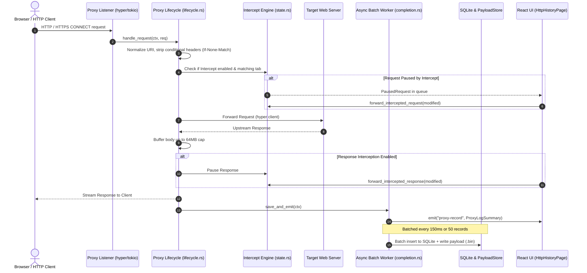

# Chapter 1: HTTP History & MITM Proxy Engine

This document details the complete end-to-end implementation of the **HTTP Traffic Capture, MITM Proxy Engine, and HTTP History Inspection System** in Halo.

---

## 1. Architectural Overview & Dataflow

Halo embeds a high-performance HTTP/HTTPS Man-in-the-Middle (MITM) proxy built on top of `hyper`, `tokio`, and `rustls` (`hexbuffer_proxy`). It intercepts traffic, dynamically terminates TLS using an on-the-fly generated certificate authority (CA), records transactions into a high-throughput SQLite + segment-file store, and streams real-time updates to a virtualized React table.



---

## 2. Backend Implementation Details (`src-tauri/src/`)

### 2.1 Proxy Engine Initialization & Lifecycle
- **Files**:
  - `src-tauri/src/proxy/mod.rs`
  - `src-tauri/src/proxy/lifecycle.rs`
  - `src-tauri/src/proxy/state.rs`
  - `src-tauri/src/proxy/completion.rs`

#### Proxy Server Runner & Ports
Defined in `src-tauri/src/proxy/mod.rs`:
- `DEFAULT_PROXY_PORT`: Atomic `8888`.
- `ACTIVE_PROXY_PORT`: Stores the active running port.
- `PROXY_SHUTDOWN`: `OnceLock<Mutex<Option<oneshot::Sender<()>>>>` controlling clean proxy shutdown.
- `ProxyConfig`:
  ```rust
  pub struct ProxyConfig {
      pub port: u16,        // HTTP Proxy port (default 8888)
      pub reuse: bool,       // SO_REUSEADDR flag
      pub tls_port: u16,    // Internal HTTPS MITM termination port
      pub enabled: bool,    // Active toggle
  }
  ```

#### Transaction Context (`Ctx`)
Defined in `src-tauri/src/proxy/lifecycle.rs`:
`Ctx` represents a single HTTP transaction as it passes through the pipeline:
- `transaction_id`: Unique `uuid::Uuid` generated for every request.
- `client_addr`: Client IP/port string.
- `server_addr`: Upstream host/port string.
- `req_method`, `req_uri`, `req_http_version`.
- `req_headers`: `HashMap<String, String>` (duplicate headers flattened per RFC 9110 §5.2 with `", "` separator, except `Set-Cookie` which uses `"; "`).
- `req_body`: Raw request bytes.
- `res_status_code`, `res_status_text`, `res_http_version`, `res_headers`, `res_body`.
- `intercept_response`: Boolean flag set if this request's subsequent response must be paused.
- `intercept_tab_id`: Scoped tab ID if matched.

#### Request Pre-Processing Pipeline (`handle_request`)
1. **Conditional Header Removal**:
   ```rust
   parts.headers.remove("if-none-match");
   parts.headers.remove("if-modified-since");
   ```
   *Rationale*: Prevents upstream servers from answering `304 Not Modified`, ensuring full 200 OK bodies are captured for inspection.
2. **URL Normalization**:
   Resolves authority from `:authority` or `Host` headers when absolute URIs are absent (e.g. standard HTTP/1.1 reverse proxies vs forward proxies).
3. **MockForge Interception**:
   Before reaching the wire, checks if `mock_forge::try_intercept` matches an active mock route.
4. **Bypass Filter Verification**:
   Checks `proxy_state.should_bypass_uri(&ctx.req_uri)` (e.g., local telemetry, captive portals).
5. **Intercept Check**:
   If `mode == InterceptMode::Enabled` and URI matches tab rules, enters a sleep-wait poll loop until released (detailed in Chapter 4).

#### Response Processing & Streaming Limits (`handle_response`)
- **Memory Safety Guardrails**:
  - `MAX_BUFFERED_RESPONSE_BODY_BYTES = 64 * 1024 * 1024` (64 MB): If declared or streaming response exceeds 64MB, it streams straight to client untouched and unbuffered to prevent OOM panics.
  - `MAX_RECORDED_BODY_BYTES = 32 * 1024 * 1024` (32 MB): Truncation limit before pushing to the logging persistence queue.
- **Header Flattening**: Preserves all header metadata.
- **De-chunking & Stream Collection**: Collects hyper `Body::Streaming` using `http_body_util::Limited`. If an unbounded chunk stream exceeds 64MB, fails gracefully with a 502 Bad Gateway.

---

### 2.2 Asynchronous Persistence & High-Speed Batch Worker
- **File**: `src-tauri/src/proxy/completion.rs`

Recording hundreds of requests per second directly to SQLite inside the hyper event loop would block network I/O. Halo solves this via a decoupled actor worker:

```rust
static LOG_SENDER: OnceLock<mpsc::UnboundedSender<(ProxyRecord, Option<String>)>> = OnceLock::new();
static LOG_BUFFER: Mutex<Vec<(ProxyRecord, Option<String>)>> = Mutex::new(Vec::new());

pub fn init_proxy_log_worker(app_handle: AppHandle) {
    let (tx, mut rx) = mpsc::unbounded_channel();
    // Tokio background worker
    tauri::async_runtime::spawn(async move {
        let mut interval = tokio::time::interval(std::time::Duration::from_millis(150));
        loop {
            tokio::select! {
                Some(item) = rx.recv() => {
                    LOG_BUFFER.lock().push(item);
                    if LOG_BUFFER.lock().len() >= 50 {
                        flush_log_buffer(&app_handle).await;
                    }
                }
                _ = interval.tick() => {
                    if !LOG_BUFFER.lock().is_empty() {
                        flush_log_buffer(&app_handle).await;
                    }
                }
            }
        }
    });
}
```

1. **Lightweight Event Broadcast**:
   Immediately emits the lightweight summary struct `ProxyLogSummary` to the frontend via `app_handle.emit("proxy-record", &summary)` so UI updates with sub-millisecond latency without transferring large bodies over IPC.
2. **Batch Flushes**:
   Pushes records to `LOG_BUFFER`. Whenever `len >= 50` or `150ms` passes, calls `flush_log_buffer` using `spawn_blocking` to execute a single atomic SQLite transaction and commit payload files.
3. **App Exit Drain**:
   `flush_proxy_log_buffer_on_exit` drains remaining items synchronously when Tauri emits `RunEvent::ExitRequested`.

---

### 2.3 Storage Architecture: SQLite + Segment Payload Store
- **Files**:
  - `src-tauri/src/db/schema.rs`
  - `src-tauri/src/db/repository/proxy_logs.rs`
  - `src-tauri/src/db/repository/http_sessions.rs`
  - `src-tauri/src/db/payload_store.rs`

Halo separates metadata from large binary payloads:
- **SQLite Database** (`~/.halo/data.db`):
  Stores indexable metadata (`id`, `session_id`, `timestamp`, `method`, `url`, `status_code`, `headers_json`, `request_size`, `response_size`, `content_type`, `host`, `path`).
- **Payload Store** (`~/.halo/sessions/`):
  Stores large request and response bodies in binary segment slabs (`.bin`), referenced by offset and length, preventing SQLite database file bloat and WAL checkpoint stalls.

---

### 2.4 Tauri Commands & IPC Interface

Registered in `src-tauri/src/main.rs`:

| Command | Arguments | Return Type | Description |
| :--- | :--- | :--- | :--- |
| `start_proxy` | `port: u16, tls_port: u16` | `Result<String, String>` | Binds TCP listener and launches proxy loop. |
| `stop_proxy` | — | `Result<String, String>` | Sends oneshot shutdown signal and clears intercept state. |
| `get_proxy_status` | — | `Result<ProxyRuntimeStatus, String>` | Probes TCP connection on active port to confirm liveness. |
| `get_proxy_recent` | `limit: Option<u32>, filter: Option<ProxyFilter>, sort_order: Option<String>` | `Result<Vec<ProxyLogSummary>, String>` | Fast indexed query for table view. |
| `get_proxy_detail` | `log_id: String` | `Result<ProxyRecord, String>` | Fetches full request & response headers and body from payload store. |
| `get_proxy_tree` | — | `Result<Vec<TreeNode>, String>` | Builds hierarchical sitemap tree by host and path. |
| `delete_proxy_by_id` | `log_id: String` | `Result<(), String>` | Deletes record from memory, DB, and payload segment. |
| `clear_proxy_all` | — | `Result<(), String>` | Clears all proxy records and vacuums tables. |
| `clear_proxy_by_date`| `keep_range: String, custom_date: Option<String>` | `Result<usize, String>` | Cleans logs older than today, week, month, or specific date. |
| `get_http_sessions` | — | `Result<Vec<HttpSessionSummary>, String>`| Lists capture sessions. |
| `create_http_session`| `name, description, capture_mode, capture_filter, exclude_filter, storage_mode` | `Result<HttpSessionRecord, String>` | Creates session with custom capture rules. |
| `set_active_http_session`| `session_id: String` | `Result<(), String>` | Activates session and syncs filter to proxy engine. |

---

## 3. Frontend Implementation Details (`src/pages/live-traffic/http-history/`)

### 3.1 Page Structure & Layout Composition
- **Entry File**: `src/pages/live-traffic/http-history/index.tsx`
- **Page Hook**: `src/pages/live-traffic/http-history/hooks/use-http-history-page.ts`

```
HttpHistoryPage
├── TabbedPageLayout (Top Tabs: All History, Pinned, Target Scopes, Custom Groups)
│   ├── LogFilters (Toolbar: Search, Status, Method, Scope, Session selector)
│   │   └── FilterChips (Quick toggles for 2xx, 3xx, 4xx, 5xx, JS, CSS, Images)
│   └── Card
│       └── HttpHistoryView (Vertical Resizable Panel Group)
│           ├── ResizablePanel (Top 60%): TrafficTable (Virtualized log rows)
│           ├── ResizableHandle (Draggable divider)
│           └── ResizablePanel (Bottom 40%): LogDetailView (Detailed request/response tabs)
├── CreateGroupDialog (Modal for creating tagged request groups)
└── TargetSelectorDialog (Modal for scoping capture to targets)
```

### 3.2 State Management & Stores
Located in `src/stores/history/`:
1. `useHttpHistoryQueryStore` (`http-query.ts`):
   - `selectedCallId: string | null` — Selected row ID in the table.
   - `searchQuery: string` — URL/path full-text filter.
   - `methodFilter: string[]` — GET, POST, PUT, DELETE, PATCH, etc.
   - `statusFilter: number[]` — 200, 302, 403, 404, 500, etc.
   - `scopeFilter: string[]` — Whitelisted domain list.
   - `refreshTrigger: number` — Counter incremented to invalidate and re-fetch queries.
2. `useHttpSessionStore` (`http-session.ts`):
   - Tracks active capture session, session switching, and session-specific storage modes.
3. `usePinnedRequestsStore` (`http-pinned.ts`):
   - Maintains set of pinned request IDs with pushpin icon markers.
4. `useGroupsStore` (`http-groups.ts`):
   - User-defined color-coded collections of requests inside HTTP history.
5. `useHighlightStore` (`http-highlight.ts`):
   - Row color tagging (Red, Amber, Green, Blue, Purple).

---

### 3.3 UI Component Locations & Specifications

#### 1. Filter Strip (`components/log-filters.tsx` & `components/filter-chips.tsx`)
- **Location**: Directly above the traffic table.
- **Affordances**:
  - Full-text search input with debounce.
  - Multi-select method dropdown (GET, POST, PUT, DELETE, OPTIONS, HEAD, PATCH).
  - Status code dropdown filter (2xx Success, 3xx Redirect, 4xx Client Error, 5xx Server Error).
  - Scope dropdown (Only in-scope targets vs All traffic).
  - Session selector dropdown with "New Session", "Rename", "Clear", and "Export".
  - One-click filter chips: `Hide 304`, `Hide Images/Fonts`, `Only API (JSON)`, `Errors Only`.

#### 2. Virtualized Traffic Table (`components/log-table/index.tsx`)
- **File**: `src/pages/live-traffic/http-history/components/log-table/index.tsx`
- **Columns**:
  1. `#`: Sequential index / ID.
  2. `Pin`: Toggle pushpin icon (`PushPinSimpleIcon`).
  3. `Method`: Colorized badge (`method-styles.ts`: GET=blue, POST=green, PUT=amber, DELETE=red, PATCH=purple).
  4. `Status`: Colorized code pill (`status-styles.ts`: 2xx=emerald, 3xx=sky, 4xx=amber, 5xx=rose).
  5. `Host`: Domain name with SSL lock indicator.
  6. `Path / URL`: High-contrast path with muted query string (`ColoredUrl`).
  7. `Type`: MIME type pill (`json`, `html`, `javascript`, `octet-stream`).
  8. `Size`: Human-readable bytes formatted (`formatBytes`).
  9. `Time`: Timestamp or latency duration.
  10. `Browser`: Client icon (`Chrome`, `Firefox`, `Safari`, `Curl`, `Custom`).

#### 3. Row Context Menu Actions (`components/log-table/hooks/use-log-entry-actions.ts`)
Right-clicking any row triggers a context menu with actions that integrate directly with other modules:
- **Send to Repeater** (`handleOpenInRepeater`):
  Converts request to raw HTTP format using `buildRawHttpRequest()` and calls `sendRawToRepeater()`, focusing the `/repeater` window.
- **Send to Intruder** (`handleOpenInIntruder`):
  Creates attack config with `createDefaultAttackConfig()`, auto-detects parameter positions via `findRequestPayloadPositions()`, adds an attack tab in `useIntruderStore`, and opens `/intruder`.
- **Send to Intercept** (`handleSendToIntercept`):
  Extracts host and invokes `useInterceptStore.getState().addTabForHost(host)`, routing subsequent requests from that host to the Intercept queue.
- **Add to Scope** (`handleAddToScope`):
  Adds host to `useTargetStore` as a defined assessment target.
- **Copy as cURL (bash)** (`handleCopyCurlCommand`):
  Generates escaped `curl -X METHOD "URL" -H "..." -d "..."` command to clipboard.
- **Quick Add to Group / Pin / Delete**:
  Immediate row tagging without leaving the keyboard.

#### 4. Detail Inspector (`components/log-table/components/log-detail-view.tsx`)
- **Location**: Bottom panel of `HttpHistoryView`.
- **Layout**: Split into **Request Panel** (left/top) and **Response Panel** (right/bottom).
- **Sub-Tabs**:
  - `Raw`: Unaltered HTTP wire format (Headers + blank line + Body) with syntax coloring in `TextEditor`.
  - `Headers`: Formatted two-column key/value table with copy-to-clipboard buttons.
  - `Body`: Formatted view with auto-detection:
    - Pretty JSON (collapsible trees, syntax highlighted).
    - HTML preview / Markdown renderer.
    - Hex Editor mode (offset, hex bytes, ASCII side-by-side).
  - `Params`: Parsed URL query parameters and form POST parameters in editable tables.
  - `Cookies`: Parsed Cookie and Set-Cookie attribute inspect tables.
- **Pop-out Window Action**: Button in header opens `response-detail-window.tsx` in a floating Tauri sub-window.
