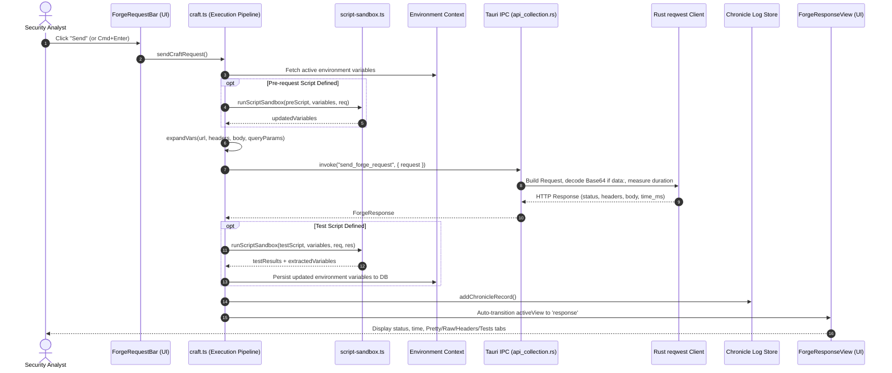

# Chapter 2: Repeater & Forge Request Workbench

This document details the complete end-to-end implementation of the **Repeater and API Forge Request Workbench** in Halo.

---

## 1. Architectural Overview & Request Lifecycle

Repeater (also known as the **Forge**) provides an interactive request crafting, replaying, and debugging workbench. It features multi-workspace tabs, hierarchical collection trees (stashes & endpoints), dynamic environment variables (`{{var}}`), pre-request scripting, post-request automated test assertions, binary payload support, and execution history ("Chronicle").



---

## 2. Backend Implementation Details (`src-tauri/src/`)

### 2.1 Native HTTP Request Execution Engines
Halo provides two backend execution endpoints:
- **`send_repeater_request`** (`src-tauri/src/commands/repeater.rs`): Direct low-level request execution without collection binding.
- **`send_forge_request`** (`src-tauri/src/commands/api_collection.rs`): Full-featured request engine with binary support and collection integration.

#### Binary Data URL & Base64 Support (`send_forge_request`)
Defined in `src-tauri/src/commands/api_collection.rs`:
```rust
#[tauri::command]
pub async fn send_forge_request(request: ForgeRequest) -> Result<ForgeResponse, String> {
    let method = Method::from_bytes(request.method.as_bytes())
        .map_err(|error| format!("Invalid HTTP method: {}", error))?;

    let client = reqwest::Client::builder()
        .redirect(reqwest::redirect::Policy::limited(10))
        .build()
        .map_err(|error| format!("Failed to build HTTP client: {}", error))?;

    let mut builder = client.request(method, &request.url);
    for (name, value) in &request.headers {
        builder = builder.header(name, value);
    }

    if !request.body.is_empty() {
        // Binary Payload Support: Checks for Data URL encoding
        if request.body.starts_with("data:") && request.body.contains(";base64,") {
            if let Some(pos) = request.body.find(";base64,") {
                let base64_data = &request.body[pos + 8..];
                if let Ok(decoded) = general_purpose::STANDARD.decode(base64_data) {
                    builder = builder.body(decoded);
                } else {
                    builder = builder.body(request.body);
                }
            } else {
                builder = builder.body(request.body);
            }
        } else {
            builder = builder.body(request.body);
        }
    }

    let started_at = Instant::now();
    let response = builder.send().await
        .map_err(|error| format!("Failed to send request: {}", error))?;
    let status = response.status();
    let final_url = response.url().to_string();
    let headers = response.headers().iter()
        .map(|(name, value)| (name.to_string(), value.to_str().unwrap_or_default().to_string()))
        .collect();
    let body = response.text().await
        .map_err(|error| format!("Failed to read response body: {}", error))?;

    Ok(ForgeResponse {
        status: status.as_u16(),
        status_text: status.canonical_reason().unwrap_or_default().to_string(),
        headers,
        body,
        time_ms: started_at.elapsed().as_millis(),
        final_url,
    })
}
```

Key technical characteristics:
1. **Redirect Policy**: Enforces a strict 10-hop redirect ceiling to avoid infinite loops while accurately capturing `final_url`.
2. **Binary Attachment Handling**: Detects `data:*/*;base64,...` payloads and decodes them directly into raw byte streams (`Vec<u8>`), enabling file uploads, multipart payloads, and raw shellcode injection.
3. **Microsecond Precision Timing**: Captures total round-trip latency (`Instant::now().elapsed().as_millis()`) independent of UI rendering overhead.

---

### 2.2 Collections, Stashes & Persistence IPC
- **File**: `src-tauri/src/commands/api_collection.rs`

Repeater requests are organized into hierarchical Collections and Stashes backed by SQLite:

| Command | Arguments | Return Type | Purpose |
| :--- | :--- | :--- | :--- |
| `get_stashes` | `workspace_id: Option<String>` | `Result<Vec<StashRecord>, String>` | Fetches all collection folders for a workspace. |
| `save_stash` | `stash: StashRecord` | `Result<(), String>` | Creates or updates a collection folder. |
| `delete_stash` | `id: String` | `Result<(), String>` | Cascades deletion of stash and child endpoints. |
| `get_stash_endpoints` | `stash_id: Option<String>` | `Result<Vec<StashEndpointRecord>, String>` | Fetches saved requests within collections. |
| `save_stash_endpoint` | `endpoint: StashEndpointRecord` | `Result<(), String>` | Persists URL, method, headers, body, and scripts. |
| `delete_stash_endpoint` | `id: String` | `Result<(), String>` | Deletes a single request endpoint. |
| `get_contexts` | — | `Result<Vec<ContextRecord>, String>` | Lists environment variable sets. |
| `save_context` | `context: ContextRecord` | `Result<(), String>` | Saves environment variables (`JSON` key-value pairs). |
| `get_chronicle_logs` | — | `Result<Vec<ChronicleLogRecord>, String>` | Returns past executed request history. |
| `add_chronicle_log` | `record: ChronicleLogRecord` | `Result<(), String>` | Appends execution record (capped at 500 items). |

---

## 3. Frontend Execution & State Architecture

### 3.1 Store Coordination (`src/stores/`)
1. **`useRepeaterStore`** (`src/stores/repeater.ts`):
   - Manages top-level **Workspaces** (e.g., "Workspace 1", "Workspace 2", "API Fuzzing").
   - `createWorkspace(name?, id?)`, `deleteWorkspace(id)`, `renameWorkspace(id, name)`.
   - `closeTabsToLeft(id)`, `closeTabsToRight(id)`.
   - Persisted in browser localStorage.
2. **`useCollectionsStore`** (`src/stores/collections.ts`):
   - `stashes`: Array of collection folders.
   - `endpoints`: Array of request definitions (`StashEndpointRecord`).
   - `selectedNodeId`: Currently active tree node (`ep-<id>` or `stash-<id>`).
   - `activeRequest`: `ActiveRequestState` holding working draft:
     - `method`, `url`, `queryParams: KeyValuePair[]`, `headers: KeyValuePair[]`.
     - `body`, `bodyType: 'none' | 'raw' | 'json'`, `preScript`, `testScript`.
     - `isLoading: boolean`, `response: ForgeResponse | null`, `error: string | null`.
     - `testResults: TestResult[]`.
   - `contexts`: Array of environment profiles (`ContextRecord`).
   - `activeContextId`: Currently selected environment.

---

### 3.2 Request Dispatch Pipeline (`src/triggers/repeater/craft.ts`)
When the user clicks "Send" or presses shortcut:
1. **Context Variable Extraction**:
   Reads `activeContextId`, parses JSON variables, filtering for `enabled !== false`.
2. **Pre-Request Script Execution**:
   Executes JS code inside `runScriptSandbox()`. Script can read/modify variables via `hb.variables.set("key", "value")`.
3. **Variable Expansion Engine (`expandVars`)**:
   Replaces all occurrences of `{{var_name}}` in:
   - Base URL (preserving unencoded curly braces in query strings).
   - Query Parameters (`encodeParamPreservingVars`: encodes URI characters while keeping `{{var}}` intact).
   - Headers (keys and values).
   - Request Body.
4. **Native Dispatch**: Invokes `send_forge_request` via Tauri IPC.
5. **Post-Request Test Runner**:
   Passes status, response headers, and response body to the sandbox. Executes `expect(...)` assertions and collects pass/fail statuses.
6. **Variable Reflection**:
   If the test script extracted tokens or session IDs, merges them into the active context and automatically updates SQLite via `updateContext()`.
7. **Chronicle Logging**:
   Appends request and response metadata into the audit log.

---

### 3.3 The Script Sandbox & Test Assertion Library (`src/pages/repeater/lib/script-sandbox.ts`)
A lightweight, sandboxed JavaScript execution environment providing Postman-compatible APIs:

```typescript
export function runScriptSandbox(
  code: string,
  variables: Record<string, string>,
  request: SandboxRequest,
  response: SandboxResponse | null
): SandboxResult
```

- **Injected Context Objects**:
  - `hb.request`: Access to method, URL, headers, and body.
  - `hb.response`: Access to status code, status text, headers, and body.
  - `hb.variables.get(key)` / `hb.variables.set(key, val)`: Dynamic environment variable mutation.
  - `console.log(...)`: Captured into an isolated `logs` array.
- **Built-in `expect()` Assertions**:
  ```javascript
  // Example Test Script:
  hb.test("Status code is 200", function() {
    expect(hb.response.status).to.equal(200);
  });

  hb.test("Response contains auth token", function() {
    const json = JSON.parse(hb.response.body);
    expect(json.token).to.be.a("string");
    hb.variables.set("jwt_token", json.token);
  });
  ```
  Supported matchers: `equal()`, `not.equal()`, `include()`, `be.a(type)`.

---

## 4. UI Layout Hierarchy & Precise Component Locations

### 4.1 Page Entry (`src/pages/repeater/index.tsx`)
Renders `TabbedPageLayout` managing workspace tabs at the very top of the window:
- Left tab bar: Workspace tabs with indicators and close buttons.
- Tab context menu: Rename, Close, Close Others, Close to Left, Close to Right.
- Body container: Renders `<WorkspacePanel key={workspaceId} workspaceId={workspaceId} />`.

---

### 4.2 Workspace Panel Layout (`src/pages/repeater/components/workspace-panel.tsx`)
Uses a horizontal `ResizablePanelGroup`:

```
┌─────────────────────────────────┬───────────────────────────────────────────────┐
│ Left: CollectionsTree           │ Right: ForgePanel                             │
│ (200px - 500px, default 272px)  │ (Min 400px, fills remaining space)            │
│ ┌─────────────────────────────┐ │ ┌───────────────────────────────────────────┐ │
│ │ TreeHeader (Search, +, ...) │ │ │ ForgeRequestBar (Env, Method, URL, Send)  │ │
│ ├─────────────────────────────┤ │ ├───────────────────────────────────────────┤ │
│ │ TreeFilter                  │ │ │ Mode Switch: [↑ Request] [↓ Response (200)] │ │
│ ├─────────────────────────────┤ │ ├───────────────────────────────────────────┤ │
│ │ Stash Node (Folder)         │ │ │ Tabs: [Params] [Headers] [Body] [Scripts] │ │
│ │   ├── Endpoint (GET /api)   │ │ │ ┌───────────────────────────────────────┐ │ │
│ │   └── Endpoint (POST /login)│ │ │ │ Editor Canvas (Key-Value / TextEditor)│ │ │
│ │ DragOverlayContent          │ │ │ └───────────────────────────────────────┘ │ │
│ └─────────────────────────────┘ │ └───────────────────────────────────────────┘ │
└─────────────────────────────────┴───────────────────────────────────────────────┘
```

---

### 4.3 Component Breakdown & File Index

#### 1. Collections Tree (`components/collection-tree/`)
- **`index.tsx`**: Main tree container with `@dnd-kit/core` drag-and-drop context.
- **`tree-header.tsx`**:
  - Filter input toggle.
  - "New Stash" (Collection folder) button.
  - "New Request" button.
  - "Import" button (triggers `import-dialog.tsx` supporting Postman Collections v2.1, OpenAPI/Swagger 3.0, and raw cURL commands).
  - "Export" button (exports workspace as JSON).
- **`tree-node-row.tsx`**:
  - Renders folder icons for stashes, chevron toggles for expand/collapse.
  - Renders method badge (GET/POST/etc.) and endpoint title.
  - Context menu: Rename, Duplicate, Send to Intruder, Copy cURL, Delete.
- **`collection-drop-zone.tsx`**: Visual drop indicator for nesting requests inside folders.

#### 2. Forge Request Bar (`components/forge-panel/forge-request-bar.tsx`)
- **Row 1 (Environment & Target)**:
  - **Environment Selector** (`<Select>`): Switch between environments (e.g. "Staging", "Production", "Local").
  - **Environment Settings Gear** (`GearSixIcon`): Opens `ContextsDialog` to add/edit environment key-value variables.
  - **Request Name Display**: Shows active endpoint name.
  - **Save Button** (`FloppyDiskIcon`): Persists current state to SQLite.
  - **Delete Button** (`TrashIcon`): Opens confirmation dialog.
- **Row 2 (Request Line)**:
  - **Method Selector** (`<Select mono>`): Dropdown with colored indicators (GET=blue, POST=green, PUT=amber, DELETE=red, PATCH=purple).
  - **Colorized URL Input** (`ColorizedUrlInput`): Syntax-highlights protocol (`https://`), domain, path, and variable placeholders (`{{var}}`).
  - **Send Button** (`Button` with `PaperPlaneTiltIcon`): Primary trigger dispatching `sendCraftRequest()`.

#### 3. Request Tabs (`components/forge-panel/forge-request-tabs.tsx`)
- **`Params`**: `ForgeKeyValueEditor` managing query string parameters. Toggling checkbox dynamically updates preview URL without destructive edits.
- **`Headers`**: `ForgeKeyValueEditor` managing HTTP headers with autocomplete for common security and API headers (`Authorization`, `Content-Type`, `X-Forwarded-For`).
- **`Body`**:
  - Format radio selector: `none`, `raw`, `json`.
  - Binary file upload button: Loads file into memory as `data:*/*;base64,...`.
  - `TextEditor`: Monaco/CodeMirror editor with line numbers, code folding, and auto-closing brackets.
- **`Scripts`**: Split editor containing **Pre-request Script** (runs before dispatch) and **Tests** (assertion script).

#### 4. Response View (`components/forge-panel/forge-response-view.tsx`)
Automatically gains focus upon request completion:
- **Response Meta Bar** (`forge-response-meta.tsx`):
  - Status pill (e.g., `200 OK` in green, `404 Not Found` in amber, `500 Server Error` in red).
  - Latency badge (e.g., `34 ms`).
  - Response size badge (e.g., `1.84 KB`).
- **Sub-Tabs**:
  1. **`Pretty`**: Syntax-highlighted and indented JSON, XML, or HTML viewer with collapsible nodes.
  2. **`Raw`**: Unformatted response body directly from the wire.
  3. **`Headers`**: Formatted table of response headers with one-click copy buttons.
  4. **`Request`**: Verbatim snapshot of the exact request that was sent (post-variable expansion).
  5. **`Tests`**: Test results panel displaying assertion checkmarks (`CheckCircleIcon` for pass, `XCircleIcon` for fail) with exact line assertion errors.
