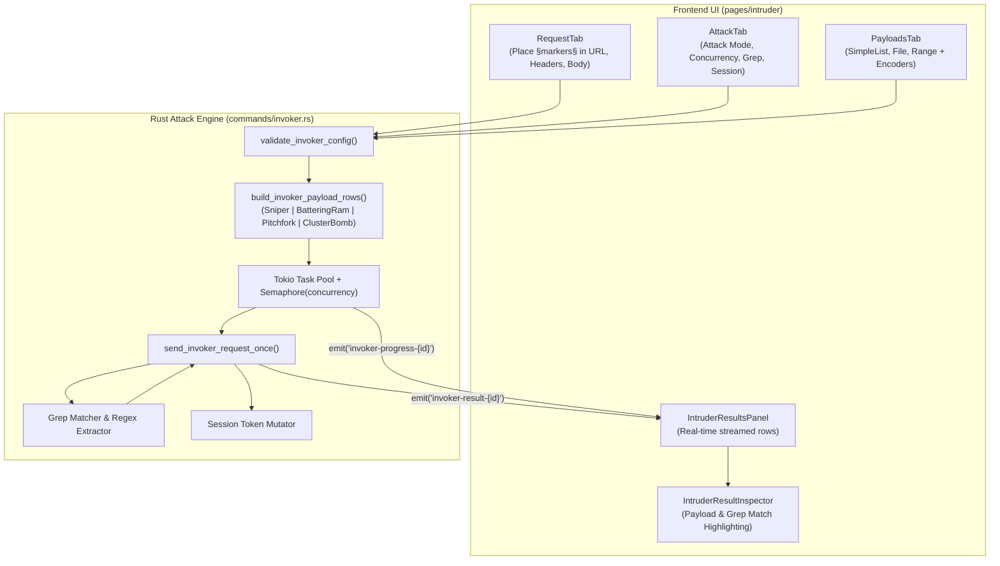

# Chapter 3: Intruder & Invoker Automated Fuzzing Engine

This document details the complete end-to-end implementation of the **Intruder (Invoker) Automated Fuzzing and Brute-Force Engine** in Halo.

---

## 1. Architectural Overview & Fuzzing Pipeline

Intruder allows security analysts to define injection positions in HTTP requests using section markers (`§`), attach single or multi-dimensional payload sets, configure attack algorithms (Sniper, Battering Ram, Pitchfork, Cluster Bomb), and execute parallelized fuzzing with real-time response analysis, pattern matching (Grep), and regex extraction.



---

## 2. Backend Implementation Details (`src-tauri/src/commands/invoker.rs`)

### 2.1 Marker Boundary Parser (`§`)
The engine scans the HTTP template for the section marker character `§` (Unicode U+00A7).

- **Header Normalization**: Headers are sorted alphabetically (ignoring ASCII case), while the `Host` header is excluded from automated injection to maintain connection stability.
- **Marker Extraction (`collect_marked_values`)**:
  ```rust
  pub fn collect_marked_values(text: &str, values: &mut Vec<String>) {
      let mut search_start = 0;
      while let Some(start) = text[search_start..].find('§') {
          let absolute_start = search_start + start;
          if let Some(end) = text[absolute_start + '§'.len_utf8()..].find('§') {
              let absolute_end = absolute_start + '§'.len_utf8() + end;
              values.push(text[absolute_start + '§'.len_utf8()..absolute_end].to_string());
              search_start = absolute_end + '§'.len_utf8();
          } else {
              break;
          }
      }
  }
  ```
- **Tracked Replacement (`replace_marked_values_tracked`)**:
  Walks through the template replacing pairs of `§...§` with either the assigned payload value for that position or the original default template value if not targeted in the current cycle.

---

### 2.2 Attack Modes & Payload Generation Algorithms
Defined in `src-tauri/src/commands/invoker.rs`:

```rust
#[derive(Debug, Clone, Deserialize)]
pub enum InvokerAttackMode {
    Sniper,
    BatteringRam,
    Pitchfork,
    ClusterBomb,
}
```

#### 1. Sniper Mode
- **Strategy**: Single payload set. Iterates through each injection position one by one. While position $i$ receives a payload from the list, all other positions ($j \neq i$) retain their original template default values.
- **Complexity**: Total requests = $N_{\text{positions}} \times N_{\text{payloads}}$.
- **Use Case**: Fuzzing parameters individually (e.g. testing for SQLi or XSS across 5 query parameters).
```rust
InvokerAttackMode::Sniper => {
    let mut rows = Vec::new();
    for position_index in 0..position_count {
        for payload in source {
            let mut row = HashMap::new();
            row.insert(position_name(&config.positions, position_index), payload.clone());
            rows.push(row);
        }
    }
    rows
}
```

#### 2. Battering Ram Mode
- **Strategy**: Single payload set. Injects the identical payload value into **all** marked positions simultaneously during every request.
- **Complexity**: Total requests = $N_{\text{payloads}}$.
- **Use Case**: When the same input is duplicated across headers, cookies, or body parameters (e.g. testing username = password).

#### 3. Pitchfork Mode
- **Strategy**: Multiple separate payload sets (one per marked position). Advances through all payload lists in lockstep. Request $k$ uses payload $k$ from list 1, payload $k$ from list 2, etc.
- **Complexity**: Total requests = $\min(N_{\text{payloads}, 1}, N_{\text{payloads}, 2}, \dots)$.
- **Use Case**: Testing known credential pairs (e.g., matching usernames with specific passwords).

#### 4. Cluster Bomb Mode
- **Strategy**: Multiple payload sets. Computes the complete Cartesian product across all marked positions.
- **Complexity**: Total requests = $\prod_{i=1}^{M} N_{\text{payloads}, i}$.
- **Safety Cap**: Enforces a strict maximum ceiling of **250,000 requests** via `append_cluster_payloads` to prevent memory exhaustion and runaway attacks.
- **Use Case**: Exhaustive combinatorial brute force (e.g., testing 100 usernames against 1,000 passwords = 100,000 requests).

---

### 2.3 Payload Types & Transformation Processing Pipeline

#### Supported Payload Types:
1. **`SimpleList`**: User-defined list of strings entered directly in the UI.
2. **`RuntimeFile`**: High-volume wordlists streamed line-by-line from disk (`config.file_path`).
3. **`NumberRange`**: Numeric sequences configured with `start`, `end`, `step`, and format string (e.g., `{:04}` generates `0001`, `0002`, ...).

#### Pre-flight Processing Pipeline (`apply_payload_processing`):
Payloads pass through a sequential chain of encoders/hashers before injection:
- `UrlEncode` / `UrlDecode`
- `Base64Encode` / `Base64Decode`
- `Md5Hash`: 128-bit MD5 hex digest.
- `Sha1Hash`: 160-bit SHA-1 hex digest.
- `Sha256Hash`: 256-bit SHA-256 hex digest.

---

### 2.4 Execution Engine, Concurrency & Cancellation
- **Concurrency Control**:
  Bounded via `tokio::sync::Semaphore::new(config.concurrency.clamp(1, 200))` to prevent socket starvation.
- **Rate Limiting & Jitter**:
  ```rust
  let base_delay = if let Some(max_delay) = config.delay_max_ms {
      if max_delay > config.delay_ms {
          config.delay_ms + (fastrand::u64(..) % (max_delay - config.delay_ms + 1))
      } else { config.delay_ms }
  } else { config.delay_ms };
  ```
- **Cancellation**:
  Managed via `state.cancellations.lock().insert(attack_id, cancel_flag)`. Clicking "Stop" sets the atomic flag, immediately halting in-flight Tokio tasks.
- **Grep Match & Extraction**:
  - `response_matches`: Fast substring search.
  - `extract_grep_value`: Compiles `config.grep_extract.regex` and extracts match or capture group.
- **Session Handling**:
  Extracts dynamic CSRF tokens or session cookies from response bodies (`extract_token_name`) and updates request headers for the subsequent worker iteration.

---

### 2.5 IPC Command Contracts & Events

| Channel | Type | Payload | Description |
| :--- | :--- | :--- | :--- |
| `start_invoker_attack` | Command | `InvokerAttackConfig` | Validates config, spawns worker task, returns `attack_id`. |
| `stop_invoker_attack` | Command | `{ attack_id: String }` | Sets cancellation atomic flag to true. |
| `invoker-result-{attack_id}` | Event | `InvokerAttackResult` | Real-time stream of completed requests with status, length, time, grep match, extracted values. |
| `invoker-progress-{attack_id}` | Event | `InvokerProgress` | Live progress updates `{ current, total }` or `Complete`. |

---

## 3. Frontend Implementation Details (`src/pages/intruder/`)

### 3.1 Store Architecture (`src/stores/intruder.ts`)
- `tabs: AttackTab[]` — Multi-tab attack sessions (e.g. "Attack 1", "Admin Login Fuzzing").
- `activeTabId: string` — Current selected tab.
- `addAttackTab(config)` — Opens a new attack tab populated with configuration.
- `updateAttackConfig(tabId, updater)` — Reactive updates to base request, positions, or payloads.
- `appendAttackResult(tabId, result)` — High-throughput queue appending results to the table.
- `setAttackProgress(tabId, progress)` — Updates progress bar percentage.
- `setAttackRunning(tabId, isRunning)` — Toggles execution state.

---

### 3.2 UI Component Hierarchy & Locations

```
IntruderPage (index.tsx)
├── Alert (Top safety warning banner)
├── TabbedPageLayout (Attack Tabs Bar)
│   ├── Top Control Toolbar (Start/Stop button, Progress %, View layout toggles)
│   └── Main Workspace (ResizablePanelGroup)
│       ├── Left Panel (45%): IntruderConfigDialog
│       │   └── Tabs: [Request] | [Config]
│       │       ├── RequestTab (Editor with § markers & auto-detect)
│       │       └── Config Tab:
│       │           ├── AttackTab (Mode, Concurrency, Delay, Grep, Session)
│       │           └── PayloadsTab (Type, Wordlist file, Presets, Encoders)
│       ├── ResizableHandle
│       └── Right Panel (55%): Results & Inspector
│           ├── IntruderResultsPanel (Virtualized data table with filter chips)
│           └── IntruderResultInspector (Side-by-side / stacked diff viewer)
```

---

### 3.3 Component Breakdown

#### 1. Top Control Toolbar (`pages/intruder/index.tsx`)
- **Start / Stop Button**:
  - `PlayIcon` "Start Attack" (disabled if no `§` markers exist or payloads are empty).
  - `SquareIcon` "Stop Attack" (destructively halts running tasks).
- **Progress Gauge**:
  - Displays formatted badge: `142 / 1000 (14%)`.
  - Progress bar filling across the toolbar bottom.
- **Layout Toggles**:
  - Split View vs Full-Width Results toggle.
  - Maximize Inspector button.

#### 2. Request Configuration Tab (`components/intruder-config/config/request-tab.tsx`)
- **Marker Control Bar**:
  - **"Add §"**: Wraps currently selected text in the editor with `§...§`.
  - **"Clear §"**: Strips all marker symbols from the template.
  - **"Auto-Mark"**: Intelligently detects URL query parameter values, JSON field values, and form fields, automatically wrapping them in markers.
- **Request Template Editor**:
  Full syntax-highlighted HTTP editor containing method, path, headers, and body.

#### 3. Attack Configuration Tab (`components/intruder-config/config/attack-tab.tsx`)
- **Attack Mode Selector**:
  Radio cards for **Sniper**, **Battering Ram**, **Pitchfork**, and **Cluster Bomb** with explanatory diagrams.
- **Performance Sliders**:
  - Concurrency slider (1 to 200 workers).
  - Request delay (ms) input and optional maximum jitter delay.
- **Grep - Match Section**:
  - Enable toggle, keyword input, and case sensitivity switch.
- **Grep - Extract Section**:
  - Regex pattern input with capture group support (e.g., `value="([a-zA-Z0-9]+)"`).
- **Session Handling Section**:
  - Toggle, token name extraction, and target header injection field.

#### 4. Payloads Tab & Preset Dialog (`components/intruder-config/config/payloads-tab.tsx`)
- **Payload Type**: Dropdown selecting `Simple List`, `Runtime File`, or `Number Range`.
- **Payload Presets Dialog** (`payload-preset-dialog.tsx`):
  Pre-loaded security wordlists:
  - SQL Injection (Auth bypass, error-based, union-based, time-based).
  - Cross-Site Scripting (XSS polyglots, script tags, event handlers).
  - Path Traversal (`../../etc/passwd`, Windows win.ini).
  - Server-Side Template Injection (SSTI for Jinja, Twig, Freemarker).
  - Common HTTP Method bypasses.
- **Payload Processing Rules**:
  Re-orderable list of processing steps (URL Encode, Base64, MD5, SHA-256).

#### 5. Results Panel (`components/results-panel.tsx`)
- **Sortable Virtualized Table**:
  - Columns: `#`, `Payload`, `Status` (color-coded), `Length`, `Time (ms)`, `Match` (green checkmark for Grep matches), `Extracted` (parsed regex value), `Error`.
- **Filter Bar**:
  - Status code filters (2xx, 3xx, 4xx, 5xx).
  - Text search filter.
  - "Show Matches Only" toggle.

#### 6. Result Inspector (`components/result-inspector.tsx`)
- Side-by-side or stacked view comparing the specific attack request with the target's response.
- Injected payload highlighted in yellow within the request tab.
- Matched Grep keyword or extracted regex highlighted in green within the response tab.
