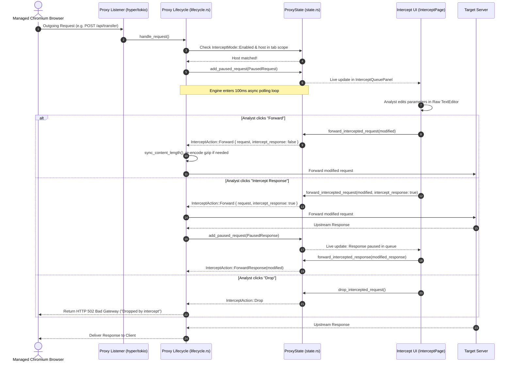

# Chapter 4: Intercept Engine & In-Flight Traffic Modification

This document details the complete end-to-end implementation of the **Intercept Engine, In-Flight Request/Response Modification, and Managed Browser Controller** in Halo.

---

## 1. Architectural Overview & Pause-and-Modify Lifecycle

Halo's Intercept feature allows security analysts to pause HTTP/HTTPS requests and responses in real-time, inspect and alter headers, methods, URLs, or payloads on the fly, and selectively forward or drop them before they hit the server or return to the browser.



---

## 2. Backend Implementation Details (`src-tauri/src/`)

### 2.1 The Intercept State Machine
- **File**: `src-tauri/src/proxy/state.rs`

The intercept engine is coordinated by thread-safe structures in `ProxyState`:

```rust
pub enum InterceptMode {
    Enabled,
    Disabled,
}

pub enum InterceptAction {
    Forward {
        request: Option<ProxyRequest>,
        intercept_response: bool,
    },
    ForwardResponse(Option<ProxyResponse>),
    Drop,
}

pub struct ProxyState {
    mode: Arc<AtomicBool>,
    paused_requests: Arc<Mutex<HashMap<Uuid, PausedRequest>>>,
    paused_actions: Arc<Mutex<HashMap<Uuid, InterceptAction>>>,
    tab_scopes: Arc<Mutex<HashMap<String, Vec<String>>>>,
    bypass_patterns: Arc<Mutex<Vec<String>>>,
}
```

- `mode`: Atomic toggle controlling whether the proxy pauses traffic or lets it stream through untouched.
- `tab_scopes`: Maps each Intercept UI tab ID to an array of captured host patterns (e.g. `["example.com", "api.target.com"]`).
- `paused_requests`: Live dictionary of pending transactions awaiting human action.
- `paused_actions`: Holds the verdict (`Forward`, `Drop`, `ForwardResponse`) queued by the UI.

---

### 2.2 In-Flight Polling & Mutation Engine (`src-tauri/src/proxy/lifecycle.rs`)

#### Request Interception Flow:
1. **Scope Matching**:
   ```rust
   let intercept_tab_id = proxy_state.matching_intercept_tab_id(&ctx.req_uri);
   ```
   If no tab is capturing the domain, the request is stamped with an internal header (`x-rusxy: 1`) and forwarded immediately without stalling the event loop.
2. **Pausing**:
   If matched, builds a `PausedRequest` struct with the request method, URI, HTTP version, headers, and body bytes, adding it to `proxy_state.add_paused_request()`.
3. **Non-Blocking Sleep Polling**:
   ```rust
   loop {
       tokio::time::sleep(Duration::from_millis(100)).await;
       if proxy_state.get_paused_request(&paused_id).is_none() {
           break;
       }
   }
   ```
   *Technical Rationale*: Using Tokio's async timer ensures the worker thread yields back to the Tokio runtime during waits, allowing other concurrent traffic (and the UI IPC) to operate without blocking.
4. **Action Execution**:
   Reads `proxy_state.take_paused_action(&paused_id)`:
   - **`Drop`**: Drops upstream connection and returns synthetic 502:
     ```rust
     Response::builder()
         .status(502)
         .body(Body::from(bytes::Bytes::from("Dropped by intercept")))
     ```
   - **`Forward`**: Rewrites parts (method, URI, headers, body).

#### Header Synchronization (`sync_content_length`):
When a user modifies a request or response body in the editor, manual `Content-Length` calculations could lead to protocol desync or HTTP request smuggling. The backend automatically repairs framing:
```rust
fn sync_content_length(
    headers: &mut HashMap<String, String>,
    body_len: usize,
    insert_if_missing: bool,
) {
    let content_length_key = headers.keys()
        .find(|k| k.eq_ignore_ascii_case("content-length")).cloned();

    if let Some(key) = content_length_key {
        headers.insert(key, body_len.to_string());
    } else if insert_if_missing && body_len > 0 {
        headers.insert("content-length".to_string(), body_len.to_string());
    }

    // Strip chunked transfer-encoding if full body length is known
    if body_len > 0 {
        if let Some(te) = headers.keys()
            .find(|k| k.eq_ignore_ascii_case("transfer-encoding")).cloned() {
            headers.remove(&te);
        }
    }
}
```

#### Content Re-Encoding:
If the original request carried a `Content-Encoding: gzip` or `deflate` header and was edited as plain text, the engine re-compresses the payload using `crate::proxy::utils::encode_body` before dispatching to upstream.

---

### 2.3 Isolated Managed Chrome & NSS Certificate Injection
- **File**: `src-tauri/src/commands/intercept.rs`

Halo provides a zero-configuration "Open Browser" button that launches an isolated Chromium instance already hooked to the proxy and trusting its root CA without requiring manual browser proxy configuration or polluting the user's primary browser profile.

#### 1. Isolated Profile Directory:
Creates an isolated sandbox at `~/.halo/intercept-browser-profile/`.

#### 2. Automatic NSS Cert Injection (`import_intercept_ca_to_chrome_profile`):
Chrome on Linux and macOS uses an NSS SQLite database (`sql:~/.halo/intercept-browser-profile`) for certificate trust. Halo searches candidate paths for `certutil` (`/opt/homebrew/opt/nss/bin/certutil`, `/opt/homebrew/bin/certutil`, etc.) and executes:
```bash
# 1. Initialize NSS database
certutil -N -d sql:<profile_dir> --empty-password

# 2. Delete any stale Halo certificates
certutil -D -d sql:<profile_dir> -n "Halo Proxy CA"

# 3. Add and trust root CA for SSL/TLS
certutil -A -d sql:<profile_dir> -n "Halo Proxy CA" -t "C,," -i <ca_path>
```
The SHA-256 fingerprint of `halo-ca.pem` is cached in `halo-ca.sha256` to skip re-import on future launches.

#### 3. Browser Process Launch:
Spawns Chrome with isolation flags:
```rust
let mut args = vec![
    format!("--user-data-dir={}", profile_dir.display()),
    "--new-window".to_string(),
    "--no-first-run".to_string(),
    "--no-default-browser-check".to_string(),
    format!("--proxy-server=127.0.0.1:{proxy_port}"),
    "about:blank".to_string(),
];
#[cfg(target_os = "macos")]
args.push("--use-mock-keychain".to_string());
```

---

### 2.4 macOS System Keychain Trust Automation (`trust_intercept_ca`)
On macOS, Halo can install and trust the CA directly into the user's login keychain so all system apps (Safari, Curl, Node.js) trust the proxy:
```bash
security add-trusted-cert -r trustRoot -p ssl -k ~/Library/Keychains/login.keychain-db halo-ca.pem
```

---

### 2.5 IPC Command Contracts

| Command | Arguments | Return Type | Description |
| :--- | :--- | :--- | :--- |
| `get_intercept_status` | — | `Result<InterceptStatus, String>` | Returns current mode and paused counts. |
| `set_intercept_enabled` | `enabled: bool` | `Result<InterceptStatus, String>` | Toggles intercept on or off. |
| `set_intercept_scope` | `tab_id: String, capture_patterns: Vec<String>` | `Result<(), String>` | Updates captured domains for a specific tab. |
| `get_paused_requests` | — | `Result<Vec<PausedRequest>, String>` | Fetches all currently held requests. |
| `forward_intercepted_request` | `request_id, request: Option<InterceptForwardRequest>, intercept_response: Option<bool>` | `Result<(), String>` | Submits edited request and releases poll loop. |
| `forward_intercepted_response` | `request_id, response: Option<InterceptForwardResponse>` | `Result<(), String>` | Submits edited response and releases poll loop. |
| `drop_intercepted_request` | `request_id: String` | `Result<(), String>` | Discards request and returns 502 to client. |
| `forward_intercepted_tab` | `tab_id: String` | `Result<usize, String>` | Batch-forwards all requests in a tab. |
| `open_intercept_browser` | `proxy_port: u16` | `Result<(), String>` | Spawns managed Chrome with proxy and NSS CA trust. |
| `trust_intercept_ca` | — | `Result<String, String>` | Automates OS keychain certificate installation. |

---

## 3. Frontend Implementation Details (`src/pages/intercept/`)

### 3.1 Store Architecture (`src/pages/intercept/state/intercept-store.ts`)
- `tabs: InterceptTab[]`: Array of tabs (e.g. "Default", "Auth Service"). Each tab maintains its own `captureHosts: string[]`.
- `activeTabId: string`: Currently focused tab.
- `status: InterceptStatus`: Current backend state (`mode: 'Enabled' | 'Disabled'`).
- `requests: PausedRequest[]`: Real-time queue of paused requests across all tabs.
- `selectedRequestId: string | null`: Selected request displayed in the raw editor.
- `rawRequest: string`: Active draft string inside the Monaco/TextEditor.
- `toggleIntercept(enabled)`: Toggles intercept mode via IPC.
- `forwardRequest(id, modified, interceptResponse)`: Dispatches forward command.
- `dropRequest(id)`: Dispatches drop command.

---

### 3.2 UI Component Breakdown & Layout Hierarchy

```
InterceptPage (index.tsx)
├── ProxyAlert (Shown if proxy is offline with "Start Proxy" CTA)
└── TabbedPageLayout (Top Tabs: Tab 1, Tab 2, Add Tab)
    └── Inner Container
        ├── InterceptToolbar (Host chips, Add Host input, On/Off toggle switch)
        └── ResizablePanelGroup (Horizontal)
            ├── Left Panel (35%): InterceptQueuePanel
            │   └── QueueRow (Individual paused request cards)
            │       ├── Method Badge (GET, POST, etc.)
            │       ├── Host & Path
            │       └── Action Buttons (Forward, Intercept Response, Drop, Don't Capture)
            ├── ResizableHandle
            └── Right Panel (65%): InterceptRequestPanel
                ├── Header: "Raw Request" / "Raw Response" Label + "Format" Button
                └── TextEditor (Monaco/CodeMirror with live editing)
```

---

### 3.3 Component Locations & Affordances

#### 1. Header Toolbar (`components/intercept-toolbar.tsx`)
- **Capture Hosts Chip Bar**:
  - Displays tags for all domains assigned to this tab (e.g., `[ api.test.com × ]`, `[ login.test.com × ]`).
  - Clicking `×` removes host from capture scope.
- **Add Host Input**:
  - Text input with auto-clean (strips `http://`, `https://`, trailing paths, and default ports).
  - Pressing `Enter` or clicking `+` immediately updates the backend via `set_intercept_scope`.
- **Master Intercept Toggle Switch**:
  - High-visibility toggle switch (`PlayIcon` / `PauseIcon`).
  - Pulsing animated badge when enabled: `● INTERCEPT ACTIVE`.
  - Paused request counter badge showing total items awaiting review.

#### 2. Queue Panel (`components/queue-panel.tsx` & `components/queue-row.tsx`)
- Displays vertically scrollable list of paused requests for the active tab.
- **Card Structure**:
  - Method pill (`POST` in green, `GET` in blue).
  - URL and clean host display.
  - Timestamp elapsed counter (e.g., `4s ago`).
  - Status indicator: `Request Paused` or `Response Paused`.
- **Card Action Buttons**:
  1. **Forward** (`Button`): Forwards modified request immediately.
  2. **Intercept Response** (`Button` with `ArrowDownIcon`): Forwards the request, but instructs proxy lifecycle to pause the upcoming response for modification.
  3. **Drop** (`Button` with `TrashIcon`): Drops transaction, returning 502 to client.
  4. **Don't Capture**: Removes this host from the tab scope and forwards.
  5. **Send to Repeater**: Clones request and opens it in the Repeater forge.

#### 3. Raw Request / Response Editor (`components/request-panel.tsx`)
- **Header Strip**:
  - Dynamic label: `Raw Request` or `Raw Response`.
  - **"Format" Button**: Automatically beautifies JSON or XML body content without corrupting headers.
- **Editor Canvas**:
  - Full-height `TextEditor` (Monaco / CodeMirror).
  - Supports full HTTP wire format editing (Request line, headers, CRLF delimiter, body).
  - Editing immediately updates `rawRequest` in state, ready for forwarding.
