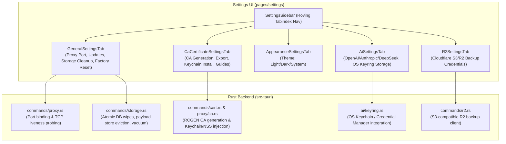

# Chapter 5: Settings & System Administration

This document details the complete end-to-end implementation of the **Settings, Certificate Authority (CA) Management, Proxy Listener Configuration, Storage Lifecycle, and Keyring Credential Store** in Halo.

---

## 1. Architectural Overview & Settings Modules

The Settings system centralizes control over the network proxy listeners, MITM root certificate issuance and platform trust, persistent disk storage, multi-provider LLM integrations with OS credential vaults, and application updates.



---

## 2. Backend Implementation Details (`src-tauri/src/`)

### 2.1 Proxy Listener & Port Configuration
- **File**: `src-tauri/src/commands/proxy.rs`

#### Port Validation & Binding:
- Default proxy port: `8888`.
- Valid port range: `1` to `65535` (excluding restricted ports).
- **Liveness Probing**: When starting or querying status, Halo does not assume the port is ready simply because the thread spawned; it executes an explicit TCP connection timeout probe off the async runtime:
  ```rust
  let reachable = tauri::async_runtime::spawn_blocking(move || {
      TcpStream::connect_timeout(&addr, Duration::from_millis(150)).is_ok()
  }).await.unwrap_or(false);
  ```

---

### 2.2 Root Certificate Authority (CA) Lifecycle
- **Files**:
  - `src-tauri/src/proxy/ca.rs`
  - `src-tauri/src/commands/cert.rs`

#### 1. Dynamic CA Generation (`ensure_ca_exists`):
On first launch, Halo checks `~/.halo/ca.key` and `~/.halo/ca.pem`. If missing, it dynamically generates a self-signed root CA using the `rcgen` crate:
- **Common Name (CN)**: `"Halo Proxy CA"`.
- **Organization (O)**: `"Halo Security Tools"`.
- **Key Spec**: RSA 2048-bit or ECDSA P-256 keypair.
- **Validity**: 10 years (3650 days).
- **Constraints**: `IsCA = true`, KeyCertSign, CRLSign.

#### 2. On-the-Fly Dynamic Server Certificate Minting:
When the proxy receives an HTTPS `CONNECT example.com:443`, the proxy terminates TLS by dynamically minting a leaf certificate for `example.com` signed by the local CA, ensuring the browser sees a valid cryptographic chain.

#### 3. CA Regeneration (`regenerate_ca_cert`):
If a certificate expires or private key security is compromised, `regenerate_ca_cert` deletes existing keys and regenerates a fresh pair, signaling the user to re-install.

#### 4. Automatic System Trust:
- **macOS**: Calls `security add-trusted-cert -r trustRoot -p ssl -k ~/Library/Keychains/login.keychain-db halo-ca.pem`.
- **Linux / Chrome**: Uses `certutil` to inject into the NSS database (`sql:~/.pki/nssdb`).

---

### 2.3 Storage Management & Reset Protocols
- **File**: `src-tauri/src/commands/storage.rs`

Halo provides fine-grained observability over its on-disk footprint across multiple storage subsystems:

```rust
#[derive(Serialize)]
pub struct StorageInfo {
    pub database_path: String,
    pub database_size_bytes: u64,
    pub log_file_size_bytes: u64,
    pub browser_artifacts_size_bytes: u64,
    pub regression_artifacts_size_bytes: u64,
}
```

#### Granular Artifact Deletion (`delete_storage_artifact`):
1. **`"database"`**:
   - Closes open SQLite connections.
   - Deletes `data.db`, WAL (`data.db-wal`), and shared memory (`data.db-shm`).
   - Clears all binary payload segment files (`sessions/*.bin`).
   - Clears in-memory ephemeral slabs in `PayloadStore`.
   - Reopens and runs SQLite DDL migrations (`reopen_and_init()`).
2. **`"log_file"`**: Truncates `/tmp/halo.log` to zero bytes without breaking open file descriptors.
3. **`"browser_artifacts"`**: Recursively purges screenshots and DOM snapshots.

#### Full Factory Reset (`reset_all_app_data`):
1. Stops the proxy server gracefully.
2. Forcefully terminates any running browser instances or crawler processes.
3. Closes SQLite and history handles.
4. Recursively wipes:
   - `~/.halo/data.db*`
   - `~/.halo/sessions/`
   - `~/.halo/intercept-browser-profile/`
   - `~/.halo/ai-browser-artifacts/`
   - `~/.halo/.halo/` (CA keys)
   - `~/.halo/halo-ca.pem`
   - `~/.halo/ai-settings.json` and `r2-settings.json`
5. Re-initializes clean SQLite database schemas.
6. Returns `ResetLocalDataResult` and reloads the webview.

---

### 2.4 Secure Credential Store (OS Keyring) & AI Providers
- **Files**:
  - `src-tauri/src/ai/keyring.rs`
  - `src-tauri/src/ai/settings.rs`

API keys for AI integrations (DeepSeek, OpenAI Compatible, Anthropic, Vector Embeddings) are **never written to plain-text configuration files**.
- Uses the `keyring` crate to bind to the OS credential store:
  - **macOS**: Apple Keychain Services.
  - **Windows**: Windows Credential Manager.
  - **Linux**: Secret Service API / FreeDesktop D-Bus.
- Service Name: `"halo-ai"`.
- Account Name: `<provider_id>` (e.g. `"openai-compatible"`, `"anthropic-compatible"`, `"deepseek"`, `"embeddings"`).

---

## 3. Frontend Implementation Details (`src/pages/settings/`)

### 3.1 Settings Layout & Roving Tabindex Navigation
- **File**: `src/pages/settings/components/settings-sidebar.tsx`
- **File**: `src/pages/settings/components/settings-layout.tsx`

Halo implements an accessible two-column settings view with a categorized sidebar:

```
┌─────────────────────────┬────────────────────────────────────────────────────────┐
│ SettingsSidebar (w-56)  │ SettingsContent (Flexible scrolling container)         │
│                         │                                                        │
│ APPLICATION             │ SettingsGroup: Proxy Listener                          │
│  • General [GearIcon]   │   Listener port: [ 8888 ] [Save] [Reset]               │
│  • Appearance [Palette] │                                                        │
│                         │ SettingsGroup: Updates                                 │
│ NETWORK                 │   Current version: v0.1.0 [Check for Updates]          │
│  • CA Certificate       │                                                        │
│                         │ SettingsGroup: Storage                                 │
│ INTEGRATIONS            │   SQL Database & Payloads: 14.2 MB [Clear]             │
│  • AI [SparkleIcon]     │   Log File: 820 KB [Clear]                             │
│  • R2 Storage [Cloud]   │   Delete all data: [Delete] (Red)                      │
│                         │                                                        │
│ AUTOMATION              │                                                        │
│  • Runtime [RobotIcon]  │                                                        │
└─────────────────────────┴────────────────────────────────────────────────────────┘
```

#### Roving Tabindex Navigation:
The entire sidebar navigation is treated as a single tab stop. Analysts can navigate categories using `ArrowUp`, `ArrowDown`, `Home`, and `End` keys, ensuring keyboard accessibility without having to tab through every button.

---

### 3.2 Settings Tabs Breakdown

#### 1. General Settings Tab (`components/general-settings-tab.tsx`)
- **Proxy Listener Port Section**:
  - Input field for default port (`MIN_PROXY_PORT = 1`, `MAX_PROXY_PORT = 65535`).
  - Validation styling (`aria-invalid`).
  - "Save" button (persists port and restarts proxy if running).
  - "Reset" button (restores factory default `8888`).
- **Updates Section**:
  - Displays `currentVersion` (from Tauri app package).
  - "Check for updates" button with spinning loader.
  - "Install vX.Y.Z" and "Restart Now" buttons upon release download.
  - Manual update script fallback snippet (`manual-update-command.tsx`).
- **Storage & Disk Usage Section**:
  - Displays exact bytes formatted (`formatBytes`: B, KB, MB, GB).
  - Individual `StorageRowDelete` confirmation dialogs for:
    - SQL Database & Payloads (`data.db`, WAL, `.bin` segments).
    - Log File (`/tmp/halo.log`).
  - **"Delete all data"** button: Opens destructive confirmation dialog requiring explicit confirmation before triggering `reset_all_app_data`.

#### 2. CA Certificate Tab (`components/ca-certificate-settings-tab.tsx`)
- **Security Alert**: Warning notice explaining that managed Chromium instances use isolated certs, so system CA installation is only necessary for external browsers.
- **Action Buttons**:
  - **"Install to macOS Keychain"** (macOS only): One-click execution of `trust_intercept_ca`.
  - **"Download CA Certificate"**: Opens OS native file picker to save `halo-ca.pem`.
  - **"Regenerate CA"**: Wipes existing certificate authority and keys, minting a new root.
- **Installation Guides Accordion** (`INSTALLATION_GUIDES` in `constants.ts`):
  Step-by-step verified procedures for:
  - Chrome / Edge (Windows)
  - Chrome / Edge (macOS)
  - Mozilla Firefox (All Platforms)
  - Apple Safari (macOS)
- **"How It Works" Section**:
  Explains the 5-step lifecycle:
  1. Certificate Generation
  2. CA Installation
  3. Dynamic Certificate Signing
  4. Secure Passthrough
  5. Privacy Boundary (only proxied ports are intercepted)
- **Troubleshooting Guide**:
  Instructions for resolving untrusted warnings, handling mobile apps with Certificate Pinning, and cleanly removing the CA.

#### 3. Appearance Settings Tab (`components/appearance-settings-tab.tsx`)
- Theme cards: **Light**, **Dark**, and **System Default**.
- Toggles CSS root classes (`.dark`) and updates Monaco Editor color schemes.

#### 4. AI Settings Tab (`components/ai-settings-tab.tsx`)
- **Provider Selector**: Dropdown for DeepSeek, OpenAI-Compatible, and Anthropic-Compatible endpoints.
- **Base URL Input**: Editable API host with presets (e.g., `https://api.openai.com/v1`, `http://localhost:11434/v1` for local Ollama).
- **API Key Field**: Password-masked input saving directly into OS Keyring via `set_ai_api_key`. Shows key status ("Configured" / "Missing").
- **Model Selector**: Dropdown with known models (`gpt-4o`, `claude-3-7-sonnet`, `deepseek-chat`, etc.) or custom model string input.
- **Memory RAG Embeddings**: Configuration for local or remote vector embedding endpoints used for semantic search across past security findings.
- **Security Approval Policy**: Toggles between autonomous tool execution vs requiring human confirmation before high-impact tools execute (e.g. Intruder fuzzing attacks).

#### 5. R2 Storage Tab (`components/r2-settings-tab.tsx`)
- Cloudflare R2 / S3-compatible remote backup configuration:
  - Account ID / Endpoint URL.
  - Access Key ID & Secret Access Key.
  - Bucket name.
  - "Test Connection" button testing S3 `ListObjectsV2` access.
