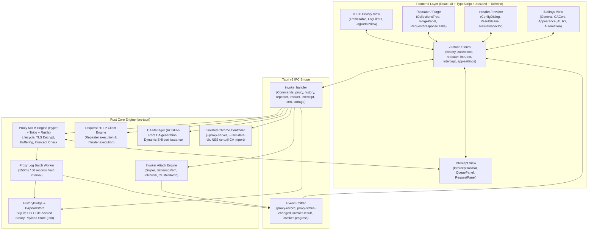

# Halo Architecture & Detailed Implementation Analysis

This directory contains a deep technical analysis of the reference implementation of **Halo** (located at `references/hexbuffer`). It provides comprehensive architectural blueprints, Rust backend engine internals, frontend React/Zustand architectures, IPC command interfaces, data contracts, and pixel-precise UI layout locations for the 5 core modules:

1. [**HTTP History & Proxy Engine**](01-http-history-and-proxy.md) (`/http-history`, `/live-traffic`)
2. [**Repeater / Forge**](02-repeater.md) (`/repeater`)
3. [**Intruder / Invoker**](03-intruder.md) (`/intruder`)
4. [**Intercept Engine**](04-intercept.md) (`/intercept`)
5. [**Settings & System Administration**](05-settings.md) (`/settings`)
6. [**Browser Automation & AI Web Crawler**](06-crawler.md) (`/browser`)
7. [**Embedded Webview & Element Inspector**](embedded-browser-element-picker.md) (`/browser` interactive webview + AI element mention)

---

## 🏗️ High-Level System Architecture



---

## 📂 Source Code Location & Mapping Table

| Feature Domain | Backend (Rust / `src-tauri/src/`) | Frontend (React / `src/`) | Zustand Stores / State |
| :--- | :--- | :--- | :--- |
| **HTTP History & Proxy** | `proxy/lifecycle.rs`<br>`proxy/completion.rs`<br>`proxy/state.rs`<br>`commands/proxy.rs`<br>`commands/history.rs`<br>`db/repository/proxy_logs.rs`<br>`db/payload_store.rs` | `pages/live-traffic/http-history/`<br>`pages/live-traffic/http-history/components/`<br>`pages/live-traffic/http-history/hooks/` | `stores/history/http-query.ts`<br>`stores/history/http-session.ts`<br>`stores/history/http-pinned.ts`<br>`stores/history/http-groups.ts` |
| **Repeater / Forge** | `commands/repeater.rs`<br>`commands/api_collection.rs`<br>`tools/repeater.rs` | `pages/repeater/`<br>`pages/repeater/components/forge-panel/`<br>`pages/repeater/components/collection-tree/`<br>`triggers/repeater/craft.ts` | `stores/repeater.ts`<br>`stores/collections.ts` |
| **Intruder / Invoker** | `commands/invoker.rs`<br>`tools/invoker.rs` | `pages/intruder/`<br>`pages/intruder/components/intruder-config/`<br>`pages/intruder/components/results-panel.tsx`<br>`pages/intruder/components/result-inspector.tsx` | `stores/intruder.ts` |
| **Intercept** | `commands/intercept.rs`<br>`tools/intercept.rs`<br>`proxy/lifecycle.rs`<br>`proxy/state.rs` | `pages/intercept/`<br>`pages/intercept/components/`<br>`pages/intercept/hooks/` | `pages/intercept/state/intercept-store.ts` |
| **Settings** | `commands/cert.rs`<br>`commands/storage.rs`<br>`proxy/ca.rs`<br>`ai/settings.rs`<br>`commands/r2.rs` | `pages/settings/`<br>`pages/settings/components/`<br>`pages/settings/hooks/` | `stores/app-settings-store.ts`<br>`stores/target.ts` |
| **Browser & Crawler** | `browser/crawl_runner.rs`<br>`browser/crawl_helpers.rs`<br>`commands/crawler.rs`<br>`db/repository/crawler.rs` | `pages/crawler/`<br>`pages/crawler/components/`<br>`pages/crawler/hooks/` | `stores/browser-automation.ts` |

---

## 📑 Detailed Documentation Chapters

1. **[01-http-history-and-proxy.md](01-http-history-and-proxy.md)**: Deep dive into the Hyper-based HTTP/HTTPS MITM proxy lifecycle, connection upgrades, header normalization, asynchronous persistence batching worker (50-item / 150ms loop), hybrid SQLite + segment payload store, and the virtualized React traffic table and inspector UI.
2. **[02-repeater.md](02-repeater.md)**: Deep dive into the Repeater workbench, workspaces, Postman/Insomnia-like collection tree with drag-and-drop, dynamic environment variables (`{{var}}`), pre-request script execution and post-request test assertions runner in a JavaScript sandbox, and side-by-side response rendering.
3. **[03-intruder.md](03-intruder.md)**: Deep dive into parameter fuzzing and automated request attacks. Detailed algorithms for Sniper, Battering Ram, Pitchfork, and Cluster Bomb attack modes, marker boundary parser (`§payload§`), semaphore-controlled parallel dispatching, payload encoders/hashers, grep matching/extraction, and live UI telemetry.
4. **[04-intercept.md](04-intercept.md)**: Deep dive into the real-time request/response pause and modification engine. Covers Tokio channel-less polling synchronization, header recalculation (Content-Length, Transfer-Encoding), isolated Chromium browser launch with NSS certutil CA certificate insertion, macOS Keychain trust automation, and the split queue/raw text editor UI.
5. **[05-settings.md](05-settings.md)**: Deep dive into system-level administration. Covers proxy listener bindings, CA certificate generation, export and automated platform trust, disk usage tracking across SQLite databases, WAL logs, payload segments and browser profiles, complete atomic data wipe protocols, AI provider keyring storage, and the roving-tabindex sidebar navigation UI.
6. **[06-crawler.md](06-crawler.md)**: Deep dive into the headless web crawling engine (`celestia_spider`) and agentic browser process manager (`agent-browser`). Covers BFS link traversal, proxy integration, bounded AI reconnaissance analysis with prompt injection defense, heuristic security findings, interactive CLI terminal console, and findings inspector.

---

## 🖥️ Per-Page UI Deep Dives (`docs/ui/`)

Every page module under `references/hexbuffer/src/pages/` (all **25** folders) also has its own
source-grounded UI doc in **[`docs/ui/`](ui/README.md)** — component names/props, layout
hierarchies, handlers, IPC commands/events, store fields, icon/library inventories, styling
details, and notable findings (dead code, orphaned components). Start at the index:
**[docs/ui/README.md](ui/README.md)**.

---

## ⌨️ Headless CLI

- **[cli.md](cli.md)**: The `halo-cli` binary — how it boots `BackendRuntime` without GPUI, the
  `proxy` / `history` / `session` / `cert` / `storage` / `repeater` / `scan` / `library` / `notes`
  subcommands with their flags, `--json` output, the detached-proxy model (`serve` child + pidfile),
  and which backend groups are not wired to the CLI yet.

  ```bash
  halo-cli proxy start --detach --port 8888
  halo-cli history ls -n 50 -s 4xx --json | jq
  halo-cli repeater send --raw request.txt
  halo-cli scan 10.0.0.1 --ports 1-1024
  ```

  Architecture rule: every command is a function in `halo_backend::commands::<group>` taking
  `&BackendRuntime` and an ambient Tokio runtime. The desktop app reaches them through
  `halo_bridge::NativeBackend` (`tokio.block_on`), the CLI through `#[tokio::main]`. Nothing under
  `crates/backend/src/commands` may depend on GPUI — that is what keeps the binary headless.
