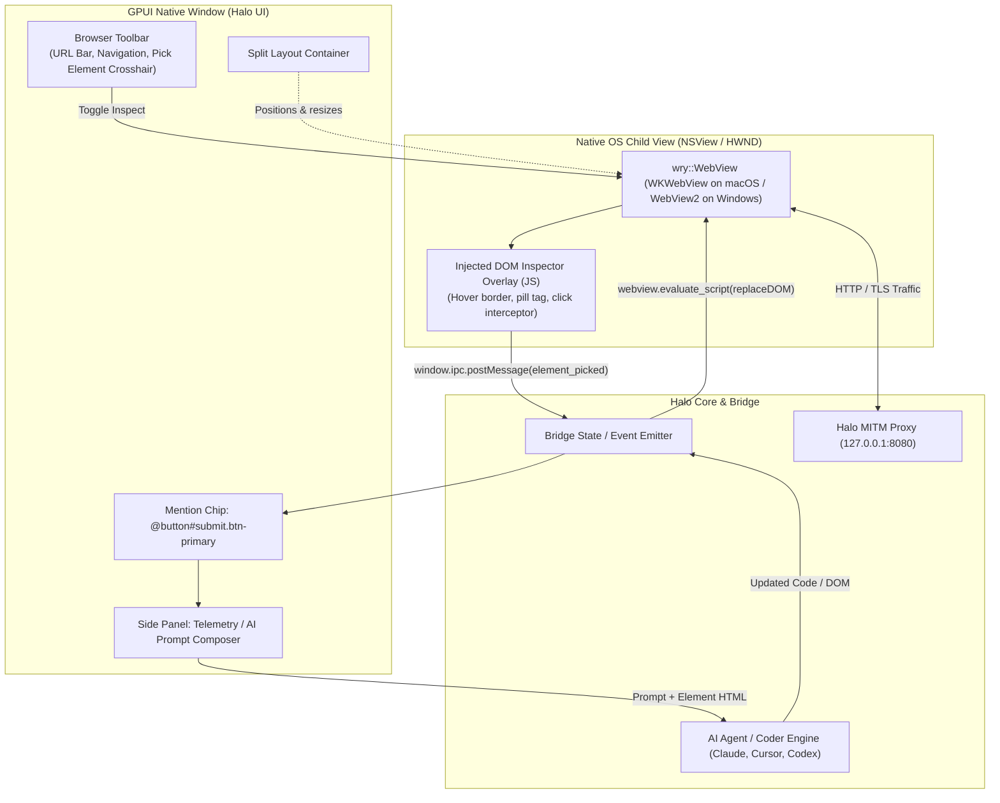

# Embedded Real Webview & Interactive Element Inspector

> **Feature Status**: Planned / Architecture Specification  
> **Target Tool**: Browser Page (`crates/ui/src/pages/browser/`), Coder Agent (`crates/coder/`), and Bridge (`crates/bridge/`)  
> **Key Technologies**: `wry` (WKWebView on macOS / WebView2 on Windows), `raw-window-handle`, GPUI Metal view overlay, injected DOM content script, bi-directional IPC.

---

## 1. Executive Summary

This specification defines the architecture, dataflow, and phased implementation plan for embedding a **real web browser engine** (`wry` / `WKWebView`) directly into Halo's GPUI desktop window, equipped with an interactive **Element Picker & Mention System** inspired by Google AI Studio, v0.dev, and Cursor Composer.

### Core Capabilities
1. **In-App Real Browser**: Renders live web applications (HTML5, JS, CSS, WebSockets, cookies, SPA routers) directly inside the Browser page layout without spawning a detached external window.
2. **Proxy-Connected**: All webview traffic automatically routes through Halo’s local MITM proxy (`127.0.0.1:<proxy_port>`), capturing requests in HTTP History and respecting Intercept rules.
3. **Interactive Element Picker**: Clicking a crosshair tool activates an in-page inspector. Hovering outlines DOM nodes with a tag/class pill; clicking captures the element’s selector, attributes, inner text, and HTML snippet.
4. **AI Element Mentioning (`@element`)**: Selected elements become interactive reference chips in the AI prompt composer. Users can direct the AI: *"Make this button emerald green and wire it to `/api/checkout`"*.
5. **Two-Way Live DOM Editing**: Code generated by the AI or written by the user can be patched directly back into the live DOM without full page reload.

---

## 2. Architecture & Dataflow



---

## 3. Core Component Design

### 3.1 Embedded Webview Mounting (`crates/ui/src/pages/browser/`)
GPUI uses AppKit on macOS (`NSWindow` and a `CAMetalLayer`-backed `NSView`). Using `raw-window-handle`, Halo extracts the native handle and mounts `wry::WebView` as a native child subview.

#### Window Handle Extraction & Child View Attachment
```rust
use raw_window_handle::{HasWindowHandle, RawWindowHandle};
use wry::{Rect, WebView, WebViewBuilder};

pub struct EmbeddedBrowserView {
    webview: Option<WebView>,
    current_bounds: Rect,
    visible: bool,
}

impl EmbeddedBrowserView {
    pub fn attach(
        window: &gpui::Window,
        bounds: gpui::Bounds<gpui::Pixels>,
        proxy_port: u16,
    ) -> anyhow::Result<Self> {
        let handle = window.window_handle()?;
        let RawWindowHandle::AppKit(appkit) = handle.as_raw() else {
            anyhow::bail!("Unsupported platform handle");
        };

        let rect = Rect {
            x: bounds.origin.x.0 as i32,
            y: bounds.origin.y.0 as i32,
            width: bounds.size.width.0 as u32,
            height: bounds.size.height.0 as u32,
        };

        let webview = WebViewBuilder::new_as_child(&window)
            .with_bounds(rect)
            .with_proxy_config(wry::ProxyConfig::Http {
                host: "127.0.0.1".into(),
                port: proxy_port,
            })
            .with_initialization_script(INSPECTOR_SCRIPT)
            .with_ipc_handler(|msg| {
                // Dispatches DOM selection events into BridgeState
                handle_webview_ipc_message(msg);
            })
            .build()?;

        Ok(Self {
            webview: Some(webview),
            current_bounds: rect,
            visible: true,
        })
    }
}
```

#### Airspace & Lifecycle Management
Because native OS subviews render on top of GPU-accelerated Metal surfaces, the webview must respect the GPUI layout hierarchy:
- **Tab Switching**: When navigating away from `Page::Browser` (e.g. switching to `HTTP History` or `Repeater`), the webview calls `set_visible(false)`.
- **Modals & Dialogs**: When a modal (like `SetupScreen` or `Settings`) opens, `set_visible(false)` prevents the webview from clipping over the modal backdrop.
- **Window Resize**: Bounds are debounced and synchronized via `set_bounds(new_rect)`.

---

### 3.2 Injected DOM Inspector Script (`INSPECTOR_SCRIPT`)

The content script injects directly into the webview before DOM execution. It remains dormant until activated by the user or shortcut.

```javascript
(function() {
  if (window.__HEX_INSPECTOR_INSTALLED) return;
  window.__HEX_INSPECTOR_INSTALLED = true;
  
  let active = false;
  let hoveredEl = null;
  let overlay = null;

  function createOverlay() {
    overlay = document.createElement('div');
    overlay.id = '__hex_inspect_overlay';
    overlay.style.position = 'fixed';
    overlay.style.pointerEvents = 'none';
    overlay.style.zIndex = '2147483647';
    overlay.style.border = '2px solid #3b82f6';
    overlay.style.backgroundColor = 'rgba(59, 130, 246, 0.15)';
    overlay.style.transition = 'all 60ms ease-out';
    overlay.style.display = 'none';

    const pill = document.createElement('div');
    pill.id = '__hex_inspect_pill';
    pill.style.position = 'absolute';
    pill.style.top = '-26px';
    pill.style.left = '0';
    pill.style.background = '#1d4ed8';
    pill.style.color = '#fff';
    pill.style.fontSize = '11px';
    pill.style.fontFamily = 'monospace';
    pill.style.padding = '2px 6px';
    pill.style.borderRadius = '3px';
    pill.style.whiteSpace = 'nowrap';
    overlay.appendChild(pill);

    document.documentElement.appendChild(overlay);
  }

  function getSelector(el) {
    if (el.id) return `#${el.id}`;
    let path = [];
    while (el && el.nodeType === Node.ELEMENT_NODE) {
      let selector = el.nodeName.toLowerCase();
      if (el.className && typeof el.className === 'string') {
        const classes = el.className.trim().split(/\s+/).filter(Boolean);
        if (classes.length) selector += `.${classes.slice(0, 2).join('.')}`;
      }
      path.unshift(selector);
      el = el.parentNode;
      if (path.length >= 3) break;
    }
    return path.join(' > ');
  }

  window.__HEX_SET_INSPECTOR = function(enabled) {
    active = enabled;
    if (!overlay) createOverlay();
    overlay.style.display = 'none';
    document.body.style.cursor = enabled ? 'crosshair' : 'default';
  };

  document.addEventListener('mousemove', function(e) {
    if (!active || !overlay) return;
    const target = document.elementFromPoint(e.clientX, e.clientY);
    if (!target || target === overlay || target.id?.startsWith('__hex_')) return;
    
    hoveredEl = target;
    const rect = target.getBoundingClientRect();
    overlay.style.display = 'block';
    overlay.style.top = `${rect.top}px`;
    overlay.style.left = `${rect.left}px`;
    overlay.style.width = `${rect.width}px`;
    overlay.style.height = `${rect.height}px`;

    const pill = overlay.querySelector('#__hex_inspect_pill');
    if (pill) {
      pill.textContent = `<${target.tagName.toLowerCase()}> ${getSelector(target)}`;
    }
  }, true);

  document.addEventListener('click', function(e) {
    if (!active) return;
    e.preventDefault();
    e.stopPropagation();

    const target = hoveredEl || e.target;
    const payload = {
      type: 'element_selected',
      tag: target.tagName.toLowerCase(),
      id: target.id || null,
      classes: Array.from(target.classList || []),
      selector: getSelector(target),
      outer_html: target.outerHTML.slice(0, 4000),
      inner_text: target.innerText ? target.innerText.slice(0, 500) : '',
      client_rect: {
        x: target.getBoundingClientRect().x,
        y: target.getBoundingClientRect().y,
        width: target.getBoundingClientRect().width,
        height: target.getBoundingClientRect().height,
      }
    };

    window.ipc.postMessage(JSON.stringify(payload));
    window.__HEX_SET_INSPECTOR(false);
  }, true);
})();
```

---

### 3.3 Data Contracts & Bridge DTOs (`crates/bridge/src/types.rs`)

```rust
#[derive(Clone, Debug, PartialEq, Eq, Serialize, Deserialize)]
pub struct SelectedDomElement {
    pub tag: String,
    pub id: Option<String>,
    pub classes: Vec<String>,
    pub selector: String,
    pub outer_html: String,
    pub inner_text: String,
}

#[derive(Clone, Debug, PartialEq, Eq, Serialize, Deserialize)]
pub struct BrowserElementMention {
    pub element: SelectedDomElement,
    pub timestamp: String,
}

#[derive(Clone, Debug, Default)]
pub struct BrowserUiState {
    pub inspector_active: bool,
    pub current_url: String,
    pub selected_element: Option<SelectedDomElement>,
}
```

---

### 3.4 AI Prompt Composition & Context Injection

When an element is selected:
1. An interactive pill badge `[@button.primary#submit ✕]` renders above or inside the AI chat input.
2. The AI prompt context is augmented with structured DOM metadata:

```markdown
User instruction: Make this button pulse with an emerald green glow and call /api/v1/checkout on click.

<referenced_element>
Selector: form#order-form > button.btn.btn-primary
Tag: button
ID: submit-btn
Current HTML:
<button id="submit-btn" class="btn btn-primary" type="submit">Complete Purchase</button>
</referenced_element>
```

When the AI returns the new code, the user can click **"Apply to Live Page"**, which runs:
```rust
pub fn apply_live_dom_patch(selector: &str, new_html: &str, webview: &wry::WebView) -> anyhow::Result<()> {
    let script = format!(
        r#"
        (function() {{
            const el = document.querySelector({selector:?});
            if (el) {{
                el.outerHTML = {new_html:?};
            }}
        }})();
        "#,
        selector = selector,
        new_html = new_html
    );
    webview.evaluate_script(&script)?;
    Ok(())
}
```

---

## 4. Phased Implementation Roadmap

```mermaid
gantt
    title Embedded Browser & Element Picker Implementation
    dateFormat  YYYY-MM-DD
    section Phase 1: Wry Core
    Add wry & raw-window-handle bindings      :p1_1, 2026-10-26, 2d
    GPUI child window mounting & bounds sync  :p1_2, after p1_1, 2d
    Tab-switch visibility & proxy wiring      :p1_3, after p1_2, 2d
    section Phase 2: DOM Inspector
    Injected script & hover overlay           :p2_1, after p1_3, 2d
    Click interception & selector generator   :p2_2, after p2_1, 2d
    IPC channel to Rust BridgeState           :p2_3, after p2_2, 1d
    section Phase 3: UI Integration
    Browser navigation toolbar & crosshair    :p3_1, after p2_3, 2d
    Side-by-side split layout (Browser + Side):p3_2, after p3_1, 2d
    section Phase 4: AI & Live Patching
    Mention chip in Coder/AI Composer         :p4_1, after p3_2, 2d
    Two-way live DOM patch dispatch           :p4_2, after p4_1, 2d
    section Phase 5: Security & QA
    Cross-origin iframe handling              :p5_1, after p4_2, 2d
    CA cert trust & end-to-end testing        :p5_2, after p5_1, 2d
```

### Phase 1: Foundation (`wry` in GPUI)
- Add `wry = "0.49"` to `Cargo.toml`.
- Implement `EmbeddedBrowserView` in `crates/ui/src/pages/browser/viewport.rs`.
- Wire `with_proxy_config` to `halo_traffic::active_proxy_port()`.
- Handle hide/show events on `Page::Browser` activation and deactivation.

### Phase 2: Injected Inspector & IPC Pipeline
- Create `crates/ui/src/pages/browser/inspector.js`.
- Wire `with_initialization_script` and `with_ipc_handler`.
- Add `Bridge::set_selected_element(element, cx)` to bridge state.

### Phase 3: Split-View UI & Toolbar
- Update `crates/ui/src/pages/browser/mod.rs` to render a 60/40 horizontal split:
  - **Left**: Browser Viewport (URL address bar, Back/Forward/Reload buttons, Crosshair "Inspect" toggle).
  - **Right**: Side panel with `[Activity]`, `[Findings]`, and `[AI Inspector]` tabs.

### Phase 4: AI Agent Integration
- In `crates/ui/src/pages/coder/agent_panel/composer.rs` and the Browser side panel:
  - Add element chip component `element_pill(el, on_remove)`.
- Connect element metadata to prompt assembly in `crates/coder/src/agent/`.
- Implement `apply_live_dom_patch` to execute DOM updates live in the webview.

### Phase 5: Hardening & Security
- Guard against infinite loops or DOM mutation collisions.
- Handle multi-frame / `iframe` isolation.
- Ensure the Halo Root CA certificate is trusted for HTTPS targets.

---

## 5. Security & Isolation Safeguards

1. **Local Proxy Isolation**: The embedded webview is configured strictly to route through `127.0.0.1:<proxy_port>`. It cannot bypass intercept rules or network audit logs.
2. **Context Isolation**: The inspector script uses closures and prefixed identifiers (`__hex_*`) to prevent name collisions with target application JavaScript.
3. **Payload Sanitization**: Elements sent to the AI context are truncated to 4,000 characters for `outerHTML` and 500 characters for `innerText` to prevent context token overflow and prompt injection from malicious DOM payloads.
