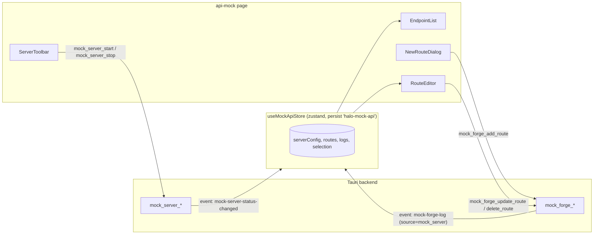

# API Mock (`api-mock`) — UI Deep Dive

> Source: `references/hexbuffer/src/pages/api-mock/` (18 files, ~2,700 lines)
> Exported page component: `MockApiPage` (alias `MockForgePage`, default export)

## 1. Overview & Purpose

API Mock (internally also called "Mock Forge") runs a local HTTP mock server on `127.0.0.1` (default port **4000**) with user-defined endpoints. Each endpoint is a `MockRoute` with method, path (supporting **dynamic params** `:id` / `{id}`), status code, a JSON **template** response body (`{{param}}` / `${param}` interpolation), and an optional chaos config (latency/error injection — typed but not edited in this UI). The page is a two-pane workbench: endpoint list on the left, a live template editor with simulation preview on the right, over a server-control toolbar.

## 2. Annotated File Tree

```
api-mock/
├── index.tsx                          (35)  MockApiPage shell: p-2 frame, rounded-lg bordered container
├── types.ts                           (71)  HttpMethod, MockRoute, MockDomain, RequestLog, ChaosConfig, RequestMatcher
├── constants.ts                       (13)  MOCK_API_SUB_TABS, HTTP_METHODS, DEFAULT_RESPONSE_BODY
├── hooks/
│   └── use-mock-api-page.ts          (180)  Page controller: store wiring, IPC load, event listeners, CRUD
├── lib/
│   └── route-template.ts             (131)  parseRouteParams, generateSamplePath, renderTemplatePreview, generateDynamicBodyTemplate
└── components/
    ├── mock-api-content.tsx           (28)  Pass-through: MockApiPage → MockServerPanel prop bridge (alias MockServerContent)
    ├── mock-server-panel.tsx            (3)  Re-export barrel → ./mock-server-pane/
    ├── logs-panel.tsx                (255)  ⚠ ORPHANED — never rendered (see §11)
    ├── new-route-dialog.tsx          (355)  Create-endpoint dialog with dynamic-param detection
    ├── route-editor.tsx              (660)  Main right-pane editor + live template preview
    ├── hooks/
    │   ├── use-routes-panel.ts       (176)  useRoutesPanel (filter/group) + useRouteEditor (body state, clone, to-Repeater, cURL)
    │   └── use-logs-panel.ts         (105)  useLogsPanel (search filter) + useLogDetail (⚠ orphaned with LogsPanel)
    └── mock-server-pane/
        ├── index.tsx                 (118)  MockServerPanel: toolbar + EndpointList | RouteEditor split (alias MockApiPanel)
        ├── types.ts                   (17)  MockServerPanelProps (13 props)
        ├── constants.ts                (8)  METHOD_COLORS — single shared method→color map
        ├── server-toolbar.tsx        (252)  Status dot, URL chip w/ copy, port input, CORS switch, Start/Stop
        ├── endpoint-list.tsx         (285)  w-80 left pane: header, search, route rows, Empty state
        └── endpoint-empty.tsx         (44)  Right-pane empty state (TreeStructureIcon)
```

## 3. Architecture & Dataflow



Load-on-mount sequence in `useMockApiPage`: `mock_forge_get_domains` → `mock_forge_get_routes` → `mock_forge_get_logs` → `mock_server_get_status`, then routes/logs are **filtered client-side** to the local server (`domainId === 'local_mock_server' || !domainId || 'localhost'`; logs additionally require `source === 'mock_server'`). The domain APIs exist because the store/page still carries the older multi-domain "forge" model.

## 4. State Management — `src/stores/api-mock.ts`

| Field | Type | Default | Persisted |
| :-- | :-- | :-- | :-- |
| `activeSubTab` | `'endpoints' \| 'logs'` | `'endpoints'` | ✅ (but never rendered — see §11) |
| `domains` | `MockDomain[]` | `[]` | ❌ |
| `routes` | `MockRoute[]` | `[]` | ❌ (rebuilt from backend on mount) |
| `logs` | `RequestLog[]` | `[]` | ❌ (capped at 200, newest first) |
| `selectedRouteId` / `selectedLogId` | `string \| null` | `null` | ❌ |
| `serverConfig` | `{ port: 4000, domainId: null, corsEnabled: true }` | — | ✅ |
| `serverStatus` | `MockServerStatus` | `{ running: false, ... }` | ❌ |

Actions: `setActiveSubTab`, `setDomains`, `setRoutes`, `setLogs`, `setSelectedRouteId`, `setSelectedLogId`, `setServerConfig` (partial merge), `setServerStatus`. Aliased export `useMockServerStore`. Persist key: **`halo-mock-api`**, `partialize` keeps only `activeSubTab` + `serverConfig`.

`useMockApiPage` adds local state `isStartingServer` and derives `selectedRoute` / `selectedLog` via `useMemo`. Hook aliases: `useMockServerPage`.

## 5. IPC Contracts

### Commands

| Command | Args | Returns | Called from |
| :-- | :-- | :-- | :-- |
| `mock_forge_get_domains` | — | `MockDomain[]` | `useMockApiPage` load |
| `mock_forge_get_routes` | — | `MockRoute[]` | `useMockApiPage` load |
| `mock_forge_get_logs` | — | `RequestLog[]` | `useMockApiPage` load |
| `mock_server_get_status` | — | `MockServerStatus` | `useMockApiPage` load |
| `mock_server_start` | `{ port, domainId, cors }` | `MockServerStatus` | `startServer` (toast on success/fail; port fallback `?? 4000`) |
| `mock_server_stop` | — | `void` | `stopServer` |
| `mock_forge_add_route` | `{ route: Omit<MockRoute,'id'> }` (domainId forced to `'local_mock_server'`) | `MockRoute` | `addRoute` |
| `mock_forge_update_route` | `{ id, patch: MockRoute }` (full merged object sent as `patch`) | `void` | `updateRoute` |
| `mock_forge_delete_route` | `{ id }` | `void` | `deleteRoute` |

### Events

| Event | Payload | Handler |
| :-- | :-- | :-- |
| `mock-forge-log` | `RequestLog` | Prepend if `source === 'mock_server'`, cap 200 |
| `mock-server-status-changed` | `MockServerStatus` | `setServerStatus` |

Errors are normalized via `toErrorMessage` from `@/lib/ipc`; toasts via `sonner`.

## 6. UI Layout & Component Breakdown

```
┌─ MockApiPage (p-2, border rounded-lg bg-background) ────────────────────────────────┐
│ ┌─ ServerToolbar (border-b bg-muted/15, px-4 py-2) ────────────────────────────────┐ │
│ │ ● RUNNING/STOPPED   [http://127.0.0.1:4000 ⧉]      Port [4000] CORS ⚙ [Start/Stop] │ │
│ └──────────────────────────────────────────────────────────────────────────────────┘ │
│ ┌─ EndpointList (w-80, border-r) ─┬─ RouteEditor (flex-1) ─────────────────────────┐ │
│ │ ⚡ Endpoints (n)  [+ New Endpoint] │ GET /api/users/:id  :id   [Repeater][Clone][🗑] │ │
│ │ [🔍 Filter endpoints...]           │ Status [200]  Tags: {{id}}   [👁][</>][💾]     │ │
│ │ ───────────────────────────────── │ ┌─ Simulate: [/api/users/12] ✓ {"id":"12"} ──┐ │ │
│ │ ● GET  /api/users/:id      200   │ │ Template Editor │ Rendered Output (Live)    │ │ │
│ │   http://127.0.0.1:4000/api/...  │ │ (Monaco json)   │ (Monaco json, readOnly)   │ │ │
│ │ ● POST /api/login          200   │ └────────────────────────────────────────────┘ │ │
│ └─────────────────────────────────┴────────────────────────────────────────────────┘ │
└─────────────────────────────────────────────────────────────────────────────────────┘
```

### `MockServerPanel` (`mock-server-pane/index.tsx`)
Props = `MockServerPanelProps` (13): `domains, routes, selectedRouteId, serverConfig, serverStatus, isStartingServer, onSelectRoute, onAddRoute, onUpdateRoute, onDeleteRoute, onStartServer, onStopServer, onConfigChange`. Holds local `searchQuery`; re-filters `routes` to local-server subset (redundant with the page hook — harmless), computes `baseUrl` from `serverStatus.running ? serverStatus.port : serverConfig.port || 4000`.

### `ServerToolbar` (`server-toolbar.tsx`)
- Status dot: `h-2 w-2 rounded-full`, running → `bg-green-500 animate-pulse`, else `bg-muted-foreground/40`; label `RUNNING`/`STOPPED` (`text-xs font-bold`).
- URL chip: mono `text-xs`; green tint when running (`bg-green-500/10 border-green-500/20`); copy `Button variant="quiet" size="icon" h-5 w-5` toggles `CopyIcon`/`CheckIcon` for 2 s (`setTimeout`), toast `Copied base URL`.
- Port `Input` (`w-20 text-center mono`), **disabled while running**; `onBlur` clamps to 1–65535 else resets to 4000.
- CORS `Switch` (`scale-90`) → `onConfigChange({ corsEnabled })`.
- Start (`PlayIcon`, label `Starting...` while `isStartingServer`) / Stop (`StopIcon`, `variant="destructive"`).

### `EndpointList` (`endpoint-list.tsx`)
Fixed `w-80 shrink-0 border-r`. Header: `LightningIcon` (emerald) + `Endpoints ({count})` uppercase; embedded `NewRouteDialog` trigger button. Search `Input` with absolute-positioned `MagnifyingGlassIcon`. Rows: method (mono bold, `METHOD_COLORS`), path (mono truncate), full URL second line (`text-3xs`), status `Badge` (`text-success` <300 else `text-warning`). Selected row: `bg-muted/40 border-l-2 border-primary`. Empty → `Empty/EmptyMedia/EmptyHeader/EmptyTitle` + `TreeStructureIcon h-8 w-8 opacity-40`.

### `RouteEditor` (`route-editor.tsx`) — the core editor
- **Header row**: method + path + `:param` badges (`Badge mono variant="secondary" text-primary`, tooltip explains `{{p}}` usage); `PencilSimpleIcon` (`h-6 w-6` quiet icon button) flips `editingHeader` → inline edit row with method `Select` (w-24) + path `Input` (Enter saves / Escape cancels via `onKeyDown`), path normalized to leading `/`.
- Right actions: **Repeater** (`ArrowSquareOutIcon`), **Clone**, **Delete** (`variant="destructive" size="icon-sm"`).
- **Controls bar**: `Status:` number `Input` (`h-6.5 w-16`, commits parsed value on `onBlur`, NaN→200); template tag chips (click → `navigator.clipboard.writeText('{{p}}')` + toast); Preview toggle (`EyeIcon` / "Hide Preview", secondary when active); Format (`CodeIcon` → `JSON.stringify(JSON.parse(body), null, 2)`, error toast on invalid JSON); Save (`FloppyDiskIcon` → `saveBody`).
- **Simulate bar** (when preview on): `Simulate:` + test path `Input` (`h-6.5 max-w-xs`) prefilled by `generateSamplePath`; live verdict — `✓ {params}` green (`text-green-600 dark:text-green-400`) or `⚠ No match` amber. Matching logic (`testExtractedParams`): segment-count equality, `:x`/`{x}` capture, literal segments must match (`*` wildcard allowed).
- **Editor area**: single Monaco `TextEditor` (language `json`, `height="100%"`, `theme` from `useTheme`) or preview `grid grid-cols-2` with "Template Editor" and "Rendered Output" panes (the latter `onChange={() => {}}`, header shows the test path + green `Live` label). Containers use `bg-code-bg`.
- Aliased `EndpointEditor`.

### `NewRouteDialog` (`new-route-dialog.tsx`)
`Dialog` + `DialogTrigger render={<Button size="sm"><PlusIcon/>{buttonLabel}</Button>}` (kit `render` prop). Fields: Method `Select` (w-28, `HTTP_METHODS`), Path `Input mono` (default `/api/resource/:id`), Status `Input` (w-20). When `parseRouteParams` finds params, shows a `bg-muted/30 border-primary/20` panel with: param badges, **Use Template Body** button (`generateDynamicBodyTemplate(params)` — builds `{ "id": "{{id}}", "message": "...", "status": "success" }`), `Matches e.g. <samplePath>` code chip, and per-param insert chips that splice `"{{p}}": "{{p}}"` into the JSON body via `prev.replace(/}/, ...)`. Submit → `onAdd({...})` with `responseHeaders: { 'Content-Type': 'application/json' }`, `chaos: { latencyMode: 'none' }`, `enabled/matcherEnabled: true`. Aliased `NewEndpointDialog`. Props `domains`, `fixedDomainId` (`'local_mock_server'`), `dialogTitle`, `buttonLabel` are configurable — `domains` is unused (`_domains`).

### `lib/route-template.ts`
- `parseRoutePath` params: both `:name` and `{name}`, query string stripped, de-duped.
- `generateSamplePath`: sensible defaults (`id→12`, `userId→101`, `postId→42`, `slug→featured-item`, `token→tk_987xyz`), else numeric for `*id*` names, else `sample_<name>`.
- `renderTemplatePreview`: replaces `{{k}}`, `{{params.k}}`, `{{param.k}}`, `${k}`, `${params.k}`, `${param.k}` plus `{{path}}`/`${path}` and `{{method}}`/`${method}`.
- `generateDynamicBodyTemplate`: as above.

## 7. UI Libraries & Primitives Used

| Category | Items (actual imports) |
| :-- | :-- |
| UI kit (`@celestia-project/ui`) | `Badge`, `Button`, `Dialog`, `DialogContent`, `DialogHeader`, `DialogTitle`, `DialogTrigger`, `Empty`, `EmptyHeader`, `EmptyMedia`, `EmptyTitle`, `Input`, `Label`, `ScrollArea`, `Select`, `SelectContent`, `SelectItem`, `SelectTrigger`, `SelectValue`, `Separator`, `Switch`, `TextEditor`, `Textarea` |
| Icons (`@phosphor-icons/react`) | `PlusIcon`, `TrashIcon`, `PencilSimpleIcon`, `ArrowSquareOutIcon`, `CodeIcon`, `FloppyDiskIcon`, `EyeIcon`, `CheckIcon`, `CopyIcon`, `PlayIcon`, `StopIcon`, `ListIcon`, `MagnifyingGlassIcon`, `LightningIcon`, `ArrowsLeftRightIcon`, `TreeStructureIcon` |
| Editor | Kit `TextEditor` (Monaco wrapper): `value`, `onChange`, `language="json"`, `height="100%"`, `theme`, `options={{ readOnly: true }}` (logs) |
| State | `zustand` + `useShallow`; direct `useMockApiStore.getState()` imperative access in hooks |
| Cross-store | `useRepeaterStore`, `useCollectionsStore`, `useNavStore` (Send-to-Repeater bridge) |
| Misc | `sonner` toasts, `@tauri-apps/api/core` `invoke`, `@tauri-apps/api/event` `listen`, `cn` from `@/lib/utils`, `useTheme` from `@/components/theme-provider` |

**Method color maps** — `METHOD_COLORS` (text, shared): GET green, POST blue, PUT yellow, DELETE red, PATCH orange, OPTIONS purple, all `font-bold` with dark: variants. `logs-panel.tsx` has its own badge variant (bg/10 + border/20) — see §11.

## 8. Keyboard Shortcuts & Interactions

- Route header inline edit: **Enter** = save, **Escape** = cancel (path input `onKeyDown`).
- Port input commits on blur (clamped); disabled while server runs.
- Clicking a tag chip copies `{{param}}`; clicking URL chip copies base URL.
- Selecting a log/endpoint row is plain click (no context menus on this page).
- No global keyboard shortcuts registered.

## 9. Styling Details

Page frame: `h-full p-2` → inner `border rounded-lg bg-background`. Section headers: `text-xs font-bold uppercase tracking-wider`. Muted overlays: `bg-muted/10/15/20/30/40`. Code surfaces: `bg-code-bg` with `border-border rounded-md`. Status colors: `<300` `text-success`, `<400` `text-warning`, else `text-destructive` (logs) — endpoint list uses success/warning only. Fonts: `font-mono` for all URLs/paths/statuses; sizes go down to `text-2xs`/`text-3xs` for meta labels. Button prop `leading="tight"` and `Input` prop `textSize="xs"` / `mono` are kit-specific extensions.

## 10. Integration Points

- **Repeater**: two independent bridges (`useRouteEditor.handleSendToRepeater` for endpoints, `useLogDetail.handleSendToRepeater` for logs). Both ensure a Repeater workspace named `mock-api` (legacy fallback `mock-forge`), a stash named `mock-api`, then `createEndpoint` + `updateActiveRequest` + `saveActiveEndpoint`; route version additionally opens/focuses the Repeater window (`useNavStore.openWindow/focusWindow`) and all paths `triggerNavBlink('/repeater')`. The log version passes captured request headers/body/query params; the route version synthesizes a request (`User-Agent: Halo-Mock-Client/1.0`, `Host: hostname:port`) and offers `handleCopyUrl` / `handleCopyCurl` (single-quote-escaped `-d` payload).
- **Backend mock server**: `mock_server_start/stop` own the actual listener; the UI is a pure config/view layer.
- **Shared method colors**: `route-editor.tsx` explicitly imports `METHOD_COLORS` from `mock-server-pane/constants` (comment notes it replaced a byte-identical duplicate).

## 11. Notable Findings

1. **`LogsPanel` is orphaned.** The 255-line logs UI (list + detail with request/response Monaco panes, "To Repeater" button) and its `useLogsPanel`/`useLogDetail` hooks are never imported by `MockApiContent` — only the endpoints pane renders. Log events still stream into the store (capped 200) but have no visible surface.
2. **Dead sub-tab model.** `MOCK_API_SUB_TABS` ('endpoints' | 'logs'), `activeSubTab`/`setActiveSubTab`, and the persisted store field exist, but no tab bar renders — a remnant of the pre-refactor "Mock Forge" page (as are the `MockForgePage`/`MockApiPanel`/`useMockServerPage` aliases and the `MockDomain`-multi-domain plumbing filtered down to `local_mock_server`).
3. **Chaos & matchers are UI-less.** `ChaosConfig` (fixed/random latency, error rate/status) and `RequestMatcher` (header/query/body conditions) are typed, seeded (`chaos: { latencyMode: 'none' }`, `matchers: []`), and sent to the backend, but no control edits them on this page.
4. **`updateRoute` sends the full merged route as `patch`** (not a delta) — `{ id, patch: updated }` where `updated = { ...existing, ...patch, domainId: 'local_mock_server' }`.
5. **Double filtering** of local routes (page hook + panel) and the duplicated method-color table (now consolidated) show iterative refactoring; the `route-editor.tsx` import comment documents the de-duplication rationale.

## 12. Source Files Documented

`index.tsx` · `types.ts` · `constants.ts` · `hooks/use-mock-api-page.ts` · `lib/route-template.ts` · `components/mock-api-content.tsx` · `components/mock-server-panel.tsx` · `components/logs-panel.tsx` · `components/new-route-dialog.tsx` · `components/route-editor.tsx` · `components/hooks/use-routes-panel.ts` · `components/hooks/use-logs-panel.ts` · `components/mock-server-pane/{index,server-toolbar,endpoint-list,endpoint-empty}.tsx` · `components/mock-server-pane/{types,constants}.ts` · `src/stores/api-mock.ts` (store)
