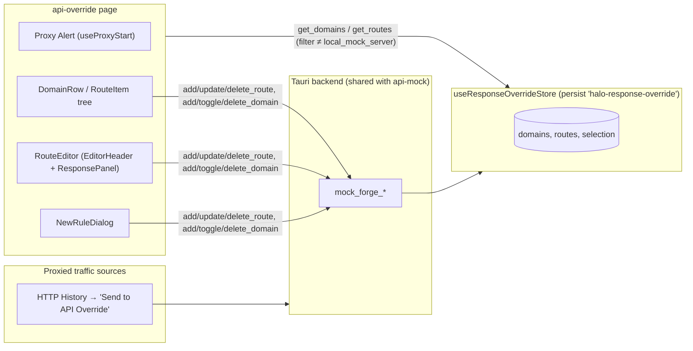

# API Override (`api-override`) — UI Deep Dive

> Source: `references/hexbuffer/src/pages/api-override/` (20 files, ~2,100 lines)
> Exported page component: `ApiOverridePage` (alias `ResponseOverridePage`, default export)

## 1. Overview & Purpose

API Override intercepts live proxied traffic and replaces responses for user-defined rules. Unlike API Mock (a local server on port 4000), this page operates **on proxy domains** — hosts captured via HTTP History's right-click **"Send to API Override"** action. The UI is a domain-grouped rule tree on the left and a response-body editor on the right. It shares the backend `mock_forge_*` command family with api-mock but filters to `domainId !== 'local_mock_server'`, and it reuses api-mock's `parseRouteParams` template utilities (cross-page import `../../../api-mock/lib/route-template`).

## 2. Annotated File Tree

```
api-override/
├── index.tsx                          (90)  Page shell + "Proxy is not running" warning Alert
├── types.ts                           (59)  MockDomain, MockRoute, RequestLog (source: 'mock_server'|'response_override'), sub-tab types
├── constants.ts                       (13)  HTTP_METHODS, DEFAULT_OVERRIDE_RESPONSE_BODY, HOW_TO_ADD_HOSTS_GUIDE
├── hooks/
│   └── use-response-override-page.ts (161)  Page controller: load, domain & route CRUD
└── components/
    ├── response-override-content.tsx   (22)  Pass-through → RulesPanel (props bridge)
    ├── rules-panel.tsx                  (3)  Re-export barrel → ./rules-pane/
    ├── new-rule-dialog.tsx            (163)  Create-rule dialog (Target Host select, full-URL parsing)
    ├── hooks/
    │   └── use-routes-panel.ts       (260)  useRoutesPanel (tree filter/expand) + useRouteEditor (body/reqBody/params, to-Repeater)
    ├── rules-pane/
    │   ├── index.tsx                 (126)  RulesPanel: toolbar + domain tree | editor split (aliases RoutesPanel, ApiRulesPanel)
    │   ├── types.ts                   (14)  RulesProps (10 props)
    │   ├── constants.ts                (8)  METHOD_COLORS (text-only map, no ALL)
    │   ├── rules-toolbar.tsx         (172)  Header, host-count badge, "How to add hosts" callout, search
    │   ├── domain-row.tsx            (235)  Collapsible host row: caret, SSL lock, count, enable Switch, delete
    │   ├── route-item.tsx             (83)  Rule leaf: method, path, enabled Switch
    │   └── empty-states.tsx          (143)  NoHostsEmpty / NoSearchResultsEmpty / NoRouteSelectedEmpty
    └── rule-editor/
        ├── index.tsx                 (138)  RouteEditor: composes EditorHeader + ResponsePanel (alias OverrideRuleEditor)
        ├── types.ts                   (11)  RouteEditorProps (7 props)
        ├── constants.ts               (13)  ALL_METHODS (with 'ALL'), METHOD_COLORS (+ALL purple)
        ├── editor-header.tsx         (215)  Match-summary display / inline method+path edit, Repeater/Clone/Delete
        └── response-panel.tsx        (191)  Status input, tag chips, Format JSON / Save Response, Monaco editor
```

## 3. Architecture & Dataflow



Load-on-mount (`useResponseOverridePage`): `mock_forge_get_domains` + `mock_forge_get_routes`, filtered to exclude `local_mock_server`. **No event listeners** on this page — no live log stream, unlike api-mock. The proxy prerequisite is handled by `useProxyStart` (`@/hooks/use-proxy-start`), which reads `proxyStatus` from `useAppStore` and calls its `startProxy()`.

## 4. State Management — `src/stores/api-override.ts`

| Field | Type | Default | Persisted |
| :-- | :-- | :-- | :-- |
| `activeSubTab` | `'hosts' \| 'rules' \| 'logs'` | `'hosts'` | ✅ (never rendered; hook returns hard-coded `'rules'`) |
| `domains` | `MockDomain[]` | `[]` | ❌ |
| `routes` | `MockRoute[]` | `[]` | ❌ |
| `logs` | `RequestLog[]` | `[]` | ❌ (no writer on this page) |
| `selectedDomainId` / `selectedRouteId` / `selectedLogId` | `string \| null` | `null` | ❌ |

Actions: `setActiveSubTab`, `setDomains`, `setRoutes`, `setLogs`, `setSelectedDomainId`, `setSelectedRouteId`, `setSelectedLogId`. Persist key **`halo-response-override`**, `partialize` keeps only `activeSubTab`. Alias type `ResponseOverrideSubTab`. Hook alias `useApiOverridePage`.

## 5. IPC Contracts

### Commands

| Command | Args | Returns | Called from |
| :-- | :-- | :-- | :-- |
| `mock_forge_get_domains` | — | `MockDomain[]` | page load (filtered ≠ `local_mock_server`) |
| `mock_forge_get_routes` | — | `MockRoute[]` | page load (same filter) |
| `mock_forge_add_domain` | `{ hostname, ssl }` (host stripped of scheme/path) | `MockDomain` | `addDomain` |
| `mock_forge_toggle_domain` | `{ id }` | `void` | `toggleDomain` (optimistic status flip after invoke) |
| `mock_forge_delete_domain` | `{ id }` | `void` | `deleteDomain` (also removes routes client-side) |
| `mock_forge_add_route` | `{ route }` | `MockRoute` | `addRoute` |
| `mock_forge_update_route` | `{ id, patch: MockRoute }` (full merged object) | `void` | `updateRoute` |
| `mock_forge_delete_route` | `{ id }` | `void` | `deleteRoute` |
| *(via `useAppStore.startProxy`)* proxy start command | — | — | "Start Proxy" button |

### Events

None. (Contrast with api-mock's `mock-forge-log` / `mock-server-status-changed`.)

## 6. UI Layout & Component Breakdown

```
┌─ ApiOverridePage (p-2) ─────────────────────────────────────────────────────────────┐
│ ⚠ Alert (warning/40): "Proxy is not running" — [Start Proxy] (hidden when connected) │
│ ┌─ border rounded-lg ──────────────────────────────────────────────────────────────┐ │
│ │ ┌ RulesPanel left (w-80 border-r) ────────┬─ RouteEditor (flex-1) ───────────────┐ │ │
│ │ │ TARGET HOSTS & RULES (n)  [+ New Rule]  │ ALL https://api.stripe.com/v1/… :id   │ │ │
│ │ │ ℹ How to add hosts: HTTP History →      │   [Repeater][Clone][🗑]                │ │ │
│ │ │   right-click → "Send to API Override"  │ RESPONSE BODY  Status[200] Tags{{id}} │ │ │
│ │ │ [🔍 Filter hosts and rules...]          │               [Format JSON][Save Resp]│ │ │
│ │ │ ▾ 🔒 api.stripe.com (3)        ⚙ [🗑]   │ ┌─ Monaco json (bg-code-bg, h-full) ─┐│ │ │
│ │ │    GET  /v1/charges/:id        ⚙       │ └────────────────────────────────────┘│ │ │
│ │ │ ▸ 🔓 api.github.com (0)                 │                                       │ │ │
│ │ └────────────────────────────────────────┴───────────────────────────────────────┘ │ │
│ └──────────────────────────────────────────────────────────────────────────────────┘ │
└─────────────────────────────────────────────────────────────────────────────────────┘
```

### Proxy Alert (`index.tsx`)
Rendered while `proxyStatus !== 'connected'`: `Alert` (warning theme: `border-warning/40 bg-warning/10 text-warning-foreground`) with `PlugsIcon`, title "Proxy is not running", description "Start the proxy to intercept and override API responses", and `AlertAction` → `Button variant="outline" size="xs"` (disabled while `isStarting || proxyStatus === 'starting'`). A source comment documents a real bug fixed here: `Alert` is CSS-grid (icon column 1 spanning both rows); an old `flex items-center` class was tailwind-merge-dropped against `display`, mis-aligning content — the layout no longer overrides `display`.

### `RulesPanel` (`rules-pane/index.tsx`)
Props = `RulesProps`: `domains, routes, selectedRouteId, onSelect, onAdd, onUpdate, onDelete` + optional `onToggleDomain, onDeleteDomain, onClone`. Left `w-80` tree; right editor with `key={selectedRoute.id}` remount on selection. Three empty states switch on `domains.length === 0` / `filteredDomains.length === 0` / no selection.

### `RulesToolbar` (`rules-toolbar.tsx`)
`Target Hosts & Rules` header + count `Badge` (`text-4xs`); `NewRouteDialog` trigger ("New Rule"); **guide callout**: `border-primary/20 bg-primary/5` rounded panel, `InfoIcon` primary-colored, text sourced from `HOW_TO_ADD_HOSTS_GUIDE` (inline JSX, not the constant's fields); search `Input` `h-7.5 pl-7.5` with `MagnifyingGlassIcon` overlay.

### `DomainRow` (`domain-row.tsx`)
Group-hover reveal pattern (`opacity-0 group-hover:opacity-100` on delete). Structure: full-width ghost `Button` (caret `CaretRightIcon` rotates 90° when open, `h-3 w-3 transition-transform`) + SSL lock (`LockSimpleIcon` green-600 for HTTPS / `LockSimpleOpenIcon` amber-600 for HTTP, tooltips) + mono hostname (`text-2xs font-bold`) + route count badge. Right side: enable/disable `Switch` (`scale-75`, `stopPropagation`, title "Disable host"/"Enable host") and delete ghost `Button` (`h-6 w-6`, hover `text-red-600 hover:bg-red-500/10`, title "Delete host and rules"). Expanded body: italic "No override rules yet for this host" or `RouteItem` list.

### `RouteItem` (`route-item.tsx`)
Indented leaf (`pl-6`): `text-3xs` method in `METHOD_COLORS`, truncated path (`text-2xs`), per-rule enable `Switch` (`scale-75`, `stopPropagation` → `onUpdate(id, { enabled })`). Disabled rules render `opacity-40`. Selected: `bg-muted/50`.

### `NewRuleDialog` (`new-rule-dialog.tsx`)
Same skeleton as api-mock's but with: **Target Host** `Select` (only when `!fixedDomainId && domains.length > 0`); **Method** select includes `'ALL'` (`METHOD_OPTIONS = ['ALL', ...HTTP_METHODS]`); **Path or Full URL** input accepting absolute URLs — `handleAdd` parses `http(s)://…` with `new URL`, matching an existing domain by hostname (case-insensitive) or falling back to `targetDomainId = host`; otherwise normalizes leading `/`. Final fallback `domainId: 'all-hosts'`. Button labels switch on `isLocalMock = fixedDomainId === 'local_mock_server'` ("New Endpoint"/"Create Endpoint" vs "New Rule"/"Create Override Rule") — this component is shared-capable but the mock page has its own copy. Aliased `NewRuleDialog`.

### `RouteEditor` (`rule-editor/index.tsx`) + `EditorHeader` + `ResponsePanel`
- `RouteEditor` resolves `matchedDomain` by `d.id === route.domainId || d.hostname === route.domainId` (host-as-id fallback) and `isFullUrl` check; `displayMatchSummary()` renders `proto://host + path` or the raw full URL.
- `handleSaveHeader` re-parses full URLs to re-target `domainId` (found-by-hostname only; no auto-create).
- **`EditorHeader`**: read mode shows method (colored), match summary (mono truncate), `:param` badges, pencil edit button, right actions Repeater/Clone/Delete (identical set to api-mock). Edit mode: method `Select` (`ALL_METHODS` incl. `ALL`, w-24) + path `Input` (Enter/Escape handling) + Save/Cancel.
- **`ResponsePanel`**: `Response Body` header, Status number input (`h-6.5 w-16`, NaN→200 on blur), `{{param}}` copy chips (`navigator.clipboard` + toast), `Format JSON` ghost button (`CodeIcon`) and `Save Response` button (`FloppyDiskIcon`), full-height Monaco `TextEditor` (`language="json"`, `height="100%"`, `bg-code-bg rounded-md border`). Unlike api-mock there is **no simulation/preview mode** and no `{{param}}` interpolation preview here — template tags are copy-only.
- Aliased `OverrideRuleEditor`.

### `useRoutesPanel` / `useRouteEditor` (`components/hooks/use-routes-panel.ts`)
- Tree state: `expandedDomains: Set<string>` seeded with all domains and auto-extended when new domains arrive (`useEffect`); `toggleDomain` flips membership. Search filters routes (path/method/hostname) then keeps domains that match or contain matching routes.
- Editor state: `body` + `reqBody` (synced from route on id/body change), `activeTab: 'config' | 'matcher' | 'response'` (**unused** by the current two-section editor — remnant), `saveBody`/`saveReqBody` (toasts "Override response body updated." / "Expected request payload saved."), `formatBody`/`formatReqBody` (JSON pretty-print with error toasts), `handleClone` (id stripped via destructuring), query-param CRUD (`handleAddParam/RemoveParam/Change/Toggle` — **no UI calls these currently**), and `handleSendToRepeater` (identical workspace/stash/endpoint bridge as api-mock's, plus URL-encoded enabled query params; opens/focuses `/repeater` window + `triggerNavBlink`), `handleCopyUrl`, `handleCopyCurl` (shell-escaped `-d`).

## 7. UI Libraries & Primitives Used

| Category | Items (actual imports) |
| :-- | :-- |
| UI kit | `Alert`, `AlertAction`, `AlertDescription`, `AlertTitle`, `Badge`, `Button`, `Dialog`, `DialogContent`, `DialogHeader`, `DialogTitle`, `DialogTrigger`, `Empty`, `EmptyHeader`, `EmptyMedia`, `EmptyTitle`, `Input`, `Label`, `ScrollArea`, `Select*`, `Switch`, `TextEditor`, `Textarea` |
| Icons (`@phosphor-icons/react`) | `PlugsIcon`, `PlusIcon`, `InfoIcon`, `MagnifyingGlassIcon`, `CaretRightIcon`, `LockSimpleIcon`, `LockSimpleOpenIcon`, `TrashIcon`, `ArrowSquareOutIcon`, `PencilSimpleIcon`, `CodeIcon`, `FloppyDiskIcon`, `GlobeIcon` |
| Editor | Kit `TextEditor` (Monaco): `value`, `onChange`, `language="json"`, `height="100%"`, `theme` |
| Cross-store | `useRepeaterStore`, `useCollectionsStore`, `useNavStore`, `useAppStore` (proxy status) |
| Misc | `sonner`, `zustand` + `useShallow`, `invoke` (`@tauri-apps/api/core`), `cn`, `useTheme` |

**Method colors** — two copies: `rules-pane/constants.ts` (6 methods) and `rule-editor/constants.ts` (7, adds `ALL: text-purple-600`). Both text-only with `font-bold` + dark variants — duplicated rather than shared with api-mock's `mock-server-pane/constants.ts`.

## 8. Keyboard Shortcuts & Interactions

- Header inline edit: **Enter** saves, **Escape** cancels.
- Switches (domain enable, rule enable) `stopPropagation` so toggling doesn't select/collapse.
- Domain collapse via caret row click; delete buttons appear on hover only.
- Tag chips copy `{{param}}` to clipboard. No global shortcuts.

## 9. Styling Details

Same frame as api-mock (`p-2`, `border rounded-lg bg-background`). Warning alert tokens: `border-warning/40 bg-warning-10`, description `text-warning-foreground/85`. Guide callout: `border-primary/20 bg-primary/5`. Tree host header: `bg-muted/60 hover:bg-muted/90 border-b`. Fonts mono for hostnames/paths/methods; meta text `text-2xs`/`text-3xs`/`text-4xs`. Kit props in play: `leading="tight"`, `textSize="xs"`, `mono`, `variant="quiet"`, `size="icon" | "icon-sm" | "xs" | "sm"`.

## 10. Integration Points

- **HTTP History**: the only way to create target hosts — right-click → "Send to API Override" (documented twice in UI: toolbar callout and `NoHostsEmpty`/`NoRouteSelectedEmpty` copy; constant `HOW_TO_ADD_HOSTS_GUIDE` holds the canonical string).
- **API Mock**: same `mock_forge_*` backend family, complementary filters (`!== 'local_mock_server'` vs `===`); imports `parseRouteParams` from `api-mock/lib/route-template`.
- **Repeater**: same `mock-api` workspace + stash + endpoint bridge as api-mock (with enabled query params serialized into the URL).
- **Proxy**: gate Alert via `useAppStore.proxyStatus`; overriding only works while the proxy runs.

## 11. Notable Findings

1. **Three sub-tabs exist in the store, none render.** `'hosts' | 'rules' | 'logs'` + `activeSubTab` persisted, but `useResponseOverridePage` returns hard-coded `activeSubTab: 'rules'` with a no-op setter; the `logs` array and `selectedLogId` have no writer/reader on this page.
2. **Dead editor capabilities.** `useRouteEditor` exposes `reqBody`/`saveReqBody`/`formatReqBody`, `activeTab` ('config'|'matcher'|'response'), and query-param CRUD — but the rendered editor is only EditorHeader + ResponsePanel; request matching/matcher UI is absent (`RequestMatcher` and `ChaosConfig` types exist but are only seeded empty).
3. **Duplicated method-color maps** in three places across api-mock/api-override (the api-mock side was consolidated with an explanatory comment; api-override still carries two).
4. **Domain id/hostname dual identity**: `matchedDomain` lookup accepts `d.hostname === route.domainId`, and `NewRuleDialog` can set `domainId` to a raw hostname string or `'all-hosts'` when no domain exists — a loose foreign key by design.
5. **Full-URL rules**: paths may be absolute URLs; the tree displays them verbatim via `displayMatchSummary()`.

## 12. Source Files Documented

`index.tsx` · `types.ts` · `constants.ts` · `hooks/use-response-override-page.ts` · `hooks/use-proxy-start.ts` (shared) · `components/response-override-content.tsx` · `components/rules-panel.tsx` · `components/new-rule-dialog.tsx` · `components/hooks/use-routes-panel.ts` · `components/rules-pane/{index,rules-toolbar,domain-row,route-item,empty-states}.tsx` · `components/rules-pane/{types,constants}.ts` · `components/rule-editor/{index,editor-header,response-panel}.tsx` · `components/rule-editor/{types,constants}.ts` · `src/stores/api-override.ts` (store)
