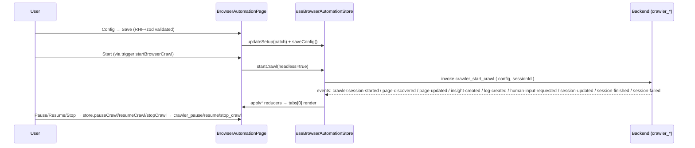

# Browser Automation (`browser`) — UI Deep Dive

> Source: `references/hexbuffer/src/pages/crawler/` (11 files, ~2,530 lines)
> Exported page component: `BrowserAutomationPage`

## 1. Overview & Purpose

The Browser Automation page drives **AI-assisted web crawling** through a managed, headless Chromium. The user configures a target (URL, depth/page limits, exclusions, timing, artifact capture, AI analysis) and starts a crawl; the backend streams live progress over `crawler:*` Tauri events. The UI is a single-session view with a CLI-style **Activity console** (modeled on the nuclei telemetry console) and an **AI Findings** panel (insights + "interesting pages", severity filtering, review workflow, save-to-Memory). Start/Pause/Resume/Stop controls and a status badge sit in a header that also hosts a debounced search across logs and findings.

## 2. Annotated File Tree

```
browser/
├── index.tsx                             (405)  Page shell: proxy+safety alerts, header (search, status badge, controls, Config), Activity|Findings tabs
├── types.ts                              (125)  CrawlSetupConfig, CrawlSession/Page, AIInsight, ActivityLog, HumanInputRequest, CrawlOverview
├── constants.ts                           (24)  DEFAULT_CRAWL_SETUP, CRAWL_VIEW_TABS ('activity'|'findings')
├── hooks/
│   └── use-page.ts                      (206)  useBrowserAutomationPage: event wiring (9 listeners), filters, interestingPages memo, alert state
├── lib/
│   └── crawl-data.ts                     (44)  deriveOverview, formatTime, downloadJson (blob anchor download)
└── components/
    ├── setup-screen.tsx                  (503)  CrawlSetupScreen: 3-section config Dialog (RHF+zod, ButtonGroup tabs)
    ├── crawl-console.tsx                 (334)  CrawlConsole: black terminal UI, type pills, autoscroll, filter
    ├── insight-panel.tsx                 (679)  AiInsightsPanel: severity filter, accordion cards, detail Dialog, Review/Memory
    └── hooks/
        ├── use-setup-screen.ts            (84)  RHF+zod form (setupFormSchema), reset-on-open
        ├── use-crawl-console.ts           (44)  filterQuery, autoScroll + scrollRef effect, visibleLogs
        └── use-ai-insights-panel.ts       (85)  severity sort/filter, detail item, openUrl, keyboard card activation
```

## 3. Architecture & Dataflow



- **Single-session view**: the store supports multiple tabs, but the page hook pins `activeTab = tabs[0]` (in-code comment: "Single-session view").
- **Event-driven state**: 9 `listen()` subscriptions in `use-page.ts`; `session-failed` synthesizes a log entry client-side (`log-${Date.now()}`). Listener registration failures are caught with a console warning (webview-less runtimes).
- **Trigger layer**: buttons call `@/triggers` exports (`startBrowserCrawl`, `toggleBrowserCrawl`, `stopBrowserCrawl`) which read the store via `getState()`; `toggleBrowserCrawl` dispatches pause vs resume by current status and throws if neither.
- **Derived overview**: `deriveOverview` computes `pagesVisited/urlsDiscovered/urlsQueued/currentDepth/errors/blockedPages/formsFound/durationSeconds` from the page list (currentDepth = max depth; duration from started/finished).

## 4. State Management — `src/stores/browser-automation.ts`

Per-tab shape (`BrowserAutomationTab`): `setup: CrawlSetupConfig`, `session: CrawlSession | null`, `pages: CrawlPage[]`, `insights: AIInsight[]`, `logs: ActivityLog[]`, `selectedPageId`, `expandedPageIds`, `humanInputRequest: HumanInputRequest | null`, `lastError`, `search`, `analyzingPageIds: Set<string>`.

Top-level: `tabs`, `activeTabId`, `nextTabNumber`. Key actions: `getActiveTab`, `overview(tabId)`, tab CRUD (`addAutomationTab`/`renameTab`/`closeTab`), `updateSetup`/`saveConfig`, `startCrawl(headless?)` / `pauseCrawl` / `resumeCrawl` / `stopCrawl`, `exportCrawl` / `exportInsights` / `exportLogs`, page selection (`selectPage`, `togglePageExpanded`, `markPageInteresting`), `toggleInsightReviewed`, `analyzePageWithAi`, `clearLogs`, the seven `apply*` event reducers, human-input actions (`submitHumanInput(action, fields)`, `clearHumanInputRequest`), and `loadPersistedSessions`.

**Persistence is manual, not zustand `persist`**: module constants `STORAGE_KEY = 'halo:crawl-setup-config'` and `DELETED_SESSIONS_STORAGE_KEY = 'halo:deleted-crawler-sessions'`; setup config and deleted-session tombstones are read/written through localStorage directly. (`DEFAULT_EXPANDED_PAGE_IDS = ['page-root', 'page-products', 'page-login']` is a demo-data leftover default.)

## 5. IPC Contracts

### Commands (via store + insight panel)

| Command | Args | Called from |
| :-- | :-- | :-- |
| `crawler_start_crawl` | `{ config: CrawlSetupConfig, sessionId }` | `startCrawl` (also re-invoked inside human-input 'continue' flow) |
| `crawler_pause_crawl` / `crawler_resume_crawl` / `crawler_stop_crawl` | `{ sessionId }` | `pauseCrawl`/`resumeCrawl`/`stopCrawl` (names built by `commandName()`) |
| `crawler_submit_human_input` | `{ ... }` | `submitHumanInput` (store — **no UI on this page renders the request**) |
| `crawler_stop_crawl` / `delete_crawler_session` | `{ sessionId }` | tab close / session cleanup (`invokeOptional` — errors swallowed) |
| `save_memory_entry` | `{ entry: { id:'', title, content, tags:[type, severity], sourceType:'insight', sourceRef, url, pinned:false } }` | `handleSaveInsightToMemory` (insight panel) |
| *(opener plugin)* `openUrl(url)` | — | `handleDetailOpenPage` (`@tauri-apps/plugin-opener`) |

All store commands except `start`/`submit` go through `invokeOptional`, which logs-and-continues on failure.

### Events

| Event | Payload | Handler |
| :-- | :-- | :-- |
| `crawler:session-started` | `CrawlSession` | `applySessionStarted` |
| `crawler:session-updated` | `Partial<CrawlSession>` | `applySessionUpdated` |
| `crawler:page-discovered` | `CrawlPage` | `applyPageDiscovered` |
| `crawler:page-updated` | `Partial<CrawlPage> & { id }` | `applyPageUpdated` |
| `crawler:insight-created` | `AIInsight` | `applyInsightCreated` |
| `crawler:log-created` | `ActivityLog` | `applyLogCreated` |
| `crawler:human-input-requested` | `HumanInputRequest` | `applyHumanInputRequested` (orphaned — see §11) |
| `crawler:session-finished` | `CrawlSession` | `applySessionUpdated({ ...payload, status: 'completed' })` |
| `crawler:session-failed` | `{ message?, sessionId? }` | status→`failed` + synthesized error log |

## 6. UI Layout & Component Breakdown

```
┌─ BrowserAutomationPage ─────────────────────────────────────────────────────────────┐
│ [⚠ Proxy is not running — Start Proxy]        (hidden when connected)               │
│ [⚠ Authorized targets only — Dismiss]         (persisted dismissal in useAppStore)  │
│ ┌─ border rounded-md (m-2 mt-0) ───────────────────────────────────────────────────┐ │
│ │ HEADER (border-b bg-muted/20): [🔍 Search logs and findings… (w-48→w-64) ✕]      │ │
│ │   [●running] [▶Start] / [⏸Pause][■Stop] / [↺Resume][■Stop]   [⚙ Config]         │ │
│ │ [Activity][Findings]  (TabsList, border-b px-3 py-1.5)                           │ │
│ │ ┌ ACTIVITY: CrawlConsole ──────────────────────────────────────────────────────┐ │ │
│ │ │ bg-black/95 text-zinc-300 · ⌨ "Crawl Console" [N events]  [🔍][Auto-scroll ⚙][🗑]│ │ │
│ │ │ $ crawl https://target.com · visited 12 · queued 34 · insights 5              │ │ │
│ │ │ [12:03:44] [NAVIGATION] Loaded page …   ↳ https://…                          │ │ │
│ │ └──────────────────────────────────────────────────────────────────────────────┘ │ │
│ │ └ FINDINGS: AiInsightsPanel ──────────────────────────────────────────────────┐ │ │
│ │ │ Insights / "Recon observations from crawl evidence."  [Severity ▾ h-7]      │ │ │
│ │ │ ▾ 😊 Interesting Pages (n)      amber cards, AI summary line-clamp-2         │ │ │
│ │ │ ▾ All Insights (n)              severity pill · AI/Heuristic badge · type    │ │ │
│ │ │    [✓ Review] [🔖 Memory] per card → detail Dialog (Open Page / Save to Memory)│ │ │
│ │ └──────────────────────────────────────────────────────────────────────────────┘ │ │
│ └──────────────────────────────────────────────────────────────────────────────────┘ │
└─────────────────────────────────────────────────────────────────────────────────────┘
```

### Header (`index.tsx`)
- Two warning `Alert`s share one wrapper (`gap-2 p-2`) — a comment explains the previous markup double-spaced via stacked `p-2`+`mb-2`. Same `Alert`-is-grid fix note as api-override. Safety alert text: "Authorized targets only … Unauthorized scanning may violate terms of service or applicable laws." Dismiss persists via `useAppStore.browserAutomationSafetyAlertDismissed`.
- Search: 200 ms debounce into `page.setSearch` (store), local echo state; clear button `aria-label="Clear search"`.
- Status `Badge mono variant="outline"` with `getCrawlStatusColor` (`bg-success` running, `bg-warning` paused, `bg-info` completed, `bg-destructive` failed, `bg-muted-foreground` idle/stopped) — semantic tokens by design (see `lib/status-colors.ts` header comment: categorical colors like severity intentionally keep explicit hues).
- Controls per status: `idle/completed/failed/stopped` → **Start** (`PlayIcon weight="fill"`); `running` → **Pause** (`PauseIcon` fill) + **Stop** (`SquareIcon` fill, destructive); `paused` → **Resume** (`ArrowCounterClockwiseIcon`) + **Stop**. Buttons use kit `leading="tight" size="md"`.
- `CrawlSetupScreen` trigger sits inline; disabled while `page.isRunning`.

### `CrawlSetupScreen` (`setup-screen.tsx`)
Config `Dialog` (`sm:max-w-[720px]`), `DialogTrigger render={<Button size="sm" variant="outline"/>}` with `GearSixIcon` + "Config". Three pseudo-tabs via `ButtonGroup` (active gets `text-green-600 dark:text-green-400` + `data-state`), body `max-h-[60vh] overflow-auto`:
- **General**: Target URL (mono input, URL+protocol validated), Exclude Paths (comma list; each must start with `/`).
- **Limits & Timing** (`grid grid-cols-2`): Max Depth (≤20), Max Pages (≤10,000), Delay ms (≤30,000), Timeout ms (1,000–120,000), Network Settle ms (step 500, ≤30,000 — "Extra wait after page load to capture API/XHR calls").
- **Artifacts & AI** (bordered panel): three `Checkbox` rows — AI analysis, Capture screenshots ("full-page PNG"), Capture rendered HTML ("post-JS DOM") — wired via RHF `setValue(..., { shouldDirty, shouldValidate })`.
Footer: Save disabled until `isValid`. Schema (`use-setup-screen.ts`): `z.coerce.number` for all numerics, `mode: 'onChange'`, form resets from live setup each open. `DEFAULT_CRAWL_SETUP`: depth 5, pages 500, delay 100, timeout 30000, settle 500, all captures + AI on, `headless: true`, excludes `/logout, /delete, /billing`.

### `CrawlConsole` (`crawl-console.tsx`)
Full black terminal: container `bg-black/95 text-zinc-300 font-mono text-xs`; toolbar `border-zinc-800 bg-zinc-950/80` with `TerminalWindowIcon` (emerald), event-count `Badge` (`border-zinc-700 text-zinc-400`), console-local filter `Input` (`h-6 pl-7 text-2xs bg-zinc-900 border-zinc-700` — independent of the header search, both applied), **Auto-scroll** `Switch` + label, clear `TrashIcon` ghost (`hover:text-red-400 hover:bg-zinc-800`).
Log line anatomy: `[HH:MM:SS]` zinc-500 → type pill (`text-3xs uppercase font-bold px-1 rounded`) from `LOG_TYPE_PILL_STYLES` (navigation sky, extraction cyan, ai purple, human amber, error `bg-rose-600 text-white`, session/policy/queue zinc) with level overrides (warning→human amber pill, error→error pill) → message in `LOG_LEVEL_TEXT_STYLES` (info zinc-300 / warning amber-400 / error rose-400) → optional `↳ url` block. Pseudo-command line: `$ crawl <targetUrl> · visited N · queued N [· errors N] · insights N`. Body is `select-text`; empty state "Waiting for crawl activity…". Not virtualized (plain map, `break-all`).

### `AiInsightsPanel` (`insight-panel.tsx`) — `memo`ized
- Sticky filter header: severity `Select` (`basis-32 h-7`, options = `SEVERITY_ORDER`: critical→info).
- Kit `Accordion multiple` with both sections open by default:
  - **Interesting Pages** (`ScanSmileyIcon`): amber cards (`border-amber-500/20 bg-amber-500/5 hover:bg-amber-500/10`), title/url/`aiSummary` (`line-clamp-2`) all through `HighlightedText` (search highlighting).
  - **All Insights**: cards with severity pill (`getSeverityColor`: info blue-600, low green-600, medium yellow-600, high orange-600, critical red-600 — deliberate categorical hues), `InsightSourceBadge` (solid purple `bg-purple-500 text-white` when AI; slate chip for `analysisSource: 'default'|'manual'` labeled by `analysisToolName` or "Heuristic"/"Manual"), mono type chip, optional "Reviewed" success badge (`CheckCircleIcon`, card dims `opacity-65`), title + `line-clamp-3` description, time + URL footer, and two ghost actions: **Review/Unreview** (`toggleInsightReviewed`) and **Memory** (`handleSaveInsightToMemory` → `save_memory_entry`, toast on success/failure). Both stop propagation so the card's onClick doesn't fire; `onKeyDown` also stopped.
- Cards are keyboard-activatable: `role="button" tabIndex={0}` + `handleCardKeyDown` (Enter/Space → detail).
- **Detail `Dialog`** (`sm:max-w-[720px] max-h-[85vh]`): highlighted title/URL; body `ScrollArea max-h-[56vh]` — for a page: "AI Summary" (`whitespace-pre-wrap`); for an insight: severity/source/type/time chip row + "Description". Footer: **Save to Memory** (insights) + **Open Page** (`openUrl`, disabled unless a page resolves — page lookup by `pageId`, then URL-normalized match stripping hash + trailing slash).

### `lib/crawl-data.ts`
`deriveOverview` (above), `formatTime` (locale HH:MM:SS), `downloadJson` (Blob → object URL → synthetic `<a download>` click → revoke).

## 7. UI Libraries & Primitives Used

| Category | Items (actual imports) |
| :-- | :-- |
| UI kit | `Accordion`, `AccordionContent`, `AccordionItem`, `AccordionTrigger`, `Alert`, `AlertAction`, `AlertDescription`, `AlertTitle`, `Badge`, `Button`, `ButtonGroup`, `Checkbox`, `Dialog*`, `Input`, `Label`, `ScrollArea`, `Select*`, `Switch`, `Tabs`, `TabsList`, `TabsTrigger` |
| Icons (`@phosphor-icons/react`) | `PlayIcon`, `SquareIcon`, `PauseIcon`, `ArrowCounterClockwiseIcon`, `MagnifyingGlassIcon`, `PlugsIcon`, `ShieldWarningIcon`, `XIcon`, `GearSixIcon`, `TerminalWindowIcon`, `TrashIcon`, `BookmarkSimpleIcon`, `CheckCircleIcon`, `ScanSmileyIcon` (several with `weight="fill"`) |
| Forms | `react-hook-form` + zodResolver + `zod` (`setupFormSchema`) |
| Highlighting | `HighlightedText` from `@/components/highlighted-text` (used for every user-visible string in findings) |
| Plugins | `@tauri-apps/plugin-opener` (`openUrl`) |
| State/IPC | `zustand` + `useShallow`, `invoke`, `listen` (`@tauri-apps/api/*`), `@/triggers` action layer |
| Shared | `useProxyStart` hook, `getCrawlStatusColor`/`getSeverityColor` (`@/lib/status-colors`), `cn`, `toErrorMessage`, `sonner` |

## 8. Keyboard Shortcuts & Interactions

- Insight/page cards: **Enter** / **Space** open the detail dialog (`handleCardKeyDown`); buttons inside stop key propagation.
- No global shortcuts; autoscroll is switch-driven; search inputs debounce 200 ms (header + console-local filter).

## 9. Styling Details

- The console is the page's signature surface: pure zinc palette on `bg-black/95` with emerald accents — deliberately different from the app's token-based chrome (like nuclei-run's telemetry console; the source comment says so).
- Status badge uses semantic tokens (`bg-success/warning/info/destructive`), while severity pills use fixed hues (`bg-red-600` etc.) — `lib/status-colors.ts` documents why: categorical distinctions must not collapse onto status tokens.
- Amber = "interesting"; purple = AI; slate = heuristic/manual source.

## 10. Integration Points

- **Proxy**: crawl traffic flows through the local proxy (`useProxyStart` gate + alert); intercepted requests appear in HTTP History.
- **Memory page**: insights can be persisted via `save_memory_entry` (`sourceType: 'insight'`, `sourceRef: insight.id`).
- **Desktop (AI assistant)**: the same store actions are exposed as tools (`triggers/browser/ai-tool.ts` wraps toggle/stop with a cancel callback) — the assistant can start/stop crawls on the user's behalf.
- **Artifacts**: screenshots and rendered HTML paths land on `CrawlPage` (`screenshotPath`/`renderedHtmlPath`) and are cleaned by `clearArtifactPaths`; `docs/04-intercept.md`'s `~/.halo/crawler-artifacts/` is the storage root.

## 11. Notable Findings

1. **Human-input flow is store-complete but UI-orphaned on this page**: `crawler:human-input-requested` populates `humanInputRequest` and the store implements `submitHumanInput` (continue / skip-branch / stop-crawl with field values → `crawler_submit_human_input`), yet no component under `pages/browser` renders the prompt.
2. **Manual localStorage persistence** (setup config + deleted-session tombstones) instead of zustand `persist` — the only page-family store doing this pattern here.
3. **Interesting-pages reference stability hack**: a `useRef` + per-field comparison memo keeps the array identity stable when contents are unchanged (marked "ponytail") — protects downstream memo/`memo()` from re-renders on every event.
4. **`session-failed` reconstructs UI state client-side** (status flip + synthesized log) rather than trusting the backend to have logged it.
5. **Search is two-layered**: the header search filters both datasets in the page hook (logs match `extra` via `JSON.stringify`), while the console has its own independent filter; both must pass (AND) for a log row to show.

## 12. Source Files Documented

`index.tsx` · `types.ts` · `constants.ts` · `hooks/use-page.ts` · `lib/crawl-data.ts` · `components/setup-screen.tsx` · `components/crawl-console.tsx` · `components/insight-panel.tsx` · `components/hooks/use-setup-screen.ts` · `components/hooks/use-crawl-console.ts` · `components/hooks/use-ai-insights-panel.ts` · `src/stores/browser-automation.ts` (interface + command sites) · `src/triggers/browser/{ui,ai-tool}.ts` · `src/lib/status-colors.ts` (crawl/severity sections)
