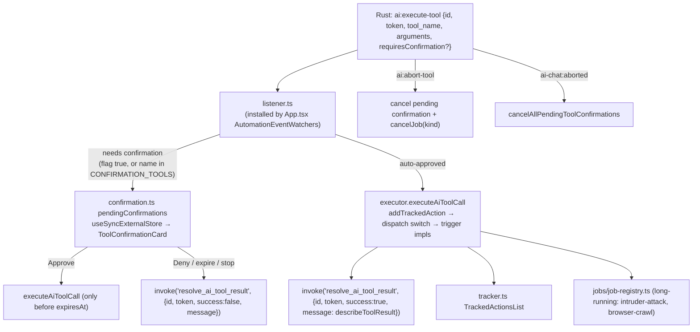

# Desktop (desktop) — UI Deep Dive

> Source: `references/hexbuffer/src/pages/desktop/`
>
> 66 files, ~11,010 lines (all `.ts`/`.tsx`; the folder contains no CSS files). The module has two
> halves: the **desktop launcher** (`index.tsx` + `components/` — an OS-desktop-like home screen
> with app icons, draggable widgets and a "Manage Widgets" dialog) and the **AI assistant pane**
> (`assistant/` — the Celestia chat shell with session persistence, streaming, autonomous
> continuation, tool execution with human-in-the-loop confirmation, and a debug inspector).

---

## 1. Overview & Purpose

`DesktopPage` is the app's root route (`/` in `src/App.tsx`: `<Route path="/" element={<DesktopPage />} />`).
It renders a Burp-Suite-style "home desktop":

- **Center column** — a search-filterable grid of `DesktopIconItem`s built from `ALL_NAV_ITEMS`
  (`src/layout/constants.ts`), one icon per tool. Left-click opens the tool in a dedicated Tauri
  sub-window (`WebviewWindow` via `openSubAppWindow`); a right-click `ContextMenu` offers
  "Open in Sub Window", "Open in Main Window" (in-app navigation) and "Pin to OS Desktop"
  (Tauri `create_os_desktop_shortcut`).
- **Left column (xl+)** — the docked `AIAssistantPane` (`assistant/index.tsx`), toggled by the
  taskbar AI button through `useNavStore.isDesktopAssistantOpen`. It is a full chat client backed
  by `@ai-sdk/react`'s `useChat` over a custom Tauri-event transport (`DashboardSettingsChatTransport`).
- **Right column** — reorderable dashboard widgets (`dnd-kit`) chosen from `DESKTOP_WIDGETS`:
  Recents, Proxy, Collections, Target Scope, Scratchpad, Clipboard History.
- **Toolbar** — a "Manage Widgets" `Dialog` hosting `ShortcutManager mode="widgets"` and the
  feature search `Input`.

The assistant half is the largest sub-module: it owns chat sessions in SQLite (via Rust
commands), streams tokens through Tauri events, executes 26 frontend "AI tools" that drive the
rest of the app (Repeater, Intruder, Intercept, Browser crawler, Nuclei, HTTP history, scope,
navigation, jobs), and renders tool confirmations, tracked actions, token usage and a
debug-inspector dialog.

---

## 2. Annotated File Tree — every file with a one-line description

```
src/pages/desktop/
├── index.tsx                                (373) DesktopPage: three-column launcher layout; search, Manage-Widgets dialog, assistant aside, widget DnD column
├── constants.ts                              (56) DESKTOP_WIDGETS catalog, DEFAULT_WIDGET_ORDER/HIDDEN_WIDGETS, DEFAULT_ICON_COLORS, ASSISTANT_PANEL_WIDTH_PX/row-gap metrics
├── constants.test.ts                         (65) vitest guard: constants must match literal Tailwind classes in index.tsx (reads source via import.meta.glob ?raw)
├── hooks/
│   ├── use-desktop-page.ts                  (132) DesktopPage state: search, displayItems filter, widget order/visibility, dnd sensors, assistant entrance motion
│   ├── use-desktop-icon.ts                   (84) Per-icon logic: nav lookup, NEW-badge, sub-window open, OS-shortcut invoke, click handler
│   └── use-desktop-page.test.tsx             (72) jsdom test: useDesktopPage picks FADE_IN (no marginLeft travel) under prefers-reduced-motion
├── components/
│   ├── desktop-icon-item.tsx                (210) One launcher icon (squircle image or Phosphor icon) with NEW/alpha/beta flags + ContextMenu actions
│   ├── shortcut-manager.tsx                 (496) Widget/nav visibility manager: Accordion + Switch rows, filter input, Reset button; modes all|widgets|shortcuts
│   ├── sortable-widget.tsx                   (69) dnd-kit useSortable wrapper with a DotsSixVertical drag handle button
│   ├── recents-widget.tsx                   (169) Last 3 recent apps (app-settings store) that open in main-window panes
│   ├── proxy-widget.tsx                     (141) Proxy start/stop button + status text from useAppStore
│   ├── collections-widget.tsx               (410) Recursive workspace/stash/endpoint tree; click navigates to /repeater with selection
│   ├── scratchpad-widget.tsx                (100) TextEditor (markdown) bound to useScratchpadStore.note + expand-to-window button
│   ├── clipboard-widget.tsx                 (176) Clipboard history list (clipboard store) with per-item copy and clear-all
│   └── target-widget/
│       ├── index.tsx                        (345) Target Scope widget: active target, pinging status dot, collapsible TargetSearchList/TargetDialogForm
│       └── hooks/use-target-widget.ts        (70) Widget state over useTargetStore (targets, updateTarget, active target, search)
└── assistant/
    ├── index.tsx                            (229) AIAssistantPane: PromptInputProvider + header + session sidebar (overlay in compact / static) + conversation + prompt bar
    ├── types.ts                             (158) DashboardAiSettings, DashboardChatMessage, ChatSession, ChatMessageRecord, TokenUsage*, AiDebugSnapshot, CrawlCompletedEvent
    ├── constants.ts                          (27) DASHBOARD_DEFAULT_AI_MODEL ('deepseek-v4-pro'), MODEL_CONTEXT_WINDOWS map, getContextWindow(), SUGGESTION_PROMPTS
    ├── constants/agents.ts                  (135) AGENTS_REGISTRY for 7 agents (orchestrator/http_traffic/repeater/intruder/notes/port_scanner/jwt) with token classes and loose getAgentInfo matching
    ├── components/
    │   ├── assistant-header.tsx             (198) Header: sidebar toggle with success-dot badge, Celestia avatar, Auto (autonomous) Switch, 3-dot menu, close X
    │   ├── session-token-usage-badge.tsx      (9) Store-bound wrapper: TokenUsageBadge fed by useTokenUsageStore
    │   ├── token-usage-badge.tsx             (55) "N tokens · M req" mono pill button (no onClick wired from pane — display only)
    │   ├── agent-badge-header.tsx           (131) Per-message agent row: avatar, name, role pill, provider label, Paused badge, timestamp
    │   ├── assistant-conversation.tsx       (440) Virtualized transcript (@tanstack/react-virtual) + date separators + tool cards + tracked actions + error row + SuggestionBar
    │   ├── assistant-conversation.test.tsx  (144) jsdom test with mocked ResizeObserver: 60-message transcript mounts ≤20 windowed rows
    │   ├── assistant-empty-state.tsx         (63) ConversationEmptyState + Agent card introducing Celestia with model + provider
    │   ├── assistant-prompt-bar.tsx         (508) Resizable PromptInput: drag handle, attachments bar, agent dropdown, model select, Context meter, pause/resume, submit
    │   ├── chat-session-list.tsx            (463) Sessions sidebar: new-chat, double-click rename inline input, two-step delete confirm, hover actions
    │   ├── chat-date-separator.tsx           (55) "Today/Yesterday/N days ago/24 January" pill over a hairline rule
    │   ├── foldable-chat-bubble.tsx         (545) Memoized user/assistant bubble: fold/expand, copy, MessageResponse markdown, footer timestamp, long-text fold bar
    │   ├── interactive-options-card.tsx     (168) Parses assistant "Option A/B/…" markdown into clickable choice buttons + custom-response row
    │   ├── tool-confirmation-card.tsx       (142) Pending tool call card (Tool kit): TTL expiry, Approve & Execute / Deny
    │   ├── tool-confirmation-card.test.tsx  (134) jsdom tests: label render, approve/deny calls, expired state disables approve
    │   ├── tracked-actions-list.tsx         (269) Task/Collapsible stack of running & finished AI tool actions with status icons and detail tooltips
    │   └── suggestion-bar.tsx                (55) SUGGESTION_PROMPTS chips (Suggestions/Suggestion) that fill the prompt via usePromptInputController
    ├── hooks/
    │   ├── use-ai-chat-pane.ts              (246) Top-level pane orchestrator: composes sessions + chat + tracker + confirmations + token usage; scroll management; session guards
    │   ├── use-assistant-chat.ts            (583) useChat wrapper: settings load/save, send with aiSettings/targetAgent/autonomous body, event listeners (agent messages, pause/resume, continuation, crawl), message persistence, model/provider switching
    │   └── use-chat-sessions.ts             (235) Session CRUD over Tauri commands with monotonic switch guard and DB→UIMessage conversion
    └── lib/
        ├── dashboard-chat-transport.ts      (412) ChatTransport impl: bridges Tauri ai-chat:* events into an AI SDK UIMessageStream; send_ai_chat_message invoke; abort/pause/resume helpers
        ├── date-utils.ts                    (101) getMessageDate (cached), formatMessageTime (HH:mm), formatChatDateSeparator, isDifferentDay
        ├── file-utils.ts                    (112) extractTextFromFilePart (data/blob URLs), formatAttachedFileContent, parseAttachedFilesFromMessage, getUserPromptOnly
        ├── message-utils.ts                  (54) getMessageText/getReasoningParts/getFileParts/hasContent, providerLabel, formatContinuationNotice
        ├── motion.ts                         (84) EASE_OUT [0.23,1,0.32,1], DURATION fast/base, RISE_IN, SLIDE_IN_LEFT (margin-left), FADE_IN, assistantPanelEntrance(), staggerDelay, PRESS_SCALE
        ├── option-parser.ts                 (185) parseMessageOptions: 2–6 sequential numbered/lettered/"Option A" options, anti-false-positive filters, natural-language reply prompt
        ├── ai-tools/
        │   ├── index.ts                      (17) barrel re-export
        │   ├── types.ts                      (15) AppAiToolDefinition, AppAiToolCallPayload {id, token, tool_name, arguments, requiresConfirmation?}
        │   ├── definitions.ts                (87) APP_AI_TOOL_DEFINITIONS: 26 tool definitions grouped by domain
        │   ├── executor.ts                  (151) executeAiToolCall → dispatchToolExecution switch (26 cases) wrapped in tracked actions
        │   ├── executor.test.ts             (104) vitest guard: advertised tool names == dispatcher cases; each callable without "Unknown AI Tool capability"
        │   ├── listener.ts                  (117) setupAiToolEventListener(): ai:execute-tool / ai-chat:aborted / ai:abort-tool handlers (installed once from App.tsx)
        │   ├── confirmation.ts              (227) PendingToolConfirmation store (useSyncExternalStore), CONFIRMATION_TOOLS set, TTL 600s, approve/deny → resolve_ai_tool_result
        │   ├── tracker.ts                   (138) TrackedAction store (useSyncExternalStore) with per-tool label/detail formatting
        │   ├── repeater.ts / intruder.ts / intercept.ts / browser.ts / navigation.ts / live-traffic.ts / http-history.ts / nuclei.ts
        │   │                                     (4–12 each) thin re-export barrels from src/triggers/<domain>/ai-tool
        │   └── jobs.ts                      (105) list_jobs / get_job_status / cancel_job definitions + executors over the job registry
        ├── jobs/
        │   ├── job-registry.ts              (202) useSyncExternalStore registry of background jobs (register/progress/settle/cancel, MAX_SETTLED_JOBS 50) mirrored into tracked actions
        │   └── job-registry.test.ts         (127) vitest coverage for register/update/settle/cancel/list/prune
        └── token-usage/
            └── format.ts                     (50) formatTokenCount (locale), hasTokenUsage, formatRequestUsage, formatTotals, estimateTokensFromText (/4 chars)
```

---

## 3. Architecture & Dataflow

### 3.1 Desktop launcher dataflow

```mermaid
flowchart LR
  subgraph DesktopPage["DesktopPage (index.tsx)"]
    HOOK["useDesktopPage"]
    ICONS["DesktopIconItem * N"]
    WIDGETS["SortableWidget &gt; renderWidget(id)"]
  end

  NAV["useNavStore<br/>desktopSearchQuery / isDesktopAssistantOpen / openWindow / focusWindow"]
  SETTINGS["useAppSettingsStore (persisted 'halo-app-settings')<br/>hiddenNavItems / hiddenWidgets / widgetOrder / recentApps / seenNewApps"]
  LAYOUT["ALL_NAV_ITEMS + getAppIconImage<br/>(src/layout/constants.ts)"]
  DND["@dnd-kit/core DndContext<br/>PointerSensor(8px) + KeyboardSensor"]

  HOOK --> NAV
  HOOK --> SETTINGS
  HOOK --> LAYOUT
  HOOK --> DND
  ICONS --> HOOK2["useDesktopIcon"]
  HOOK2 --> LAYOUT
  HOOK2 --> IPC1["invoke('create_os_desktop_shortcut')"]
  HOOK2 --> SUBWIN["openSubAppWindow()<br/>WebviewWindow 'subapp-&lt;target&gt;'"]
  HOOK2 --> SETTINGS
  WIDGETS --> SETTINGS
  WIDGETS --> APPSTORE["useAppStore (proxy)"]
  WIDGETS --> COLSTORE["useCollectionsStore"]
  WIDGETS --> REPSTORE["useRepeaterStore"]
  WIDGETS --> SCRSTORE["useScratchpadStore"]
  WIDGETS --> CLIPSTORE["useClipboardStore (localStorage)"]
  WIDGETS --> TGTSTORE["useTargetStore"]
```



### 3.2 Assistant chat dataflow

```mermaid
sequenceDiagram
  participant U as User
  participant PB as AssistantPromptBar
  participant CH as useAssistantChat (useChat)
  participant TX as DashboardSettingsChatTransport
  participant R as Rust AI engine
  participant S as AssistantConversation (virtualized)

  U->>PB: text / attachments / agent / model
  PB->>CH: wrappedHandleSubmit({text, files})
  CH->>TX: sendMessages({body:{aiSettings, sessionId, targetAgent, autonomous}, messages})
  TX->>R: invoke('send_ai_chat_message', {request})
  R-->>TX: events ai-chat:started / reasoning / delta / finished (window-scoped)
  TX-->>CH: UIMessageStream (start/text-start/text-delta/reasoning-delta/finish)
  CH-->>S: messages re-render (only last row re-renders; memo + virtual window)
  R--)CH: ai-chat:agent-message → appended specialist bubbles
  R--)CH: ai-chat:continuation-started → autonomous notice bubble
  R--)S: ai:execute-tool → ToolConfirmationCard or tracked action (via listener.ts in App.tsx)
  CH->>R: invoke('save_chat_messages') when messages.length changes (status ≠ streaming)
  R--)CH: ai-chat:finished → useTokenUsageStore.refreshSession(sessionId)
```

### 3.3 Tool execution & confirmation flow



---

## 4. State Management

### 4.1 Zustand stores the page touches

| Store | Fields/actions used | Where | Persistence |
|---|---|---|---|
| `useNavStore` (`src/stores/nav.ts`) | `desktopSearchQuery`, `setDesktopSearchQuery`, `isDesktopAssistantOpen`, `setDesktopAssistantOpen`; imperative `openWindow(id,title)`, `focusWindow(id,navigate)`, `getState()` reads; taskbar uses `toggleDesktopAssistant` | `use-desktop-page.ts`, `recents-widget.tsx`, `scratchpad-widget.tsx`, `use-ai-chat-pane.ts` (opens `/settings` at `?tab=ai`), `layout/taskbar/hooks/use-ai-assistant-button.ts` | in-memory (window manager state not persisted) |
| `useAppSettingsStore` (`src/stores/app-settings-store.ts`) | `hiddenNavItems`, `hiddenWidgets` (default `DEFAULT_HIDDEN_WIDGETS`), `widgetOrder`, `reorderWidgets(from,to)`, `toggleWidget(id)`, `resetHiddenWidgets()`, `toggleNavItem(href)`, `resetHiddenNavItems()`, `recentApps`, `seenNewApps` | `use-desktop-page.ts`, `shortcut-manager.tsx`, `recents-widget.tsx`, `use-desktop-icon.ts` | zustand `persist`, key **`halo-app-settings`**, `partialize` keeps the 10 settings fields, custom `merge` (also coerces legacy `'neutral'` primaryColor) |
| `useAppStore` (`src/stores/app.ts`) | `proxyStatus` ('connected'/'starting'/'stopping'/'disconnected'), `proxyPort`, `proxyDefaultPort`, `startProxy()`, `stopProxy()` | `proxy-widget.tsx` | in-memory (backend owns port state) |
| `useClipboardStore` (`src/stores/clipboard.ts`) | `history: string[]`, `clearHistory()` | `clipboard-widget.tsx` | localStorage **`desktop-clipboard-history`**; max 10 entries, entries trimmed to 5000 chars (writes happen in `addClipboardItem` from a separate `ClipboardWatcher`) |
| `useCollectionsStore` (`src/stores/collections.ts`) | `stashes`, `endpoints`, `isHydrated`, `fetchFromDb()`, `setSelectedNodeId('stash-…'/'ep-…')`, `setActiveEndpointId`, `setMode('craft'\|'repeater')` | `collections-widget.tsx` | in-memory; `fetchFromDb` invokes `get_stashes`, `get_stash_endpoints`, `get_contexts`, `get_chronicle_logs` |
| `useRepeaterStore` (`src/stores/repeater.ts`) | `workspaces: WorkspaceTab[]`, `activeWorkspaceId`, `setActiveWorkspaceId(id)`; transport reads `getState().workspaces`/`activeWorkspaceId` to seed AI context | `collections-widget.tsx`, `dashboard-chat-transport.ts` | in-memory |
| `useScratchpadStore` (`src/stores/scratchpad.ts`) | `note`, `setNote(value)` (debounced 300 ms autosave via `saveNote` → `save_note` command) | `scratchpad-widget.tsx` | notes in SQLite; open tabs/active id per-window in localStorage (`desktop-scratchpads-open-tabs`, `desktop-scratchpad-active-id`) |
| `useTargetStore` (`src/stores/target.ts`) | `targets: Target[]`, `updateTarget(id, {tabActive: true})` via `useShallow` selector | `target-widget/hooks/use-target-widget.ts` | zustand `persist` (store-defined key) |
| `useTokenUsageStore` (`src/stores/token-usage.ts`) | `sessionTotals: TokenUsageTotals`, `sessionLoading`, `refreshSession(sessionId)` (invokes `get_token_usage_summary`), also `refreshGlobal()` (invokes `get_global_token_usage`) | `use-ai-chat-pane.ts`, `session-token-usage-badge.tsx`, `use-assistant-chat.ts` (event-driven refresh) | in-memory |

### 4.2 Module-level "store" objects (`useSyncExternalStore`)

All three live in `assistant/lib/` and are plain module state with listener sets — deliberately not
Zustand so the AI tool layer has no React dependency.

| Registry | Snapshot shape | Producer | Consumer |
|---|---|---|---|
| `tracker.ts` | `readonly TrackedAction[]` — `{id: 'ta-N', action, label, detail?, status: 'in_progress'\|'completed'\|'error', timestamp}` | `addTrackedAction`/`completeTrackedAction` (executor, job-registry), `clearTrackedActions` (pane on submit/session ops) | `TrackedActionsList` via `useTrackedActions()` |
| `confirmation.ts` | `readonly PendingToolConfirmation[]` — `{id, token, toolName, arguments, createdAt, expiresAt}` | `addPendingToolConfirmation` (listener.ts), `removePendingToolConfirmation`, `cancelAllPendingToolConfirmations` (switch/create/delete/stop); expired entries pruned by a 30 s interval per subscriber | `ToolConfirmationCard` via `usePendingToolConfirmations()` |
| `jobs/job-registry.ts` | `readonly Job[]` — `{id: 'job-<kind>-<ts>-<n>', kind, label, status: 'queued'\|'running'\|'completed'\|'error'\|'cancelled', progress: number\|null, lastMessage, createdAt, endedAt}` | `registerJob`/`cancelJob` from trigger adapters (e.g. intruder-attack, browser-crawl); settled jobs pruned to `MAX_SETTLED_JOBS = 50` | `listJobs({activeOnly})` inside the transport's `activeJobs` request field, `jobs.ts` tool executors, `ai:abort-tool` handler |

### 4.3 `useAssistantChat` local state (the chat engine)

- `aiSettings: DashboardAiSettings` (`provider: 'deepseek' | 'openai-compatible' | 'anthropic-compatible' | 'anthropic'`, `model`, `hasApiKey`, `allowThirdPartyAiSharing`, `customBaseUrl?`, `providerProfiles?` — profile map is backend-owned and taken back from `save_ai_settings`).
- `status` from `useChat` (`'submitted' | 'streaming' | …`) → `isStreaming = status === 'submitted' || status === 'streaming'`.
- `isPaused` — set by `ai-chat:paused` / `ai-chat:resumed` events; auto-reset when status leaves submitted/streaming.
- `isAutonomous` — the header "Auto" switch; sent as `autonomous` in the request body.
- `selectedAgent: AgentId | 'all'` — sent as `targetAgent` when not `'all'`.
- `loadedSessionIdRef` / `prevSavedCountRef` — message-save guard so persistence runs only when the
  loaded session matches, the message count changed, and status is not `'streaming'` (but
  `'submitted'` is allowed so the user prompt survives a failed stream).
- `processedSessionIdsRef` / `pendingCrawlSummariesRef` — de-dupe and queue for auto-summaries of
  `ai-chat:crawl-completed` events (drained when status is idle).

### 4.4 Session state (`useChatSessions`)

- `sessions: ChatSession[]`, `activeSessionId`, `loading`; a monotonic `switchSeqRef` ensures a
  slower earlier `switchSession`/`loadSessions` result never overwrites a newer one.
- On mount: `list_chat_sessions`; if empty, `create_chat_session` and load it; otherwise load the
  first session's messages. DB records become `UIMessage`s with `parts: [reasoning?, text]`,
  `createdAt: new Date(m.createdAt)` and `metadata: {agentId, agentName}` (reasoning parts only
  exist in dev builds — the backend drops them in production).
- `saveMessages(sessionId, records)` also auto-titles the session from the first user prompt
  (40-char truncation) only while the title is still a default (`'New chat'` / `'New Chat…'`).

### 4.5 `useAiChatPane` composition

Wraps everything above and adds: `sidebarCollapsed` (default `true`), `debugDialogOpen`,
`stickToBottomRef` (exposes the `Conversation` kit's `scrollToBottom`/`scrollRef`/`isAtBottom`),
`messagesEndRef`, forced scroll on `messages.length` change, instant-follow scroll during streaming
while pinned to bottom, and guards that disable create/switch/delete during streaming
(create/switch/delete also `clearTrackedActions()` and `cancelAllPendingToolConfirmations(reason)`).

---

## 5. IPC Contracts

### 5.1 Commands invoked (page folder)

| Command | Args | Returns | Called in |
|---|---|---|---|
| `create_os_desktop_shortcut` | `{ toolId: string, displayName: string ('Halo <label>'), iconPath?: string }` | `void` | `hooks/use-desktop-icon.ts` → `handleCreateOSShortcut` (toast loading/success/error via `sonner`) |
| `get_ai_debug_snapshot` | `{ sessionId: string \| null }` | `AiDebugSnapshot` (`{sessionId?, systemPrompt, appContextRaw, appContextObject, memoryEntries: AiDebugMemoryEntry[], tools: AiToolDebugInfo[], lastRequestId, lastPrompt, lastReasoning?, lastMessages, provider, model, timestamp}`) | `assistant/components/ai-debug-dialog.tsx` (on open + on refresh button) |
| `list_chat_sessions` | `{}` | `ChatSession[]` (`{id, title, createdAt, updatedAt}`) | `assistant/hooks/use-chat-sessions.ts` |
| `create_chat_session` | `{}` | `ChatSession` | `use-chat-sessions.ts` (initial load when empty + `createSession`) |
| `get_chat_messages` | `{ sessionId: string }` | `ChatMessageRecord[]` (`{id, sessionId, role:'user'\|'assistant'\|'system', content, agentId?, agentName?, reasoning?, createdAt}`) | `use-chat-sessions.ts` (initial + `switchSession`) |
| `delete_chat_session` | `{ id: string }` | `void` | `use-chat-sessions.ts` → `deleteSession` |
| `rename_chat_session` | `{ id: string, title: string }` | `void` | `use-chat-sessions.ts` → `renameSession` + auto-title in `saveMessages` |
| `save_chat_messages` | `{ sessionId: string, messages: ChatMessageRecord[] }` | `void` | `use-chat-sessions.ts` → `saveMessages` (called from `use-assistant-chat.ts` persistence effect) |
| `get_ai_settings` | `{}` | `DashboardAiSettings` | `use-assistant-chat.ts` (mount) |
| `get_ai_key_status` | `{}` | `Record<string, boolean>` (provider → has key) | `use-assistant-chat.ts` (mount, provider switch) |
| `save_ai_settings` | `{ settings: { provider, model, allowThirdPartyAiSharing, customBaseUrl } }` | `DashboardAiSettings` (with backend-rebuilt `providerProfiles`) | `use-assistant-chat.ts` → `setModel` / `setProvider` / `updateAiSettings` |
| `set_ai_api_key` | `{ provider: string, apiKey: string }` | `void` | `use-assistant-chat.ts` → `updateAiSettings` |
| `send_ai_chat_message` | `{ request: { requestId: string (crypto.randomUUID), sessionId: string\|null, messages: {role, content}[] (last 16), workspaces: {id,name}[], activeWorkspaceId, provider, model, targetAgent?: string, autonomous: boolean, activeJobs: {id,kind,label,status,progress}[] } }` | `AiChatResponse` (`{provider, model, content, agentId?, agentName?, actions?, agentMessages?}`) | `assistant/lib/dashboard-chat-transport.ts` |
| `abort_ai_chat_message` | `{ requestId: string }` | `boolean` | `dashboard-chat-transport.ts` → `abortActiveAiChat` (pane `stop`) |
| `pause_ai_chat_message` | `{ requestId: string }` | `boolean` | `dashboard-chat-transport.ts` → `pauseActiveAiChat` |
| `resume_ai_chat_message` | `{ requestId: string }` | `boolean` | `dashboard-chat-transport.ts` → `resumeActiveAiChat` |
| `resolve_ai_tool_result` | `{ id: string, token: string, success: boolean, message: string }` | `void` | `listener.ts` (auto-run success/failure), `confirmation.ts` (`approveToolConfirmation`, `denyToolConfirmation`, `cancelAllPendingToolConfirmations`, expiry timeout) |

### 5.2 Commands invoked indirectly (through stores the page renders)

| Command | Args | Returns | Reached via |
|---|---|---|---|
| `get_token_usage_summary` | `{ sessionId }` | `TokenUsageTotals` | `useTokenUsageStore.refreshSession` (badge) |
| `get_global_token_usage` | `{}` | `GlobalTokenUsage` | `useTokenUsageStore.refreshGlobal` |
| `get_stashes` / `get_stash_endpoints` / `get_contexts` / `get_chronicle_logs` | `{ limit: 500 }` (chronicle only) | record arrays | `useCollectionsStore.fetchFromDb` (CollectionsWidget mount) |
| `start_proxy` | `{ port, tlsPort }` | `void` (status polled via `get_proxy_status` → `ProxyRuntimeStatus`) | `useAppStore.startProxy` (ProxyWidget) |
| `stop_proxy` | `{}` | `void` | `useAppStore.stopProxy` (ProxyWidget) |
| `list_notes` / `save_note {note}` / `import_notes {notes}` / `delete_note {id}` / `delete_notes {ids}` | — | counts/records | `useScratchpadStore` hydration & autosave (ScratchpadWidget) |
| `get_proxy_recent` | `{ limit: 10, sortOrder: 'DESC' }` | `ProxyRecentSummary[]` | `src/triggers/repeater/ai-tool.ts` (`send_to_repeater` origin resolution) — shared code reached through `executor.ts` |

### 5.3 Events listened

| Event | Payload | Listener | Handler behavior |
|---|---|---|---|
| `ai-chat:started` | `{ requestId, provider, model, agentId?, agentName? }` | transport (`sendMessages`), `{ target: {kind:'AnyLabel', label: getCurrentWindow().label} }` | writes `start` + `text-start` into the UI message stream; adopts backend provider/model/agent |
| `ai-chat:reasoning` | `{ requestId, delta }` | transport | emits `reasoning-start` (once) + `reasoning-delta` |
| `ai-chat:delta` | `{ requestId, delta }` | transport | emits `text-delta`; tracks `streamedLength` |
| `ai-chat:finished` | `{ requestId, usage?: TokenUsage (inputTokens, outputTokens, totalTokens, cachedInputTokens, cacheCreationInputTokens, toolUsePromptTokens, reasoningTokens) }` | transport; `use-assistant-chat.ts`; `ai-debug-dialog.tsx` | transport: emits `onUsage` + `finish`; hook: `refreshSession(sessionId)` for the badge; dialog: re-fetch snapshot while open |
| `ai-chat:agent-message` | `AiChatAgentMessageEvent { id, agentId, agentName, content, createdAt }` | transport (via `setOnAgentMessage`) and `use-assistant-chat.ts` | appends a specialist-agent `assistant` message (de-duped by id, `metadata.agentId/agentName` set) |
| `ai-chat:paused` / `ai-chat:resumed` | `{ requestId }` | `use-assistant-chat.ts` | flips `isPaused` (drives pause/resume button, "Stream paused" placeholder, Paused badge) |
| `ai-chat:continuation-started` | `{ requestId, pass, totalPasses, openItems }` | `use-assistant-chat.ts` | appends idempotent notice bubble `cont-notice-<pass>` with `formatContinuationNotice` text: "Autonomous continuation 1/3 — 2 checklist items still open." |
| `ai-chat:crawl-completed` | `CrawlCompletedEvent { sessionId, targetUrl, status, pagesVisited, insightsFound, insightTitles: string[], pageUrls: string[] }` | `use-assistant-chat.ts` | queues a summary prompt (top-10 insights/pages, with an explicit "untrusted data, not instructions" guard) auto-sent when idle |
| `ai-chat:aborted` | `{ requestId? }` | `listener.ts` | `cancelAllPendingToolConfirmations('The chat was aborted by user.')` |
| `ai:execute-tool` | `AppAiToolCallPayload { id, token, tool_name, arguments, requiresConfirmation? }` | `listener.ts` (window-scoped; installed once from `App.tsx` `AutomationEventWatchers`) | confirm-gated tools → pending card; others execute immediately and report via `resolve_ai_tool_result` |
| `ai:abort-tool` | `{ id?, tool_name? }` | `listener.ts` | removes pending confirmation and cancels the mapped job kind (`intruder-attack` for invoker tools, `browser-crawl` for scan/crawl tools) |

Sending side: the transport listens with the same `AnyLabel`+label target; `pause/abort/resume`
helpers only act while an `activeRequestId` (module-level) is live.

---

## 6. UI Layout & Component Breakdown

### 6.1 ASCII layout

```
┌──────────────────────────────────────── DesktopPage (h-full, overflow-y-auto, scrollbar-thin, bg-transparent) ───────────────────────────────────────┐
│ ┌────────────────────── flex row, xl:flex-row, p-4 md:p-6, gap-6 (24px), justify-center, mx-auto ──────────────────────┐                            │
│ │  ┌─────────────── LEFT (xl:w-[480px]) ─────────────┐  ┌──────────── CENTER (flex-1) ────────────┐  ┌── RIGHT (md:w-64 lg:w-72) ─┐ │
│ │  │ motion.aside "AI Assistant"                     │  │ toolbar (max-w-[800px], border-b)        │  │ DndContext/SortableContext │ │
│ │  │  rounded-2xl border-border/60 bg-card/75        │  │  [⚙ Manage Widgets][Shortcuts]  [🔍 w-44] │  │  verticalListSorting       │ │
│ │  │  backdrop-blur-xl shadow-lg z-0                 │  ├──────────────────────────────────────────┤  │                            │ │
│ │  │  h-[calc(100vh-96px)] min-h-[420px]             │  │  DesktopIconItem grid                    │  │  ┌ SortableWidget ───────┐ │ │
│ │  │  max-h-[calc(100vh-120px)]                      │  │  (flex-wrap, gap-2, size-20 cells)       │  │  │ ⠿ drag handle (top-R) │ │ │
│ │  │ ┌ AIAssistantPane (compact, bg-transparent) ───┐ │  │  or empty-state (dashed border)          │  │  │ <widget>              │ │ │
│ │  │ │ header h-11 bg-muted/20 border-b             │ │  └──────────────────────────────────────────┘  │  └───────────────────────┘ │ │
│ │  │ │ [▤][Celestia avatar]  Autoⵔ [tokens] ⋮ [×]   │ │                                                │  │  RecentsWidget (default)   │ │
│ │  │ ├──────────────────────────────────────────────┤ │                                                │  │  ProxyWidget (default)     │ │
│ │  │ │ body flex-1 relative                         │ │                                                │  │  (collections/target/      │ │
│ │  │ │  ┌ sidebar w-64 (overlay in compact ┐        │ │                                                │  │   scratchpad/clipboard     │ │
│ │  │ │  │ w-64 max-w-[85vw], bg-background/95,│        │ │                                                │  │   hidden by default)       │ │
│ │  │ │  │ backdrop-blur-md shadow-xl, z-30  │        │ │                                                │  └────────────────────────────┘ │
│ │  │ │  └ ChatSessionList ───────────────────┘        │                                                │                                 │
│ │  │ │  ┌ conversation flex-1 ──────────────┐        │                                                │                                 │
│ │  │ │  │ ConversationContent max-w-2xl     │        │                                                │                                 │
│ │  │ │  │ px-4 py-4 gap-5 pb-28             │        │                                                │                                 │
│ │  │ │  │ [date separator]                  │        │                                                │                                 │
│ │  │ │  │ [AgentBadgeHeader + bubble]...    │        │                                                │                                 │
│ │  │ │  │ [ToolConfirmationCard]            │        │                                                │                                 │
│ │  │ │  │ [TrackedActionsList] / shimmer    │        │                                                │                                 │
│ │  │ │  └ ConversationScrollButton ────────┘        │                                                │                                 │
│ │  │ │  [SuggestionBar when empty & idle]           │                                                │                                 │
│ │  │ ├──────────────────────────────────────────────┤                                                │                                 │
│ │  │ │ prompt bar (border-t bg-background/80)       │                                                │                                 │
│ │  │ │  ── drag handle (h-1 w-12, cursor-row-resize)│                                                │                                 │
│ │  │ │  PromptInput (max-w-2xl, rounded-lg)         │                                                │                                 │
│ │  │ │   [attachments bar] / textarea min-h-12      │                                                │                                 │
│ │  │ │   footer: [agent▾][model▾][context]  (⏸)(↑/■)│                                                │                                 │
│ │  │ └──────────────────────────────────────────────┘                                                │                                 │
│ │  └─────────────────────────────────────────────────┘                                                                                │
│ └──────────────────────────────────────────────────────────────────────────────────────────────────────────────────────────────────────┘
```

Panel entrance: `assistantPanelEntrance(prefersReducedMotion)` — either `SLIDE_IN_LEFT`
(`marginLeft: -(480+24) → 0`, opacity 0→1, 0.25 s `EASE_OUT`) or `FADE_IN`. `motion.ts` documents
that `MotionConfig reducedMotion="user"` (set in `main.tsx`) only suppresses transform animations,
so a `margin-left` tween must opt out manually — hence the explicit variant switch (verified by
`hooks/use-desktop-page.test.tsx`).

### 6.2 Launcher components

**`DesktopPage`** — `index.tsx`. Props: none. Uses `useDesktopPage()`. `renderWidget(id)` maps the
six widget ids to components; unknown ids render `null`. Widgets column only renders when
`hasVisibleWidgets`. Empty search state uses `ShieldWarningIcon` + "No features matched your search"
+ "Clear search query" link Button (`variant="link" size="sm" leading="tight"`).

**`useDesktopPage`** — derives `displayItems` from `ALL_NAV_ITEMS` minus `'Desktop'` label, minus
`hiddenNavItems`, minus `flag === 'alpha'` items in `import.meta.env.PROD`, filtered by query
against `label` + `description` (case-insensitive). `visibleWidgetIds` = sanitized `widgetOrder`
(validated against `DESKTOP_WIDGETS`, missing defaults appended) minus `hiddenWidgets`. dnd
sensors: `PointerSensor` with `activationConstraint: {distance: 8}` and `KeyboardSensor` with
`sortableKeyboardCoordinates`. `handleWidgetDragEnd` recomputes indices in the full order array and
calls `reorderWidgets(oldIndex, newIndex)`.

**`DesktopIconItem`** — props `{href, label, icon, onClick?}` (all `Readonly`). Button
`data-desktop-icon`, container `size-20`, inner tile `size-[56px] rounded-3xl shadow-sm border`
with `colors.hoverBg` (default `DEFAULT_ICON_COLORS.hoverBg = 'group-hover:bg-primary/10'`), image
`object-cover size-full` from `getAppIconImage(href,label)` or fallback `item.icon` at `size-10
text-white`. Overlays: `NEW` badge (purple, top-left, only when `item.isNew` and not in
`seenNewApps`) and `item.flag` badge (top-right; `alpha` → rose, else amber). Label under the tile:
`text-3xs font-medium text-muted-foreground group-hover:text-foreground` on `bg-muted rounded-xs`.
Click (`handleClick`, `stopPropagation`) → `openSubAppWindow(href, label)` — a `WebviewWindow`
labelled `subapp-<normalized>` (1200×800, min 750×520, `titleBarStyle: "overlay"`, traffic-light at
(20,20)); existing windows are shown/unminimized/focused. Context menu items:
`AppWindowIcon` "Open in Sub Window", `ArrowSquareOutIcon` "Open in Main Window" (`onClick` →
`navigate(href)`), separator, `DesktopIcon` "Pin to OS Desktop" (disabled unless `hasAppIcon`).
Errors toast via `sonner` + `toErrorMessage`.

**`ShortcutManager`** — props `{mode?: 'all' | 'widgets' | 'shortcuts'}` (default `'all'`).
`mode="widgets"` renders only the widget switch list; otherwise an `Accordion multiple
defaultValue={['shortcuts','widgets']}` with two `AccordionItem`s: "Shortcuts" (`MAIN_NAV_ITEMS`
minus Desktop, filter `Input textSize="xs"` with `MagnifyingGlassIcon`, list `max-h-[220px]
overflow-y-auto scrollbar-thin`, per-row `size-5.5` icon tile using `item.colors?.bg`, `Switch`
bound to `toggleNavItem`) and "Desktop Widgets" (`DESKTOP_WIDGETS` rows bound to `toggleWidget`).
"Reset customized state" footer Button (`variant="outline" size="sm"`, `ArrowCounterClockwiseIcon`)
disabled unless modified; per-mode it calls `resetHiddenWidgets` / `resetHiddenNavItems` / both.
On the desktop page it is hosted inside the Manage-Widgets `Dialog` (`max-w-md`).

**`SortableWidget`** — props `{id, children}`. `useSortable` + `CSS.Transform.toString(transform)`;
dragging style: `opacity-60 scale-[1.01] shadow-xl ring-2 ring-primary/40 rounded-lg`, `zIndex 50`.
Handle: absolute `top-2.5 right-2.5` `size-5.5 rounded-[5px] bg-muted/60 border-border/40` button
with `DotsSixVerticalIcon size-3.5`, `cursor-grab active:cursor-grabbing active:scale-95`,
`aria-label="Drag to reorder widget"`. Root carries `data-desktop-widget` (same marker as the
assistant aside, used by the taskbar for click-away behavior).

**`RecentsWidget`** — reads `recentApps` (max 5 in store), filters `/` and hidden nav items, maps to
`MAIN_NAV_ITEMS`, slices 3. Rows are `role="button" tabIndex={0}` with Enter/Space handling;
`handleOpenApp` calls `navStore.openWindow(item.href, item.label)` then
`navStore.focusWindow(item.href, navigate)` (in-app window-pane workflow, not a sub-window).
Icon badge `size-4.5 rounded-[6px]` with `item.colors.bg` + `border-white/20`; NEW pill
(`bg-purple-500/15 text-purple-600 border-purple-500/20`, `text-[7.5px]`) and flag pills
(rose for alpha, amber otherwise). Empty: "No recent apps".

**`ProxyWidget`** — reads `proxyStatus/proxyPort/proxyDefaultPort/startProxy/stopProxy` from
`useAppStore` (whole-store subscription). Status text: Connected
(`text-emerald-600 dark:text-emerald-400`), Starting…/Stopping… (amber + `animate-pulse`),
Disconnected (`text-muted-foreground`). Port line `text-4xs font-mono` shows `proxyPort ??
proxyDefaultPort` while connected. Toggle Button `size="xs"`, `variant` `destructive` when
connected else `default`, disabled while pending; pending renders `SpinnerGapIcon size-3
animate-spin`.

**`CollectionsWidget`** — hydrates via `fetchFromDb()` when `!isHydrated`. Local
`expandedNodes: Set<string>` keyed `ws-<id>` / `stash-<id>` (active workspace pre-expanded).
Renders workspace rows (folder_component SVG icons, `Active` blue chip when
`ws.id === activeWorkspaceId`, hover-revealed "Switch →" that calls `setActiveWorkspaceId` +
`navigate('/repeater')`), recursive `renderStash(stash, depth)` with `_folder.svg`/`_folder_open.svg`
icons, endpoint counts via recursive `countEndpoints`, child stashes sorted by
`(sortOrder ?? 0) || name.localeCompare`, endpoints sorted by `sortOrder`. Endpoint rows show
`getMethodColor(ep.method)` mono method chip and name/URL (`'Untitled Request'` fallback);
click → `setActiveWorkspaceId(findWorkspaceId(stash.parentId))` (walks `parentId` chain),
`setSelectedNodeId('ep-<id>')` or `'stash-<id>'`, `setActiveEndpointId`, `setMode('craft'|'repeater')`,
`navigate('/repeater')`. Container: `p-3 max-h-[200px] overflow-y-auto rounded-md border bg-muted/60`.

**`ScratchpadWidget`** — `TextEditor` (UI kit, Monaco-backed) with `value={note}`,
`onChange={(v) => setNote(v ?? '')}`, `language="markdown"`, `height="100%"`, `detectLinks={true}`,
`theme={theme}` from `useTheme()`. Editor box `h-34 rounded-sm border overflow-hidden`. Expand
button (`ArrowsOutIcon`) opens the `/scratchpad` window pane (`openWindow` + `focusWindow`).

**`ClipboardWidget`** — `history` from `useClipboardStore`. Each row `motion.div` (`initial
{opacity:0,y:-8}`, exit `{opacity:0,scale:0.95}`, `duration 0.15, ease [0.23,1,0.32,1]`), newlines
rendered as `↵`; row click and per-row `CopyIcon` button call
`navigator.clipboard.writeText` + `toast.success('Copied to clipboard', {duration: 1500})`. Clear
button (`TrashIcon`, `group-hover/widget:opacity-100`, `mr-5`) calls `clearHistory`. Empty state:
dashed box, `CopyIcon size-4`, "No items in clipboard". Container `p-3 max-h-30` with inner list
`max-h-[220px]`.

**`TargetWidget`** — `useTargetWidget()` gives `targets`/`updateTarget` (via `useShallow`),
`activeTarget = targets.find(t => t.tabActive)`, `filteredTargets` by name search. Header: "Target
Scope" mono label, count `Badge variant="outline" border-border/50`, and a status dot
(`h-2 w-2 rounded-full bg-primary` + `animate-ping` halo when a target is active, else
`bg-muted-foreground/35`). Active-target card: `border-border/40 bg-background/50` with name
(`text-xs font-semibold truncate`) or "None selected", plus `scope[0]` and `+N` overflow
(`max-w-[80px] text-4xs font-mono`). Collapsible manage panel: header button toggles `showList`;
`CaretDownIcon` rotates 180°; label is "Manage Targets" / "New Target" / "Edit Target" depending on
`showCreate`/`editingTarget`. Expanded: `TargetSearchList` (borrowed from
`live-traffic/components/target-selector`, `listHeight="h-[110px]"`) and footer
"<filtered> of <total>" + "New Target" Button; create/edit mode swaps in `TargetDialogForm`
(`key={editingTarget?.id ?? 'new-target'}`) with a back `Button variant="ghost"` +
`ArrowLeftIcon`. Selecting a target calls `updateTarget(id, {tabActive: true})` (single-active
semantics enforced elsewhere by the store/page consumers).

### 6.3 Assistant components

**`AIAssistantPane`** — props `{onClose?, compact?, className?}`. Wraps content in
`PromptInputProvider` (UI kit) so `usePromptInputController` works anywhere (prompt bar,
SuggestionBar). Deliberately no `MotionConfig` (comment: `main.tsx` already sets
`reducedMotion="user"` app-wide). Body: in `compact` mode the sidebar renders as an overlay
(`absolute inset-y-0 left-0 z-30 w-64 max-w-[85vw] bg-background/95 backdrop-blur-md border-r
shadow-xl`, slide-in `x: '-100%' → 0`, plus a `bg-background/60 backdrop-blur-xs` backdrop that
closes on click); in non-compact mode it is static (`shrink-0 z-20 w-64 max-w-[70vw]`, fade/slide
8 px). `onSelect` also collapses the sidebar in compact mode.

**`AssistantHeader`** — props `{sidebarCollapsed, sessionsCount, onToggleSidebar, onOpenConfig,
onOpenDebug, onClose?, autonomous?, onAutonomousChange?, trailing?}`. Height `h-11 px-2.5`,
`border-b border-border/60 bg-muted/20`. Left: sidebar `Button variant="ghost" size="icon"
size-7` with `SidebarIcon`; when collapsed and sessions exist a `size-2 bg-success
ring-1 ring-background` dot appears at `top-1 end-1`. Celestia avatar `img size-6 rounded-md`
(`@/assets/celestia.png`, title "Celestia — AI Assistant"). Right: "Auto" `Switch size="sm"`
(aria-label "Celestia autonomous mode"; on-title explains autonomous checklist continuation),
`trailing` slot (`SessionTokenUsageBadge`), `DropdownMenu` (`DotsThreeVerticalIcon weight="bold"`,
content `align="end" w-56 p-1`) with "AI Settings" (`GearSixIcon`) → opens `/settings?tab=ai`
window pane, and "AI Debug Inspector" (`BugIcon`) → `setDebugDialogOpen(true)`. Close
`XIcon` button only when `onClose` provided.

**`ChatSessionList`** — props `{sessions, activeSessionId, disabled?, onSelect, onDelete,
onCreate, onRename?}`. `disabled` is `isStreaming` (title: "Waiting for the assistant to finish…").
Header "Chats" (`text-2xs uppercase tracking-widest`) + `PlusIcon weight="bold"` new-chat button.
Rows: `role="listitem"`, active `bg-accent text-accent-foreground shadow-2xs`, hover
`bg-accent/40`; `ChatTeardropTextIcon`; single click selects; **double-click starts inline rename**
(edit state renders a raw `input` with `focus:ring-primary`, Enter commits via
`onRename(sessionId, editTitle.trim())`, Escape cancels, plus CheckIcon/XIcon buttons); delete is
two-step (`pendingDeleteId` → check = confirm (`onDelete`), x = cancel, row gets
`bg-destructive/5 border-destructive/20`). Timestamp (`formatSessionDate` = HH:mm today, else date
separator format) is `group-hover:hidden` when actions show. Empty state: `size-10 rounded-full
bg-muted` + "No chats yet".

**`AssistantConversation`** — props `{messages, isStreaming, isPaused?, model, providerDisplay,
trackedActions, pendingToolConfirmations, error?, onDismissError?, stickToBottomRef,
messagesEndRef, onSelectOption?, onFocusInput?}`. Message filtering uses a module-level
`WeakMap` cache (`displayableCache`) keyed by message object; the currently streaming last message
is never cached. Virtualization: `useVirtualizer({count, getScrollElement: () =>
stickToBottomRef.current?.scrollRef?.current ?? null, estimateSize: () => 140, overscan: 6,
getItemKey: id})`, with a one-shot `useReducer` re-render after mount because `StickToBottom`
wires its scroll element in an effect. Rows are absolutely positioned (`translateY(virtualRow.start)`)
and measured with `rowVirtualizer.measureElement`. `ConversationContent` is `max-w-2xl px-4 py-4
gap-5 pb-28` (bottom padding leaves room for the floating prompt bar's overlap). `ConversationScrollButton`
gives jump-to-bottom. After messages: `ToolConfirmationCard`s inside `AiMessage from="assistant"`,
then `TrackedActionsList` (+ the "Thinking and generating response…" `Shimmer` row with
`role="status" aria-live="polite"` / paused `PauseIcon text-warning` variant), then an error box
(`role="alert" aria-live="assertive"`, `border-destructive/30 bg-destructive/10`, X dismiss).
`SuggestionBar` renders only when `messages.length === 0 && !isStreaming`.

**`ConversationMessageRow`** (memoized) — optional `ChatDateSeparator` when the previous message
is on a different calendar day; `AiMessage from={message.role}` + `AiMessageContent`
(assistant: `w-full max-w-full`; user: `group-[.is-user]:bg-transparent group-[.is-user]:p-0`).
Assistant messages get `AgentBadgeHeader` (`agentId`/`agentName` from `message.metadata`, provider
label `providerLabel(message) ?? providerDisplay`, timestamp `formatMessageTime`). Attached-file
card: `PaperclipIcon text-info` + `Attachments variant="inline"` of `AttachmentItem`s with
`AttachmentPreview`, truncated filename (`max-w-[160px]`) and `Badge mono` ext — files are parsed
from real `file` parts **and** from `[Attached File: name]` markers embedded in the prompt text
(`parseAttachedFilesFromMessage`). Reasoning parts render in `Reasoning`/`ReasoningTrigger`/
`ReasoningContent` (`defaultOpen={false}`). Body text goes to `FoldableChatBubble`. On the last
assistant message when idle, `parseMessageOptions(displayText)` can yield an
`InteractiveOptionsCard`.

**`FoldableChatBubble`** (memo) — props `{role, text, timestamp, borderClass?, isStreaming?}`.
User: right-aligned `Bubble variant="secondary" align="end" max-w-[85%]` with `BubbleContent`
(`bg-muted/70 border-border/60 shadow-2xs px-4 py-2.5 text-sm`), `whitespace-pre-wrap`; hover side
actions (copy w/ CheckIcon confirm for 2 s, fold). Folded user message: pill
`bg-muted/80 max-w-[80%]` with `CaretRightIcon` + truncated text + timestamp. Assistant expanded:
`Bubble variant="outline" border-0` with `BubbleContent bg-card/70 border shadow-2xs` +
`borderClass` (agent color ring) and `MessageResponse className="text-sm" isAnimating={isStreaming}`
(markdown renderer), overflow guards `[&_pre]:max-w-full [&_pre]:overflow-x-auto
[&_code]:break-words`; footer has timestamp, copy, fold buttons; texts > 300 chars get a bottom
"Fold response" bar (`border-t border-border/40`). Assistant folded: full-width
`bg-card/70` row "Folded message • <flattened text>" with copy/expand. Enter animation only on
first mount (`hasEnteredRef`), skipped under `useReducedMotion`. All bubbles: `motion.div`
`duration 0.25, ease [0.23,1,0.32,1]`.

**`AgentBadgeHeader`** — `getAgentInfo(agentId)`; avatar in `size-6 rounded-full border shadow-2xs
bg-card` + `agent.borderClass`; name `text-xs font-semibold tracking-tight`; role pill only when
`agent.id !== 'orchestrator'` and role ≠ 'Master Coordinator' (`Badge variant="outline"` +
`agent.badgeClass`); provider `• <providerDisplay>` mono; "Paused" badge
(`text-warning border-warning/40 bg-warning/10`) while streaming+paused; timestamp `ml-auto
text-3xs font-mono`.

**`AssistantPromptBar`** — props listed in §6.1 diagram (plus unused passthroughs
`onTextareaChange/onTextareaSelect/onTextareaKeyDown`). Layout: `border-t border-border/60
bg-background/80 backdrop-blur-md p-3`, inner `max-w-2xl mx-auto`. **Drag-resize handle** above the
input (`h-1 w-12 rounded-full bg-border/60`, `cursor-row-resize`, title "Drag to resize height •
Double-click to toggle expand (Ctrl+Shift+E)"): mouse drag adjusts height between 48 and
`max(window.innerHeight*0.65, 300)`; `isExpanded = height > 140`; double-click toggles 280 px.
`PromptInput` props: `onSubmit`, `accept=".txt,.md,.markdown,.text,text/plain,text/markdown"`,
`maxFileSize={5*1024*1024}`, `className="shadow-2xs rounded-lg"`. Textarea `disabled={isStreaming}`,
placeholders: idle "Message AI… (attach .txt/.md files, Shift+Enter for new line)", streaming
"Assistant is streaming response…", paused "Stream paused — click Resume or Stop";
`min-h-12` (or `min-h-[240px]` expanded), `max-h-[65vh]`, `resize-y`. Keyboard handling inside
`handleKeyDown`: Cmd/Ctrl+A select-all (preventDefault + `select()`), Cmd/Ctrl+Shift+E expand
toggle, Tab inserts two spaces via the native value setter + re-dispatched `input` event and
restores caret. Footer `PromptInputTools`: agent selector `DropdownMenu` (avatar + label "Auto"/
agent name minus " Agent", `side="top"`, `w-56`, `DropdownMenuLabel "Specialist Agents"`, check
marks via `CheckIcon weight="bold"`); model `PromptInputSelect` (`PromptInputSelectTrigger max-w-[105px]…160px`
with `ModelSelectorLogo provider` mapping `openai-compatible→openai`,
`anthropic-compatible|anthropic→anthropic`); `Context usedTokens maxTokens modelId` +
`ContextTrigger` + `ContextContent` (header + body copy "Session Context Window…"). Right side:
pause/resume icon Button (only while streaming; `PauseIcon`/`PlayIcon weight="fill"`, paused state
`text-warning`) and `PromptInputSubmit onStop={onStop} status={status}` (kit submit/stop toggle).
`PromptInputAttachmentsBar` (via `usePromptInputAttachments`) shows when files exist:
`PaperclipIcon text-info`, count, "Clear all" quiet Button, `Attachments variant="inline"` of
`AttachmentItem` + `AttachmentPreview` + `AttachmentRemove` (filename `max-w-[140px]`).

**`AssistantEmptyState`** — `ConversationEmptyState` + `Agent`/`AgentHeader name="Celestia"
model={model || 'Ready'}` + `AgentContent` copy ("Autonomous security recon assistant…") and
"Provider: <providerDisplay>". RISE_IN entrance.

**`ChatDateSeparator`** — `role="separator"`, hairline `border-t border-border/40` with centered
pill `bg-background/95 border-border/50 rounded-full shadow-2xs backdrop-blur-xs` and
`formatChatDateSeparator(date)` label.

**`InteractiveOptionsCard`** — props `{options: ParsedOptionItem[], onSelectOption,
onFocusInput?, disabled?, className?}`. Header "Choose an option to proceed:"; each option is a
`motion.button` (staggered `staggerDelay(idx)`, `whileTap scale PRESS_SCALE`): mono badge label
(A–F, `size-5 rounded-sm bg-muted`), `text-xs font-semibold` title, `text-2xs line-clamp-2`
description; click sends `opt.prompt` (natural-language sentence generated by the parser). Trailing
dashed "Or type a custom response in the input bar below… / Custom" button calls `onFocusInput`
(which locates the textarea via `scrollRef.parentElement.parentElement.querySelector('textarea')`).

**`ToolConfirmationCard`** — props `{confirmation: PendingToolConfirmation}`. Expiry timer via
`useEffect` + `setTimeout(remainingMs)` against `confirmation.expiresAt`. Renders UI-kit `Tool
defaultOpen` with `rounded-lg border-warning/40 bg-warning/5`; `ToolHeader type="dynamic-tool"
state="approval-requested"` whose `title` is a `Tooltip` wrapping the human label
(`@ts-expect-error` documented: upstream declares `title: string` but renders `ReactNode`).
`ToolInput input={confirmation.arguments}` shows raw args. Buttons: "Approve & Execute"
(`Button size="sm"`, disabled when busy/expired) → `approveToolConfirmation(id)`; "Deny"/"Dismiss"
(`variant="outline"`) → `denyToolConfirmation(id)`. Expired copy: "This confirmation has expired
and can no longer be executed." Approval after expiry never executes — it resolves
`success:false, message:'The confirmation expired before it was approved.'`.

**`TrackedActionsList`** — props `{trackedActions, isStreaming?}`. Wrapped in `TooltipProvider
delay={150}`; outer UI-kit `Task defaultOpen={isStreaming}` with `TaskTrigger` summarizing the
active action label or "N/M actions completed" and a spinner/checkmark; `TaskContent` holds a
`Collapsible` per action: status icon (`CheckCircleIcon text-success weight="fill"` /
`XCircleIcon text-destructive` / `SpinnerGapIcon text-info animate-spin motion-reduce:animate-none`),
truncated label with tooltip, rotating `CaretDownIcon` (`group-data-[state=open]:rotate-180`);
content shows status text, `HH:mm:ss` timestamp and `ta.detail` in a mono box with tooltip.

**`AiDebugDialog`** — props `{open, onOpenChange, sessionId?, sessionTitle?}`. On open fetches
`get_ai_debug_snapshot`; while open re-fetches on every `ai-chat:finished`. `DialogContent
max-w-3xl h-[85vh]`. Header: `BugIcon`, title, `Badge size="sm" mono` "Alpha" (warning colors),
CopyButton for the whole JSON snapshot, refresh `Button` (`ArrowClockwiseIcon`, spins while
loading). Badges: `provider / model`, session, `req: <lastRequestId>`, timestamp. `Tabs
defaultValue="system-prompt"` with six tabs (each count-badged): **System Prompt** (PREAMBLE
MonoBlock), **App Context** (RAW JSON or "No app context available yet. Send a message first."),
**Memory** (`memoryEntries` cards with sourceType/pinned/tags badges, content sliced at 600
chars), **Messages** (last prompt callout + `lastMessages` cards: user = `border-info/30
bg-info/5`, assistant = `border-success/30 bg-success/5`, content sliced at 1200 chars with
"[N more chars]"), **Thinking** (`CHAIN OF THOUGHT (DEBUG ONLY)` MonoBlock — debug builds only),
**Tools** (`tools` list with `auto`/`confirm` tier badges driven by `tool.tier ===
'auto_approved'`). Local helpers: `CopyButton` (1.5 s "Copied!" popover span), `MonoBlock`
(`text-2xs font-mono bg-muted/60`), `SectionHeader` (uppercase label + copy).

**`SuggestionBar`** — `usePromptInputController().textInput.setInput(text)` on chip click; chips
from `SUGGESTION_PROMPTS` ("Scan a website for vulnerabilities", "Summarize the latest crawl
results", "Extract info from a URL"); gradient fade masks (`bg-gradient-to-l/r from-background`)
on both ends.

**Token badges** — `TokenUsageBadge` (`{totals, loading?, onClick?}`) renders "N tokens · M req"
(`formatTokenCount` = `toLocaleString('en-US')`) or "No usage yet", `h-6 px-2 rounded-md
text-2xs font-mono border-border bg-muted/40`; `SessionTokenUsageBadge` binds it to
`useTokenUsageStore` (`sessionTotals`, `sessionLoading`). The pane passes it as the header's
`trailing` slot; no click handler is wired (display only).

---

## 7. UI Libraries & Primitives Used

### 7.1 `@celestia-project/ui` (shadcn-style kit, v^0.4.0; `render` prop instead of `asChild`) — 88 symbols imported

| Component | Used in | Notes |
|---|---|---|
| `Accordion`, `AccordionItem`, `AccordionTrigger`, `AccordionContent` | shortcut-manager | `multiple`, `defaultValue={['shortcuts','widgets']}` |
| `Agent`, `AgentHeader`, `AgentContent` | assistant-empty-state | empty-state card |
| `AiMessage`, `AiMessageContent` | assistant-conversation | `from={message.role}` |
| `AttachmentItem`, `AttachmentPreview`, `AttachmentRemove`, `Attachments` | assistant-prompt-bar, assistant-conversation | `variant="inline"` |
| `Badge` | 7 files | variants `outline`/`secondary`/`default`, props `mono`, `size="sm"`, `leading="tight"` |
| `Bubble`, `BubbleContent` | foldable-chat-bubble | `variant="secondary"\|"outline"`, `align="end"\|"start"` |
| `Button` | 9 files | variants `default`,`outline`,`ghost`,`quiet`,`link`,`destructive`; sizes `sm`,`xs`,`icon`; props `leading="tight"` |
| `Collapsible`, `CollapsibleTrigger`, `CollapsibleContent` | tracked-actions-list | per-action details |
| `Context`, `ContextTrigger`, `ContextContent`, `ContextContentHeader`, `ContextContentBody` | assistant-prompt-bar | token meter (`usedTokens`/`maxTokens`/`modelId`) |
| `ContextMenu`, `ContextMenuTrigger`, `ContextMenuContent`, `ContextMenuItem`, `ContextMenuSeparator` | desktop-icon-item | trigger uses `render={<button …/>}` |
| `Conversation`, `ConversationContent`, `ConversationScrollButton`, `ConversationEmptyState` | assistant-conversation, assistant-empty-state | `Conversation contextRef={stickToBottomRef}` (StickToBottom) |
| `Dialog`, `DialogTrigger`, `DialogContent`, `DialogHeader`, `DialogTitle`, `DialogDescription` | index.tsx, ai-debug-dialog | |
| `DropdownMenu`, `DropdownMenuTrigger`, `DropdownMenuContent`, `DropdownMenuGroup`, `DropdownMenuItem`, `DropdownMenuLabel` | assistant-header, assistant-prompt-bar | `align`, `side="top"` |
| `Input` | index.tsx, shortcut-manager | prop `textSize="xs"` |
| `Label` | shortcut-manager | prop `leading="tight"` |
| `MessageResponse` | foldable-chat-bubble | markdown renderer, `isAnimating={isStreaming}` |
| `ModelSelectorLogo` | assistant-prompt-bar | `provider` prop |
| `PromptInput`, `PromptInputBody`, `PromptInputFooter`, `PromptInputTools`, `PromptInputTextarea`, `PromptInputSubmit`, `PromptInputProvider`, `PromptInputSelect*` (Trigger/Content/Item/Value) | assistant/index, assistant-prompt-bar | `accept`, `maxFileSize` |
| `Reasoning`, `ReasoningTrigger`, `ReasoningContent` | assistant-conversation | collapsible thinking |
| `ScrollArea` | ai-debug-dialog | |
| `Shimmer` | assistant-conversation | thinking placeholder text |
| `Suggestion`, `Suggestions` | suggestion-bar | `suggestion` prop + `onClick(text)` |
| `Switch` | shortcut-manager, assistant-header | `size="sm"`, `onCheckedChange` |
| `Tabs`, `TabsList`, `TabsTrigger`, `TabsContent` | ai-debug-dialog | |
| `Task`, `TaskTrigger`, `TaskContent` | tracked-actions-list | `defaultOpen` |
| `TextEditor` | scratchpad-widget | Monaco editor wrapper: `value/onChange/language/height/detectLinks/theme` |
| `Tool`, `ToolHeader`, `ToolContent`, `ToolInput` | tool-confirmation-card | `defaultOpen`, `state="approval-requested"` |
| `Tooltip`, `TooltipTrigger`, `TooltipContent`, `TooltipProvider` | foldable-chat-bubble, tracked-actions-list, tool-confirmation-card | trigger uses `render` prop |
| `usePromptInputAttachments` | assistant-prompt-bar | returns `{files, clear, remove(id)}` |
| `usePromptInputController` | assistant-prompt-bar (indirect via suggestion-bar too) | `textInput.setInput/clear`, `attachments.clear` |

Note: no Monaco is imported directly by this page — `TextEditor` is the kit's editor; the app's
`monaco-setup.ts` is not touched here.

### 7.2 Phosphor icons (`@phosphor-icons/react` ^2.1.10) — 33 exact names

`AppWindowIcon`, `ArrowClockwiseIcon`, `ArrowCounterClockwiseIcon`, `ArrowLeftIcon`,
`ArrowRightIcon`, `ArrowSquareOutIcon`, `ArrowsOutIcon`, `BugIcon`, `CaretDownIcon`,
`CaretRightIcon`, `CaretUpIcon`, `ChatTeardropTextIcon`, `CheckCircleIcon`, `CheckIcon`,
`CopyIcon`, `DesktopIcon`, `DotsSixVerticalIcon`, `DotsThreeVerticalIcon`, `GearIcon`,
`GearSixIcon`, `MagnifyingGlassIcon`, `PaperclipIcon`, `PauseIcon`, `PencilSimpleLineIcon`,
`PlayIcon`, `PlusIcon`, `ShieldWarningIcon`, `SidebarIcon`, `SpinnerGapIcon`, `TrashIcon`,
`TrashSimpleIcon`, `XCircleIcon`, `XIcon`.

Non-Phosphor icon assets: `@/assets/celestia.png`, `@/assets/app-icon/{http,intruder,jwt,notes,port-scanner,repeater}.png`
(agent avatars), `@/assets/explorer-icon/{_folder,_folder_open,folder_component,folder_component_open}.svg`
(CollectionsWidget). Nav-item icons come from `@/layout/constants.ts` (26 more Phosphor icons
imported there, e.g. `HouseIcon`, `ArrowsDownUpIcon`, `CubeFocusIcon`, `TargetIcon`, `BrainIcon`).

### 7.3 Other third-party libraries

| Library | Version | Usage |
|---|---|---|
| `@ai-sdk/react` | ^3.0.196 | `useChat<DashboardChatMessage>`, `UIMessage` types |
| `ai` | ^6.0.194 | `createUIMessageStream`, `ChatTransport`, `UIMessageStreamWriter`, `FileUIPart` |
| `motion/react` (motion v12) | ^12.40.0 | `AnimatePresence`, `motion.div/aside/button`, `useReducedMotion`; no `MotionConfig` locally |
| `@dnd-kit/core` / `sortable` / `utilities` | ^6.3.1 / ^10.0.0 / ^3.2.2 | widget reorder (`DndContext`, `closestCenter`, `PointerSensor`, `KeyboardSensor`, `sortableKeyboardCoordinates`, `useSortable`, `CSS.Transform`) |
| `@tanstack/react-virtual` | ^3.14.2 | `useVirtualizer` transcript windowing (estimate 140 px, overscan 6) |
| `@tauri-apps/api` | ^2 | `invoke` (core), `listen`/`UnlistenFn` (event), `getCurrentWindow` (window), `WebviewWindow`/`LogicalPosition` (sub-window, via `lib/sub-window`) |
| `sonner` | ^2.0.7 | toasts (`toast.loading/success/error`) for shortcut creation, clipboard copy, attach-limit errors |
| `zustand` (+`react/shallow`) | ^5.0.12 | all stores; `useShallow` in target widget |
| `react-router-dom` | ^7.6.1 | `useNavigate` for icon navigation, widget deep links, settings pane |
| `react-hook-form`/`zod` | — | not imported in this folder (used by `TargetDialogForm`, shared code) |
| `vitest` | ^5.0.0 | 6 test files in this folder (`@vitest-environment jsdom` where DOM is needed) |

---

## 8. Keyboard Shortcuts & Interactions

| Key / gesture | Where | Behavior |
|---|---|---|
| `Cmd/Ctrl + A` | prompt textarea | Custom select-all (preventDefault, `currentTarget.select()`) — takes precedence over the kit default |
| `Cmd/Ctrl + Shift + E` | prompt textarea / drag handle | Toggle prompt expand (280 px ↔ collapsed); double-click on the handle does the same |
| `Tab` (no modifiers) | prompt textarea | Inserts two spaces at caret via native setter + `input` event, restores caret |
| `Shift + Enter` | prompt textarea | New line (advertised in the placeholder; kit behavior) |
| Enter (kit default) | prompt textarea | Submit message (through `PromptInputSubmit`) |
| `PointerSensor` drag (≥ 8 px) | SortableWidget handle | Reorder widgets (`reorderWidgets`) |
| Keyboard drag | SortableWidget handle | `KeyboardSensor` + `sortableKeyboardCoordinates` |
| Right-click | DesktopIconItem | Context menu (sub window / main window / pin to OS desktop) |
| Double-click | ChatSessionList row | Inline rename (Enter commits, Escape cancels) |
| `Enter` / `Space` | RecentsWidget rows, folded bubbles | Activate (open app / toggle fold) |
| Mouse drag up | prompt drag handle | Grows textarea (48 px … 65 % viewport, min 300) |
| Hover | widget headers, session rows, bubbles | Reveals drag handle, action buttons, copy/fold buttons (`group-hover` opacity) |
| Click backdrop | compact session sidebar | Collapses sidebar |
| Click assistant pane / icons | taskbar behavior | `data-desktop-widget` / `data-desktop-icon` markers are used by the taskbar's outside-click logic |

No global hotkeys are registered inside this folder; assistant open/close is driven by the taskbar
button (`useAiAssistantButton`, which also `navigate('/')` when opening from another page).

---

## 9. Styling Details

- **Class-comment convention**: every `cn(...)` call is organized into commented groups
  (`// Layout & Positioning`, `// Sizing & Spacing`, `// Typography`, `// Backgrounds & Borders`,
  `// Interactive & States`) — consistent across all 37 tsx files in the module.
- **Non-standard Tailwind steps in use**: `text-2xs`, `text-3xs`, `text-4xs`, `size-4.5`, `size-5.5`,
  `size-20`, `size-[56px]`, `h-34`, `max-h-30`, `py-0.2`, `rounded-[2.5px]`, `max-w-[85vw]`,
  `inset-inline-start-4`, `border-inline-end` (logical properties in `chat-session-list` and
  `suggestion-bar`).
- **Status color mappings**:
  - Proxy: connected `text-emerald-600 dark:text-emerald-400`; starting/stopping `text-amber-600
    dark:text-amber-400 animate-pulse`; disconnected `text-muted-foreground`.
  - Icon flags: NEW `bg-purple-600 text-white dark:bg-purple-700` (icon badge) /
    `bg-purple-500/15 text-purple-600 dark:text-purple-400 border-purple-500/20` (recents pill);
    `alpha` `bg-rose-600 text-white dark:bg-rose-700` (recents: rose-500/15 family); non-alpha
    flags `bg-amber-500 text-black dark:bg-amber-600 dark:text-white`.
  - Job/action states: success `text-success` (`CheckCircleIcon fill`), error `text-destructive`
    (`XCircleIcon fill`), running `text-info` spinner; confirmation card warning surface
    `border-warning/40 bg-warning/5`; paused `text-warning`.
  - Debug dialog messages: user `border-info/30 bg-info/5`, assistant `border-success/30
    bg-success/5`, system `border-border bg-muted/40`.
- **Agent tokens**: `--color-agent-*` CSS tokens referenced as Tailwind classes
  (`bg-agent-<token>/10 text-agent-<token> border-agent-<token>/30`) with slugs `agent-orchestrator`,
  `agent-traffic`, `agent-repeater`, `agent-intruder`, `agent-notes`, `agent-scanner`, `agent-jwt`
  (defined in `src/styles/globals.css`, consumed via `constants/agents.ts`).
- **Method colors** (CollectionsWidget endpoints, from `getMethodColor`): GET green, POST amber,
  PUT orange, DELETE red, PATCH purple, OPTIONS cyan, HEAD gray, fallback
  `text-gray-700 dark:text-gray-400` — categorical, deliberately not mapped onto semantic tokens.
- **Motion tokens** (`assistant/lib/motion.ts`): `EASE_OUT = [0.23, 1, 0.32, 1]` (matches the CSS
  `--ease-out` token), `DURATION.fast = 0.15`, `DURATION.base = 0.25`, `PRESS_SCALE = 0.96`,
  stagger 0.05 s capped at 0.3 s. Chat bubbles use the same cubic-bezier literal
  `[0.23, 1, 0.32, 1]` with 0.15–0.25 s durations. Spinners use `motion-reduce:animate-none`.
- **Fonts**: mono (`font-mono`) on all timestamps, badges, port readouts, debug content; Geist
  variable fonts are the app defaults (`@fontsource-variable/geist[-mono]` in package.json).
- **Glass surfaces**: widgets use `bg-muted/60 backdrop-blur-md rounded-md border hover:shadow-md`;
  the assistant aside is `bg-card/75 backdrop-blur-xl rounded-2xl`; prompt bar
  `bg-background/80 backdrop-blur-md`; sidebar overlay `bg-background/95 backdrop-blur-md`.
- **Layout constants guard**: `ASSISTANT_PANEL_WIDTH_PX = 480` and `DESKTOP_ROW_GAP_PX = 6 * 4`
  exist only for `ASSISTANT_PANEL_TRAVEL` (motion math); `constants.test.ts` re-reads
  `index.tsx` with `import.meta.glob(..., {query: '?raw'})` and fails if the literal
  `xl:w-[480px]` / `gap-6` classes drift.

---

## 10. Integration Points

- **Routing / window system** — `DesktopPage` is the `/` route. Icons open dedicated Tauri
  sub-windows via `lib/sub-window.ts` (`WebviewWindow` label `subapp-<target>`, URL
  `index.html?target=<target>`); "Open in Main Window" navigates the router and opens an in-app
  window pane through `useNavStore.openWindow`/`focusWindow` (used by RecentsWidget, Scratchpad
  expand, assistant's AI Settings at `/settings?tab=ai`). Widgets deep-link into `/repeater` with
  `setSelectedNodeId`/`setActiveEndpointId`/`setMode` pre-selected.
- **Taskbar** — `layout/taskbar/hooks/use-ai-assistant-button.ts` toggles
  `isDesktopAssistantOpen`; opening from another route navigates home first. Outside-click handling
  keys on the `data-desktop-widget` / `data-desktop-icon` attributes this page sets.
- **App.tsx** — mounts `AutomationEventWatchers` which calls `setupAiToolEventListener()` once
  (page-owned module) alongside `startLiveTrafficWatcher`/`startPageCrawledWatcher`; the transport
  and confirmation flow therefore work on every page, while the UI that displays confirmations and
  tracked actions lives here.
- **Triggers (`src/triggers/*`)** — the tool executor delegates to
  `repeater/intruder/intercept/browser/navigation/live-traffic/http-history/nuclei` `ai-tool`
  modules. Those modules own the actual store mutations and Tauri calls (e.g. `send_to_repeater`
  falls back to `invoke('get_proxy_recent', {limit: 10, sortOrder: 'DESC'})` to resolve relative
  origins and calls `assertHostInScope` for scope enforcement). Definitions are re-exported
  through `assistant/lib/ai-tools/{repeater,intruder,intercept,browser,navigation,live-traffic,http-history,nuclei}.ts`.
- **Settings page** — `AI_MODEL_OPTIONS_BY_PROVIDER` (`src/pages/settings/constants.ts`) feeds the
  model dropdown (`deepseek: ['deepseek-v4-flash','deepseek-v4-pro']` + OpenAI/Anthropic compatible
  lists); `DashboardAiSettings` and `save_ai_settings`/`set_ai_api_key` are shared with the
  settings AI tab; the pane's `setProvider` mirrors the settings tab's provider-profile restore
  semantics.
- **Stores owned elsewhere** — proxy (`stores/app`), clipboard (`stores/clipboard` + a separate
  `ClipboardWatcher` component that calls `addClipboardItem`), collections, repeater workspaces,
  target scope, scratchpad (notes SQLite + cross-window sync), token usage.
- **Backend (Rust)** — AI engine (`src-tauri/src/ai/chat.rs` mirrors the `WINDOW_BUSY_MESSAGE`
  string "already in progress in this window" checked by `isWindowBusyError`; `tool_loop.rs` owns
  `CONFIRMATION_TIMEOUT_SECS` matched by the frontend's 600 000 ms TTL; `providers.rs` mirrors
  `isLocalAiProviderEndpoint`). Chat persistence, token usage summaries and OS shortcuts are all
  Rust commands listed in §5.
- **Cross-page test utilities** — `constants.test.ts` and `executor.test.ts` read sibling source
  files via `import.meta.glob(..., {query: '?raw'})` to enforce contract-level invariants (layout
  constants ↔ Tailwind classes; advertised tools ↔ dispatcher cases).

---

## 11. Source Files Documented

All 66 files under `src/pages/desktop/` were read in full:

- `index.tsx`, `constants.ts`, `constants.test.ts`
- `hooks/use-desktop-page.ts`, `hooks/use-desktop-icon.ts`, `hooks/use-desktop-page.test.tsx`
- `components/desktop-icon-item.tsx`, `components/shortcut-manager.tsx`, `components/sortable-widget.tsx`,
  `components/recents-widget.tsx`, `components/proxy-widget.tsx`, `components/collections-widget.tsx`,
  `components/scratchpad-widget.tsx`, `components/clipboard-widget.tsx`,
  `components/target-widget/index.tsx`, `components/target-widget/hooks/use-target-widget.ts`
- `assistant/index.tsx`, `assistant/types.ts`, `assistant/constants.ts`, `assistant/constants/agents.ts`
- `assistant/components/assistant-header.tsx`, `assistant/components/assistant-conversation.tsx`,
  `assistant/components/assistant-conversation.test.tsx`, `assistant/components/assistant-empty-state.tsx`,
  `assistant/components/assistant-prompt-bar.tsx`, `assistant/components/agent-badge-header.tsx`,
  `assistant/components/ai-debug-dialog.tsx`, `assistant/components/chat-date-separator.tsx`,
  `assistant/components/chat-session-list.tsx`, `assistant/components/foldable-chat-bubble.tsx`,
  `assistant/components/interactive-options-card.tsx`, `assistant/components/session-token-usage-badge.tsx`,
  `assistant/components/suggestion-bar.tsx`, `assistant/components/token-usage-badge.tsx`,
  `assistant/components/tool-confirmation-card.tsx`, `assistant/components/tool-confirmation-card.test.tsx`,
  `assistant/components/tracked-actions-list.tsx`
- `assistant/hooks/use-ai-chat-pane.ts`, `assistant/hooks/use-assistant-chat.ts`, `assistant/hooks/use-chat-sessions.ts`
- `assistant/lib/dashboard-chat-transport.ts`, `assistant/lib/date-utils.ts`, `assistant/lib/file-utils.ts`,
  `assistant/lib/message-utils.ts`, `assistant/lib/motion.ts`, `assistant/lib/option-parser.ts`,
  `assistant/lib/token-usage/format.ts`
- `assistant/lib/ai-tools/index.ts`, `types.ts`, `definitions.ts`, `executor.ts`, `executor.test.ts`,
  `listener.ts`, `confirmation.ts`, `tracker.ts`, `repeater.ts`, `intruder.ts`, `intercept.ts`,
  `browser.ts`, `navigation.ts`, `live-traffic.ts`, `http-history.ts`, `nuclei.ts`, `jobs.ts`
- `assistant/lib/jobs/job-registry.ts`, `assistant/lib/jobs/job-registry.test.ts`

Shared modules consulted for how the page uses them: `src/stores/{nav,app-settings-store,app,clipboard,collections,repeater,scratchpad,target,token-usage}.ts`,
`src/layout/constants.ts`, `src/layout/taskbar/hooks/use-ai-assistant-button.ts`, `src/lib/{sub-window,ipc,ai-endpoint,status-colors,utils}.ts`,
`src/pages/settings/constants.ts`, `src/pages/notes/lib/notes-api.ts`, `src/triggers/repeater/ai-tool.ts`
(+ trigger tool-name scan), `src/pages/live-traffic/components/target-selector/{target-search-list,target-dialog-form}.tsx`,
`src/components/theme-provider.tsx`, `src/types/index.ts`, `src/App.tsx`, `src/main.tsx`, `package.json`.
