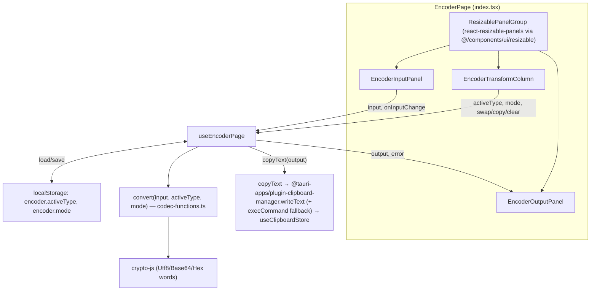

# Encoder (encoder) — UI Deep Dive

> Source: `references/hexbuffer/src/pages/encoder/`

## 1. Overview & Purpose

Encoder is Halo's Burp-Suite-style "Decoder" equivalent: a three-pane, live-transforming codec tool. The left panel is the source text, a fixed-width middle column picks the codec (URL, Base64, Base64URL, Hex, Binary, HTML entities) and direction (Encode/Decode) plus Swap/Copy/Clear actions, and the right panel shows the transformed output or a decode error. All conversion happens client-side on every keystroke (`useMemo` over `convert`) — no backend round-trip. Codec choice and mode persist in `localStorage`.

Mounted at route `/encoder` (`src/App.tsx`, `src/routes/page-resolver.tsx` as `StandaloneLayout id="/encoder" title="Encoder"`) and registered in the Desktop workspace (`src/layout/desktop-workspace/page-lazy-imports.ts`).

## 2. Annotated File Tree

```
encoder/
├── index.tsx                            # EncoderPage: ResizablePanelGroup shell wiring the three panes to the hook
├── constants.ts                         # CODECS (6 codec definitions with hints), CODEC_LABELS, MODE_LABELS (source/target/action strings)
├── types.ts                             # CodecType, CodecMode, CodecResult { output, error }
├── hooks/
│   └── use-encoder-page.ts              # State (input/activeType/mode), localStorage persistence, derived output, swap/copy/clear handlers
├── lib/
│   └── codec-functions.ts               # ENCODER_FUNCTIONS / DECODER_FUNCTIONS (crypto-js + hand-rolled binary/HTML) and convert()
└── components/
    ├── encoder-input-panel.tsx          # Left pane: header label + char count + mono Textarea
    ├── encoder-transform-column.tsx     # Middle column: codec list, Encode/Decode ButtonGroup, Swap/Copy/Clear buttons
    └── encoder-output-panel.tsx         # Right pane: header label + codec label + char count, read-only Textarea or error block
```

## 3. Architecture & Dataflow



Flow: typing in the input updates `input` state; `convert` recomputes `{output, error}` synchronously (empty/whitespace-only input short-circuits to `{output:'', error:null}`); the output textarea is controlled and `readOnly`. **Swap** flips the mode and replaces the input with the last output (`setInput(output || input)`), emulating Burp's "swap direction". Copy pushes the output through the app-wide clipboard pipeline (records it in `useClipboardStore` before writing via Tauri).

## 4. State Management

No Zustand store is used — everything is local `useState` in `useEncoderPage` plus `localStorage` persistence.

| State | Type | Initial | Persistence |
|---|---|---|---|
| `input` | `string` | `''` | none (cleared on reload) |
| `activeType` | `CodecType` (`'url' \| 'base64' \| 'base64url' \| 'hex' \| 'binary' \| 'html'`) | `localStorage['encoder.activeType']` if valid, else `'url'` | effect writes on change |
| `mode` | `CodecMode` (`'encode' \| 'decode'`) | `localStorage['encoder.mode'] === 'decode' ? 'decode' : 'encode'` | effect writes on change |

Derived: `output`/`error` via `useMemo(convert(...))`; `currentMode = MODE_LABELS[mode]` (gives `source`, `target`, `action` strings — the page uses `source`/`target` as panel headers); `isEmpty = !input && !output && !error`.

Handlers: `handleCopy` (copies only when `output` truthy), `handleClear` (`setInput('')`), `handleSwap` (toggles mode; seeds input with `output || input`).

The clipboard write also touches the shared `useClipboardStore` (`src/stores/clipboard.ts`) via `copyText` in `src/lib/clipboard.ts` — the only shared-store interaction on this page.

## 5. IPC Contracts

### Commands invoked

None. There is **no `invoke` call anywhere in the encoder folder**; all codecs are computed in the frontend. The only Tauri touchpoint is indirect: `copyText` calls `@tauri-apps/plugin-clipboard-manager`'s `writeText(text)` (plugin API, not an app command), falling back to a hidden-textarea `document.execCommand('copy')` if it rejects.

### Events listened

None.

## 6. UI Layout & Component Breakdown

### Layout diagram

```
┌─────────────────────────── EncoderPage ────────────────────────────────────┐
│ outer: h-full p-2 bg-background                                            │
│  card: h-full border bg-card rounded-md flex-col                           │
│ ┌────────────────────────────────────────────────────────────────────────┐ │
│ │ ResizablePanelGroup orientation="horizontal"  (no page header bar)     │ │
│ │ ┌───────────────┬┬──────────────┬┬────────────────────────────────┐    │ │
│ │ │ PLAIN TEXT /  ││ URL          ││ ENCODED · Base64               │    │ │
│ │ │ ENCODED (40%) ││ Base64       ││ 123 chars                      │    │ │
│ │ │ 12 chars      ││ Base64URL    ││                                │    │ │
│ │ │               ││ Hex          ││                                │ │ │
│ │ │  <Textarea    ││ Binary       ││  <Textarea mono readOnly>      │ │ │
│ │ │   mono>       ││ HTML         ││                                │ │ │
│ │ │               ││ ──────────   ││   or, on decode error:         │ │ │
│ │ │               ││ [Enc|Dec]    ││   error text in text-destructive│ │ │
│ │ │               ││ [⇄ Swap]     ││   on bg-destructive/5          │ │ │
│ │ │               ││ [⧉ Copy out] ││                                │ │ │
│ │ │               ││ [🗑 Clear]   ││                                │ │ │
│ │ └───────────────┴┴──────────────┴┴────────────────────────────────┘    │ │
│ │   defaultSize 40%   220px fixed-range   defaultSize 40%                │ │
│ │   minSize 25%       190–300px           minSize 25%                    │ │
│ └────────────────────────────────────────────────────────────────────────┘ │
└────────────────────────────────────────────────────────────────────────────┘
```

The middle column uses pixel sizing (`defaultSize="220px" minSize="190px" maxSize="300px"`) — this app's `react-resizable-panels` wrapper accepts percent or px strings. Two `ResizableHandle withHandle` separators render a grabbable `h-6 w-5 rounded-md bg-background border` pill containing `DotsSixVerticalIcon` (size 14, `text-muted-foreground`).

### Components

**`EncoderPage`** — `index.tsx`
- Props: none. Consumes the whole `useEncoderPage()` return as `page`.
- Composes the card-in-page shell (`p-2` gutter, `border bg-card rounded-md` inner card) and maps hook state to the three panels:
  - Input panel header label: `page.currentMode.source` ("Plain text" / "Encoded").
  - Output panel header label: `page.currentMode.target` ("Encoded" / "Plain text"); codec label from `CODEC_LABELS[page.activeType]`.

**`EncoderInputPanel`** — `components/encoder-input-panel.tsx`
- Props: `{ headerLabel: string; input: string; onInputChange: (v: string) => void }`.
- Header strip `h-8 px-3 border-b bg-muted/10`: label in `text-2xs font-semibold uppercase tracking-wider text-muted-foreground`; right-aligned `{input.length.toLocaleString()} chars` (`text-3xs`) shown only when input is non-empty.
- Body: `Textarea leading="tight" mono` with `resize-none p-3 border-0 rounded-none bg-transparent shadow-none focus-visible:ring-0` (flat fill of the panel), placeholder `` `Enter ${headerLabel.toLowerCase()}...` ``.

**`EncoderTransformColumn`** — `components/encoder-transform-column.tsx`
- Props: `{ activeType, onTypeChange, mode, onModeChange, output, isEmpty, onSwap, onCopy, onClear }`.
- Container: `overflow-y-auto gap-4 p-3 bg-muted/20 border-x` (visually separates the rail from both text panes).
- Codec list: one full-width `Button variant="ghost" size="md" justify-between px-2 font-normal` per `CODECS` entry; active row gets `bg-accent text-accent-foreground` and reveals its hint (`text-3xs text-muted-foreground`) on the right — hints: URL "Percent-encoding", Base64 "Standard alphabet", Base64URL "URL-safe alphabet", Hex "Hexadecimal bytes", Binary "8-bit groups", HTML "HTML entities".
- Mode toggle: `ButtonGroup` (kit composite, `role="group"`) holding two outline `flex-1` buttons **Encode** / **Decode**; the inactive one is dimmed (`text-muted-foreground` when it is not selected).
- Action stack: `Swap` (`ArrowsLeftRightIcon h-3 w-3`, disabled `isEmpty`), `Copy output` (`CopyIcon`, disabled `!output`), `Clear` (`TrashIcon`, `variant="quiet"`, disabled `isEmpty`). All `size="md" w-full px-2 gap-1.5`.

**`EncoderOutputPanel`** — `components/encoder-output-panel.tsx`
- Props: `{ headerLabel, codecLabel, output, error }`.
- Header strip mirrors the input's, label `{headerLabel} · {codecLabel}`, char count from `output`.
- Body branches: on `error` → a `whitespace-pre-wrap overflow-auto p-4 font-mono text-xs text-destructive bg-destructive/5` block rendering the message; otherwise the same flat mono `Textarea` as the input but `readOnly`, placeholder `` `${headerLabel} output will appear here...` ``.

### Context menus
None on this page.

## 7. UI Libraries & Primitives Used

### UI kit — `@celestia-project/ui`

| Export | Used in | Notes |
|---|---|---|
| `Textarea` | input & output panels | Props used: `leading="tight"` (line-height variant), `mono` (renders `font-mono` + `data-mono`) |
| `Button` | codec list, mode toggle, actions | Variants: `ghost`, `outline`, `quiet`; size `md`; `leading="tight"` |
| `ButtonGroup` | Encode/Decode toggle | Composite `div role="group"` wrapper that joins child buttons |

### Local / third-party

| Library | Usage |
|---|---|
| `@/components/ui/resizable` (Halo-local wrapper, **not** the kit) | `ResizablePanelGroup` (`orientation="horizontal"`), `ResizablePanel` (`defaultSize`/`minSize`/`maxSize` strings), `ResizableHandle withHandle` — wraps `react-resizable-panels` (`Group` / `Panel` / `Separator` exports) |
| `react-resizable-panels` | underlying primitives; handles show `DotsSixVerticalIcon` from Phosphor |
| `crypto-js` | `enc.Utf8.parse` → `toString(enc.Base64|enc.Hex)` and reverse; binary codec built from `bytes.words`/`bytes.sigBytes` |
| `@tauri-apps/plugin-clipboard-manager` | `writeText` via shared `copyText` |
| `@phosphor-icons/react` | `ArrowsLeftRightIcon`, `CopyIcon`, `TrashIcon` (page) + `DotsSixVerticalIcon`, `DotsSixIcon` (resizable handle) |
| `zustand` (indirect) | `useClipboardStore.addClipboardItem` from `copyText` |

No Radix primitives are imported directly in this folder; no Monaco, no dnd-kit, no framer-motion.

## 8. Keyboard Shortcuts & Interactions

No custom keyboard shortcuts are registered on this page (no `addCommand`, no `window` listeners). Interactions:

- Typing in the input textarea transforms live (per keystroke).
- Clicking a codec row switches codec (persists).
- Encode/Decode toggle switches direction (persists).
- **Swap**: flips direction and feeds the previous output back in as input; disabled when everything is empty.
- **Copy output**: copies via Tauri clipboard (records into clipboard history store); disabled without output.
- **Clear**: empties the input; output/error follow.
- Drag the two handles to resize panes (middle column clamped 190–300 px).

## 9. Styling Details

- Page gutter `p-2` with an inset `border bg-card rounded-md` card — other pages (e.g. notes) use full-bleed; encoder is framed.
- Section headers: `h-8 px-3 border-b bg-muted/10`, label `text-2xs font-semibold uppercase tracking-wider text-muted-foreground`, counts `text-3xs`.
- Textareas are flattened to panel fill: `border-0 rounded-none bg-transparent shadow-none focus-visible:ring-0 resize-none p-3`, mono stack via the kit's `mono` prop.
- Transform rail: `bg-muted/20 border-x`; active codec row `bg-accent text-accent-foreground`; inactive `text-muted-foreground hover:text-foreground`.
- Error surface: `text-destructive` mono text on `bg-destructive/5`.
- Micro type: `text-2xs` / `text-3xs` in headers and hints.

## 10. Integration Points

- **Routing**: lazy-loaded at `/encoder` in `src/App.tsx`; `StandaloneLayout` wrapper in `src/routes/page-resolver.tsx`; Desktop workspace page map `src/layout/desktop-workspace/page-lazy-imports.ts`.
- **Clipboard subsystem**: `copyText` (`src/lib/clipboard.ts`) writes through `@tauri-apps/plugin-clipboard-manager` and registers the copy in `useClipboardStore`, so encoder output appears in the app's clipboard history / clipboard-watcher UI (`src/components/clipboard-watcher.tsx`).
- **No store, no IPC**: unlike other pages, encoder shares no Zustand store with the rest of the app and calls no Rust commands; it is fully self-contained. The `resizable` wrapper it imports from `src/components/ui/resizable` is shared with other split layouts.

## 11. Source Files Documented

- `references/hexbuffer/src/pages/encoder/index.tsx`
- `references/hexbuffer/src/pages/encoder/constants.ts`
- `references/hexbuffer/src/pages/encoder/types.ts`
- `references/hexbuffer/src/pages/encoder/hooks/use-encoder-page.ts`
- `references/hexbuffer/src/pages/encoder/lib/codec-functions.ts`
- `references/hexbuffer/src/pages/encoder/components/encoder-input-panel.tsx`
- `references/hexbuffer/src/pages/encoder/components/encoder-output-panel.tsx`
- `references/hexbuffer/src/pages/encoder/components/encoder-transform-column.tsx`
- Shared (read for usage context): `src/components/ui/resizable.tsx`, `src/lib/clipboard.ts`, celestia-starter `packages/ui` `textarea.tsx` / `button-group.tsx` (prop surface only), `src/App.tsx` + `src/routes/page-resolver.tsx` (mount points only).
