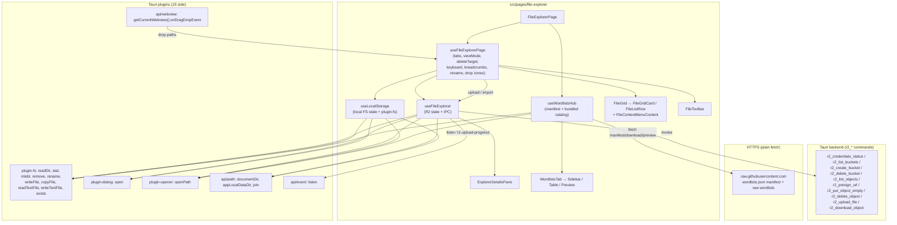

# File Explorer (file-explorer) — UI Deep Dive

> Source: `references/hexbuffer/src/pages/file-explorer/` (26 code files + 21 bundled wordlist data files, ~5,700 code lines)
> Related shared modules documented for page usage: `src/layout/tabs-layout/*` (TabbedPageLayout), `src/components/ui/resizable.tsx` (react-resizable-panels wrappers), `src/lib/clipboard.ts` (`copyText`), `src/lib/ipc.ts` (`toErrorMessage`), Tauri plugins (`@tauri-apps/plugin-fs`, `plugin-dialog`, `plugin-opener`, `plugin-clipboard-manager`, `api/path`, `api/webview`, `api/event`, `api/core`), route wrapper in `src/routes/page-resolver.tsx`.

## 1. Overview & Purpose

File Explorer is a three-tab workspace that lives at route `/file-explorer` (wrapped in `StandaloneLayout` by `page-resolver.tsx`):

- **Local Files** (`local`) — a sandboxed local workspace rooted at `Documents/Halo Files` (constant `LOCAL_STORAGE_DIR_NAME`). Browse, create folders, rename, delete, and import files via native dialogs or OS drag-and-drop. On first run it seeds `diagrams/flowchart-diagram.png` from an embedded base64 image (`DEFAULT_FLOWCHART_BASE64`).
- **R2 Storage** (`r2`) — a Cloudflare R2 object-storage browser. Buckets are auto-discovered via the Rust backend (secret never leaves the Rust process); objects are listed under a key prefix, uploaded (with backend-driven progress events), deleted, folder-created via zero-byte key placeholders, cached to `{appLocalDataDir}/r2_cache/…`, streamed & opened via the OS opener, and shared via public or presigned URLs.
- **Wordlists Hub** (`wordlists`) — a catalog of fuzzing/pentest wordlists. Bundled lists ship inside the app (loaded via Vite `import.meta.glob …?raw`); remote lists come from a GitHub manifest (`wordlists.json`), can be previewed (first 100 lines), downloaded to `Documents/Halo Files/Wordlists`, bundle-downloaded per tag (concurrency 3), revealed in the OS, or deleted.

State is **all local React state** (no Zustand store) split across three hooks: `useFileExplorer` (R2), `useLocalStorage` (local FS), `useWordlistsHub` (catalog). Cross-tab UI state (active tab, list/grid view mode, pending delete target, keyboard handlers, breadcrumbs, inline rename) lives in `useFileExplorerPage`. Persistence is minimal and manual: `localStorage` keys `explorer_view_mode` and `r2_custom_buckets`, plus the manifest cache `halo_wordlists_manifest_cache`.

## 2. Annotated File Tree — every file with a one-line description of what it does

```
src/pages/file-explorer/
├── index.tsx                            FileExplorerPage: TabbedPageLayout(3 tabs), R2 onboarding guard, per-tab render, collapsible details panel (PanelImperativeHandle), floating upload-progress card.
├── types.ts                             R2Item, R2Credentials, WordlistManifestItem, WordlistDownloadStatus ('idle'|'downloading'|'installed'|'error'|'bundled'), WordlistItemWithStatus, WordlistCategoryTag.
├── constants.ts                         PRESIGNED_URL_EXPIRATIONS (1h/12h/1d/7d), PREVIEWABLE_EXTENSIONS (exported, currently unused), WORDLISTS_MANIFEST_URL / RAW_BASE_URL (GitHub raw), WORDLISTS_DIR_NAME='Wordlists', DEFAULT_FLOWCHART_BASE64 (embedded PNG).
├── hooks/
│   ├── use-file-explorer-page.ts        Page controller: tabs, viewMode (localStorage), deleteTarget, grid-item id joining, breadcrumbs, keyboard-nav wiring, local rename state, two Tauri drop zones.
│   ├── use-file-explorer.ts             R2 engine (~470 lines): credentials status, bucket discovery/CRUD, list objects, cache status probe, upload w/ progress event, download+cache+open, URLs, folder create, delete.
│   ├── use-local-storage.ts             Local FS engine: ensure root dir + seed sample, readDir+stat listing (folders-first sort), navigate, open, delete (toast.promise), mkdir, rename, multi-file import (dialog or dropped paths).
│   ├── use-tauri-file-drop.ts           Webview-level onDragDropEvent (enter/over/drop) hit-tested against a zone rect scaled by devicePixelRatio; returns {dropZoneRef, isDragOver}.
│   └── use-wordlists-hub.ts             Wordlists engine: manifest fetch+validate+cache, bundled merge, tag aggregation, download/bundle(concurrency 3)/delete/preview(100 lines)/open.
├── components/
│   ├── file-toolbar.tsx                 Shared toolbar: collapse-to-4 breadcrumbs w/ "…" ellipsis, navigate-up, New Folder inline form, primary action (Upload/Import), List/Grid ButtonGroup, search w/ clear, refresh (spins while loading).
│   ├── file-grid.tsx                    Generic FileGrid<T extends FileItem>: loading spinner, Empty folder state, grid mode (auto-fill 100px cards) or list mode (sticky-header table), controlled AlertDialog delete confirm.
│   ├── file-grid-card.tsx               Grid card (h-24, 48px icon img, label/rename input, status overlay slot), ContextMenu + Tooltip wrapper, inline rename input.
│   ├── file-list-row.tsx                Table row (icon img 16px, name/type/size/modified/sync cols, hover Rename+Delete icons), ContextMenuTrigger render=<tr>, inline rename input.
│   ├── file-context-menu.tsx            Shared FileContextMenuContent: Open/Open Folder, Rename (optional), renderExtraItems slot, separator, destructive Delete.
│   ├── explorer-sidebar.tsx             R2 bucket list: header w/ count, per-bucket row (DatabaseIcon, hover trash → AlertDialog "Delete Bucket" confirm), add-bucket form, "Discovering buckets…" pulse.
│   ├── explorer-details-pane.tsx        R2 properties pane: type Badge, summary box (Local Sync / Remote Only chip), Key/Size/Modified details, Cache Synchronization card (Open Local File vs Stream & Open), Temporary URL Access (expiration Select + Presigned), Copy Public URL; folder variant.
│   ├── file-drop-overlay.tsx            Drag overlay: absolute inset-2 dashed primary border, pointer-events-none, UploadSimpleIcon + title + "Release to add files".
│   └── wordlists/
│       ├── wordlists-tab.tsx            Wordlists Hub shell: ResizablePanelGroup(sidebar 20% | toolbar+table | preview 26% when selected), search toolbar w/ "N of M wordlists" + Refresh.
│       ├── wordlists-sidebar.tsx        Tag category list: All Wordlists row (SparkleIcon), per-tag rows (TagIcon, count, all-installed CheckCircle), footer Download-bundle button w/ "(c/t)" progress.
│       ├── wordlists-table.tsx          Catalog table: name+href, tag Badges, Lines, WordlistStatus pill (Bundled/Ready/Downloading…/Error/Cloud), per-row actions (Eye/FolderOpen/Trash or Download).
│       └── wordlist-preview-pane.tsx    Preview pane: status pill, name/href, Lines+File Size metadata grid, tags, Reveal in Files / Delete / Download to Local / copy URL (Globe), first-100-lines <pre> w/ Copy.
├── data/
│   └── bundled-wordlists.ts             import.meta.glob('./bundled-wordlists/**/*' eager ?raw) → BUNDLED_WORDLISTS + BUNDLED_WORDLIST_CATEGORIES; formatWordlistName().
│   └── bundled-wordlists/               21 raw data files: DNS (subdomains top-1m 5k/20k/110k, services-names), api/ (13 files incl. api-endpoints-res.txt 10.9k lines, salesforce-aura-objects.txt), BurpSuite-ParamMiner headers, Logins.fuzz.txt, usernames.
└── lib/
    ├── file-icons.ts                    EXACT filename → icon, EXT extension → icon (~120 entries), FOLDER_NAMES folder → icon; getFolderIconSrc/getFileIconSrc mapping to /src/assets/explorer-icon/*.svg.
    ├── format.ts                        formatBytes(): B/KB/MB/GB/TB, '—' for unknown.
    ├── mime.ts                          getMimeType(): 14-extension Content-Type map, fallback 'application/octet-stream'.
    ├── path.ts                          safePathSegments() (strips '.', '..', empty, both separators) and isSafeFileName() (strict reject).
    └── keyboard-nav.ts                  handleFileGridKeyDown(): arrows (spatial via DOM row geometry in grid mode), Home/End, Enter/Space open, F2 rename, Delete/Backspace → delete request, Escape clears; ignores INPUT/TEXTAREA targets.
```

## 3. Architecture & Dataflow



Key flow facts:

- **Two distinct file systems, one grid component.** `FileGrid` is generic over `FileItem {id,name,type,size?,lastModified?}`; the page maps `R2Item` (id=`key`) and `LocalItem` (id=`path`) onto it, so selection, context menu, keyboard nav, and delete-confirm logic are written once.
- **R2 secrets never enter the webview.** `r2_credentials_status` returns `{accountId, accessKeyId, customEndpointUrl?, hasSecret}`; the hook synthesizes `R2Credentials` with `secretAccessKey: ''` and treats `hasSecret === false` as unconfigured (rendering the onboarding screen). Presigning is done in Rust via `r2_presign_url`.
- **Uploads are sequential and backend-progressed.** `runUploads` loops paths calling `r2_upload_file` one at a time; the Rust uploader emits `r2-upload-progress` events (`{fileName, progress}`) that drive the floating progress card (only rendered on the `r2` tab).
- **Caching is path-sanitized.** Every R2 key that becomes a filesystem path goes through `safePathSegments(currentBucket, item.key)` (strips `..`, `.`, empty segments) under `{appLocalDataDir}/r2_cache/`. Cache presence per item is probed with the `plugin-fs` `exists()` and shown as a dot overlay (grid) / "Local"·"R2" chip (list).
- **Remote-controlled wordlists are containment-hardened.** Manifest entries are validated by `isWordlistManifest`, hrefs pass through `wordlistRelativeSegments` (strip a leading `wordlists/` + `safePathSegments`) before `join(wordlistsDir, …)`; downloads are plain `fetch` + `writeTextFile`, never Tauri commands.
- **Native drag-and-drop** uses `getCurrentWebview().onDragDropEvent` (HTML5 drop carries no file data under Tauri's dragDropEnabled), hit-testing `payload.position` against the zone rect multiplied by `devicePixelRatio`.

## 4. State Management

No Zustand store on this page. All state is React `useState`/`useMemo`/`useRef` inside the four hooks, plus two `localStorage` keys.

### R2 hook (`useFileExplorer`) fields

| State | Type | Notes |
|---|---|---|
| `loading` | `boolean` | drives toolbar disable + grid spinner |
| `credentials` | `R2Credentials \| null` | from `r2_credentials_status`; `null` ⇒ onboarding gate |
| `buckets` | `string[]` | union of discovered + `customBuckets` |
| `currentBucket` | `string` | set on select/create; resets listing |
| `currentPrefix` | `string` | R2 key prefix ending in `/`; `navigateUp` pops one segment |
| `items` | `R2Item[]` (filtered) | folders first from listing; `filteredItems` applies `searchQuery` |
| `selectedItem` | `R2Item \| null` | cleared on every listing |
| `uploadProgress` | `{fileName, progress} \| null` | from `r2-upload-progress` event; card shown while non-null |
| `cacheStatus` | `Record<string, {isCached, localPath}>` | probed via `exists()` after each listing; merged incrementally |
| `creatingFolder`, `deletingKey` | `string \| null` / `boolean` | in-flight markers (`deletingKey` disables confirm buttons + dims row/card) |
| `searchQuery` | `string` | client-side name filter |
| `customBuckets` | `string[]` | **persisted** in `localStorage['r2_custom_buckets']` |

### Local hook (`useLocalStorage`) fields
`rootDir`, `currentPath` (resolved after mount from `documentDir()`), `items` (folders-first, `localeCompare` sort, search-filtered), `loading`, `selectedItem`, `searchQuery`, `deletingPath`, plus derived `breadcrumbs` and `isAtRoot`.

### Wordlists hook (`useWordlistsHub`) fields
`wordlistsDir` (`Documents/Halo Files/Wordlists`, created on mount), `items` (manifest with `syncLocalStatuses` — `exists()`+`stat()` per entry), `catalogItems` (`BUNDLED_HUB_ITEMS` prepended), `tags` (`WordlistCategoryTag[]` sorted by count desc then name, `installedCount` includes `bundled`), `selectedTag` (default `'all'`), `searchQuery` (matches name/href/tags), `selectedItem`, `previewContent` (first 100 lines), `previewLoading`, `bundleDownloading`, `bundleProgress {current,total}`. Manifest cached in `localStorage['halo_wordlists_manifest_cache']` (validated on read; force-refresh bypasses).

### Page-level (`useFileExplorerPage`)
`activeTab` (default `'local'`), `viewMode` (default `'list'`, **persisted** in `localStorage['explorer_view_mode']`), `deleteTarget: FileItem | null` (shared confirm dialog target; cleared on tab change), `localRenamingPath`/`localRenameValue`/`localRenameInputRef`, two `useTauriFileDrop` instances (`r2Drop` enabled only when `activeTab==='r2' && currentBucket`, `localDrop` when `activeTab==='local'`), memoized `r2GridItems`/`localGridItems` (id-joined copies), `r2Breadcrumbs`/`localBreadcrumbs`.

## 5. IPC Contracts

### Commands invoked (Tauri `invoke`)

| Command | Args | Returns | Where called |
|---|---|---|---|
| `r2_credentials_status` | — | `{accountId: string, accessKeyId: string, customEndpointUrl?: string \| null, hasSecret: boolean} \| null` | `invokeStatus()` on mount → `fetchCredentials` |
| `r2_list_buckets` | — | `string[]` | `loadBuckets` after credentials resolve |
| `r2_create_bucket` | `{ name: string }` | void | `handleAddCustomBucket` (failure falls back to local-only registration; `BucketAlreadyExists`/`BucketAlreadyOwnedByYou` → info toast) |
| `r2_delete_bucket` | `{ name: string }` | void | `handleRemoveBucket` (then re-lists) |
| `r2_list_objects` | `{ bucket: string, prefix: string }` | `R2Listing { folders: {prefix,name}[], files: {name,key,size?,lastModifiedMs?}[] }` | `listItems` on bucket/prefix change |
| `r2_presign_url` | `{ bucket: string, key: string, expiresSeconds: number }` | `string` (URL) | `handleCopyPresignedUrl` (details pane / context menu, 3600 default) |
| `r2_put_object_empty` | `{ bucket: string, key: string }` | void | `handleCreateFolder` (key = `prefix + name/`) |
| `r2_delete_object` | `{ bucket: string, key: string }` | void | `handleDeleteItem` (wrapped in `toast.promise`) |
| `r2_upload_file` | `{ bucket: string, key: string, sourcePath: string, contentType: string }` | void | `uploadFileFromPath` (per path, sequential) |
| `r2_download_object` | `{ bucket: string, key: string }` | `string` (local cached file path) | `handleOpenFile` (after `toast.loading('Streaming …')`) |

All R2 commands are invoked via `useFileExplorer`; errors surface as `toast.error` with `toErrorMessage`/raw error text.

### Events listened (`listen` / webview APIs)

| Event | Payload | Handler |
|---|---|---|
| `r2-upload-progress` | `{ fileName: string, progress: number }` | sets `uploadProgress` in `useFileExplorer`; floating card renders `%` bar; cleared in `runUploads` `finally` |
| webview `onDragDropEvent` | `{ type: 'enter'\|'over'\|'drop'\|'leave'…, position: {x,y}, paths?: string[] }` | `useTauriFileDrop`: `isDragOver` = position inside zone rect × devicePixelRatio; on `drop` calls `handleUploadPaths(paths)` (R2) or `handleImportFile(paths)` (local) |

### Non-IPC remote calls (plain `fetch`)
- `GET https://raw.githubusercontent.com/dev-celestia/wordlists/main/wordlists.json` — manifest (validated `WordlistManifestItem[]`), cached in localStorage.
- `GET https://raw.githubusercontent.com/dev-celestia/wordlists/main/{href}` — raw wordlist download and remote preview (first 100 lines).

### Tauri plugin APIs used directly (not custom commands)
`plugin-fs`: `readDir`, `stat`, `mkdir`, `remove({recursive})`, `rename`, `writeFile` (Uint8Array), `copyFile` (dynamic import), `readTextFile`, `writeTextFile`, `exists`; `plugin-dialog`: `open({multiple, title})`; `plugin-opener`: `openPath`; `api/path`: `documentDir`, `appLocalDataDir`, `join`; clipboard via shared `copyText` (`plugin-clipboard-manager` `writeText` + textarea fallback, recording into `useClipboardStore`).

## 6. UI Layout & Component Breakdown

```
┌───────────────────────────────────────────────────────────────────────────────┐
│ PageTabBar: Local Files | R2 Storage | Wordlists Hub                          │
├───────────────────────────────────────────────────────────────────────────────┤
│ ┌ border rounded-lg (contentClassName) ─────────────────────────────────────┐ │
│ │ [R2 tab]  FileToolbar (breadcrumbs ↑ NewFolder Upload List|Grid 🔍 ↻)     │ │
│ │ ┌─ ResizablePanelGroup horizontal ─────────────────────────────────────┐  │ │
│ │ │ ExplorerSidebar 22% (15–35) │⟷│ FileGrid 78% (min 30) │⟷│ Details    │  │ │
│ │ │ "R2 Buckets" + count        │  │ grid: cards 100px autofill          │  │ │
│ │ │ bucket rows + trash         │  │ list: sticky-header table           │  │ │
│ │ │ "Add bucket manually…"      │  │ + FileDropOverlay while dragging    │  │ │
│ │ └─────────────────────────────┴──┴─────────────┴──┴ 18–40%, collapsible┘  │ │
│ │ [Local tab] FileToolbar + FileGrid (no sidebar, drop overlay)             │ │
│ │ [Wordlists tab] sidebar 20% | search+count+Refresh, table | preview 26%   │ │
│ └───────────────────────────────────────────────────────────────────────────┘ │
│ [R2 only] floating upload card: absolute bottom-4 end-4 z-50 w-80             │
└───────────────────────────────────────────────────────────────────────────────┘
```

### FileExplorerPage (`index.tsx`)
Props: none (default export also provided). Early-returns the **onboarding screen** when `!loading && !credentials && activeTab === 'r2'`: centered card (`border-border bg-muted/10 backdrop-blur-sm`) with pulsing `HardDriveIcon size-10 text-primary`, "Cloudflare R2 Storage Not Configured", R2 pitch copy, and a "Configure Credentials" Button navigating to `/settings?tab=r2` via `useNavigate`. The details `ResizablePanel` stays mounted with `panelRef` (`PanelImperativeHandle`): selection expands it (falling back to `panel.resize('24%')` if `expand()` is a no-op with no previous size), deselect collapses it; the second `ResizableHandle` gets `pointer-events-none opacity-0` while nothing is selected. The upload-progress card: filename + mono `%`, `h-1.5` bar (`bg-primary`, `transition-all duration-300`), caption with `ShieldWarningIcon` "Uploading to R2 Storage bucket…", entrance `animate-in fade-in slide-in-from-bottom-3 duration-200`.

### FileToolbar (`components/file-toolbar.tsx`)
Props: `{breadcrumbs, isAtRoot, onNavigateUp, onNavigateTo, onCreateFolder, actionLabel, actionIcon, onActionClick, actionDisabled?, searchQuery, onSearchChange, onRefresh, viewMode, onViewModeChange, loading}`. Bar: `px-3 py-2 border-b border-border bg-muted/20`. Left: navigate-up `Button size="sm" variant="quiet" size-7` (`ArrowLeftIcon`, `active:scale-[0.97]`, disabled at root/loading) + breadcrumb buttons (`CaretRightIcon` separators, last crumb `text-foreground font-semibold cursor-default`, others `hover:bg-muted/40`; each `max-w-[180px] truncate`). Paths deeper than `MAX_VISIBLE_CRUMBS = 4` collapse to `root … tail` with a `…` span whose title reports hidden level count. Right: New Folder toggle → inline `<form>` (`Input w-32` + `CheckIcon` submit + `XIcon` cancel, disabled while `creating`); primary action Button (`UploadSimpleIcon`+Upload for R2, `DownloadSimpleIcon`+Import for local, disabled without bucket on R2); `ButtonGroup` view toggle (`ListIcon`/`SquaresFourIcon`, active = `text-primary bg-muted/60`, `data-state` attr); search `w-44` fixed zone (`MagnifyingGlassIcon` prefix, `ps-7 pe-7`, X clear when non-empty); refresh ghost Button (`ArrowClockwiseIcon`, `animate-spin` while loading).

### FileGrid (`components/file-grid.tsx`)
Generic `FileGrid<T extends FileItem>` props (see tree). Loading: centered `CircleNotchIcon animate-spin text-primary` + "Loading files…". Empty: `FolderIcon size-10 text-muted-foreground/30` + "Empty folder" + prop `emptyMessage`. Grid mode: container `tabIndex={0}` `onKeyDown` `p-3 overflow-auto` with CSS grid `grid-cols-[repeat(auto-fill,minmax(100px,1fr))] gap-3` of `FileGridCard`s. List mode: `<table className="w-full text-left text-xs">` with sticky thead (`bg-muted/50 border-b text-3xs uppercase tracking-wider`), columns Name (w-1/2), Type (w-16 center), Size (w-24 right), Modified (w-36), optional Sync (w-20, when `renderSyncStatus` provided), actions (w-16); `tbody divide-y divide-border/40 font-mono`. Both containers carry `focus-visible:ring-1 focus-visible:ring-ring/40`. Delete confirm: `AlertDialog` controlled by `deleteTarget`; title "Delete Folder/File", description quotes the name + "This action cannot be undone."; Cancel/Action `size="xs"` (Action `variant="destructive"`, shows `CircleNotchIcon` + "Deleting…" while `deletingId === deleteTarget?.id`).

### FileGridCard / FileListRow (`components/file-grid-card.tsx`, `components/file-list-row.tsx`)
Both render a `ContextMenu` whose trigger is the item and whose content is the shared `FileContextMenuContent`; both support inline rename (input with `autoFocus`, Enter=commit, Escape=`stopPropagation()`+cancel, blur=commit; ref forwarded via `renameInputRef` ref-callback so page code can `.select()`).
- Card: `h-24 p-2 rounded-md` column, 48 px `` icon (folder via `getFolderIconSrc`, file via `getFileIconSrc ?? '_file.svg'`, each with `onError` fallback to the generic icon), label `text-2xs font-sans` (folders `font-semibold text-foreground`), selected = `bg-primary/10 border-primary/30`, hover = `hover:bg-muted/50`, press `active:scale-[0.97]`, deleting = `opacity-40 pointer-events-none`. Optional `renderGridStatusOverlay` slotted bottom-end (the R2 cache dot: `size-1.5 rounded-full bg-emerald-500` cached / `bg-muted-foreground/40` remote, `title='Local Cached'|'R2 Remote'`). When not renaming the card is wrapped in a `Tooltip` showing the name.
- Row: `ContextMenuTrigger render={<tr …/>}` (kit render-prop) with click/double-click/contextmenu selecting; cells Name (`flex items-center gap-2` + 16 px img), Type (uppercase `text-3xs`), Size (`font-mono text-2xs`, folders `—`), Modified (`toLocaleString('en-US', {month:'short',day:'numeric',hour:'2-digit',minute:'2-digit'})`), Sync (`renderSyncStatus` chip: emerald `CheckCircleIcon` "Local" vs muted `CloudArrowDownIcon` "R2"), and hover-revealed actions (`opacity-0 group-hover:opacity-100`): `PencilSimpleIcon` rename (when `onRenameStart`) and `TrashIcon` delete (`hover:text-destructive`).

### FileContextMenuContent (`components/file-context-menu.tsx`)
`ContextMenuContent className="w-44 font-sans text-xs"`: Open (`FolderOpenIcon`, label "Open Folder"/"Open"), Rename (`PencilSimpleIcon`, only when `onStartRename` provided — so R2 has no rename), `renderExtraItems?.(item)` (R2 injects `ContextMenuSeparator` + "Copy Public URL" (`CopyIcon`) + "Copy Presigned URL" (`LinkSimpleIcon`, hardcoded 3600 s)), separator, Delete (`TrashIcon`, `ContextMenuItem variant="destructive"`).

### ExplorerSidebar (`components/explorer-sidebar.tsx`)
Props: `{buckets, currentBucket, onSelectBucket, onAddCustomBucket, onRemoveBucket, loading}`. Panel `rounded-md border bg-background`; header `px-3 py-1.5 bg-muted/40` "R2 Buckets" + mono count. Rows: `DatabaseIcon size-3.5` (primary when active), truncated name, active = `bg-primary/10 font-semibold dark:bg-primary/15`, `active:scale-[0.99]`; hover trash (`TrashIcon size-3`, `hover:text-destructive`, `stopPropagation`) opens the **Delete Bucket** `AlertDialog` (warns the bucket must be empty on R2). Footer form `border-t bg-muted/20`: `Input` "Add bucket manually…" + `PlusIcon` submit. Loading placeholder "Discovering buckets…" (`animate-pulse`).

### ExplorerDetailsPane (`components/explorer-details-pane.tsx`)
Props: `{item, cacheStatus, onOpenFile, onCopyPublicUrl, onCopyPresignedUrl}`. Empty state: `FileIcon size-8` + "No item selected". Populated: header "Properties" + `Badge variant={cached?'outline':'secondary'}` showing type; summary box (`bg-muted/10`) with folder/file icon (folder amber `text-amber-600/80`), name (`break-all`), chip "Local Sync" (emerald) or "Remote Only" (muted); "File Details" block with Key/Path (mono break-all), Size (`formatBytes`), Last Modified; for files, "Cache Synchronization" card: cached → emerald `CheckCircleIcon` + mono `localPath` + outline Button **Open Local File**; not cached → `CloudArrowDownIcon` + "Remote Object Only" + default Button **Stream & Open File** (both call `onOpenFile`); "Temporary URL Access" card: `Select h-7` over `PRESIGNED_URL_EXPIRATIONS` (default `'3600'`) + outline Button "Presigned" (`LinkSimpleIcon`) → `onCopyPresignedUrl(item, parseInt(expiration,10))`; full-width "Copy Public URL" outline Button (`CopyIcon`). Folders instead show a centered "Selected Folder" block with the key in mono.

### FileDropOverlay (`components/file-drop-overlay.tsx`)
Props `{show, title}`. `absolute inset-2 z-40 … pointer-events-none`, `border-2 border-dashed border-primary/50 bg-primary/5 backdrop-blur-[2px]`, `animate-in fade-in duration-150`, `UploadSimpleIcon size-8 text-primary` + title + "Release to add files".

### WordlistsTab / Sidebar / Table / Preview (`components/wordlists/*`)
- **WordlistsTab** owns `useWordlistsHub`; layout `ResizablePanelGroup horizontal`: sidebar `defaultSize="20" minSize="14" maxSize="35"`; center panel (`minSize="40"`) with toolbar (`px-3 py-1.5 bg-muted/40`: search `max-w-sm` with clear; right side mono "N of M wordlists" + outline Refresh Button calling `fetchManifest(true)`, title "Refresh Wordlists Catalog from GitHub", spins while loading) and `WordlistsTable`; preview panel `defaultSize="26" minSize="18" maxSize="40"` only when `hub.selectedItem` (mounted on selection, like the R2 pane). Header totals: `totalInstalled` counts `installed`+`bundled`.
- **WordlistsSidebar**: header "Categories ({tags.length})" + `Badge mono variant="outline"` `installed/total`; "All Wordlists" row (`SparkleIcon`); tag rows (`TagIcon`, `capitalize`, mono count, emerald `CheckCircleIcon` when `installedCount === count`); footer full-width outline Button: `DownloadSimpleIcon` or spinning `CircleNotchIcon`, label `Downloading (current/total)` / `Download All Missing` (tag `all`) / `Download "{tag}"` → `onDownloadBundle(selectedTag)`.
- **WordlistsTable**: loading/empty states mirror FileGrid ("Loading wordlists catalog…", `FileTextIcon` "No Wordlists Found"). Sticky thead: Wordlist Name (min-w 200px; name + mono href), Tags (`Badge variant="secondary"`), Lines (right, mono `toLocaleString()`), Status (center, `WordlistStatus`), Actions (right w-28). Row click = `onSelectItem` (loads preview); double-click = preview when installed/bundled else download. `WordlistStatus` pills: Bundled (`PackageIcon`, primary), Ready (`CheckCircleIcon`, emerald, + mono `formatBytes(fileSize)`), Downloading… (spinning, pulse), Error (`WarningCircleIcon`, destructive), Cloud (`CloudArrowDownIcon`, muted). Actions per status: bundled → Eye preview; installed → Eye + FolderOpen "Reveal in System" + Trash "Delete local file" (ghost, `hover:text-destructive`); else outline "Download" (`CloudArrowDownIcon`) disabled while downloading.
- **WordlistPreviewPane**: empty state "No Wordlist Selected". Header "Wordlist Preview" + Bundled/Ready/Cloud pill. Info box: name + mono href, metadata grid (`grid-cols-2`, `RowsIcon` Lines, `HardDriveIcon` File Size — "Built-in" for bundled), tags row (`TagIcon` + badges), and for non-bundled items action row: installed → "Reveal in Files" (`FolderOpenIcon`) + destructive-ghost Trash; else "Download to Local" (`CloudArrowDownIcon`/spinning); plus a `GlobeIcon` Button copying `${WORDLISTS_RAW_BASE_URL}${href}` (`toast.success('Copied download URL')`). Preview section: "Preview (First 100 Lines)" + Copy button (`CopyIcon`, `copyText` → toasts); content in `pre.whitespace-pre-wrap.break-all font-mono text-2xs` inside `bg-muted/20 border-border/60` box with `min-h-[140px]`; loading spinner "Loading preview…"; fallback italic "Click a wordlist to load preview".

## 7. UI Libraries & Primitives Used

### UI kit — `@celestia-project/ui` (shadcn-style; uses `render` props, e.g. `ContextMenuTrigger render={<tr/>}`, not `asChild`)

| Component | Where used |
|---|---|
| `AlertDialog`, `AlertDialogAction`, `AlertDialogCancel`, `AlertDialogContent`, `AlertDialogDescription`, `AlertDialogFooter`, `AlertDialogHeader`, `AlertDialogTitle` | file delete confirm (FileGrid), bucket delete confirm (ExplorerSidebar) |
| `Badge` (accepts `mono`) | details pane type, wordlist counts, tags |
| `Button` (variants used: `default`, `outline`, `ghost`, `quiet`, `destructive` via AlertDialogAction; sizes `sm`, `md`, `xs` on AlertDialog buttons; accepts `leading="tight"`) | every toolbar/sidebar/pane |
| `ButtonGroup` | list/grid view toggle |
| `ContextMenu`, `ContextMenuContent`, `ContextMenuItem`, `ContextMenuSeparator`, `ContextMenuTrigger` | grid cards + list rows + R2 extra items |
| `Input` (accepts `textSize="xs"`) | search, folder name, bucket name, rename inputs use raw `<input>` instead |
| `Select`, `SelectContent`, `SelectItem`, `SelectTrigger`, `SelectValue` (accept `leading="tight"`) | presigned expiration |
| `Tooltip`, `TooltipContent`, `TooltipTrigger` | grid card name tooltip |
| `TabbedPageLayout` (from `@/layout/tabs-layout`) | page shell |

### Radix / panels
`react-resizable-panels` via `src/components/ui/resizable.tsx`: `ResizablePanelGroup`, `ResizablePanel` (incl. `panelRef` → `PanelImperativeHandle` with `expand/collapse/isCollapsed/resize`), `ResizableHandle withHandle`.

### Phosphor icons — `@phosphor-icons/react` (exact names imported)
index.tsx: `HardDriveIcon, GearSixIcon, ShieldWarningIcon, CheckCircleIcon, CloudArrowDownIcon, CopyIcon, LinkSimpleIcon, UploadSimpleIcon, DownloadSimpleIcon`. file-grid: `CircleNotchIcon, FolderIcon`. file-toolbar: `CaretRightIcon, FolderPlusIcon, ArrowLeftIcon, MagnifyingGlassIcon, CheckIcon, XIcon, ListIcon, SquaresFourIcon, ArrowClockwiseIcon`. file-list-row / file-context-menu: `TrashIcon, PencilSimpleIcon, FolderOpenIcon`. explorer-sidebar: `DatabaseIcon, PlusIcon, TrashIcon`. explorer-details-pane: `FileIcon, FolderIcon, CheckCircleIcon, CloudArrowDownIcon, CopyIcon, LinkSimpleIcon`. file-drop-overlay: `UploadSimpleIcon`. wordlists-tab: `ArrowClockwiseIcon, MagnifyingGlassIcon, XIcon`. wordlists-sidebar: `TagIcon, DownloadSimpleIcon, CheckCircleIcon, SparkleIcon, CircleNotchIcon`. wordlists-table: `CloudArrowDownIcon, CheckCircleIcon, CircleNotchIcon, FileTextIcon, PackageIcon, TrashIcon, FolderOpenIcon, EyeIcon, WarningCircleIcon`. wordlist-preview-pane: `FileTextIcon, CloudArrowDownIcon, CheckCircleIcon, CircleNotchIcon, CopyIcon, FolderOpenIcon, TrashIcon, TagIcon, RowsIcon, HardDriveIcon, GlobeIcon`.

### Other third-party
- Tauri v2 APIs: `@tauri-apps/api/core` (`invoke`), `@tauri-apps/api/event` (`listen`), `@tauri-apps/api/webview` (`getCurrentWebview().onDragDropEvent`), `@tauri-apps/api/path`, `@tauri-apps/plugin-fs`, `@tauri-apps/plugin-dialog`, `@tauri-apps/plugin-opener`, `@tauri-apps/plugin-clipboard-manager` (via `copyText`).
- `sonner` (`toast`, `toast.promise`, `toast.loading`/`dismiss`), `react-router-dom` (`useNavigate`).
- No Radix direct imports in page code, no dnd-kit, no framer-motion, no Monaco/CodeMirror. The only animation classes are Tailwind `animate-in fade-in slide-in-from-*` utilities and `animate-pulse`/`animate-spin`.
- Custom SVG icon assets: `/src/assets/explorer-icon/*.svg` referenced as `` (not Phosphor) — ~120 distinct file/folder glyph names from `lib/file-icons.ts`.

## 8. Keyboard Shortcuts & Interactions

| Input | Context | Effect |
|---|---|---|
| `ArrowUp/Down` | grid container (`tabIndex=0`) | moves selection by one row; in grid mode the step equals the DOM-derived column count (`getGridColumns` counts `[data-file-item]` cells sharing the first row's `offsetTop`, so it stays correct across panel resizes) |
| `ArrowLeft/Right` | grid container | selection ±1 |
| `Home` / `End` | grid container | first / last item |
| `Enter` / `Space` | grid container, item selected | open: folder → navigate; file → R2 cache/stream-open, local `openPath` |
| `F2` | grid container (local tab only — `onStartRename` passed only for local) | starts inline rename |
| `Delete` / `Backspace` | grid container, item selected | sets `deleteTarget` → confirm dialog |
| `Escape` | grid container | clears selection |
| `Enter` / `Escape` / blur | inline rename input | commit (`handleRenameItem`, rejects `/` and `\` via `isSafeFileName`) / cancel (with `stopPropagation`) / commit |
| `Enter` | toolbar New Folder form | creates folder (R2: `r2_put_object_empty`; local: `mkdir` with name validation) |
| Click crumb | toolbar | `onNavigateTo(crumb.id)` (prefix for R2, absolute path for local); last crumb disabled |
| Single click | card/row | select (also selected on right-click) |
| Double click | card/row | folder → navigate into; file → open (R2: cache-or-stream; local: `openPath`) |
| Right-click | card/row | selects item + opens context menu (Open, Rename [local], Copy Public URL / Copy Presigned URL [R2 files], Delete) |
| Hover | list row / bucket row | reveals rename/delete icons; bucket trash opens confirm dialog |
| Drag files over workspace | R2 or Local tab | Tauri webview drag events set `isDragOver` → `FileDropOverlay`; release uploads (R2, only when a bucket is selected) or imports (local) |
| Keyboard events in inputs | rename/search fields | ignored by `handleFileGridKeyDown` (early return for `INPUT`/`TEXTAREA` targets) |

## 9. Styling Details

- Selection grammar used consistently across panes: `bg-primary/10` (list rows add `hover:bg-primary/15 dark:bg-primary/15 dark:hover:bg-primary/20 font-medium`); inactive hover `hover:bg-muted/30`–`/50`.
- The project's bespoke text scale is used everywhere: `text-4xs` (mono micro-labels), `text-3xs` (uppercase `tracking-wider` section headers like "Cache Synchronization", "File Details"), `text-2xs` (data values), `text-xs` (body). Data cells use `font-mono`; names use `font-sans`.
- Header bars repeat the pattern `px-3 py-1.5 border-b border-border bg-muted/40` (sidebar, details pane, wordlists toolbar); the file toolbar uses `bg-muted/20`.
- Press feedback: `active:scale-[0.97]` (toolbar up-button, grid cards) / `active:scale-[0.99]` (sidebar rows, wordlist tags).
- Status colors: emerald (`bg-emerald-500/10 border-emerald-500/20 text-emerald-600 dark:text-emerald-400`) for cached/installed/Ready; amber for folder icons (`text-amber-600/80`); destructive for deletes; primary for Bundled/Downloading pills (`bg-primary/10 border-primary/20`).
- Icon strategy: file/folder glyphs are `` SVGs from `/src/assets/explorer-icon/` with `onError` fallback to `_folder.svg`/`_file.svg` (graceful degradation for unmapped names); UI chrome icons are Phosphor.
- Drop overlay and upload card use `backdrop-blur` (`backdrop-blur-[2px]`, `backdrop-blur-md bg-background/95`) and `animate-in` utility classes.
- Table styling: `border-collapse`, `divide-y divide-border/40` body, sticky thead `z-10`; grid card tile is exactly `h-24` with `size-12` icons.

## 10. Integration Points

- **Intruder**: `src/pages/intruder/components/hooks/use-payload-preset-dialog.ts` imports `BUNDLED_WORDLISTS` and `BUNDLED_WORDLIST_CATEGORIES` from `data/bundled-wordlists.ts`, plus `WORDLISTS_DIR_NAME`, `LOCAL_STORAGE_DIR_NAME`, and `formatBytes` — the Hub's bundled catalog is the same source the Intruder payload presets offer, and both resolve installed wordlists under `Documents/Halo Files/Wordlists`.
- **Settings**: the R2 onboarding button deep-links to `/settings?tab=r2` where credentials are configured; the page itself only reads `r2_credentials_status`.
- **OS shell**: `openPath` (plugin-opener) is the open/reveal mechanism for cached R2 files, local files, and installed wordlists.
- **Clipboard center**: `copyText` (public URL, presigned URL, wordlist raw URL, preview lines) records each copy into `useClipboardStore` before writing to the system clipboard.
- **Navigation**: `TabbedPageLayout` provides the three fixed tabs (`FILE_EXPLORER_TABS` ids `local`/`r2`/`wordlists`); the page is mounted by `routes/page-resolver.tsx` inside `StandaloneLayout` for id `/file-explorer` (lazy-loaded).
- **Security posture**: `safePathSegments` guards every remote-derived path (R2 keys into `r2_cache`, manifest hrefs into `Wordlists`); `isSafeFileName` guards user-typed names; `wordlistRelativeSegments` additionally strips a leading `wordlists/` so the manifest cannot steer writes; R2 secrets stay in Rust.
- Dead export: `PREVIEWABLE_EXTENSIONS` (constants.ts) is referenced nowhere else in `src/` — likely vestigial from an in-app preview feature.

## 11. Source Files Documented

Page (`src/pages/file-explorer/`):
- index.tsx; types.ts; constants.ts
- hooks/use-file-explorer-page.ts; hooks/use-file-explorer.ts; hooks/use-local-storage.ts; hooks/use-tauri-file-drop.ts; hooks/use-wordlists-hub.ts
- components/file-toolbar.tsx; file-grid.tsx; file-grid-card.tsx; file-list-row.tsx; file-context-menu.tsx; explorer-sidebar.tsx; explorer-details-pane.tsx; file-drop-overlay.tsx
- components/wordlists/wordlists-tab.tsx; wordlists-sidebar.tsx; wordlists-table.tsx; wordlist-preview-pane.tsx
- lib/file-icons.ts; format.ts; mime.ts; path.ts; keyboard-nav.ts
- data/bundled-wordlists.ts (plus inventory of the 21 raw wordlist files under data/bundled-wordlists/)

Shared modules read for usage:
- src/layout/tabs-layout/tabbed-page-layout.tsx; types.ts (also used by workflow doc)
- src/components/ui/resizable.tsx (head — react-resizable-panels wrappers)
- src/lib/clipboard.ts (copyText implementation)
- src/routes/page-resolver.tsx (mount point, grepped)
- src/pages/intruder/components/hooks/use-payload-preset-dialog.ts (cross-imports, grepped)
