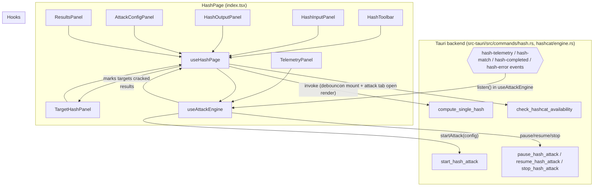

# Hash (hash) — UI Deep Dive

> Source: `references/hexbuffer/src/pages/hash/`

## 1. Overview & Purpose

The Hash page is a two-function module routed at `/hash` (lazy-loaded as `m.HashPage` from `src/App.tsx`):

1. **Hash Calculator** — a live plaintext→digest converter. Input is auto-hashed on every keystroke via the Rust backend command `compute_single_hash`; the user picks one of 16 algorithms from a toolbar button group.
2. **Password Auditing** — a hashcat-driven cracking workbench. The user configures an attack (straight / combinator / mask / hybrid), loads target hashes (single, bulk paste, or file import), starts/pauses/stops the attack, watches live telemetry streamed from the Rust `hashcat` engine over Tauri events, and exports cracked results as `hash:plaintext` text.
3. **Results** — a searchable, copyable, exportable list of cracked hashes with per-card plaintext emphasis.

The page is built on `TabbedPageLayout` with three fixed, non-closable, non-renamable tabs (`calculator`, `attack`, `results`). The Attack/Results tabs share a status toolbar; the tab strip shows a running/paused status chip and a green results-count badge.

Notably, **no Zustand store is used** — all state is local `useState` inside `useHashPage` + `useAttackEngine`; nothing persists across restarts.

## 2. Annotated File Tree

```
src/pages/hash/
├── index.tsx                       (534 L)  HashPage: TabbedPageLayout, 3 tabs, attack toolbar (start/pause/stop/resume/reset, status dot, hashcat badges), tab-body switching into calculator/attack/results layouts
├── types.ts                        (116 L)  HashType (16 algs), AttackMode, discriminated union AttackConfig (Straight|Combinator|Mask|Hybrid), TargetHash, AttackStatus, TelemetryData, AttackEngineState, CrackedResult, RuleDefinition, TabMode, HashcatAvailability
├── constants.ts                    (133 L)  HASH_OPTIONS (16 entries w/ cryptoMethod), ATTACK_MODE_OPTIONS (4), RULE_PRESETS (none/best64/leetspeak/common/append-years), HASHCAT_UNSUPPORTED_ALGORITHMS = ['blake3','scrypt'], INITIAL_TELEMETRY
├── hooks/
│   ├── use-hash-page.ts            (239 L)  Page orchestrator: tab state, calculator auto-hash, copy/clear, attack validation, export via Blob download, syncs cracked results back into targets
│   └── use-attack-engine.ts        (269 L)  Attack lifecycle state machine + 4 Tauri event listeners (hash-telemetry / hash-match / hash-completed / hash-error) + invoke wrappers
└── components/
    ├── hash-toolbar.tsx            (96 L)   Calculator tab toolbar: ButtonGroup of 16 algorithm buttons, Copy Output, Clear (Trash)
    ├── hash-input-panel.tsx        (114 L)  "Input Text" pane: header (h-9) + bare <textarea> (font-mono text-xs)
    ├── hash-output-panel.tsx       (112 L)  "Hash Result" pane: header (h-9) with Copy button + readOnly <textarea>
    ├── attack-config-panel.tsx     (562 L)  Algorithm Select, 2×2 attack-mode card grid, per-mode forms (wordlist pickers via Tauri dialog, rule-preset Select, mask pattern + charset checkboxes, hybrid digit mask); private WordlistPathPicker
    ├── target-hash-panel.tsx       (544 L)  Target hash manager: single/bulk toggle, algorithm Select (w-48), import from file (Tauri `readTextFile` with DOM `<input type=file>` fallback), target rows with crack status, footer stats
    ├── telemetry-panel.tsx         (352 L)  Live metrics: status header + ETA, 4 MetricCards (Hash Rate / Matches / Progress / Elapsed), 3 StatItems (Tested / CPU / Memory), gradient progress bar; private MetricCard & StatItem
    └── results-panel.tsx           (443 L)  Cracked results list: search Input, Copy All / Export, empty states, ResultCard with hash + plaintext rows and "Cracked after N attempts"; private ResultCard
```

## 3. Architecture & Dataflow



Key flows:
- **Calculator**: `handleHash` is a `useCallback` on `[input, activeType]`; a `useEffect` re-runs it whenever input/algorithm change *and only when `activeTab === 'calculator'`*. Output replaces (not appends) `output`.
- **Availability check**: `check_hashcat_availability` fires on mount and re-fires whenever `activeTab === 'attack'` becomes true (dep is the boolean expression `activeTab === 'attack'`). Failures are converted into an "unavailable" `HashcatAvailability` via `toErrorMessage` from `@/lib/ipc`.
- **Attack**: `startAttack` resets state, builds a mode-discriminated `rustMode` object, and invokes `start_hash_attack`; results stream in asynchronously as `hash-match` events and are deduped by `(hash, plaintext)`.
- **Crack feedback loop**: a `useEffect` in `useHashPage` patches `targets` (sets `cracked`, `plaintext`, `crackedAt`) whenever `attackEngine.results` grows, so `TargetHashPanel` rows turn green live.

## 4. State Management

No Zustand store. All state lives in the two hooks:

### `useHashPage` (local useState)
| Field | Type | Default | Notes |
|---|---|---|---|
| `activeTab` | `TabMode` | `'calculator'` | Setter cast from tab id in `index.tsx` |
| `hashcatInfo` | `HashcatAvailability \| null` | `null` | Refreshed on mount + each attack-tab activation |
| `input` | `string` | `''` | Calculator plaintext |
| `activeType` | `HashType` | `'sha256'` | Calculator algorithm |
| `output` | `string` | `''` | Digest from Rust |
| `attackConfig` | `AttackConfig \| null` | `{ mode: 'straight', wordlistPath: '', rules: [] }` | Reset to straight on `handleResetAttack` |
| `attackAlgorithm` | `HashType` | `'sha256'` | Attack target algorithm |
| `targets` | `TargetHash[]` | `[]` | Patched from results; passed to engine |
| `isEmpty` | derived | — | `!input && !output` |

### `useAttackEngine`
| Field | Type | Default | Notes |
|---|---|---|---|
| `status` | `AttackStatus` | `'idle'` | `idle/running/paused/stopped/completed/error` |
| `telemetry` | `TelemetryData` | `INITIAL_TELEMETRY` | Replaced wholesale by each `hash-telemetry` event |
| `results` | `CrackedResult[]` | `[]` | Deduped on hash+plaintext |
| `startedAt` / `completedAt` | `Date \| null` | `null` | Set locally |
| `errorMessage` | `string \| null` | `null` | Set by start failure or `hash-error` |

Unlisten functions for the four listeners are kept in refs (`unlistenTelemetryRef`, `unlistenMatchRef`, `unlistenCompletedRef`, `unlistenErrorRef`) and torn down on unmount with an `isMounted` guard.

**Persistence**: none. The hash page loses all state on app restart.

## 5. IPC Contracts

### Commands invoked
| Command | Args (names & types) | Returns | Called from |
|---|---|---|---|
| `compute_single_hash` | `input: string`, `algorithm: string` (HashType) | `string` (hex digest) | `use-hash-page.ts` `handleHash`, on every input/algorithm change while on the calculator tab |
| `check_hashcat_availability` | — | `HashcatAvailability { available, path, version, error }` | `use-hash-page.ts` effect (mount + attack-tab activation); backend: `commands/hash.rs:29` |
| `start_hash_attack` | `config: { mode: rustMode, algorithm, targets: {id,hash,algorithm}[], rules: string[], threads: null }` where `rustMode` is `{mode:'straight', wordlistPath}` / `{mode:'combinator', leftWordlistPath, rightWordlistPath}` / `{mode:'mask', pattern, charset:{lower,upper,digits,special,custom\|null}}` / `{mode:'hybrid', wordlistPath, mask}` | `Promise` (error → status `error`) | `use-attack-engine.ts` `startAttack`; backend: `commands/hash.rs:47` |
| `pause_hash_attack` | — | `Result<(), String>` | `use-attack-engine.ts` `pauseAttack` |
| `resume_hash_attack` | — | `Result<(), String>` | `use-attack-engine.ts` `resumeAttack` |
| `stop_hash_attack` | — | `Result<(), String>` | `use-attack-engine.ts` `stopAttack` and `resetEngine` (best-effort) |

Dialog/fs plugin calls (not app commands): `open(...)` from `@tauri-apps/plugin-dialog` in `attack-config-panel.tsx` (wordlist filters `txt, dic, lst, dict, wordlist`) and `target-hash-panel.tsx` (filters `txt, hash, lst`); `readTextFile` from `@tauri-apps/plugin-fs` in `target-hash-panel.tsx`.

### Events listened
| Event | Payload | Handler effect |
|---|---|---|
| `hash-telemetry` | `TelemetryData { hashRate, totalTested, matchesFound, progressPercent, elapsedSeconds, etaSeconds: number\|null, cpuUtilization, memoryUsage }` | `setTelemetry(event.payload)` — replaces the whole object |
| `hash-match` | `RustCrackedMatch { id, hash, plaintext, algorithm, crackedAt: string, attempts: number }` | Converted to `CrackedResult` (`crackedAt` → `new Date`), appended unless `(hash, plaintext)` already present; `toast.success("Cracked: <plaintext>")` |
| `hash-completed` | `()` (none) | `status='completed'`, `completedAt=new Date()`, `toast.info('Hash attack finished')` |
| `hash-error` | `string` | `status='error'`, `errorMessage=payload`; if payload contains `'hashcat binary not found'` the toast runs 12 s, else `toast.error("Engine error: …")` |

Backend emitters verified in `src-tauri/src/hashcat/engine.rs` (`app.emit("hash-telemetry", &data)` at line ~638, `"hash-match"` ~573, `"hash-completed"` ~358/368, `"hash-error"` ~194).

## 6. UI Layout & Component Breakdown

### ASCII layout
```
┌─────────────────────────────────────────────────────────────────────┐
│ PageTabBar: [Hash Calculator][Password Auditing ●status][Results ③] │
├─────────────────────────────────────────────────────────────────────┤
│ ┌ m-2 rounded-lg border bg-background (contentClassName) ─────────┐ │
│ │ ATTACK/RESULTS TOOLBAR (h-10 px-3, border-b bg-muted/20)        │ │  ← only on attack/results tabs
│ │ [▶Start Attack][⏸Pause][■Stop][↻Reset] | ● RUNNING | [N targets]│ │
│ │                                  [Hashcat v][SHA256][straight]  │ │
│ ├─────────────────────────────────────────────────────────────────┤ │
│ │ CALCULATOR TAB                     ATTACK TAB                   │ │
│ │ HashToolbar h-10                   [⚠ hashcat-not-found banner] │ │
│ │ ┌─50% (min 30)──┬─┬─50% (min 30)─┐ ┌35%┬─handle─┬─65%────────┐│ │
│ │ │ Input Text    │h│ Hash Result  │ │Config│  │ Telemetry  ││ │
│ │ │ (textarea)    │a│ (readOnly    │ │panel │  │ Target     ││ │
│ │ │               │n│  textarea)   │ │      │  │ Hashes     ││ │
│ │ └───────────────┴─┴──────────────┘ └──────┴──┴────────────┘│ │
│ │ RESULTS TAB: TelemetryPanel + ResultsPanel (fills rest)         │ │
│ └─────────────────────────────────────────────────────────────────┘ │
└─────────────────────────────────────────────────────────────────────┘
```

### `HashPage` (`index.tsx`)
- Props: none. Wraps everything in `TabbedPageLayout` (from `@/layout/tabs-layout/tabbed-page-layout`) with `tabs`, `activeTabId`, `onTabChange`, `className="flex flex-col flex-1 min-h-0 h-full"`, `contentClassName="flex-1 min-h-0 overflow-hidden m-2 rounded-lg border bg-background"`.
- Tab definitions: `calculator` / `attack` / `results`, all `closable:false, renamable:false`. The `attack` tab carries `status: { kind: 'running' | 'needs-action', label: 'Attack running' | 'Attack paused' }`; the `results` tab carries an `indicator` — a `h-4 min-w-4 px-1 text-4xs font-bold rounded-full bg-emerald-500 text-white` pill showing `results.length`.
- Header toolbar (attack/results only): status-conditional button set — idle: `Start Attack` (disabled when no targets / no config / hashcat unavailable, `title` carries the hashcat error); running: `Pause` (outline) + `Stop` (destructive); paused: `Resume` + `Stop`; stopped/completed/error: `Reset` (outline, `ArrowsClockwiseIcon`). Status dot: `bg-emerald-500 animate-pulse` (running), `bg-amber-500` (paused), `bg-muted-foreground/45` otherwise; label is `text-2xs font-semibold uppercase tracking-wider`. Error chip: `max-w-md text-3xs font-mono text-red-700 dark:text-red-300 bg-red-500/10 border-red-500/20`. Count chips: `<N target(s)>` in muted, `<N cracked>` in emerald. Right side: three `Badge mono` — engine name (`Hashcat <version>` or `Hashcat Engine`), `attackAlgorithm.toUpperCase()`, and `attackConfig.mode` (outline, capitalize).
- Attack tab: amber warning banner (`bg-amber-500/10 border-amber-500/20 text-amber-700 dark:text-amber-300`, `Warning` icon) when `hashcatInfo.available === false`. Split: left `ResizablePanel defaultSize={35} minSize={25}` → `AttackConfigPanel` (wrapper `bg-muted/5`); right `defaultSize={65} minSize={35}` → `TelemetryPanel` stacked over `TargetHashPanel`.
- Results tab: `TelemetryPanel` over `ResultsPanel`.
- Calculator tab: `HashToolbar` over a horizontal `ResizablePanelGroup` of two 50/30-min panels with `ResizableHandle withHandle`.

### `HashToolbar` (`hash-toolbar.tsx`)
Props: `activeType, onTypeChange, output, isEmpty, onCopy, onClear`. Container `h-10 px-3 gap-3 border-b bg-muted/20 select-none`. Left: `ButtonGroup` mapping all 16 `HASH_OPTIONS`; active option gets `variant="secondary"`, others `"outline"`. Right: `Copy Output` (outline, `Copy` icon, disabled `!output`) and destructive icon-only `Trash` clear (`title="Clear inputs and outputs"`).

### `HashInputPanel` / `HashOutputPanel`
Identical chrome: `h-9 px-3 border-b border-border/40 bg-muted/10` header with `text-2xs font-semibold uppercase tracking-wider` title + `text-3xs` hint, body is a borderless `p-3` `<textarea>` (`font-mono text-xs leading-relaxed`, `resize-none`, no ring). Input has placeholder `Enter text to hash here...`; output is `readOnly`, `select-all`, placeholder `Calculated hash output will appear here...`. Each header carries a destructive Trash / outline Copy `size="sm"` button.

### `AttackConfigPanel` (`attack-config-panel.tsx`)
Props: `config: AttackConfig | null, algorithm, onConfigChange, onAlgorithmChange, disabled`. Local mirror state: `activeMode`, `selectedRules`, `maskPattern`, `maskCharset` (default `{lower:true, upper:false, digits:true, special:false, custom:''}`), `hybridWordlistPath`, `hybridMask` — each seeded from `config` when its mode matches. `handleModeChange` emits a fresh partial config per mode (straight preserves any prior `wordlistPath` via the `'wordlistPath' in config` check). Sections:
- **Hash Algorithm**: `Select` over `HASH_OPTIONS`; items whose value is in `HASHCAT_UNSUPPORTED_ALGORITHMS` (`blake3`, `scrypt`) are `disabled` and labeled `"(calculator only)"`.
- **Attack Mode**: `grid grid-cols-2 gap-2` of plain `<button>` cards (`p-2.5 rounded-md border`; selected: `border-primary bg-primary/10 font-semibold`; plus `hover:border-primary/50 active:scale-98`).
- **Straight**: `WordlistPathPicker` + Rule Preset `Select` over `RULE_PRESETS`; the current preset is matched by `JSON.stringify(rules)` equality, defaulting to `'none'`. SelectItems render name + description + rule count.
- **Combinator**: two `WordlistPathPicker`s (Left/Right).
- **Mask**: pattern `Input` (placeholder `e.g. pin??? or ????????`), charset checkbox grid (Lowercase/Uppercase/Digits/Special in bordered labels), custom-characters `Input`.
- **Hybrid**: wordlist picker + Digit Mask `Input` (placeholder `e.g. ?? appends two digits`).

`WordlistPathPicker` (private, 85 L): label + `Input` (`/path/to/wordlist.txt`), `Browse` button calling `open({ multiple:false, filters:[Wordlists, All files] })` from `@tauri-apps/plugin-dialog`, and an `X` ghost clear button shown only when `path` is non-empty.

### `TargetHashPanel` (`target-hash-panel.tsx`)
Props: `targets, defaultAlgorithm, onTargetsChange, disabled`. Local: `inputHash`, `inputAlgorithm` (seeded from `defaultAlgorithm`), `bulkMode`, `bulkInput`.
- Header `h-10 border-b border-border/40 bg-muted/15 backdrop-blur-md`: count label `"<cracked>/<total> cracked"` or `"<total> loaded"`; actions `Single|Bulk` toggle, `Import` (`UploadSimple`), destructive `Clear All` (disabled when `totalCount === 0`).
- Input area: algorithm `Select` in a `w-48` slot; single mode = `Input` + `Add` button (`Plus`), Enter key submits (`onKeyDown === 'Enter' → addSingleHash`); bulk mode = `h-24` mono `<textarea>` + `Add <N> Hashes` where N is live count of non-empty lines. IDs are `target-${Date.now()}-${Math.random()}`, `target-bulk-${Date.now()}-${idx}`, `target-file-${Date.now()}-${idx}`.
- `importFromFile`: native `open` + `readTextFile`, splits on newlines; on any error falls back to a DOM `<input type="file" accept=".txt,.hash">` and `file.text()`.
- Rows: `Check` (emerald, cracked) or `X` (muted) icon, mono hash (`title` = full hash), `→ plaintext` line in emerald when cracked, algorithm label + `• Cracked <time>`; hover-revealed (`opacity-0 group-hover:opacity-100`) ghost Trash remove. Row bg: `bg-emerald-500/10 border-emerald-500/30` cracked vs `bg-muted/20 border-border/40` pending.
- Footer `h-8 border-t bg-muted/10`: `Total: N` / `Pending: N` / `Cracked: N` (emerald).

### `TelemetryPanel` (`telemetry-panel.tsx`)
Props: `telemetry, status`. Formatters: `formatHashRate` (H/s→KH/s→MH/s→GH/s, 2 decimals), `formatNumber` (K/M/B), `formatTime` (`Xs` / `Xm Ys` / `Xh Ym`), `formatMemory` (B→KB→MB→GB). Status header with pulsing dot + colored label (`statusColor` map: running=emerald, paused=amber, error=red, completed=blue, else muted); ETA with `Clock` icon shown only while running and `etaSeconds !== null`. Metric grid `grid-cols-2 md:grid-cols-4`: Hash Rate (cyan, `Lightning`), Matches (emerald, `CheckCircle`), Progress (blue, `Percent`), Elapsed (purple, `Clock`). Secondary row: Tested (`Database`), CPU (`Cpu`), Memory (`Database`) as `StatItem`s. While running, a `h-1 rounded-full bg-muted/40` track with a `bg-gradient-to-r from-cyan-500 via-blue-500 to-emerald-500` fill (`transition-all duration-300 ease-out`, width clamped to 100%).

### `ResultsPanel` (`results-panel.tsx`)
Props: `results, onExport`. Local `searchQuery`; `filteredResults` filters hash/plaintext/algorithm case-insensitively via `useMemo`. Header: `"N recovered"` in emerald mono; `Copy All` (joins `hash:plaintext` lines to clipboard) and `Export` (ghost buttons, only when non-empty). Search bar (rendered only when results exist). Empty state: `CheckCircle` in a `h-12 w-12 rounded-full bg-muted/30` circle + "No results yet" / "Cracked passwords will appear here in real time". No-match state quotes the query. `ResultCard` (private): emerald-tinted card (`border-emerald-500/30 bg-emerald-500/5 hover:bg-emerald-500/10 group`), header = `CheckCircle` + algorithm label + `crackedAt.toLocaleTimeString()` + hover-revealed copy button; "Hash:" row (`bg-muted/30`) and "Plain:" row (`bg-emerald-500/10`, bold emerald mono); optional `Cracked after {attempts.toLocaleString()} attempts`. Footer stats: `"N total"` or `"N of M"` and a hard-coded `Recovery rate: 100%`.

## 7. UI Libraries & Primitives Used

### `@celestia-project/ui` components
| Component | Used in |
|---|---|
| `Badge` (props: `mono`, `variant`) | `index.tsx` engine/algorithm/mode badges |
| `Button` (variants: default/outline/secondary/destructive/ghost; sizes: sm; plus `size`, `title`) | everywhere |
| `ButtonGroup` | `hash-toolbar.tsx` |
| `Checkbox` | `attack-config-panel.tsx` charset toggles |
| `Input` | `attack-config-panel.tsx`, `target-hash-panel.tsx`, `results-panel.tsx` |
| `ResizableHandle`, `ResizablePanel`, `ResizablePanelGroup` (prop `orientation="horizontal"`, `defaultSize`/`minSize` as **numbers**) | `index.tsx` |
| `Select`, `SelectContent`, `SelectItem`, `SelectTrigger`, `SelectValue` | `attack-config-panel.tsx`, `target-hash-panel.tsx` |

### Radix / other primitives
No direct Radix imports in this folder — the kit encapsulates them. Resizable panels come from the kit barrel here (contrast: jwt/memory import `@/components/ui/resizable`).

### Phosphor icons (exact names, `@phosphor-icons/react`)
`ArrowsClockwiseIcon`, `PauseIcon`, `PlayIcon`, `SquareIcon`, `Warning` (index.tsx); `Copy`, `Trash` (hash-toolbar, hash-input/output/results/target panels); `FolderOpen`, `X` (attack-config-panel); `Plus`, `UploadSimple`, `Check`, `X`, `Trash` (target-hash-panel); `Lightning`, `Clock`, `CheckCircle`, `Percent`, `Cpu`, `Database` (telemetry-panel); `Copy`, `DownloadSimple`, `MagnifyingGlass`, `CheckCircle` (results-panel).

### Editors / crypto libs
None. No Monaco, no CodeMirror, no crypto-js — hashing is entirely backend-side. The calculator input/output are plain `<textarea>` elements.

### Third-party libs
| Lib | Usage |
|---|---|
| `@tauri-apps/api/core` — `invoke` | all 6 commands |
| `@tauri-apps/api/event` — `listen`, `UnlistenFn` | 4 attack events |
| `@tauri-apps/plugin-dialog` — `open` | wordlist + hash-list file pickers |
| `@tauri-apps/plugin-fs` — `readTextFile` | hash list import |
| `sonner` — `toast` | success/info/error toasts throughout (incl. `{ duration: 12000 }` for hashcat-missing) |
| Web APIs | `navigator.clipboard`, `Blob` + `URL.createObjectURL` export download, `document.createElement('a')` |

## 8. Keyboard Shortcuts & Interactions

- **Enter** in the target-hash single `Input` submits `addSingleHash` (`onKeyDown` check on `e.key === 'Enter'`). No other custom shortcuts.
- Resizable splitters (`ResizableHandle withHandle`) between calculator panels and attack panels are mouse-drag only.
- Hover reveals: per-target remove button, per-result copy button (`opacity-0 group-hover:opacity-100 transition-opacity`).
- Button state machine driven purely by `attackEngine.status`; config/targets edits are blocked with `disabled` while `running` or `paused`.
- `title` tooltips used as inline help (Start Attack disabled reason, Clear, Copy Output, error chips, hash values).

## 9. Styling Details

- **Semantic tokens**: `bg-background`, `bg-muted/{5,10,15,20,30,40,60}`, `border-border/{30,40,60}`, `text-muted-foreground/{45,50,70,80}`, `text-foreground`, `border-primary`, `bg-primary/10`, `text-destructive`.
- **Emerald = cracked/success** consistently: `bg-emerald-500` tab badge, `bg-emerald-500/10 border-emerald-500/30` cards, `text-emerald-600 dark:text-emerald-400` values.
- **Status hues**: running emerald + `animate-pulse`, paused amber (`bg-amber-500`, banners `bg-amber-500/10`), error red (`bg-red-500/10 border-red-500/20`, `text-red-700 dark:text-red-300`), completed blue, progress bar cyan→blue→emerald gradient.
- **Micro type scale**: the app defines sub-Tailwind sizes `text-4xs`, `text-3xs`, `text-2xs` used pervasively for uppercase tracking-wider labels (`uppercase tracking-wider font-semibold`).
- **Glass surfaces**: `backdrop-blur-md` on results/target/telemetry headers.
- Glass-comment convention: every `cn(...)` call groups classes under `// Layout & Positioning`, `// Sizing & Spacing`, `// Typography`, `// Backgrounds & Borders`, `// Interactive & States` comments.
- `font-mono` on all hashes, digests, telemetry values, paths, and error chips.

## 10. Integration Points

- **Backend hashcat engine** (`src-tauri/src/hashcat/engine.rs`) — the only page that consumes hashcat telemetry/match events; commands registered in `commands/hash.rs`.
- **`@/lib/ipc`** — imports `toErrorMessage` for uniform error strings in both hooks (module also provides `isTauriAvailable`, `TAURI_UNAVAILABLE_MESSAGE`, `DROPPED_REQUEST_MESSAGE`).
- **`@/layout/tabs-layout`** — `TabbedPageLayout` + `PageTabItem` (shared with jwt). Status/indicator slots of `PageTabItem` are exercised here.
- **`@/lib/utils`** — `cn` class merger.
- **Routing** — `src/App.tsx` lazy-imports `HashPage` onto `/hash`.
- **Hash page ↔ JWT page**: none; both use `TabbedPageLayout` but no shared state.
- `HASH_OPTIONS.cryptoMethod` values (`SHA256`, `SHA3_256`, `RIPEMD160`, …) exist for backend naming parity but are only consumed by the frontend for labels.

## 11. Source Files Documented

- `src/pages/hash/index.tsx`
- `src/pages/hash/types.ts`
- `src/pages/hash/constants.ts`
- `src/pages/hash/hooks/use-hash-page.ts`
- `src/pages/hash/hooks/use-attack-engine.ts`
- `src/pages/hash/components/hash-toolbar.tsx`
- `src/pages/hash/components/hash-input-panel.tsx`
- `src/pages/hash/components/hash-output-panel.tsx`
- `src/pages/hash/components/attack-config-panel.tsx`
- `src/pages/hash/components/target-hash-panel.tsx`
- `src/pages/hash/components/telemetry-panel.tsx`
- `src/pages/hash/components/results-panel.tsx`

Supporting shared files read for usage context: `src/lib/ipc.ts`, `src/layout/tabs-layout/tabbed-page-layout.tsx`, `src/layout/tabs-layout/types.ts`, `src-tauri/src/commands/hash.rs` (command signatures), `src-tauri/src/hashcat/engine.rs` (event emit sites).
