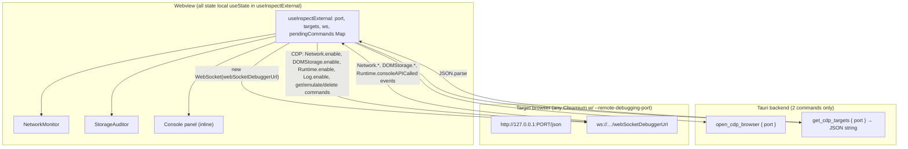

# Inspector (`inspector`) — UI Deep Dive

> Source: `references/hexbuffer/src/pages/inspector/` (8 files, ~2,170 lines)
> Exported page component: `InspectorPage` ("InspectExternal")

## 1. Overview & Purpose

A Chrome DevTools-style inspector that attaches to **any browser exposing a CDP (Chrome DevTools Protocol) remote-debugging port** — not just Halo's managed browser. The user sets a debugging port (default **9223**), optionally launches a CDP-configured browser via the backend, scans for debuggable tabs, and connects. Once connected, the webview speaks **CDP directly over a WebSocket** (`target.webSocketDebuggerUrl`) — no Rust intermediary for protocol traffic — driving three dashboards: **Network** (virtualized request ledger + Headers/Payload/Response/WebSocket detail with throttling emulation), **Storage** (cookies / localStorage / sessionStorage audit with per-item delete and origin wipe), and **Console** (captured `Runtime.consoleAPICalled` lines).

## 2. Annotated File Tree

```
inspector/
├── index.tsx                          (422)  Header (identity, badges, port/connect controls) + 3 TabsContent panels (Console inline)
├── types.ts                           (106)  InspectorConsoleLog/PageInfo/NetworkEntry/Cookie/StorageEntry + duplicated Target/NetworkRequest/Cookie/StorageItem/ConsoleLog/WebSocketFrame
├── constants.ts                        (53)  DEFAULT_DEBUGGING_PORT (9222), TOP_LEVEL_TABS, TABS, CONSOLE_FILTERS, CONSOLE_LEVEL_COLORS, EVENT_COLORS
├── api.ts                              (20)  openInspectorBrowser → open_cdp_browser; getInspectorPages → get_cdp_targets (JSON-in-string)
├── hooks/
│   └── use-inspect-external.ts        (680)  The engine: local useState store, WebSocket CDP client, sendCommand promise map, all event handling
└── components/
    ├── network-monitor.tsx            (533)  Virtualized ledger + resizable detail (Headers/Payload/Response/WebSocket tabs)
    ├── storage-auditor.tsx            (325)  Sidebar (Cookies/Local/Session) + tables + JSON/raw value inspector
    └── json-viewer.tsx                 (29)  Pretty-printed <pre> in ScrollArea with clipboard copy hook
```

## 3. Architecture & Dataflow



- **CDP client** (`sendCommand`): promise-per-command with an incrementing `id` and a `pendingCommands` Map keyed by the echoed id; resolves `data.result`, rejects with `data.error.message`. The file header documents the `catch (e: any)` → `unknown` fix (Tauri rejects with a *string*, so `.message` was `undefined` and real CDP errors were masked).
- **Connect sequence**: `disconnect()` → status `connecting` → `new WebSocket(url)` → on open: enable `Network`, `DOMStorage`, `Runtime`, `Log` domains → initial storage fetch. On close/error: back to `disconnected`.
- **Event handling** (in `ws.onmessage`): `Network.requestWillBeSent` (dedup by requestId), `Network.responseReceived`, `Network.loadingFinished`, `Network.loadingFailed` (errorText), `Network.webSocketFrame{Received,Sent}` (frames appended, timestamps ×1000), `DOMStorage.domStorageItem{Added,Removed,Updated,Cleared}` (trigger `refreshStorage`), `Runtime.consoleAPICalled` (args serialized via `arg.value || JSON.stringify(arg)`, level mapped, id = `Math.random().toString(36).substr(2,9)`).
- **Discovery**: `openBrowser` launches via backend then **polls `get_cdp_targets` up to 8× at 500 ms**, auto-connecting to the first `type === 'page'` target with a `webSocketDebuggerUrl`; `fetchTargets` (Scan button) is manual. A background `setInterval` (2 s) re-scans while the browser is running but disconnected.
- **Port change** resets targets/scanCount/isBrowserRunning.

## 4. State Management

**No Zustand store — everything is `useState` inside `useInspectExternal`:**

| Group | State | Detail |
| :-- | :-- | :-- |
| Connection | `port: number \| ''` (init **9223**), `targets`, `selectedTarget`, `connectionStatus: 'disconnected'\|'connecting'\|'connected'`, `error`, `scanCount`, `isBrowserRunning`, `activeTab` (default `'network'`) | Nothing persisted |
| Network | `networkRequests: NetworkRequest[]`, `selectedRequestId`, `responseBodies: Record<id, {body, base64Encoded}>` (lazy cache), `loadingBodyId`, `networkThrottling: 'online'` | WS frames accumulate on the request record |
| Storage | `cookies`, `localStorageItems`, `sessionStorageItems` | Fetched per-origin via `DOMStorage.getDOMStorageItems` |
| Console | `consoleLogs: ConsoleLog[]` | Unbounded array |
| Search | `searchQuery` | Shared by NetworkMonitor |
| Refs | `wsRef`, `idCounter`, `pendingCommands: Map<number, {resolve, reject}>` | Cleared on disconnect |

Throttling profiles (`emulateNetwork` → `Network.emulateNetworkConditions`): `offline` (0/0), `fast3g` (100 ms latency, 1.5 Mbps down / 750 Kbps up), `slow3g` (400 ms, 400 Kbps / 200 Kbps) — throughput computed as `(bits)/8` per second.

## 5. IPC Contracts

### Commands (only two)

| Command | Args | Returns | Notes |
| :-- | :-- | :-- | :-- |
| `open_cdp_browser` | `{ port }` | `void` | Launches Chromium with `--remote-debugging-port` (api.ts wrapper `openInspectorBrowser` accepts an unused `proxyPort`/`profilePath`) |
| `get_cdp_targets` | `{ port }` | `string` (JSON array of `Target`) | Double-parsed: `JSON.parse(resp)`; hook throws a descriptive error when the port answers but isn't CDP |

### Protocol (CDP over WebSocket, webview → browser directly)

Enabled domains: `Network`, `DOMStorage`, `Runtime`, `Log`. Commands sent: `Network.emulateNetworkConditions`, `Network.getCookies`, `Network.deleteCookies {name, domain}`, `DOMStorage.getDOMStorageItems {storageId: {securityOrigin, isLocalStorage}}`, `DOMStorage.removeDOMStorageItem`, `Storage.clearDataForOrigin {origin, storageTypes: 'all'}`, `Network.getResponseBody {requestId}`. Events consumed: the 9 listed in §3.

### Events (Tauri)

None.

## 6. UI Layout & Component Breakdown

```
┌─ TabbedPageLayout [Network|Storage|Console] (m-2 rounded-lg) ───────────────────────┐
│ HEADER (border-b bg-muted/20):                                                      │
│  [🐞] InspectExternal  [✓Session: Connected][✓CDP Browser: Active] / [Connecting…]  │
│  title — url (mono truncate)     [Disconnect]  OR  Port[9223] [Open Browser][Scan]  │
│                                          [Select target... ▾ (w-200)]               │
│ (disconnected) → Empty: Bug icon, guidance, "Discovery Error" card with fix steps   │
│   incl. copy-ready launch command: Chrome --remote-debugging-port={port}            │
│ (connected) ── Network: toolbar [🔍 Filter URL, Method, Status…][Clear] [Throttling ▾]│
│   [N requests]  || Ledger 50% (virtualized, 28px rows: METHOD URL STATUS TYPE TIME) │
│                 || Detail 50% (Headers/Payload/Response|WebSocket sub-tabs)         │
│ ── Storage: sidebar w-60 [🍪 Cookies n][HardDrive Local n][Session n]               │
│   toolbar [🔍][Refresh] Origin chip [Wipe Origin Storage (rose)]                    │
│   table (cookies 7-col / kv 3-col) + right w-96 JSON/raw value viewer               │
│ ── Console: [Console logs] [Clear Console] + mono log rows [time][LEVEL][text]      │
└─────────────────────────────────────────────────────────────────────────────────────┘
```

### Header (`index.tsx`)
Identity block: `Bug` icon in a `size-7 rounded-sm border bg-background text-primary` square, "InspectExternal" (`text-xs font-semibold`), then status badges in three states: connected → `bg-success` "Session: Connected" (with `PlugsConnected`) + "CDP Browser: Active" (variant `success`, dot span); connecting → `variant="warning" animate-pulse` "Connecting..."; else "Session: Disconnected" + "CDP Browser: Active/Offline" (outline, `bg-muted-foreground/45` dot). Connected also shows `selectedTarget.title — url` mono line. Right side switches between **Disconnect** and the discovery cluster: `Port:` number Input (`w-16`, empty-string aware), **Open Browser** (`Browser` icon), **Scan** (`ArrowClockwise`), and a target `Select` (`w-[200px] h-7`, placeholder "No active tabs") that connects on selection. Icons are imported **without the `Icon` suffix** here (`Bug`, `Terminal`, `WifiHigh`, …) — the only page doing so.

### Disconnected state
Kit `Empty` ("Disconnected from debugger target") with contextual description: after a scan that found zero tabs, an amber hint ("Browser is running on port {port}, but has no debuggable tabs open…"); otherwise generic guidance. On error, a `bg-destructive/10 border-destructive/20` card ("Discovery Error") with a numbered fix list and the macOS launch command rendered in a `<code>` block.

### `NetworkMonitor`
- Toolbar: filter `Input w-64` (matches url/method/type/status), **Clear** (`Trash`), native `<select>` throttling dropdown (not the kit Select — styled `bg-background border-input rounded-md`), count `Badge mono`.
- **Ledger** (left `ResizablePanel` 50%/min 20): CSS-grid rows `grid-cols-[80px_1fr_65px_80px_70px]`, **virtualized via `@tanstack/react-virtual`** (`estimateSize: 28`, `overscan: 10`), each row a `<button>` (absolute-positioned via `translateY`). Method colors: POST amber, GET emerald, else blue; status ≥400 rose / ≥300 amber / else emerald; in-flight shows a spinning `Hourglass`; failures show rose "Failed" with `errorText` tooltip. Selected row: `bg-primary/10 border-primary/20`.
- **Detail** (right panel, `bg-card`): header `METHOD URL` + × close; kit `Tabs` with `TabsList h-8 bg-muted/40` and `text-3xs h-7` triggers — **Headers**, **Payload**, and **Response** or **WebSocket** (WebSocket selected automatically for `type === 'WebSocket'` requests, and tab resets to headers on request change).
  - **Headers**: General grid (URL/Method/Status Code, "Pending" fallback), Request/Response header tables (`grid-cols-[150px_1fr]`, keys `text-primary/85`, count in the section title).
  - **Payload**: Query String Parameters parsed from the URL (`searchParams`, rose error text on parse failure); Request Post Body — JSON → `JsonViewer` (fixed `h-[250px]`), else `<pre>` fallback (max-h-300).
  - **Response**: lazily fetched on tab entry (`getResponseBody`), spinner while `loadingBodyId`; result header strip announces "Base64 Encoded Binary Data" vs "Formatted Text Response" and warns "Large body (N KB)" over 100,000 chars; `image/*` MIME renders an `` (data-URL when base64) on a `bg-checkerboard`; JSON → `JsonViewer` (base64 `atob`-decoded first); else plain `<pre>` ("(Empty Response Body)" placeholder).
  - **WebSocket**: frame ledger `grid-cols-[24px_60px_60px_1fr_60px]` — direction arrow (`ArrowDownLeft` incoming emerald / `ArrowUpRight` outgoing blue, tinted row bg `bg-emerald-500/5`/`bg-blue-500/5`), opcode names (1 Text, 2 Binary, 8 Close, 9 Ping, 10 Pong, else `Op:N`), size "N B", truncated payload with title tooltip, HH:MM:SS time.

### `StorageAuditor`
- **Sidebar** (`w-60 border-r bg-muted/20`): three buttons (Cookies `CookieIcon` / Local Storage / Session Storage both `HardDrive`) with count badges; selected = `bg-primary/10 text-primary border-primary/10`.
- **Toolbar**: search (`w-60`), **Refresh** (`ArrowsClockwise`), origin chip (mono, parsed from `targetUrl`), and the rose **Wipe Origin Storage** button (`border-rose-500/30 text-rose-600 hover:bg-rose-500/5`) → `Storage.clearDataForOrigin 'all'`.
- **Cookies table** (`grid-cols-[180px_1fr_120px_100px_60px_60px_45px]`): name/value/domain/path + ✓/− for HttpOnly and Secure + per-row delete (`Trash`, rose hover → `Network.deleteCookies`).
- **KV tables** (`grid-cols-[200px_1fr_45px]`): rows are buttons selecting the item (highlight `bg-primary/5 border-l-2 border-primary`); delete via `DOMStorage.removeDOMStorageItem` with the section's `isLocalStorage` flag.
- **Value inspector** (`w-full md:w-96 bg-card`, hidden for cookies): JSON → `JsonViewer`, else raw `<pre>`; empty state `HardDrive` icon + "Click a key-value row to inspect parsed or nested data structure".
- Section switch resets search + selection. All tables are plain (non-virtualized) with `divide-y` rows.

### `JsonViewer`
`JSON.stringify(data, null, 2)` in a `ScrollArea`/`<pre>` (`text-xs font-mono text-muted-foreground`); clipboard copy exposed to parents via an `onCopyRef` callback (assigned inside a `useMemo` — an unconventional ref-style pattern; no consumer passes it today).

### Console tab (inline in `index.tsx`)
Toolbar + `ScrollArea mono` (`bg-black/5 dark:bg-black/20 text-2xs`) of rows: `[HH:MM:SS]` + uppercase level (`w-12`) + `break-all` text. Level styling: error → `text-destructive bg-destructive/5 rounded`, warning → `text-warning-foreground bg-warning/5`, info → `text-info`, debug → muted, default `text-foreground/80`. Empty: `Terminal` icon + "No console messages captured yet."

## 7. UI Libraries & Primitives Used

| Category | Items (actual imports) |
| :-- | :-- |
| UI kit | `Badge`, `Button`, `Empty`, `EmptyContent`, `EmptyDescription`, `EmptyHeader`, `EmptyMedia` (with `variant="icon"`), `EmptyTitle`, `Input`, `ScrollArea`, `Select*`, `Tabs`, `TabsContent`, `TabsList`, `TabsTrigger` |
| Local primitives | `ResizablePanel/Handle/Group` (`@/components/ui/resizable`) |
| Virtualization | `@tanstack/react-virtual` (`useVirtualizer`) — the only inspector-table that is virtualized |
| Icons (`@phosphor-icons/react`, no `Icon` suffix) | `PlugsConnected`, `Bug`, `Terminal`, `WifiHigh`, `HardDrive`, `Browser`, `ArrowClockwise`, `Warning`, `Trash`, `MagnifyingGlass`, `ArrowUpRight`, `ArrowDownLeft`, `Hourglass`, `Gauge`, `Eye`, `Cookie as CookieIcon`, `ArrowsClockwise`, `Plus` (unused) |
| Networking | Raw browser `WebSocket` for CDP; `invoke` for the two backend commands |
| Misc | `cn`, `toErrorMessage` (`@/lib/ipc`), `TabbedPageLayout` |

**Dead constants** (`constants.ts`): `DEFAULT_DEBUGGING_PORT` (9222 — the hook uses 9223), `TOP_LEVEL_TABS`, `BROWSER_TAB_ID`, `DEFAULT_TOP_TAB`, `TABS`, `CONSOLE_FILTERS`, `CONSOLE_LEVEL_COLORS`, `EVENT_COLORS` (crawl/chat event chip colors) — none are imported by the current page.

## 8. Keyboard Shortcuts & Interactions

- No global or per-panel shortcuts; everything is click-driven (rows, sidebar buttons, sub-tabs).
- Detail panel and storage value viewer close via `×` buttons; ledger rows are focusable `<button>`s.

## 9. Styling Details

- Denser than most pages: `text-3xs`/`text-2xs` throughout, `font-mono` on all data cells, uppercase tracked section headers.
- Status colors are explicit hue pairs with dark variants (rose/amber/emerald-600) — same family as intercept's palette but inline, not via `request-styles`.
- `bg-checkerboard` utility for image previews; `bg-black/5 dark:bg-black/20` console gutter.
- Native `<select>` for throttling stands out as the only non-kit form control on the page.

## 10. Integration Points

- **Managed browser**: `open_cdp_browser` launches Chromium with remote debugging (the intercept page's managed browser is a separate flow); Inspector can attach to it or to any user-launched browser.
- **Regression page** (next chapter) drives its own browser automation; Inspector is the manual, human-driven counterpart.
- **No stores, no cross-page bridges**: findings cannot be pushed to Memory/Notes; response bodies live only in memory.

## 11. Notable Findings

1. **CDP from the webview**: protocol traffic bypasses Rust entirely (raw `WebSocket` to the debug port) — only target discovery and browser launch touch Tauri. This means the browser's debugger endpoint must be reachable from the webview's origin process.
2. **Port mismatch**: `constants.ts` declares `DEFAULT_DEBUGGING_PORT = 9222` but the hook initializes `9223` and every fallback uses 9223 — the constant is dead, and the docs/examples in the error card use the live port value.
3. **Duplicated types**: `Target`, `NetworkRequest`, `Cookie`, `StorageItem`, `ConsoleLog`, `WebSocketFrame` are defined in *both* `types.ts` and `hooks/use-inspect-external.ts` (the components import from the hook). `InspectorNetworkEntry`/`InspectorCookie`/`InspectorConsoleLog` in `types.ts` are unused variants.
4. **Error-handling archaeology in comments**: the hook documents that `catch (e: any).message` silently discarded real CDP errors (Tauri rejections are strings) — `errorMessage(unknown)` now wraps `toErrorMessage`.
5. **Unbounded growth**: `consoleLogs`, `networkRequests`, and `webSocketFrames` have no caps; long sessions grow until Clear/disconnect. `Runtime.exceptionThrown`/`Log.entryAdded` are enabled (`Log.enable`) but only `consoleAPICalled` is consumed.

## 12. Source Files Documented

`index.tsx` · `types.ts` · `constants.ts` · `api.ts` · `hooks/use-inspect-external.ts` · `components/network-monitor.tsx` · `components/storage-auditor.tsx` · `components/json-viewer.tsx`
