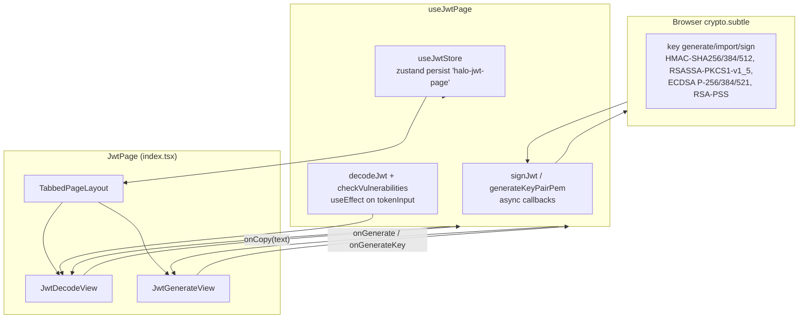

# JWT (jwt) — UI Deep Dive

> Source: `references/hexbuffer/src/pages/jwt/`

## 1. Overview & Purpose

The JWT page (route `/jwt`, lazy-loaded as `m.JwtPage` from `src/App.tsx`) is a two-tab JWT toolkit:

1. **Decoder** — paste a token into a Monaco-backed editor with a custom `jwt` Monarch grammar that colors header (red), payload (purple), signature (cyan) and delimiters (gray bold). The page live-decodes on every keystroke (pure frontend, no IPC), renders a claim-by-claim breakdown with typed value colors and humanized timestamps for `iat`/`exp`/`nbf`, and runs a rule-based vulnerability auditor (`none` algorithm, expired/missing `exp`, future `nbf`, missing `iat`, symmetric-alg advisory) whose findings badge the Decoder tab with an amber count.
2. **Generator** — build a token from JSON header/payload editors, a grouped algorithm Select (HMAC / RSA / ECDSA / RSA-PSS / None), and a secret/private-key field (password-masked for HMAC, PEM textarea for asymmetric, eye toggle). Signing uses the Web Crypto API (`crypto.subtle`) entirely client-side; a "Generate Key Pair / Secret" button produces random HMAC secrets or real RSA/EC/RSA-PSS keypairs exported to PEM.

All page state is persisted through the Zustand store `useJwtStore` (storage key `halo-jwt-page`) — token text, form contents, secret, generated token and active tab all survive restarts. Derived decode/vulnerability state is ephemeral `useState`.

## 2. Annotated File Tree

```
src/pages/jwt/
├── index.tsx                       (109 L)  JwtPage: TabbedPageLayout with decode/generate tabs; Decoder tab shows amber vulnerability-count indicator; branches to JwtDecodeView or JwtGenerateView passing store+hook state down as props
├── types.ts                        (33 L)   JwtAlgorithm (13 values), JwtMode, JwtVulnerabilitySeverity, JwtDecoded, JwtVulnerability
├── constants.ts                    (62 L)   SEVERITY_CONFIG (severity → { color classes, Phosphor icon }), ALGORITHM_OPTIONS (13 entries with category/type/description), DEFAULT_HEADER, DEFAULT_PAYLOAD
├── hooks/
│   └── use-jwt-page.ts             (175 L)  Bridges useJwtStore (persisted) + local ephemeral state; auto-decode effect; handleGenerate/handleGenerateKey/copy/clear actions
├── lib/
│   ├── jwt-helpers.ts              (463 L)  base64url codec, decodeJwt, formatTimestamp, checkVulnerabilities, signJwt (WebCrypto HMAC/RSASSA/ECDSA/RSA-PSS), generateKeyPairPem, pemToDer (incl. PKCS#1→PKCS#8 DER wrapping), derToPem
│   └── jwt-helpers.test.ts         (210 L)  Vitest suite: base64url round-trips (unicode), decodeJwt malformed cases, formatTimestamp (fake timers, ms-vs-s scaling), checkVulnerabilities rules, PEM helpers (64-char wrapping, single-line PEM tolerance)
└── components/
    ├── jwt-decode-view.tsx         (519 L)  Decoder tab: registers `jwt` Monaco language + jwt-light/jwt-dark themes; left token TextEditor / right DecodedSection breakdown + signature block; bottom Vulnerability Findings section
    ├── jwt-generate-view.tsx       (600 L)  Generator tab: header/payload TextEditors, key field with show/hide + Generate Key Pair, grouped algorithm Select, error box, Generate JWT footer button, colorized token output
    ├── decoded-section.tsx         (163 L)  Claim list with per-type value colors (green string / amber number / purple boolean / gray null / cyan object) and italic relative timestamps for iat/exp/nbf; private ColorizedValue
    ├── vulnerability-card.tsx      (96 L)   Severity-styled finding card: SEVERITY_CONFIG icon+border color, mono severity Badge via getSeverityColor
    └── colorized-jwt-input.tsx     (65 L)   Overlay-highlight textarea (transparent text + absolutely-positioned colored mirror, scroll-synced). Exported but NOT imported anywhere in the folder — superseded by the Monaco editor in jwt-decode-view
```

## 3. Architecture & Dataflow



Key flows:
- **Decode (no backend)**: `tokenInput` lives in the store; a `useEffect` re-runs `decodeJwt` + `checkVulnerabilities` on every change. Success populates `decoded` + `vulnerabilities` and clears `decodeError`; any non-3-part or non-JSON token sets `decodeError` to the fixed message `'Invalid JWT format. Expected three base64url-encoded parts separated by dots.'`.
- **Generate**: `handleGenerate` JSON-parses header/payload locally (errors set `genError`), forces `headerObj.alg = genAlgorithm`, then `signJwt(...)` with the Web Crypto API; result goes back to the store via `setGeneratedToken`.
- **Key gen**: `handleGenerateKey` returns an empty string for `none`; HMAC gets `crypto.getRandomValues` hex (32/48/64 bytes for HS256/384/512); RS/ES/PS get real `crypto.subtle.generateKey` keypairs exported as PKCS#8 private / SPKI public PEM. The private key overwrites `genSecret` in the store.
- **No Tauri IPC at all** — jwt performs zero `invoke`/`listen` calls; the only shared import from `@/lib/ipc` is `toErrorMessage` for error formatting.

## 4. State Management

### `useJwtStore` (`src/stores/jwt-store.ts`) — persisted via `zustand/middleware persist`
| Field | Type | Default | Persisted | Setters |
|---|---|---|---|---|
| `mode` | `JwtMode` (`'decode' \| 'generate'`) | `'decode'` | yes | `setMode` |
| `tokenInput` | `string` | `''` | yes | `setTokenInput` |
| `genHeader` | `string` | `DEFAULT_HEADER` (`{"alg":"HS256","typ":"JWT"}` pretty-printed) | yes | `setGenHeader` |
| `genPayload` | `string` | `DEFAULT_PAYLOAD` (`{sub:'1234567890', name:'John Doe', iat:1516239022}`) | yes | `setGenPayload` |
| `genSecret` | `string` | `''` | yes (⚠ secrets persist to disk) | `setGenSecret` |
| `genAlgorithm` | `JwtAlgorithm` | `'HS256'` | yes | `setGenAlgorithm` |
| `generatedToken` | `string` | `''` | yes | `setGeneratedToken` |
| — | `clearDecode()` | — | — | resets `tokenInput` |
| — | `clearGenerate()` | — | — | resets header/payload/secret/token to defaults |

Persistence details: storage `name: 'halo-jwt-page'`; `partialize` keeps the 7 data fields; a custom `merge` validates the persisted `genAlgorithm` against the 13-member whitelist and coerces invalid values back to `'HS256'`.

### Ephemeral state in `useJwtPage` (useState)
| Field | Type | Purpose |
|---|---|---|
| `decoded` | `JwtDecoded \| null` | Last successful decode |
| `vulnerabilities` | `JwtVulnerability[]` | Audit findings |
| `decodeError` | `string \| null` | Decode failure message |
| `genError` | `string \| null` | Signing/validation failure |
| `generating` | `boolean` | Sign-in-flight flag |
| `generatingKey` | `boolean` | Keygen-in-flight flag |

Local to `JwtGenerateView`: `showSecret` (eye toggle). Local to `JwtDecodeView`: `monacoRef`.

## 5. IPC Contracts

**None.** The JWT page is fully client-side:

- No `invoke(...)` commands.
- No `listen(...)` event subscriptions.
- Signing/keygen use the standard `crypto.subtle` / `crypto.getRandomValues` Web Crypto API inside `lib/jwt-helpers.ts` (not crypto-js, not jose, not a Rust backend).

## 6. UI Layout & Component Breakdown

### ASCII layout
```
┌──────────────────────────────────────────────────────────────────────┐
│ PageTabBar: [Decoder (2)amber][Generator]                            │
├──────────────────────────────────────────────────────────────────────┤
│ ┌ m-2 border rounded-md bg-background ─────────────────────────────┐ │
│ │ DECODE TAB                          GENERATE TAB                 │ │
│ │ ┌─50% (min 30)──┬─┬─50% (min 30)──┐ ┌─50% (min 30)─┬─50%──────┐│ │
│ │ │ JWT Token     │h│ Decoded      │ │ Configuration│ Generated ││ │
│ │ │ [trash] h-8   │a│ Breakdown    │ │ h-8 [trash]  │ Token     ││ │
│ │ │ Monaco 'jwt'  │n│ [copy] h-8   │ │ Header JSON  │ [copy]    ││ │
│ │ │ custom theme  │d│ Header claims│ │ (Monaco 160) │ colorized ││ │
│ │ │ wordWrap on   │l│ Payload      │ │ Payload JSON │ text      ││ │
│ │ │ fontSize 12   │e│ Signature    │ │ (Monaco 180) │           ││ │
│ │ ├───────────────┴─┴──────────────┤ │ Secret/PEM   │           ││ │
│ │ │ Vulnerability Findings (max-h  │ │ + Algorithm  │           ││ │
│ │ │ 140px ScrollArea)              │ │ [error box]  │           ││ │
│ │ └────────────────────────────────┘ │ [Generate]   │           ││ │
│ │                                    └──────────────┴───────────┘│ │
│ └──────────────────────────────────────────────────────────────────┘ │
└──────────────────────────────────────────────────────────────────────┘
```

### `JwtPage` (`index.tsx`)
- `TabbedPageLayout` with `tabs=[Decoder, Generator]` (both `closable:false, renamable:false`); `className="flex flex-col min-h-0 h-full"`, `contentClassName="flex-1 min-h-0 overflow-hidden m-2 border rounded-md bg-background"`. Children wrapped in a `<main className="flex flex-col flex-1 min-h-0">`.
- Decoder tab `indicator` when `vulnerabilities.length > 0`: `h-3.5 min-w-3.5 p-1 text-[8px] font-bold text-white rounded-full bg-amber-600` count pill.

### `JwtDecodeView` (`jwt-decode-view.tsx`)
Props: `tokenInput, setTokenInput, decoded, vulnerabilities, decodeError, onCopy(text), onClear?`.
- **Monaco customization** (`handleMount`, cached in `monacoRef`): registers language id `'jwt'` (idempotent via `languages.getLanguages()` check) with a Monarch tokenizer whose states are `root/afterHeader/payload/afterPayload/signature`, `tokenPostfix: '.jwt'`; defines `jwt-dark` (base `vs-dark`; header `ef4444`, payload `c084fc`, signature `22d3ee`, delimiter `71717a` bold) and `jwt-light` (base `vs`; `dc2626` / `9333ea` / `0891b2` / `71717a`). A second `useEffect` re-applies the theme on `useTheme()` changes.
- **TextEditor options**: `wordWrap:'on', lineNumbers:'off', minimap:{enabled:false}, scrollBeyondLastLine:false, fontSize:12, folding:false, renderLineHighlight:'none'`, `height="100%"`, `language="jwt"`.
- Left pane header `h-8 px-3 border-b bg-muted/10`: "JWT Token" + hint; `TrashIcon` clear `Button variant="quiet" size="icon" className="h-6 w-6"` disabled when input empty.
- Right pane: algorithm chip (`px-1.5 py-0.2 text-3xs font-mono text-white bg-primary rounded`); `CopyIcon` quiet icon button that copies a formatted `"Header:\n{...}\n\nPayload:\n{...}"` string. Body: `decodeError` → `text-xs font-mono text-destructive bg-destructive/5` block; else `ScrollArea` of `DecodedSection title="Header"` + `title="Payload"` + signature block (Algorithm / Value rows, `break-all text-2xs opacity-85`); else centered "Paste a JWT token to decode."
- **Vulnerability Findings** section (bottom, only when findings exist): `h-8 border-b bg-muted/15` header with `"N issue(s) detected"`, `ScrollArea max-h-[140px]` of `VulnerabilityCard`s in `space-y-1.5 p-3`.
- ⚠ Resizable panels here come from **`@/components/ui/resizable`** (local wrapper over `@celestia-project/ui`'s primitives, imported as `Group/Panel/Separator`), with string-typed sizes `defaultSize="50" minSize="30"` — unlike the hash page which imports the same names from the kit barrel with numeric sizes.

### `JwtGenerateView` (`jwt-generate-view.tsx`)
Props: `genHeader/genPayload/genSecret` + setters, `genAlgorithm` + setter, `generatedToken, genError, generating, generatingKey?, onGenerate, onGenerateKey?, onCopy(text), onClear?`.
- Derived flags: `isNone = genAlgorithm === 'none'`; `isAsymmetric = RS*|ES*|PS*`. `isEmpty` gates the clear button.
- Left panel `ScrollArea`: Header JSON `TextEditor` (`language="json"`, `height={160}`, bordered, theme = raw `theme` value) and Payload JSON (`height={180}`), both under `Label leading="tight"`.
- Key row: label switches `Key` (none) / `Private Key (PEM)` (asymmetric) / `Secret Key`; header-right actions are `Copy` (when a secret exists) and `Generate Key Pair` / `Generate Secret` (`KeyIcon`, disabled while `generatingKey`). Asymmetric input = `Textarea leading="tight" mono` `h-24 resize-none bg-muted/5` with PKCS#8/PKCS#1 placeholder; symmetric = `Input textSize="xs" mono` `h-8 pr-8` with `type={showSecret ? 'text' : 'password'}` and an absolutely-positioned eye button (`EyeIcon`/`EyeSlashIcon`, `tabIndex={-1}`) toggling visibility. Disabled when `isNone`.
- Algorithm column `w-[105px]`: `Select` whose `SelectContent` groups `ALGORITHM_OPTIONS` by `category` into `SelectGroup` + `SelectLabel` (`text-3xs uppercase tracking-wider`).
- `genError` box: `p-2.5 text-xs font-mono text-destructive rounded-md bg-destructive/5`.
- Footer `border-t bg-muted/10`: `Generate JWT` button (`KeyIcon size-3.5`) disabled while `generating` or when `!isNone && !genSecret.trim()`; label "Generating..." while in flight.
- Right panel: token rendered as `colorizedToken` (useMemo splitting on `.`) with spans `text-red-600 dark:text-red-400` / `text-purple-600 dark:text-purple-400` / `text-cyan-600 dark:text-cyan-400` and muted dots; fallback text "Generated JWT token will appear here..." in a `font-mono text-xs whitespace-pre-wrap break-all p-4` container.

### `DecodedSection` (`decoded-section.tsx`)
Props: `title, data: Record<string, unknown>`. Renders `Label text-3xs font-bold uppercase tracking-wider` + rows (`key:` in `font-mono text-blue-700 dark:text-blue-300`). For `iat`/`exp`/`nbf` numeric claims (`TIMESTAMP_KEYS` set) shows `formatTimestamp` in italic muted text instead of the raw value. `ColorizedValue` (private) colors by `valueType`: string green, number amber, boolean purple, null gray, object cyan (`JSON.stringify` inline, `break-all text-2xs opacity-85`).

### `VulnerabilityCard` (`vulnerability-card.tsx`)
Props: `vuln: JwtVulnerability`. Icon from `SEVERITY_CONFIG[vuln.severity].icon` (`ShieldWarningIcon` critical / `ShieldIcon` high / `WarningCircleIcon` medium / `Info` low+info), card border/bg from `config.color`; severity rendered as `Badge mono variant="outline"` with `getSeverityColor` (`src/lib/status-colors.ts` — bg-blue-600/green-600/yellow-600/orange-600/red-600) and `text-4xs uppercase text-white rounded shadow-none border-none`.

### `ColorizedJwtInput` (`colorized-jwt-input.tsx`)
Props: `value, onChange, placeholder`. A highlight-layer-over-transparent-textarea trick: colored `<span>` mirror (`#ef4444` / `#a855f7` / `#06b6d4`, delimiter `#d4d4d8`, inline `style` not classes) with `aria-hidden pointer-events-none`, textarea has `style={{ color: 'transparent', caretColor: 'hsl(var(--foreground))' }}`, scroll synced via `handleScroll`. **Dead code in this page** — no imports; decode view uses Monaco instead.

## 7. UI Libraries & Primitives Used

### `@celestia-project/ui` components
| Component | Used in |
|---|---|
| `Badge` (`mono`, `variant='outline'`) | `vulnerability-card.tsx` |
| `Button` (`variant='quiet'` heavily used; `size='icon' | 'xs' | 'md'`) | both views |
| `Input` (`textSize='xs'`, `mono`) | `jwt-generate-view.tsx` secret field |
| `Label` (custom prop `leading="tight"`) | decode/generate views, decoded-section |
| `ScrollArea` | both views |
| `Select`, `SelectContent`, `SelectGroup`, `SelectItem`, `SelectLabel`, `SelectTrigger`, `SelectValue` | generate view algorithm picker |
| `TextEditor` / `MonacoInstance` / `TextEditorInstance` (types exported from the kit) | decode token editor, generate header/payload editors |
| `Textarea` (`leading="tight"`, `mono`) | generate view PEM field |

### Local wrapper
`@/components/ui/resizable` — `ResizableHandle`, `ResizablePanel`, `ResizablePanelGroup` (wraps kit `Group/Panel/Separator`; used with string sizes here).

### Phosphor icons (exact names, `@phosphor-icons/react`)
`CopyIcon`, `TrashIcon` (decode view + generate view); `EyeIcon`, `EyeSlashIcon`, `KeyIcon` (generate view); `ShieldIcon`, `ShieldWarningIcon`, `WarningCircleIcon`, `Info` (constants.ts SEVERITY_CONFIG, rendered by vulnerability-card).

### Editors
Monaco via the kit's `TextEditor`: custom `jwt` Monarch language, two custom themes, JSON language for form editors. No CodeMirror.

### Crypto / third-party libs
| Lib / API | Usage |
|---|---|
| Web Crypto `crypto.subtle` | `signJwt` (HMAC, RSASSA-PKCS1-v1_5, ECDSA, RSA-PSS), `generateKeyPairPem` (RSA 2048, EC P-256/384/521, RSA-PSS) |
| `crypto.getRandomValues` | HMAC secret generation (32/48/64 bytes hex) |
| Web APIs | `atob`/`btoa`/`TextEncoder`/`encodeURIComponent` for base64url; `navigator.clipboard` |
| `zustand` + `zustand/middleware persist` | `useJwtStore` |
| `sonner` — `toast` | keygen success/info, copy confirmation |
| `vitest` | `jwt-helpers.test.ts` |
| **Not used**: crypto-js, jose, jsonwebtoken, any Tauri API |

## 8. Keyboard Shortcuts & Interactions

- No custom keyboard shortcuts. Monaco supplies its own editor keymap (wordWrap on, no line numbers).
- Eye button (`tabIndex={-1}`) is deliberately mouse-only so Tab order skips it.
- Live decode happens on every editor change; vulnerability section mounts/unmounts with findings.
- Buttons: Copy JSON (decode), Copy generated token, Copy secret, Generate Key Pair/Secret, Generate JWT, Clear (per view), all guarded by `disabled` state.
- Select clear absorption is not needed here (algorithm always valid; store `merge` guards persisted values).

## 9. Styling Details

- **JWT tri-color scheme** appears twice: Monaco theme tokens (`ef4444`/`c084fc`/`22d3ee` dark; `dc2626`/`9333ea`/`0891b2` light) and Tailwind spans in the generated-token output (`text-red-600/400`, `text-purple-600/400`, `text-cyan-600/400`), with `text-muted-foreground` dot separators.
- **Claim value colors** (`TYPE_COLORS`): `text-green-700 dark:text-green-300` string, `text-amber-700 dark:text-amber-300` number, `text-purple-700 dark:text-purple-300` boolean, `text-gray-500 dark:text-gray-400` null, `text-cyan-700 dark:text-cyan-300` object; keys always `text-blue-700 dark:text-blue-300`.
- **Severity palette** (`SEVERITY_CONFIG`): critical red, high orange, medium yellow, low blue, info muted — as `border-<c>-500/20 bg-<c>-500/5 text-<c>-600/400` card treatments.
- Headers are compact `h-8 px-3 border-b bg-muted/10` (slightly tighter than the hash page's `h-10`); kit `Button variant="quiet" size="icon"` with `h-6 w-6` for pane-level actions.
- Kit extension props used: `leading="tight"` on Label/Textarea/SelectTrigger/SelectItem/Button, `textSize="xs"`, `mono` on Input/Textarea/Badge — all `@celestia-project/ui`-specific (not shadcn defaults).
- `text-2xs` / `text-3xs` / `text-4xs` micro sizes recur; `font-mono` on all token/claim/signature output.

## 10. Integration Points

- **`src/stores/jwt-store.ts`** — the only jwt-owned shared state; imports `DEFAULT_HEADER`/`DEFAULT_PAYLOAD` back from `@/pages/jwt/constants` (page→store→page cycle).
- **`@/components/theme-provider`** — `useTheme()` drives Monaco theme selection (`jwt-light`/`jwt-dark`) and the raw `theme` prop for JSON editors.
- **`@/lib/status-colors`** — `getSeverityColor` supplies badge background hues shared with other severity UIs in the app.
- **`@/lib/ipc`** — only `toErrorMessage` (for the keygen failure toast and HMAC sign error text). No backend commands.
- **`@/layout/tabs-layout`** — `TabbedPageLayout`/`PageTabItem` (indicator slot used for the vulnerability count).
- **Routing** — `src/App.tsx` maps `/jwt` → lazy `JwtPage`.
- **Potential consumers of helpers**: `base64UrlDecode/Encode`, `decodeJwt`, `signJwt`, `generateKeyPairPem` are exported from `lib/jwt-helpers.ts` and reusable by other modules (e.g. proxy/repeater token tooling), though no cross-page import was found in this folder's scope.

## 11. Source Files Documented

- `src/pages/jwt/index.tsx`
- `src/pages/jwt/types.ts`
- `src/pages/jwt/constants.ts`
- `src/pages/jwt/hooks/use-jwt-page.ts`
- `src/pages/jwt/lib/jwt-helpers.ts`
- `src/pages/jwt/lib/jwt-helpers.test.ts`
- `src/pages/jwt/components/jwt-decode-view.tsx`
- `src/pages/jwt/components/jwt-generate-view.tsx`
- `src/pages/jwt/components/decoded-section.tsx`
- `src/pages/jwt/components/vulnerability-card.tsx`
- `src/pages/jwt/components/colorized-jwt-input.tsx`

Supporting shared files read for usage context: `src/stores/jwt-store.ts`, `src/components/ui/resizable.tsx`, `src/components/theme-provider.tsx`, `src/lib/status-colors.ts`, `src/layout/tabs-layout/tabbed-page-layout.tsx`.
