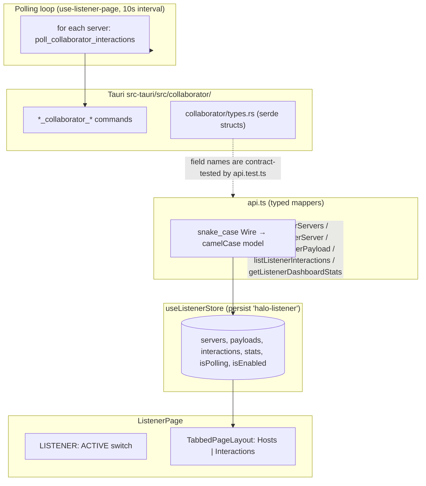

# Listener (`listener`) — UI Deep Dive

> Source: `references/hexbuffer/src/pages/listener/` (12 files, ~2,475 lines)
> Exported page component: `ListenerPage`

## 1. Overview & Purpose

The Listener page is Halo's **out-of-band (OOB) interaction detector** — the Burp Collaborator / interactsh analog. Users register external listener servers (self-hosted collaborator, interactsh, etc.) by URL + API key, generate **callback payload URLs** ("subdomains") to inject into target requests (SSRF/XXE/Log4Shell probes), and watch incoming **interactions** (DNS / HTTP / HTTPS callbacks) arrive via a 10-second polling loop against each registered server. Two tabs: **Hosts** (server + payload management) and **Interactions** (grouped event table + detail pane), plus a global `LISTENER: ACTIVE/DISABLED` switch overlaid on the tab bar.

## 2. Annotated File Tree

```
listener/
├── index.tsx                             (140)  Page: global toggle overlay, TabbedPageLayout (hosts|interactions)
├── types.ts                               (62)  ListenerServer, ListenerPayload, ListenerInteraction, ListenerDashboardStats
├── api.ts                                (224)  Typed IPC layer: snake_case wire structs → camelCase mappers (12 commands)
├── api.test.ts                           (369)  Contract test: parses src-tauri/src/collaborator/types.rs as fixture
├── hooks/
│   └── use-listener-page.ts             (299)  Page controller: loads, CRUD, 10s polling loop, search filter, auto-payload
└── components/
    ├── hosts-panel.tsx                   (467)  ListenerHosts: server cards grid, add/edit Dialog (RHF+zod), SetupGuide
    ├── interactions-panel.tsx            (368)  ListenerInteractions: metrics bar, filter toolbar, server-grouped tables
    ├── interaction-detail-pane.tsx       (164)  Detail: Overview/Headers/Body/Raw tabs
    ├── metrics.tsx                        (74)  ListenerMetrics status strip (servers/payloads/interactions/last callback)
    └── hooks/
        ├── use-hosts-panel.ts           (192)  Form state (zod schema), key visibility, payload generation
        ├── use-interactions-panel.ts     (70)  Collapse state, drag cover, grouping by server, orphan detection
        └── use-interaction-detail.ts     (45)  Detail tabs, headers JSON.parse, query-param extraction
```

## 3. Architecture & Dataflow



- **Polling**: `useEffect` keyed on `[isEnabled, servers.length]` (deliberately `servers.length`, per an in-code comment, so unrelated server edits don't restart the interval). Each tick: `pollListenerInteractions(server.id)` for every server, then reloads interactions + stats + payloads; errors land in `lastPollError`. `isPolling` toggles the Interactions tab status badge.
- **Auto-payload bootstrap**: a separate `useEffect` creates a `Default Callback [<HH:MM:SS>]` payload for any server without an active payload (fire-and-forget with console error handling).
- **No Tauri events** — everything is command polling.

## 4. State Management — `src/stores/listener.ts`

| Field | Type | Default | Persisted |
| :-- | :-- | :-- | :-- |
| `activeSubTab` | `'hosts' \| 'interactions'` | `'hosts'` | ✅ (merge re-validates against the union, else `'hosts'`) |
| `servers` | `ListenerServer[]` | `[]` | ✅ |
| `isEnabled` | `boolean` | `true` | ✅ (merge coerces to boolean) |
| `payloads` / `interactions` / `stats` | — | `[]` / `[]` / zeroed stats | ❌ (explicitly reset in custom `merge`) |
| `selectedInteractionId` / `selectedPayloadFilter` / `selectedTypeFilter` | `string \| null` | `null` | ❌ (selectedInteractionId reset on rehydrate) |
| `isPolling` | `boolean` | `false` | ❌ |
| `lastPollError` | `string \| null` | `null` | ❌ |
| `search` | `string` | `''` | ❌ (reset on rehydrate) |

Persist key **`halo-listener`** with a **custom `merge`** that whitelists persisted keys and force-resets ephemeral state. `selectedPayloadFilter` has a store setter but no UI control (type filter only).

## 5. IPC Contracts

### Commands (all via `api.ts`; wire structs are snake_case per `src-tauri/src/collaborator/types.rs`)

| Command | Args (snake_case) | Returns | Frontend wrapper |
| :-- | :-- | :-- | :-- |
| `list_collaborator_servers` | — | `ServerWire[]` | `listListenerServers()` |
| `add_collaborator_server` | `{ server: { name, url, api_key } }` | `ServerWire` | `addListenerServer` |
| `update_collaborator_server` | `{ server: { id, name, url, api_key, status, created_at, updated_at } }` | `ServerWire` | `updateListenerServer` |
| `delete_collaborator_server` | `{ id }` | `void` | `deleteListenerServer` |
| `check_collaborator_server_health` | `{ id }` | `ServerWire` | `checkListenerServerHealth` |
| `create_collaborator_payload` | `{ request: { server_id, name, description, tags } }` | `PayloadWire` | `createListenerPayload` |
| `list_collaborator_payloads` | `{ serverId: string \| null }` | `PayloadWire[]` | `listListenerPayloads` |
| `delete_collaborator_payload` | `{ id }` | `void` | `deleteListenerPayload` |
| `archive_collaborator_payload` | `{ id }` | `void` | `archiveListenerPayload` |
| `list_collaborator_interactions` | `{ payloadId, interactionType }` (both nullable) | `InteractionWire[]` | `listListenerInteractions` |
| `poll_collaborator_interactions` | `{ serverId }` | `InteractionWire[]` | `pollListenerInteractions` |
| `get_collaborator_dashboard_stats` | — | `DashboardStatsWire` | `getListenerDashboardStats` |

### Events

None — polling only.

**Contract test (`api.test.ts`)**: a vitest suite that `import.meta.glob`s the actual Rust `types.rs` as raw text and derives the expected snake_case key sets, so a renamed Rust field or command breaks the test instead of silently rendering blanks. The file documents that `status`/`interaction_type` unions are cast, not checked — "the one remaining unsound edge."

## 6. UI Layout & Component Breakdown

```
┌─ ListenerPage (relative h-full) ─────────────────────────────────────────────────────┐
│                        LISTENER: ACTIVE  ⬤⬤ (Switch, absolute right-4 top-[9px] z-20)│
│ ┌─ TabbedPageLayout (m-2 border rounded-lg) ────────────────────────────────────────┐ │
│ │ [ Hosts ]  [ Interactions ●Polling active / ⚠Polling disabled ]                   │ │
│ │ ┌ HOSTS TAB ────────────────────────────────────────────────────────────────────┐ │ │
│ │ │ "2 hosts configured"                                [+ Add Host]              │ │ │
│ │ │ ┌─ Card ─────────────┐ ┌─ Card ─────────────┐  (grid md:2 lg:3)             │ │ │
│ │ │ │ name  [CONNECTED]  │ │ ...                │                                 │ │ │
│ │ │ │ https://collab...  │ │                    │                                 │ │ │
│ │ │ │ API Key: abcd••••  │ │                    │                                 │ │ │
│ │ │ │ Subdomains (2) [+New]                     │                                 │ │ │
│ │ │ │  [xxx.collab… ⧉ 🗑]│ │                    │                                 │ │ │
│ │ │ │ [⟳ Check][✎ Edit][🗑]                     │                                 │ │ │
│ │ │ └────────────────────┘ └────────────────────┘                                 │ │ │
│ │ └──────────────────────────────────────────────────────────────────────────────┘ │ │
│ │ ┌ INTERACTIONS TAB ────────────────────────────────────────────────────────────┐ │ │
│ │ │ ●2 servers active | 🛡3 payloads | 📈12 interactions today (DNS:4·HTTP:6·H:2)│ │ │
│ │ │ 12 interactions   [🔍 Search (w-52→w-72) ✕] [All Types ▾]                    │ │ │
│ │ │ ▾ My Collab (collab.example.com)                                    [3]      │ │ │
│ │ │   │TYPE│SOURCE IP│METHOD│PATH│TIME│   ← Table, sticky header bg-muted/65     │ │ │
│ │ │ ▾ Orphaned Interactions (destructive tint)                          [1]      │ │ │
│ │ ├────────────────── ResizableHandle (withHandle) ─────────────────────────────┤ │ │
│ │ │ [HTTPS] 1.2.3.4   [Overview|Headers|Body|Raw]                          [✕]   │ │ │
│ │ └──────────────────────────────────────────────────────────────────────────────┘ │ │
│ └──────────────────────────────────────────────────────────────────────────────────┘ │
└─────────────────────────────────────────────────────────────────────────────────────┘
```

### Global toggle (`index.tsx`)
Absolute overlay (`absolute right-4 top-[9px] z-20`): mono `text-3xs` label `LISTENER: ACTIVE/DISABLED` + a downsized `Switch` (`h-4 w-7`, knob `[&>span]:h-3 [&>span]:w-3`, checked state `data-[state=checked]:bg-green-500` with `translate-x-3` override, `aria-label="Toggle listener active state"`). Tab status: Interactions shows `{ kind: 'running', label: 'Polling active' }` when polling, `{ kind: 'needs-action', label: 'Polling disabled' }` when the global switch is off. Source comment marks this a "ponytail: simplified two tabs layout".

### `ListenerHosts` (`hosts-panel.tsx`)
- Header bar (`h-10 border-b bg-muted/40`): count label ("N host(s) configured") + `Add Host` outline button.
- **Empty state → `SetupGuide`**: an animated (inline `<style>` + `@keyframes listener-guide-enter`, 280ms cubic-bezier, 55ms staggered steps) onboarding panel: "Out-of-Band Listener" explainer, 3-step numbered spine (Add a Host / Copy Callback URL / Inject & Monitor — `h-5 w-5 rounded-full bg-primary/10` circles with `w-px flex-1 bg-border/60` connectors), an example `<pre>` showing SSRF/`X-Forwarded-For`/XXE injection of `YOUR_CALLBACK_URL`, and an "Add your first host" CTA.
- **Server `Card` grid** (`md:grid-cols-2 lg:grid-cols-3`, `items-start`): status `Badge` (`default` when `connected`, else `secondary`, uppercase `text-4xs`); **API key row** masked `${slice(0,4)}••••••` with per-server eye toggle (`showKeys` record) and copy button (both `variant="quiet" size="icon" h-4.5 w-4.5`, key text is `select-all`); **Subdomains** section listing active payloads (`rounded bg-muted/40 border-border/30` chips with copy + delete, `select-all` mono `text-4xs`), "Generating first subdomain..." spinner state, and a `+ New` quiet button (`SpinnerGapIcon animate-spin` while `generating === s.id`); footer actions `Check Status` (`ArrowClockwiseIcon` spins while `checking === s.id`) / `Edit` / destructive-tinted delete.
- **Add/Edit `Dialog`** (`max-w-md`): react-hook-form `Form/FormField/FormItem/FormLabel/FormControl/FormMessage` + zod `SERVER_FORM_SCHEMA` (`name` min 1; `url` must parse with `http:`/`https:` protocol; `apiKey` min 1; `mode: 'onChange'`). API key field has show/hide (`showFormKey`) and copy buttons; submit label `Connecting...` / `Save Changes` / `Connect Host`; server-side failures via `form.setError('root')` rendered as `text-destructive`. **`startAdd` pre-fills a random 32-char hex key** generated from `'abcdef0123456789'` via `Math.random` (frontend-side, not crypto).
- `toggleExpandPayloads`/`expandedPayloads` are kept by the hook but unused by the panel (payload list is always expanded).

### `ListenerMetrics` (`metrics.tsx`)
One-line mono strip (`border-b bg-muted/30 px-3 py-1.5 text-xs font-mono`), pipe-separated: pulsing emerald dot (`animate-ping` + solid, gray when disabled) + `{servers active}`; `ShieldIcon` payloads; `PulseIcon` interactions today with `(DNS: n · HTTP: n · HTTPS: n)` breakdown; conditional `ClockIcon` "Last callback: <relative>" via `formatRelative` (Just now / Xm ago / Xh ago / Xd ago). Servers count shows `0` when the global switch is off.

### `ListenerInteractions` (`interactions-panel.tsx`)
- **Toolbar** (`h-10`): count label; search `Input` (`w-52 pl-7 pr-7`, expands to `focus:w-72 transition-all duration-150`, `MagnifyingGlassIcon` overlay, clear `XIcon` button) with **200 ms debounce** to the store; type `Select` (`All Types/DNS/HTTP/HTTPS`, `h-7 w-32`, `null` when 'all').
- **Split view**: local `ResizablePanelGroup` from `@/components/ui/resizable` (`orientation="vertical"`, ids `listener-interactions-split` / `-list` / `-detail`), list `defaultSize={selectedInteraction ? "60" : "100"} minSize="20"`, detail `defaultSize="40" minSize="15"` rendered only when a row is selected. During handle drag (`handlePointerDown` + window `pointerup`), `coverStyle` (`pointerEvents: none; userSelect: none`) is applied to both panes to stop text-selection flicker.
- **Grouping**: per-server sections (collapsible via `collapsedServers`, header `bg-muted/15 hover:bg-muted/30`, count `Badge mono`), each containing a kit `Table` (`TableHeader` sticky `top-0 bg-muted/65 z-10`; columns Type w-[80px], Source IP w-[120px], Method w-[80px], Path, Time w-[160px]; `TableCell size="sm"` with kit `mono` prop). Type badge variants via `TYPE_VARIANT`: `dns→secondary`, `http→default`, `https→outline`.
- **Orphaned interactions**: interactions whose payload or server no longer exists group under a destructive-tinted section (`bg-destructive/5 hover:bg-destructive/10`, `Badge variant="destructive"`, subtitle "(Hosts no longer registered)") with its own identical table.
- Empty text: "No hosts configured. Configure a host to start receiving interactions."
- Non-virtualized — plain tables (fine at poll-sourced volumes).

### `InteractionDetailPane` (`interaction-detail-pane.tsx`)
`h-10` header: uppercase type `Badge variant="outline"` + mono source IP + `XIcon` close (`h-6 w-6` quiet icon). Hand-rolled tab bar (`h-9 bg-muted/20`, active = `bg-background shadow-sm`): Overview / Headers / Body / Raw.
- **Overview**: `InfoBlock` rows (Type, Source IP, Method, Path, Timestamp, Payload ID) + parsed **Query Parameters** section (from `useInteractionDetail.parsedQuery`, `URLSearchParams` over `path.slice(indexOf('?'))`).
- **Headers**: `interaction.headers` is stored as a JSON string → `JSON.parse` with null fallback ("No headers available"); key column right-aligned `w-32`.
- **Body**: Request Body and Server Response `RawBlock`s (`pre max-h-80 overflow-auto bg-muted/50 font-mono text-3xs select-text`).
- **Raw**: `rawRequest` in a `RawBlock`.

## 7. UI Libraries & Primitives Used

| Category | Items (actual imports) |
| :-- | :-- |
| UI kit | `Badge`, `Button`, `Card`, `CardContent`, `Dialog`, `DialogContent`, `DialogHeader`, `DialogTitle`, `Form`, `FormControl`, `FormField`, `FormItem`, `FormLabel`, `FormMessage`, `Input`, `Select*`, `Switch`, `Table`, `TableBody`, `TableCell`, `TableHead`, `TableHeader`, `TableRow`, `TabsContent` |
| Local primitives | `ResizablePanel/ResizableHandle/ResizablePanelGroup` from `@/components/ui/resizable` (not the kit) |
| Icons (`@phosphor-icons/react`) | `PlusIcon`, `ArrowClockwiseIcon`, `TrashIcon`, `EyeIcon`, `EyeSlashIcon`, `CopyIcon`, `PencilSimpleIcon`, `SpinnerGapIcon`, `CaretDownIcon`, `CaretRightIcon`, `MagnifyingGlassIcon`, `XIcon`, `ShieldIcon`, `PulseIcon`, `ClockIcon`, `WifiHighIcon` (imported, unused) |
| Forms | `react-hook-form` + `@hookform/resolvers/zod` + `zod` (`SERVER_FORM_SCHEMA`) |
| Layout | `TabbedPageLayout` from `@/layout/tabs-layout/tabbed-page-layout` (tab `status` badges: `running` / `needs-action`) |
| State/IPC | `zustand` + `useShallow`, `invoke` — **no `listen()`** |
| Misc | `sonner`, `cn`, `toErrorMessage` (`@/lib/ipc`) |

## 8. Keyboard Shortcuts & Interactions

- None registered. All interaction is click-driven: row select, section collapse, tab switch, resizable handle drag.
- API keys and payload URLs are `select-all` text for quick triple-click copy; dedicated copy buttons provide clipboard + toast.

## 9. Styling Details

- Tabular meta text: `text-3xs`/`text-4xs` with `font-mono` throughout (listener is a "telemetry" page).
- Status greens: `bg-emerald-400/500` (metrics), `data-[state=checked]:bg-green-500` (global switch), `text-green-600 dark:text-green-400` (SSL lock is **not** used here — that's api-override).
- Orphan/destructive tint: `bg-destructive/5`, `hover:bg-destructive/10`, `Badge variant="destructive"`.
- Sticky table headers: `sticky top-0 bg-muted/65 z-10`.
- `WifiHighIcon` is imported in `metrics.tsx` but never rendered.

## 10. Integration Points

- **Backend**: dedicated `src-tauri/src/collaborator/` module (server registry, payload identifiers, interaction storage, health checks, poll cursor) — independent of the proxy.
- **No cross-page bridges**: unlike api-mock/api-override, there is no "send to" from listener interactions to Repeater; the workflow is copy-payload-URL → inject manually.
- **Security-relevant**: servers hold API keys rendered in the DOM (masked visually, `select-all`, one click from clipboard). The audit chapter's redaction-on-write work item applies here.

## 11. Notable Findings

1. **Poll-driven, zero events** — the only one of the proxy-adjacent pages with no `listen()` subscriptions; freshness is bounded by the 10 s interval, and the poll loop reloads three datasets per tick.
2. **Rust-source-derived contract test**: `api.test.ts` reads `src-tauri/src/collaborator/types.rs` text and asserts the wire key set — an unusual, deliberate guard against silent field-rename blanks (documented in-file).
3. **Random API keys from `Math.random`** are pre-generated client-side in `startAdd` (hex chars, `Math.floor(Math.random()*len)` — not `crypto.getRandomValues`).
4. **Orphaned interactions get first-class UI** (destructive-tinted group) rather than being dropped — data survives host deletion.
5. **Hook surface > UI surface**: `expandedPayloads`/`toggleExpandPayloads`, `selectedPayloadFilter`, and `WifiHighIcon` are wired in hooks/imports but unused by the current JSX; "ponytail" comments mark deliberate simplifications (single payload list inline in cards, two tabs only).

## 12. Source Files Documented

`index.tsx` · `types.ts` · `api.ts` · `api.test.ts` (skimmed: header + imports, full contract documented) · `hooks/use-listener-page.ts` · `components/hosts-panel.tsx` · `components/interactions-panel.tsx` · `components/interaction-detail-pane.tsx` · `components/metrics.tsx` · `components/hooks/use-hosts-panel.ts` · `components/hooks/use-interactions-panel.ts` · `components/hooks/use-interaction-detail.ts` · `src/stores/listener.ts` (store)
