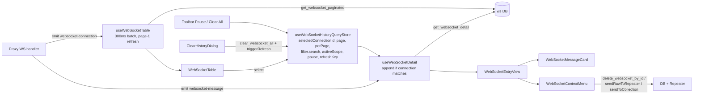

# Live Traffic (live-traffic) — UI Deep Dive

> Source: `references/hexbuffer/src/pages/live-traffic/`
> 62 files, ~10,900 lines. The HTTP proxy history ("heart" of the app) plus WebSocket connection history.
> Stack observed in this folder: React + TypeScript, Zustand stores (`src/stores/history/`), UI kit `@celestia-project/ui` (shadcn/Radix-style, Monaco-backed `TextEditor`), `@phosphor-icons/react` icons, `@tanstack/react-virtual` row virtualization, `react-resizable-panels` (via `@/components/ui/resizable`), `sonner` toasts, Tauri v2 IPC.

## 1. Overview & Purpose

Live Traffic is the module that records and lets the operator inspect everything that passed through the Halo MITM proxy. It exports two routed pages:

- **`HttpHistoryPage`** (`http-history/index.tsx`) — the Burp-Suite-like HTTP history: a virtualized 8-column traffic table, filter toolbar, session selector, collapsible request/response detail pane, and a right-click action menu that dispatches requests to every other tool in the app (Repeater, Intruder, Intercept, Notes, API Override, Browser Automation, Target scope, groups, pins, highlights, blacklist).
- **`WebSocketHistoryPage`** (`websocket-history/index.tsx`) — a paginated table of captured WebSocket handshakes with a detail view showing handshake headers and a live-streaming frame/message stream (Text/JSON/Hex views per frame).

Both pages share:
- A `TabbedPageLayout` whose tabs are driven by **active targets** (each target with `tabActive: true` becomes a scope tab) plus special "All History" / "Pinned" tabs and user-created color-coded group tabs (HTTP only).
- A **`SessionSelector`** — proxy recording sessions persisted in SQLite with capture modes `all` / `target_scope` / `custom`, storage modes `ephemeral` (RAM, sliding window) / `persistent` (disk), and per-session capture/exclude host filters.
- A **`TargetSelectorDialog`** for activating/creating scope targets, opened via the `openTargetSelector` trigger (floating-bar UI store).
- Live streaming: the Rust proxy emits `proxy-record`, `websocket-connection`, and `websocket-message` events; the pages debounce them (250–300 ms) and either refetch or, when paused, show a "N new requests — Click to refresh" banner.

## 2. Annotated File Tree — every file with a one-line description

```
live-traffic/
├── components/                                   # Components shared by HTTP + WebSocket history
│   ├── history-loading-state.tsx                 # Skeleton loading grid (label + configurable rows/columns with fixed col widths)
│   ├── inspector.tsx                             # InspectorSection: accordion of KeyValue items in TextEditor (text) or Table (table) view; exports buildHeadersList/buildCookiesList/buildParamsList
│   ├── target-selector/
│   │   ├── hooks.ts                              # useTargetSelectorDialog: open/close (internal or externally controlled), search filter, create/edit routing
│   │   ├── index.tsx                             # TargetSelectorDialog: two-mode dialog — target list (TargetSearchList) or create/edit form (TargetDialogForm)
│   │   ├── target-dialog-form.tsx                # Target create/edit form (name, description, scope patterns textarea + live parsed preview); delete via nested AlertDialog
│   │   └── target-search-list.tsx                # ScrollArea list of targets with Active badge, primary scope chip, "+N more", edit pencil; search input shown at ≥5 targets
│   └── traffic-table-pagination.tsx              # Reusable pagination footer ("Showing X – Y of Z", chunked at 60/page, Previous/Next)
├── http-history/
│   ├── api.ts                                    # Thin typed wrappers over Tauri commands (sessions, proxy logs, DB filter, CA cert); ProxyFilter interface; HTTP_LOGS_LIMIT=100
│   ├── index.tsx                                 # HttpHistoryPage: TabbedPageLayout + tab indicators (pin icon / group color dot), tab context menus, LogFilters + Card(HttpHistoryView), global dialogs
│   ├── state/
│   │   ├── build-history-query.ts                # Pure functions: HistoryFilterState → ProxyFilter (status-class label → concrete code list), hasActiveHistoryFilters
│   │   └── build-history-query.test.ts           # Vitest unit tests for the above (7 + 3 cases)
│   ├── hooks/
│   │   ├── use-history-detail.ts                 # useHistoryDetail: fetches full ProxyRecord for selectedCallId → ApiCall via adaptProxyRecordToApiCall
│   │   ├── use-http-history-page.ts              # Page-level hook: tab model (all/pinned/target/group), scope→store sync, rename/close/group dialog, sendScopeToNotes
│   │   └── use-log-filters.ts                    # useLogFilters: debounced search (200 ms), method/status toggles, stream pause, blacklist+highlight chip data, openTargetSelector
│   └── components/
│       ├── filter-chips.tsx                      # FilterChips: DB-recording badge, red blacklist-rule chips, per-highlight color chips (key "host|path")
│       ├── group-dialog.tsx                      # CreateGroupDialog: 360px name dialog; joins existing case-insensitive group or creates one, optionally adds initialCall
│       ├── http-history-view.tsx                 # Vertical ResizablePanelGroup: table panel (60/100) + detail panel (40) when a call is selected; drag-cover to stop pointer stealing
│       ├── log-filters.tsx                       # Toolbar row: WindowHeaderSlot Pause/Target buttons, SessionSelector, search InputGroup, Method/Status dropdowns, FilterChips
│       ├── log-table/
│       │   ├── constants.ts                      # buildLogMenuItems: full context/dropdown menu model (types LogMenuItemData/LogSubmenuItemData) + BuildLogMenuItemsParams
│       │   ├── index.tsx                         # TrafficTable (memo): sticky header, @tanstack/react-virtual rows (32px est, overscan 10), new-events banner, empty/error/loading states, CreateGroupDialog
│       │   ├── utils.tsx                         # METHOD_FILTERS, STATUS_FILTERS, formatTimestamp/formatBytes/formatDuration, getExtension, parseCookieHeader, buildCurlCommand, parseApiCall (DTO→ApiCall normalizer), getCallHost, isJsonContent
│       │   ├── hooks/
│       │   │   ├── index.ts                      # Barrel: useHistoryTable, useLogEntryActions, useTrafficTableColumns, useTrafficTable + adaptors
│       │   │   ├── use-history-table.ts          # Fetch loop: getHttpLogs (limit 100) + 'proxy-record' listener w/ 250ms batching, session filter, pause→newEventsCount, removeCallLocally, exports adapt*ToApiCall
│       │   │   ├── use-log-entry-actions.ts      # THE integration hub: ~20 action handlers (curl copy, pin, groups, scope, Intruder, Repeater, Intercept, API Override, Notes, Browser Automation, delete, blacklist, highlight)
│       │   │   ├── use-traffic-table.ts          # Row-model assembly: pinned-first ordering, group tab (cachedCalls), blacklist filtering, empty-state text, selection handler
│       │   │   └── use-traffic-table-columns.tsx # 8 column defs (Time/Method/Host/URL/Size/Length/MIME/action) w/ Badges, pins, group dots, lock + browser icons, ColoredUrl
│       │   └── components/
│       │       ├── browser-icon.tsx              # BrowserIcon: 14px PNG favicon for detected browser
│       │       ├── call-action-cell.tsx          # 2-line re-export barrel of CallActionCell from log-context-menu.tsx
│       │       ├── colored-url.tsx               # ColoredUrl: base URL + per-query-param rainbow coloring via PARAM_COLORS
│       │       ├── log-context-menu.tsx          # LogEntryContextMenu (Radix ContextMenu), LogMenuItems (variant-driven context/dropdown renderer), CallActionCell (⋮ dropdown)
│       │       ├── log-detail-view.tsx           # LogDetailView: two-pane request|response inspector; Text (TextEditor/Monaco raw) vs Table (InspectorSection) modes; fullscreen expand Dialog (95vw×92vh)
│       │       ├── response-detail-window.tsx    # Standalone response-only window (h-screen; "Response" header + status Badge + InspectorSections) — for sub-window usage
│       │       ├── traffic-table-row.tsx         # memo row: <button aria-pressed> wrapping cells, row bg states (pinned amber, group sky, selected/hover muted)
│       │       └── hooks/
│       │           ├── use-browser-icon.ts       # detectBrowser UA sniffing (chrome/firefox/safari; excludes edg/opr/brave) + icon map from @/assets/icons/*.png
│       │           ├── use-call-action-cell.ts   # 2-line re-export barrel: useLogMenuItems as useCallActionCell
│       │           ├── use-colored-url.ts        # PARAM_COLORS (7 One-Dark hues) + URL query splitting
│       │           ├── use-log-context-menu.ts   # 2-line re-export barrel: useLogMenuItems as useLogContextMenu
│       │           ├── use-log-entry-view.ts     # Detail-pane state: viewMode text|table, isExpanded, rawRequest/rawResponse builders, header/cookie/param lists, Send-to handlers
│       │           ├── use-log-menu-items.ts     # Wires useLogEntryActions + HIGHLIGHT_COLORS into buildLogMenuItems → menuItems array
│       │           └── use-response-detail-window.ts # Fetch + adapt one ProxyRecord for ResponseDetailWindow; statusVariant memo; headers/cookies/body memos
│       └── session/
│           ├── index.ts                          # Barrel: SessionSelector, trigger, item row, filter fields, dialogs + hooks
│           ├── session-dialogs.tsx               # CreateSessionDialog (480px), EditSessionDialog (+delete section), ClearSessionDataDialog & DeleteSessionDialog (destructive AlertDialogs w/ byte counts)
│           ├── session-filter-fields.tsx         # SessionFilterFields: 3-tab capture mode selector (All Traffic / In-Scope Only / Custom Hosts) + whitelist/exclude pattern chip editors
│           ├── session-item-row.tsx              # Rich DropdownMenuItem per session: check/dot, name, ButtonGroup (promote/configure/broom/delete), mode badges, req/size/date stats, whitelist preview
│           ├── session-selector-trigger.tsx      # forwardRef Button: pulsing status dot (amber=ephemeral, emerald=persistent), label, unconfigured warning Tooltip, caret
│           └── hooks/
│               ├── use-session-dialogs.ts        # 4 dialog-state hooks (create w/ timestamped default name; edit hydrates JSON filters; delete/clear confirm wrappers)
│               └── use-session-selector.ts       # useSessionSelector: useHttpSessionStore wiring + 4 dialog targets + create/update/delete/clear/promote handlers
└── websocket-history/
    ├── api.ts                                    # WebSocketFilter + local DTO interfaces + 4 commands (get_websocket_paginated, get_websocket_detail, delete_websocket_by_id, clear_websocket_all)
    ├── index.tsx                                 # WebSocketHistoryPage: TabbedPageLayout + toolbar (SessionSelector, search, Pause/Target/Clear All w/ Tooltips) + ClearHistoryDialog + TargetSelectorDialog
    ├── utils.ts                                  # formatHexDump: 16-byte/line hex+ASCII dump with 8-digit address column
    ├── hooks/
    │   ├── use-websocket-detail.ts               # Detail state: connection+messages fetch, live 'websocket-message' append, direction/heartbeat/search filters, adaptMessage (payload decode)
    │   ├── use-websocket-history-page.tsx        # Page hook: "All Connections" + per-target tabs (ws-history-target-tabs scope), scope→store sync, memoized WebSocketHistoryView
    │   ├── use-websocket-query.ts                # Assembles {page, perPage, filter{search, scope, states, session_id}} from stores
    │   ├── use-websocket-search.ts               # Debounced (200 ms) search → store.setSearch (which resets page to 1)
    │   └── use-websocket-table.ts                # Paginated fetch (60/page, 250 ms debounce, 300 ms event batching), newEventsCount, page navigation, removeConnectionLocally
    └── components/
        ├── clear-history-dialog.tsx              # ClearHistoryDialog: destructive confirm → clear_websocket_all + triggerRefresh + deselect
        └── websocket-history-view/
            ├── index.tsx                         # WebSocketHistoryView: vertical ResizablePanelGroup 60/40 (table / entry view)
            ├── websocket-context-menu.tsx        # Per-row ContextMenu: Copy URL, Copy Host, Send to Repeater (raw handshake), Send to Repeater collection submenu, Delete Connection
            ├── websocket-entry-view.tsx          # Two-column detail: left handshake meta + InspectorSections; right frames stream w/ search, direction segmented control, hide-heartbeats + auto-scroll checkboxes
            ├── websocket-message-card.tsx        # Per-frame card: direction pill (out=blue ↑, in=emerald ↓), type/size/timestamp, Text|JSON|Hex switcher, copy button, <pre> payload
            └── websocket-table.tsx               # Virtualized 6-col table (Status/Time/Host/Path/Frames/Last Active) + StatusIndicator dot pill + pagination + new-connections banner
```

## 3. Architecture & Dataflow

### 3.1 HTTP history dataflow

```mermaid
flowchart TD
    subgraph Rust backend
        PROXY[MITM proxy engine] -->|emit proxy-record| EVT1{{Tauri event}}
        PROXY -->|SQLite write| DB[(proxy log DB)]
        CMDS[Tauri commands<br/>get_proxy_recent / get_proxy_detail /<br/>session CRUD / set_proxy_db_filter] --> DB
    end

    subgraph Stores (src/stores/history/)
        Q[useHttpHistoryQueryStore<br/>filter, activeScope, sortOrder,<br/>selectedCallId, isStreamManuallyPaused, refreshKey]
        S[useHttpSessionStore<br/>sessions, activeSessionId, activeSession]
        P[usePinnedRequestsStore (persist)<br/>pinnedIds, pinnedCalls]
        G[useGroupsStore (persist)<br/>groups, groupRequestIds, cachedCalls]
        B[useBlacklistStore (persist)<br/>rules]
        H[useHighlightStore (persist)<br/>highlightedHosts]
    end

    subgraph UI
        PAGE[HttpHistoryPage] -->|tabs, scope| Q
        LF[LogFilters] -->|setFilter / pause| Q
        SS[SessionSelector] -->|createSession / switchSession /<br/>clearSessionLogs / promoteSession| CMDS
        S -->|syncActiveSessionFilterToProxy<br/>set_proxy_db_filter| CMDS
        TT[TrafficTable] -->|useHistoryTable| CMDS
        EVT1 -->|listen, 250ms batch| UHT[useHistoryTable]
        UHT -->|calls| TT
        P -->|pinned-first ordering| TT
        G -->|group tab contents / dots| TT
        B -->|visibleCalls filter| TT
        H -->|host/path color| TT
        TT -->|handleRowClick → setSelectedCallId| Q
        Q -->|selectedCallId| DV[LogDetailView]
        DV -->|useHistoryDetail → get_proxy_detail| CMDS
        MENU[LogEntryContextMenu / CallActionCell] -->|useLogEntryActions| CMDS
        MENU -->|sendTo* + openWindow| OTHER[Repeater / Intruder / Intercept /<br/>API Override / Notes / Browser Automation / Targets]
    end
```

### 3.2 WebSocket history dataflow



Key flow rules found in code:
- **Stream pause** is three-way: `useHistoryTable` receives `isStreamPaused` (true while any row context menu is open — from `useTrafficTable`) OR the manual `isStreamManuallyPaused` flag. While paused, incoming `proxy-record` events only increment `newEventsCount` (shown in the refresh banner); unpausing via the Pause/Resume button calls `triggerRefresh()` and refetches.
- **Selection** (`selectedCallId`) lives in the query store so the detail panel renders below the table (default sizes 60/40, min 20/15).
- **Session change** refetches: `fetchSessions` → `activeSessionId` changes → `baseQueryKey` changes → `fetchLogs`. Out-of-session events are dropped in the event handler (`record.session_id !== activeSessionIdRef.current`).
- **Scope tabs**: `useHttpHistoryPage` computes `activeScope` from the active target's `scope` and pushes it into the query store via `setActiveScope` (which also clears `selectedCallId` when the scope actually changes).

## 4. State Management

All stores are plain Zustand (`create`). Persistence via `zustand/middleware` `persist` (localStorage) is marked below.

### 4.1 `useHttpHistoryQueryStore` (`src/stores/history/http-query.ts`) — not persisted

| Field | Type | Touched by |
|---|---|---|
| `filter` | `HistoryFilterState { search: string; methods: Set<string>; statusCodes: Set<string>; pathFilter: string \| null }` | `LogFilters`/`useLogFilters` (`setFilter`, `clearFilters`), read by `useHistoryTable` |
| `activeScope` | `string[] \| null` | `useHttpHistoryPage.setActiveScope` (from active target tab) |
| `sortOrder` | `'asc' \| 'desc'` (default `'desc'`) | read by `useHistoryTable`; `setSortOrder` via `toggleSortOrder` |
| `selectedCallId` | `string \| null` | row click, `closeDetailView` (`setSelectedCallId(null)`), `removeCallLocally`, `setActiveScope`/`clearFilters` reset it |
| `isStreamManuallyPaused` | `boolean` | Pause button (`handleToggleStreamPause` flips + triggers refresh on resume) |
| `refreshKey` | `number` | `triggerRefresh()` — bumped by delete, resume, clear-search paths; part of `baseQueryKey` |

Actions: `setSearch`, `setFilter`, `setPathFilter`, `setActiveScope` (no-op when JSON-equal; clears selection), `toggleMethod`, `toggleStatus`, `clearFilters`, `setSortOrder`, `setSelectedCallId`, `setStreamManuallyPaused`, `triggerRefresh`.

### 4.2 `useHttpSessionStore` (`src/stores/history/http-session.ts`) — not persisted

| Field | Type |
|---|---|
| `sessions` | `HttpSessionSummary[]` |
| `activeSessionId` / `activeSession` | `string \| null` / `HttpSessionSummary \| null` (first `is_active` or first session after fetch) |
| `isLoading`, `isCreating`, `isDeleting`, `error` | `boolean` / `boolean` / `boolean` / `string \| null` |

Actions (all call the `http-history/api.ts` wrappers): `fetchSessions`, `createSession(name, description?, captureMode='all', captureFilter=[], excludeFilter=[], storageMode='ephemeral')` — stringifies filters, emits a `useNotificationStore.addAlert` warning for `all` mode; `promoteSession` (ephemeral→disk, alert "Session Persisted"); `updateSessionFilter`; `switchSession` (`set_active_http_session` + refetch); `renameSession`; `deleteSession`; `clearSessionLogs`; `incrementSessionStats(sessionId, additionalBytes)` — optimistically bumps `request_count`/`total_size_bytes` from each `proxy-record` event; `syncActiveFilter` → `syncActiveSessionFilterToProxy` which derives `ProxyDbFilterConfig { enabled:true, mode, custom_hosts, target_hosts (from active targets' scope), exclude_hosts }` and pushes it with `set_proxy_db_filter`.

### 4.3 `usePinnedRequestsStore` (`http-pinned.ts`) — **persisted** as `halo-pinned-requests`

`pinnedIds: string[]`, `pinnedCalls: Record<string, ApiCall>`; `MAX_PINS = 10` (toast warning on overflow; success toast "Request pinned — view it in the Pinned tab" when the first pin creates the tab). Actions: `togglePin(call)`, `isPinned(id)`, `unpinId`, `unpinAll` (invoked when the Pinned tab is closed), `pinnedCount()`, `getPinnedCalls()`.

### 4.4 `useGroupsStore` (`http-groups.ts`) — **persisted** as `halo-groups`

`groups: GroupDefinition { id (uuid), name (trim 50), color, createdAt }`, `groupRequestIds: Record<groupId, string[]>`, `cachedCalls: Record<callId, ApiCall>` (call snapshots cached so group tabs render without DB fetch). `MAX_GROUPS = 20`. `GROUP_COLORS` palette cycles 10 colors: `#3b82f6, #10b981, #8b5cf6, #f43f5e, #f97316, #06b6d4, #ec4899, #eab308, #6366f1, #14b8a6`. Actions: `createGroup` (returns id or null), `renameGroup`, `deleteGroup` (GCs `cachedCalls` not referenced elsewhere), `addRequestToGroup` (idempotent), `removeRequestFromGroup` (GCs cache when last reference), `removeRequestFromAllGroups`, `getGroupsForRequest`, `getGroupRequests`.

### 4.5 `useBlacklistStore` (`http-blacklist.ts`) — **persisted** as `halo-blacklist`

`rules: BlacklistRule { id, host, path: string|null, createdAt }`, `MAX_BLACKLIST_RULES = 50`. Helpers exported: `extractCallHost(call)` (host field → `host`/`Host`/`:authority` headers → URL parse → `server_ip`), `normalizeHost`, `isHostMatch` (exact, port-insensitive, `*.sub` wildcard), `normalizePath`, `isPathMatch` (exact, query-substring, pathname, prefix, `*` regex). Actions: `addRule(host, path?)` (dedupe toast, cap toast, success toast), `removeRule`, `isBlacklisted(call)`, `getMatchingRule(call)`. Used to compute `visibleCalls` and the red "Hidden:" chips.

### 4.6 `useHighlightStore` (`http-highlight.ts`) — **persisted** as `halo-highlights`

`highlightedHosts: Record<"host|path", hexColor>`; `MAX_HIGHLIGHTS = 6`; `HIGHLIGHT_COLORS = ['#f43f5e','#f97316','#eab308','#22c55e','#3b82f6','#a855f7']` with `HIGHLIGHT_COLOR_LABELS` Rose/Orange/Yellow/Green/Blue/Purple. `highlightHost` toggles off when re-picking the same color; `getHighlightColor` falls back through exact path → pathname-only → host-only → port-stripped host. Colors the host cell and URL cell text.

### 4.7 `useWebSocketHistoryQueryStore` (`websocket-query.ts`) — not persisted

`filter: { search: string }`, `activeScope`, `page` (1-based), `perPage: 60`, `selectedConnectionId`, `isStreamManuallyPaused`, `refreshKey`. `setSearch` and `setActiveScope` reset `page` to 1 (scope change also clears selection).

### 4.8 Peripheral stores written from this page

| Store | What the page does with it |
|---|---|
| `useTargetStore` | tabs from `targets.filter(tabActive)`, `removeActiveTab`, `updateTarget` (rename), `addHostTarget(host)` (Add to Target), `addTarget`/`removeTarget` (TargetDialogForm) |
| `useScratchpadStore` | `setNote` appends scope blocks (`sendScopeToNotes`) and formatted request entries (`handleSendToNotes`) |
| `useFloatingBarUiStore` | `isTargetSelectorOpen` + `setTargetSelectorOpen` (trigger `openTargetSelector`/`closeTargetSelector`) |
| `useNavStore` | `openWindow(path, title)`, `focusWindow(path)`, `triggerNavBlink(path)` for every Send-to destination |
| `useIntruderStore` | `addAttackTab(config)` with `createDefaultAttackConfig()` + `findRequestPayloadPositions` |
| `useInterceptStore` (intercept page) | `addTabForHost(host)` |
| `useResponseOverrideStore` | `setDomains`, `setRoutes`, `setActiveSubTab('rules')`, `setSelectedDomainId`, `setSelectedRouteId` after creating a mock route |
| `useBrowserAutomationStore` | `addAutomationTab({ targetUrl }, host)` |
| `useRepeaterStore` / `useCollectionsStore` | via triggers: workspace/collection resolution, `setActiveWorkspaceId`, `fetchFromDb` |
| `useTabsLayoutStore` | `useTabState(tabs, 'http-history-target-tabs' \| 'ws-history-target-tabs')` stores per-scope active tab id (`activeTabIds: Record<scope, id>`) |
| `useClipboardStore` | `copyText` records every programmatic copy |

## 5. IPC Contracts

All commands go through `invokeTauri` (`src/lib/ipc.ts`) which guards `window.__TAURI_INTERNALS__`, normalizes ArrayBuffer/string rejections into readable errors, and detects dropped requests. The page also calls `invoke` directly in two places (noted below).

### 5.1 Commands invoked

| Command | Args (JS → Rust snake_case) | Returns | Called from |
|---|---|---|---|
| `get_http_sessions` | — | `HttpSessionSummary[]` | `api.getHttpSessions` → `useHttpSessionStore.fetchSessions` |
| `create_http_session` | `name, description?, captureMode?, captureFilter?, excludeFilter?, storageMode?` (filters are JSON strings) | `HttpSessionRecord` | `api.createHttpSession` → `createSession` |
| `promote_session` | `sessionId` | `void` | `api.promoteSession` → `promoteSession` (ephemeral→persistent) |
| `update_http_session_filter` | `sessionId, captureMode, captureFilter, excludeFilter` | `void` | `api.updateHttpSessionFilter` → `updateSessionFilter` |
| `get_proxy_db_filter` | — | `ProxyDbFilterConfig` | `api.getProxyDbFilter` |
| `set_proxy_db_filter` | `config: ProxyDbFilterConfig` | `void` | `api.setProxyDbFilter` → `syncActiveSessionFilterToProxy` |
| `set_active_http_session` | `sessionId` | `void` | `api.setActiveHttpSession` → `switchSession` |
| `delete_http_session` | `sessionId` | `void` | `api.deleteHttpSession` → `deleteSession` |
| `rename_http_session` | `sessionId, name` | `void` | `api.renameHttpSession` → `renameSession` |
| `clear_http_session_logs` | `sessionId` | `number` (deleted rows; Rust returns `usize`) | `api.clearHttpSessionLogs` → `clearSessionLogs` |
| `get_proxy_recent` | `limit` (default `HTTP_LOGS_LIMIT=100`), `filter?: ProxyFilter`, `sortOrder: 'asc'\|'desc'` | `ProxyLogSummary[]` | `api.getHttpLogs` → `useHistoryTable.fetchLogs` |
| `get_proxy_detail` | `logId` | `ProxyRecord` | `api.getHttpLogDetail` → detail hooks, curl/URL copy, all Send-to handlers, `sendToRepeater` trigger |
| `delete_proxy_by_id` | `logId` | `void` | `useLogEntryActions.handleDelete` (direct `invoke`) |
| `mock_forge_get_domains` | — | `MockDomain[]` | `handleSendToApiOverride` (direct `invoke`) |
| `mock_forge_add_domain` | `hostname, ssl` (ssl = URL starts with `https`) | `MockDomain` | `handleSendToApiOverride` (direct `invoke`) |
| `mock_forge_add_route` | `route: MockRoute` (built from the captured response, minus content-encoding/length/transfer-encoding headers, with parsed query params) | `MockRoute` | `handleSendToApiOverride` (direct `invoke`) |
| `save_stash_endpoint` | `record: StashEndpointRecord` | `void` | `sendToCollection` trigger (Send to Repeater collection) |
| `get_websocket_paginated` | `page, perPage (default 60), filter?: WebSocketFilter` | `PaginatedResponse<WebSocketConnectionSummary>` | `api.getWebSocketLogs` → `useWebSocketTable.fetchPage` |
| `get_websocket_detail` | `connectionId` | `WebSocketConnectionDetail { connection, messages }` | `api.getWebSocketDetail` → `useWebSocketDetail`, WS context menu |
| `delete_websocket_by_id` | `connectionId` | `void` | `api.deleteWebSocket` → WS row context menu |
| `clear_websocket_all` | — | `void` | `api.clearWebSocketAll` → `ClearHistoryDialog` |

CA-cert commands exist in `api.ts` but are not wired into this folder's UI: `get_ca_cert`, `regenerate_ca_cert`, `save_ca_cert(path, content)`, `trust_intercept_ca` (exported for other modules, e.g. Intercept).

### 5.2 Events listened (`listen` from `@tauri-apps/api/event`)

| Event | Payload | Handler(s) |
|---|---|---|
| `proxy-record` | `ProxyLogSummary` (`{ id, session_id, timestamp, method, url, response_status, response_status_text, response_content_type, request_body_size, response_body_size, server_addr, user_agent, host }`) — emitted by `proxy/completion.rs` after each DB insert | `useHistoryTable`: increments session stats (`incrementSessionStats`), drops events from other sessions, 250 ms debounce → refetch or `newEventsCount` bump |
| `websocket-connection` | `{ session_id?: string, ...WebSocketConnectionRecord }` (handler only reads `session_id`) — emitted from `proxy/lifecycle.rs` | `useWebSocketTable`: 300 ms debounce → `fetchPage(1)` when on page 1 & not paused, else `newEventsCount += count` |
| `websocket-message` | `WebSocketMessageRecord { id, connection_id, timestamp, direction, message_type, payload: number[], payload_size }` — emitted from `proxy/lifecycle.rs` | `useWebSocketDetail`: appends the adapted message only when `record.connection_id === selectedConnectionId` |

The page emits no events. (`sendRawToRepeater`'s `openStandaloneRepeater` emits `halo:subapp-params`, but that path is only reached from a standalone app target.)

## 6. UI Layout & Component Breakdown

### 6.1 HTTP history page layout

```
┌──────────────────────────────────────────────────────────────────────────────┐
│ PageTabBar (border-b border-primary)                                          │
│ [All History] [Pinned (n) 📌] [Target name…] [● Group…] [+]                   │  ← indicators:
│      tab context menu: "Clear Group" (destructive) / "Send scope to Notes"    │    pin icon amber,
├──────────────────────────────────────────────────────────────────────────────┤    2px color dot
│ content: m-2 border rounded-lg bg-background                                  │
│ ┌ LogFilters (p-2 px-2) ────────────────────────────────────────────────────┐ │
│ │ WindowHeaderSlot → [⏸ Pause] [◎ Target]  (portal into window title bar)   │ │
│ │ [SessionSelector ▾●] [🔍 Search URL, host, method, body… w-48→w-64]        │ │
│ │                              [Method (n) ▾][Status (n) ▾] (ButtonGroup)    │ │
│ │ FilterChips: DB Recording badge / Hidden: red chips / Highlights: chips    │ │
│ └────────────────────────────────────────────────────────────────────────────┘ │
│ ┌ Card !py-0 flex-1 ── HttpHistoryView (ResizablePanelGroup vertical) ──────┐ │
│ │ ┌ ResizablePanel #http-history-table defaultSize 60 (or 100) min 20 ─────┐ │ │
│ │ │ [N new requests - Click to refresh] (only when paused & events queued) │ │ │
│ │ │ sticky header: TIME 80 │ METHOD 105 │ HOST 140 │ URL flex(≥180) │      │ │ │
│ │ │   SIZE 70 │ LENGTH 70 │ MIME 120 │ ⋮ 36   (px-3 py-1.5, uppercase,     │ │ │
│ │ │   text-3xs tracking-wider)                                             │ │ │
│ │ │ virtual rows (h-8 ≈32px, overscan 10): pinned amber bg first, then     │ │ │
│ │ │ unpinned; selected = bg-muted; hover:bg-muted/50; border-b             │ │ │
│ │ └───────────────────────────────────────────────────────────────────────-┘ │ │
│ │ ├─── ResizableHandle withHandle (drag cover: pointerEvents none while ─────│ │
│ │ │                                    dragging to avoid iframe/steal) ──────│ │
│ │ └ ResizablePanel #http-history-detail defaultSize 40 min 15 bg-muted ─────┐ │ │
│ │ │ LogDetailView — 2 panes (flex-1 each, left has border-r bg-background): │ │ │
│ │ │  LEFT: viewMode text → "Raw Request" Label + TextEditor (Monaco)        │ │ │
│ │ │        viewMode table → InspectorSection Headers/Cookies/Params         │ │ │
│ │ │  RIGHT: toolbar row (ArrowsOut expand, ⋮ menu, X close) then response   │ │ │
│ │ │  (same text/table modes; Body section pretty-prints JSON)               │ │ │
│ │ └────────────────────────────────────────────────────────────────────────-┘ │
│ └────────────────────────────────────────────────────────────────────────────-┘
└──────────────────────────────────────────────────────────────────────────────┘
  + CreateGroupDialog, TargetSelectorDialog mounted at page level
```

### 6.2 WebSocket history page layout

```
┌ PageTabBar: [All Connections] [Target tabs…] (no pin/group tabs) ┐
├ content m-2 border rounded-lg bg-background ──────────────────────┤
│ toolbar (p-1 px-2 border-b bg-muted/20):                           │
│   [SessionSelector] [🔍 Search URL, host, path… w-48→w-64]         │
│   [⏸/▶ Pause (amber bg when paused)] [◎ Target] [🗑 Clear All red] │
│   each wrapped in Tooltip (side bottom, offset 6)                  │
│ WebSocketHistoryView (ResizablePanelGroup vertical 60/40):         │
│  ┌ WebSocketTable ────────────────────────────────────────────┐   │
│  │ header: Status 80 │ Time 90 │ Host 200 │ Path flex │        │   │
│  │         Frames 80(right) │ Last Active 90                   │   │
│  │ rows h-8 font-mono text-xs; StatusIndicator pill (OPEN =    │   │
│  │ emerald pulsing dot, ERROR = destructive, else muted)       │   │
│  │ TrafficTablePagination footer ("Chunked at 60/page")        │   │
│  ├─ handle ────────────────────────────────────────────────────┤   │
│  └ WebSocketEntryView (grid grid-cols-2 p-1) ──────────────────┘   │
│   LEFT: state pill + url + meta (time, client→server, status)     │
│        InspectorSection Handshake Request/Response Headers        │
│   RIGHT: "Frames (n)" + toolbar (🔍 search frames; All/Out/In     │
│        segmented buttons; Hide heartbeats checkbox; Auto-scroll)  │
│        WebSocketMessageCard list (max-h-60 pre, direction stripe) │
└────────────────────────────────────────────────────────────────────┘
```

### 6.3 Per-component details

**`HttpHistoryPage`** — `http-history/index.tsx`. Props: none. Maps `page.tabs` to `PageTabItem`s: pinned tabs get a `PushPinSimpleIcon` indicator (`size-3 text-amber-600 dark:text-amber-400`), group tabs a `size-2 rounded-full` span colored by `tab.color`; `renamable` only for group/target tabs. `renderTabContextMenuItems` returns `null` for the All tab, a destructive **Clear Group** item for `group:` tabs (calls `deleteGroup` + jumps to All), and **Send scope to Notes** for target tabs. Wraps `TabbedPageLayout` (`className="flex flex-col min-h-0 h-full"`, `contentClassName="flex flex-col flex-1 min-h-0 overflow-hidden m-2 border rounded-lg bg-background"`).

**`useHttpHistoryPage`** — builds `HttpHistoryTabData[]`: `{ id: 'all-scope', name: 'All History', type: 'all' }`, optional `{ id: 'pinned', name: \`Pinned (${n})\`, type: 'pinned' }`, one per active target (`type: 'target'`), one per group (`id: 'group:<uuid>'`, `type: 'group'`). Tab removal semantics: closing Pinned calls `unpinAll()`; closing a group calls `deleteGroup`; closing a target calls `useTargetStore.removeActiveTab`. Renames route to `renameGroup` or `updateTarget(id, { name })`. `sendScopeToNotes` builds `## Scope: <name>` + backtick-quoted patterns and appends to the scratchpad note (toast errors: "Target scope is unavailable", "Target has no scope patterns").

**`HttpHistoryView`** — `http-history-view.tsx`. Props: `activeTabId?, activeScope?, isPinnedTabActive?, isGroupTabActive?, activeGroupId?` (all optional). Panels are named (`id="http-history-view"`, `"http-history-table"`, `"http-history-detail"`). During handle drag (`onPointerDown` → window `pointerup`), a `coverStyle` of `{ pointerEvents:'none', userSelect:'none' }` is applied to both panel wrappers to keep the drag smooth.

**`TrafficTable`** — `log-table/index.tsx` (memo). Renders: destructive `Alert` on `loadError`; `HistoryLoadingState label="Loading HTTP history..." columns={8}`; group-tab empty state ("Right-click a request and choose \"Add to Group\"…"); generic `Empty` states from `useTrafficTable.emptyState` (three copy variants: pinned, filtered/scope, no traffic). Virtualizer: `useVirtualizer({ count, estimateSize: () => 32, overscan: 10 })` with `measureElement` and absolute positioning via `translateY(virtualRow.start)`. Header cells and row cells share the same sizing logic (`width: col.size`, URL column `flex: '1 1 auto'`, `minWidth: 180`). The "N new request(s) — Click to refresh" `Button variant="outline" size="sm"` sits above the scroll area.

**Column model** (`use-traffic-table-columns.tsx`): `TrafficTableColumn { id, header, size, cell(call, searchQuery) }`.
- `timestamp` (80): `text-xs font-mono text-muted-foreground`, `formatTimestamp` (HH:MM:SS, hour12:false).
- `method` (105): `Badge mono` with `getMethodBadgeColor(method)` (solid pill: GET green, POST amber, PUT orange, DELETE red, PATCH purple, OPTIONS cyan, HEAD gray — all `text-white`), a second status Badge using `getStatusColor(status)` (`bg-success`/`bg-info`/`bg-warning`/`bg-destructive` tokens, `text-white`), plus a `WarningCircleIcon` (`text-yellow-600 dark:text-yellow-400`) with `title="Request body was decoded from gzip/br/deflate"` when `content_decoded`.
- `host` (140): `font-mono text-xs`, colored inline by `getHighlightColor(host, path)`, wrapped in `HighlightedText`.
- `url` (flex): pin icon, group color dots (`size-1.5 rounded-full`, `title=g.name`), `LockIcon` (emerald, title "HTTPS (Secured)") / `LockOpenIcon` (amber, "HTTP (Not Secured)") based on `https://`/`wss://`/`security_state === 'secure'`, `BrowserIcon` (UA-derived 14px PNG), then `ColoredUrl` inside a `dir="rtl"` truncation trick (keeps the *end* of long URLs visible) with highlight color.
- `response_body_size` (70, right): `formatBytes` (B/KB/MB).
- `request_body_size` (70, right, header "Length").
- `response_content_type` (120): `HighlightedText`, fallback `-`.
- `action` (36, centered): `CallActionCell`.

**`TrafficTableRow`** (memo) — a `<button type="button" aria-pressed={isSelected} className="... h-8 font-mono text-xs">` per row (full-row click target). Backgrounds: `isPinned && "bg-amber-500/10 dark:bg-amber-800/20"`, `isGroupTabActive && "bg-sky-500/5 dark:bg-sky-950/20"`, selected `bg-muted` with `hover:!bg-muted`, otherwise `hover:bg-muted/50`. Cell `title` set for url/host/content-type columns. Focus ring: `focus-visible:ring-1 focus-visible:ring-ring`.

**`LogEntryContextMenu` / `LogMenuItems` / `CallActionCell`** — `log-context-menu.tsx`. The same `LogMenuItems` renders into either a Radix `ContextMenu` (row right-click; `ContextMenuContent className="p-0.5"`) or a `DropdownMenu` (the ⋮ `Button variant="ghost" size="icon" h-6 w-6 p-0` with `DotsThreeVerticalIcon size-3.5`; `DropdownMenuContent align="end"`; click stops propagation so the row isn't selected). Items come from `buildLogMenuItems` (see §10). `CollectionPickerSubmenu` is spliced in at the `repeater-collection` marker. Submenu items support `colorDot` (`size-1.5` default, `size-2` for highlight colors) and a `✓` check (`ml-auto text-muted-foreground`) for checked states.

**`LogDetailView`** — `log-detail-view.tsx`. States: no selection → `Empty "No request selected"`; loading → `Empty "Loading..."`; error → destructive `Alert "Failed to load request details"`; not found → `Empty "Request not found"`. Header toolbar (right pane): expand `Button size="icon"` with `ArrowsOutIcon` (title "Expand to fullscreen"), ⋮ `DropdownMenu` (Expand Editor / Toggle Text ↔ Toggle Table / `CollectionPickerSubmenu` / "Send to Intruder" with `CrosshairIcon`), close `XIcon` button → `setSelectedCallId(null)`. Fullscreen `Dialog` is `sm:max-w-[95vw] w-[95vw] h-[92vh] max-h-[92vh] p-4`, header shows uppercase method span, `DialogTitle mono` URL, and a status chip with 4-tier color classes (2xx emerald, 3xx blue, 4xx amber, else red — `bg-*-500/10 text-*-600 dark:text-*-400 border-*-500/30`), body is `grid grid-cols-2 gap-3` Request/Response panels with `bg-muted/40` section headers. Both panes' text mode uses `TextEditor value={rawRequest|rawResponse} theme={theme} disableValidation` inside `rounded-md border` (Monaco read-only-ish raw HTTP view; theme `'light'|'dark'` from `useTheme`, default dark).

**`useLogEntryView`** — builds `rawRequest` via `buildRawHttpRequest` (pretty-prints JSON bodies first via `isJsonContent` + `formatJsonBody`), `rawResponse` via `buildRawHttpResponse({ prettyJsonBody: true })`, `requestHeaders/responseHeaders` via `buildHeadersList`, cookies parsed from `cookie`/`Set-Cookie` headers with `parseCookieHeader`, `requestParams` from `query_params` via `buildParamsList`. Send-to-Intruder here uses `navigate('/intruder')` (react-router) rather than the nav store.

**`InspectorSection`** — `components/inspector.tsx` (memo). Props: `title, items: KeyValue[], defaultOpen=true, defaultView='text'|'table', onItemSelect?, isItemSelected?`. Accordion (`defaultValue=[title]`); trigger `px-2 py-1.5 text-xs font-semibold hover:bg-muted/50`; text view is a fixed `h-80` read-only Monaco `TextEditor` rendering `formatItemsAsText` ("name: value" pairs, Domain/Path sub-lines, raw body when a single "body" item); table view is `Table table-fixed` with blue header names (`text-blue-600`), `ExpandableValue` collapsing at `MAX_COLLAPSED_VALUE_LENGTH = 120` with a "Show more/Show less" toggle (`text-2xs font-medium text-primary hover:underline`), `wrappedCellClass = 'py-1 px-2 font-mono whitespace-normal break-words [overflow-wrap:anywhere]'`.

**`SessionSelector`** — `session-selector.tsx`. Trigger button (`SessionSelectorTrigger`, `forwardRef`): `h-7 px-2.5 max-w-[280px] text-xs`, pulsing two-layer status dot (`animate-ping` + solid; `bg-amber-*` when `storage_mode === 'ephemeral'`, `bg-emerald-*` otherwise), unconfigured warning (`WarningCircleIcon` + Tooltip: "This session captures all proxy traffic to SQLite. We recommend setting up target scope or custom whitelist to avoid database bloat."). Dropdown content `min-w-[400px]`, header "Sessions (n)" + `PlusIcon` button, scrollable `max-h-72` list of `SessionItemRow`s, footer "Create New Session" item. `SessionItemRow` shows: CheckIcon (active) or muted dot; ButtonGroup of `icon-sm` outline buttons — FloppyDisk (promote, only for ephemeral, amber), SlidersHorizontal (configure), Broom (clear traffic), Trash (delete, hover destructive) — all with `stopPropagation` wrappers; badges `Ephemeral (RAM)` (outline amber, `text-warning border-warning/30`), `Scope`, `Custom (n)`, `All Traffic` (with warning tooltip "All traffic recorded • Host filtering recommended"); stats row `{request_count} reqs · {formatBytes(total_size_bytes)} · <locale date>`; whitelist preview (first 3 patterns + `(+n)`); italic description.

**`CreateSessionDialog`** — 480px; name (default `Session - <dd MMM> <HH:mm>`, maxLength 60), description (120), a 2-column custom Storage Mode selector (two bordered buttons: FloppyDisk "Persistent — Saved to disk, survives restarts" vs Lightning "Ephemeral — RAM only, sliding window", selected = `border-primary bg-primary/5 text-foreground`), then `SessionFilterFields`, footer Cancel / "Create Session" (disabled while `isSubmitting`, empty name, or `custom` mode with 0 hosts — submit label "Creating…").

**`SessionFilterFields`** — `Tabs` with 3 `TabsTrigger`s (`grid grid-cols-3 h-8 p-0.5 bg-muted/60`): `all`/`target_scope`/`custom` with Globe/Target/Funnel icons. `all` → explanatory text; `target_scope` → "Only requests matching active **Target Scope** rules will be stored in SQLite…" panel; `custom` → "Whitelist Host / URL Patterns" InputGroup (`placeholder="e.g. api.example.com or *.internal.net"`, Enter/`PlusIcon` adds a `Badge mono` chip with `border-primary/20 bg-primary/10 text-primary`, chips max `max-h-24` scroll, empty warning "Add at least one host pattern…"). Below: collapsible "Exclude Host Patterns (Optional)" (▼/▶ toggle button with count `Badge size="sm" text-4xs`; chips styled `border-destructive/20 bg-destructive/10 text-destructive`).

**Edit/Clear/Delete dialogs** — `EditSessionDialog` ("Configure Session", SlidersHorizontal header icon; same fields minus storage; danger zone "Delete Session & Data — Permanently remove this session and all {count} requests." with destructive Delete button that closes edit and opens delete dialog). `ClearSessionDataDialog` / `DeleteSessionDialog` are `AlertDialog`s (`sm:max-w-[420px]`, title `text-destructive`) that quote `request_count.toLocaleString()` requests and `formatBytes(total_size_bytes)`; clear keeps "session name, notes, and traffic filtering rules"; delete mentions "SQLite database storage will be reclaimed automatically via disk vacuum"; confirm buttons `size="xs" variant="destructive"` labeled "Clear Data" / "Delete & Reclaim Space".

**`TargetSelectorDialog`** — `sm:max-w-xl gap-4 p-5`. List mode: `TargetSearchList` (search input appears when ≥5 targets; `ScrollArea h-[260px]`; rows show name + `Active` badge (`border-primary/30 bg-primary/10`, `CheckCircleIcon`), first scope pattern in `font-mono text-[10.5px] bg-muted/60` chip, `+N more`, pencil edit button with `aria-label={\`Edit ${target.name}\`}`); footer "Showing {filteredCount} of {targetCount}" + "Create New Target". Form mode (`TargetDialogForm`, keyed by target id): back arrow (`ArrowLeftIcon`, `aria-label="Back to target list"`), Name (required), Description, Scope `Textarea mono rows={3}` (`parseScopePatterns` splits on newline/comma), "{n} rule(s) parsed" badge, "Scope Preview" chip list (`max-h-[64px]`), validation errors `text-2xs font-medium text-destructive` ("Target name is required", "At least one valid scope pattern is required"), footer with destructive Delete (nested AlertDialog "This action cannot be undone…") and Save ("Create Target" with `PlusIcon` / "Save Changes" with `CheckIcon`). New targets get `id: crypto.randomUUID()`, `tabActive: true`. Selecting a target sets `tabActive: true` → a new scope tab appears.

**`WebSocketTable`** — fixed column widths (`w-[80px]`, `w-[90px]`, `w-[200px]`, flex, `w-[80px]` right, `w-[90px]`), same virtualizer config as HTTP. `StatusIndicator` pill per state. Frame count `Badge size="sm" mono variant="secondary" bg-muted/80`. Row selection `bg-accent text-accent-foreground font-medium`. Banner button includes a `size-2 rounded-full bg-emerald-500 animate-ping` dot. Uses `HistoryLoadingState columns={5}` and `TrafficTablePagination itemLabel="connection"`.

**`WebSocketEntryView`** — left pane header: state pill (same 3-way classes as table), URL (`font-mono text-xs truncate flex-1`), meta row `{formatDateTime(timestamp)} · {client_addr} → {server_addr} · Status {handshake_response_status}` (status in emerald). Right pane toolbar: `InputGroup flex-1 min-w-[120px]` ("Search frames…"), segmented control (`h-7 p-0.5 border rounded bg-muted/50`; buttons `text-3xs uppercase font-semibold font-mono`; active All = `bg-background text-foreground shadow-xs`, Out = `text-blue-600 dark:text-blue-400`, In = `text-emerald-600 dark:text-emerald-400`), `Checkbox size-3.5` for "Hide heartbeats" and "Auto-scroll". Auto-scroll effect sets `scrollTop = scrollHeight` on `filteredMessages.length` change. Heartbeat filter drops `ping`/`pong` types and payloads matching `'ping'`, `'pong'`, `{"type":"ping"}`, `{"event":"pong"}`, `{"op":"ping"}`, `{"heartbeat":true}` etc.

**`WebSocketMessageCard`** — left border stripe `border-l-[3px]` (outbound `border-l-blue-500/80`, inbound `border-l-emerald-500/80`); header: direction pill with `ArrowUpRightIcon`/`ArrowDownLeftIcon`, type chip, `formatBytes(size)`, view switcher (`Text` always; `JSON` when payload parses as JSON → `JSON.stringify(parsed, null, 2)`; `Hex` when `rawPayload` exists → `formatHexDump`), JSON badge (`bg-primary/10 text-primary border-primary/20`), timestamp, copy `Button size="icon-xs" variant="quiet"` that flips to `CheckIcon` (emerald) for 2 s. Payload in `<pre className="p-2.5 max-h-60 overflow-auto text-2xs font-mono whitespace-pre-wrap break-all leading-relaxed bg-muted/5 ... selection:bg-primary/20">`, `'(empty payload)'` fallback.

**`ResponseDetailWindow`** — standalone `h-screen bg-background` response viewer (sub-window target): 40px `bg-muted border-b` header ("Response" + `{method} {url}` mono + status `Badge variant={statusVariant}` where 2xx→`default`, ≥400→`destructive`, else `secondary`), body shows `{formatBytes(size)} received` + InspectorSections Headers/Cookies/Body.

## 7. UI Libraries & Primitives Used

The page's own UI kit is **`@celestia-project/ui`** (v0.4.x — an internal shadcn/Radix-style kit; components use a `render` prop pattern on triggers, e.g. `<DropdownMenuTrigger render={<Button/>}/>`). Note: this codebase uses **Phosphor icons (`@phosphor-icons/react` v2.1.10), not lucide-react**, and Monaco via the kit's `TextEditor` (wired to the locally bundled `monaco-editor` 0.55.1 through `src/lib/monaco-setup.ts` / `monacoLoader`).

### 7.1 `@celestia-project/ui` components imported by live-traffic (72, exact names)

| Category | Components |
|---|---|
| Layout / surface | `Card`, `Tabs`, `TabsList`, `TabsTrigger`, `Accordion`, `AccordionItem`, `AccordionTrigger`, `AccordionContent`, `ScrollArea`, `Separator`-free — resizable handled by `@/components/ui/resizable` |
| Buttons / inputs | `Button`, `ButtonGroup`, `Input`, `InputGroup`, `InputGroupAddon`, `InputGroupButton`, `InputGroupInput`, `Textarea`, `Checkbox`, `Label`, `Badge` (props used: `mono`, `size="sm"`, `variant`), `Skeleton` |
| Overlays | `Dialog`, `DialogContent` (`showCloseButton={false}` used), `DialogHeader`, `DialogTitle` (`mono`), `DialogDescription`, `DialogFooter`, `DialogTrigger`, `AlertDialog`, `AlertDialogContent`, `AlertDialogHeader`, `AlertDialogTitle`, `AlertDialogDescription`, `AlertDialogFooter`, `AlertDialogAction`, `AlertDialogCancel`, `AlertDialogTrigger`, `DropdownMenu*` (11: `DropdownMenu`, `DropdownMenuTrigger`, `DropdownMenuContent`, `DropdownMenuGroup`, `DropdownMenuLabel`, `DropdownMenuItem` (`leading="tight"`, `variant`), `DropdownMenuCheckboxItem`, `DropdownMenuSeparator`, `DropdownMenuSub`, `DropdownMenuSubTrigger`, `DropdownMenuSubContent`), `ContextMenu*` (9: `ContextMenu`, `ContextMenuTrigger`, `ContextMenuContent`, `ContextMenuItem`, `ContextMenuSeparator`, `ContextMenuSub`, `ContextMenuSubTrigger`, `ContextMenuSubContent` + `ContextMenuSubContent`), `Tooltip`, `TooltipTrigger`, `TooltipContent` |
| Data display | `Table`, `TableHeader`, `TableBody`, `TableRow`, `TableHead`, `TableCell`, `Empty`, `EmptyTitle`, `EmptyDescription`, `Alert`, `AlertTitle`, `AlertDescription` |
| Editor | `TextEditor` (Monaco; props used: `value`, `theme`, `disableValidation`, `options={{ readOnly: true }}`) |

### 7.2 `@phosphor-icons/react` icons (37, exact names)

`ArrowDownLeftIcon`, `ArrowLeftIcon`, `ArrowUpRightIcon`, `ArrowsOutIcon`, `BroomIcon`, `CaretDownIcon`, `CaretLeftIcon`, `CaretRightIcon`, `CheckCircleIcon`, `CheckIcon`, `CopyIcon`, `CrosshairIcon`, `DotsThreeVerticalIcon`, `FileTextIcon`, `FloppyDiskIcon`, `FunnelIcon`, `GlobeIcon`, `LightningIcon`, `LockIcon`, `LockOpenIcon`, `MagnifyingGlassIcon`, `PaletteIcon`, `PaperPlaneTiltIcon`, `PauseIcon`, `PencilIcon`, `PlayIcon`, `PlusIcon`, `ProhibitIcon`, `PushPinSimpleIcon`, `PushPinSimpleSlashIcon`, `SlidersHorizontalIcon`, `TableIcon`, `TagIcon`, `TargetIcon`, `TrashIcon`, `WarningCircleIcon`, `XIcon`. (Icons inside `CollectionPickerSubmenu` add `FolderStarIcon`, `FolderOpenIcon`, `SpinnerGapIcon`.) `weight="fill"` is used on `LightningIcon` and `WarningCircleIcon`.

### 7.3 Other libraries

| Library | Usage |
|---|---|
| `@tanstack/react-virtual` | `useVirtualizer` in `TrafficTable` and `WebSocketTable` (`estimateSize: () => 32`, `overscan: 10`, `measureElement`) |
| `react-resizable-panels` | via `@/components/ui/resizable` (`ResizablePanelGroup`/`ResizablePanel`/`ResizableHandle withHandle`; `Group` uses `orientation` prop, wraps `Separator`) |
| Monaco editor | through kit `TextEditor` (raw request/response, inspector text view); `src/lib/monaco-setup.ts` avoids the CDN loader |
| `zustand` + `zustand/react/shallow` | all stores; `useShallow` selectors in `useHistoryTable`, `useLogFilters`, `useSessionSelector`, `useTargetSelectorDialog`, `useWebSocketQuery`, `useWebSocketTable` |
| `sonner` | `toast.success/error/warning/info` throughout actions and stores |
| `react-router-dom` | `useNavigate` in `useLogEntryView` (`navigate("/intruder")`) and `WebSocketContextMenu` (`navigate('/repeater')`) |
| Tauri APIs | `@tauri-apps/api/core` (`invoke`), `@tauri-apps/api/event` (`listen`), `@tauri-apps/plugin-clipboard-manager` (`writeText` in `copyText`) |
| Assets | `@/assets/icons/chrome.png`, `firefox.png`, `safari.png` (browser favicons) |
| Test | `vitest` (`build-history-query.test.ts`) |
| Not used here | dnd-kit, framer-motion/motion, react-hook-form, lucide-react, CodeMirror |

## 8. Keyboard Shortcuts & Interactions

The folder defines no global hotkeys; keyboard behavior is Enter-key handling and standard Radix focus flow:

| Surface | Key | Behavior |
|---|---|---|
| `CreateGroupDialog` Input | Enter | submits (create/join group, optionally add `initialCall`) |
| `CreateSessionDialog` name/description Inputs | Enter (not Shift) | `handleSubmit` → `createSession` |
| `EditSessionDialog` name Input | Enter (not Shift) | `handleSave` → rename + `updateSessionFilter` |
| `SessionFilterFields` custom/exclude `InputGroupInput` | Enter | `preventDefault()` + add pattern chip |
| `TargetDialogForm` | form submit (Enter in inputs) | `saveTarget()` with validation |
| Traffic row | Left click | select (`setSelectedCallId`) → opens detail panel |
| Traffic row / WS row | Right click | Radix ContextMenu (pauses the HTTP stream while open — `isContextMenuOpen` → `isStreamPaused`) |
| Traffic row ⋮ button | click | dropdown menu (`e.stopPropagation()`, row not selected) |
| Resizable handles | pointer drag | panel resize with drag-cover; `withHandle` grip visible |
| Search inputs | typing | debounced 200 ms store updates; clear button (`aria-label="Clear search"`) |
| Detail expand | ArrowsOut button | fullscreen Dialog 95vw×92vh |
| WS frames | Auto-scroll checkbox | pins scroll to bottom on new frames |

Tab interactions come from `TabbedPageLayout`/`PageTabBar`: switch, close (`closable`), inline rename (`renamable`), add (`onTabAdd` → `CreateGroupDialog`), and per-tab context menu items.

## 9. Styling Details

- **Comment-organized `cn()` blocks**: virtually every `className` is assembled as `cn("Layout & Positioning", "Sizing & Spacing", "Typography", "Backgrounds & Borders", "Interactive & States")` — the reference implementation groups tokens by concern in source order.
- **Micro type scale**: `text-4xs` < `text-3xs` < `text-2xs` < `text-xs` are used liberally (badges, stats, headers use `text-3xs uppercase tracking-wider font-semibold`).
- **Fonts**: `font-mono text-xs` is the table/URL/data idiom; stats rows are `font-mono` with `font-sans` for locale dates; fonts themselves are Geist/Geist Mono variable (`@fontsource-variable/geist(-mono)`) applied app-wide.
- **Method badge colors** (`getMethodBadgeColor`, `src/lib/status-colors.ts`): GET `bg-green-500`, POST `bg-amber-500`, PUT `bg-orange-500`, DELETE `bg-red-500`, PATCH `bg-purple-500`, OPTIONS `bg-cyan-500`, HEAD `bg-gray-500` — all `border-<same>-500 text-white`, theme-invariant solids.
- **Status colors** (`getStatusColor`): 2xx `bg-success`, 3xx `bg-info`, 4xx `bg-warning`, 5xx `bg-destructive`, none `bg-muted-foreground` (design-system tokens).
- **Semantic status classes** (inline, e.g. detail dialog / WS state): emerald for 2xx/open (`bg-emerald-500/10 text-emerald-600 dark:text-emerald-400 border-emerald-500/20|30`), blue for 3xx, amber for 4xx, red/destructive for 5xx/error.
- **Pinning/pause tint**: pinned rows `bg-amber-500/10 dark:bg-amber-800/20`; pinned tab indicator + pin icons `text-amber-600 dark:text-amber-400`; paused WS button `bg-amber-500/10 hover:bg-amber-500/15`; group-tab rows `bg-sky-500/5 dark:bg-sky-950/20`.
- **Highlight palette** (6): Rose `#f43f5e`, Orange `#f97316`, Yellow `#eab308`, Green `#22c55e`, Blue `#3b82f6`, Purple `#a855f7`; chips render with `${color}15` bg, `${color}40` border, full color text.
- **URL query param colors** (`PARAM_COLORS`, One-Dark inspired): `#e06c75 #61afef #98c379 #e5c07b #c678dd #56b6c2 #d19a66`, cycled per param; `&` separators in `text-muted-foreground`.
- **Group colors** (10, cycled): `#3b82f6 #10b981 #8b5cf6 #f43f5e #f97316 #06b6d4 #ec4899 #eab308 #6366f1 #14b8a6`.
- **Search highlight**: `<mark className="rounded-sm break-all bg-yellow-300/40 px-0.5 text-foreground dark:bg-yellow-500/40">` (`HighlightedText`).
- **Destructive surfaces**: alert boxes `rounded-md border border-destructive/20 bg-destructive/5 text-muted-foreground` with `font-semibold text-foreground` for counts; blacklist chips `border-red-500/20 bg-red-500/10 text-red-600 dark:text-red-400`.
- **RTL truncation trick**: URL cell uses `dir="rtl"` + `truncate text-left` so long paths elide from the left, keeping the tail visible.
- **Table density**: rows exactly `h-8` with `px-3 py-1`, sticky header `px-3 py-1.5` `z-10`.

## 10. Integration Points

`useLogEntryActions` (`use-log-entry-actions.ts`) is the dispatch hub. Every handler first fetches the full record via `getHttpLogDetail(call.id)` when it needs headers/body (summaries in the table don't carry them). All handlers surface results via `sonner` toasts and navigate with `useNavStore.openWindow` + `focusWindow` + `triggerNavBlink`.

| Menu item (key in `buildLogMenuItems`) | Handler | Destination |
|---|---|---|
| `copy-curl` "Copy as curl command (bash)" | `handleCopyCurlCommand` → `buildHttpCurlCommand` (multiline, `-k --path-as-is -i -s`, skips `:method`-style pseudo headers, title-cases headers, strips default ports) → `copyText` | clipboard + clipboard store |
| `copy-url` "Copy URL" | `handleCopyUrl` → `cleanUrl` (strips `:443`/`:80`) → `copyText` | clipboard |
| `pin` Pin/Unpin | `handleTogglePin` → `usePinnedRequestsStore.togglePin` (max 10) | Pinned tab |
| `add-to-group-sub` / `add-group-quick` | `addRequestToGroup` / `handleQuickAddToGroup` ("Group N" naming, dedupe by name) | Groups store; group tabs |
| `new-group-action` "New Group…" | `handleNewGroup(call)` | `CreateGroupDialog` with `initialCall` |
| `remove-from-group-sub` | `removeRequestFromGroup` | Groups store |
| `add-to-scope` "Add to Target" | `handleAddToScope` → `resolveHostForCall` (host header → call.host → URL → `server_ip` → Origin → Referer, falls back to fetching detail) → `useTargetStore.addHostTarget(host)` → opens `/` window titled "Scope" | Targets page |
| `send-to-intruder` "Send to Intruder" | `handleOpenInIntruder` → `createDefaultAttackConfig()` + `findRequestPayloadPositions(baseRequest)` → `useIntruderStore.addAttackTab(config)` → `/intruder` | Intruder |
| `send-to-repeater` (`repeater-collection` marker) | `CollectionPickerSubmenu` → `handleSendToCollection(stashId)` → `sendToCollection({ stashId, endpointData{...} })` → `save_stash_endpoint` IPC → activates workspace → `/repeater`; `handleOpenInRepeater` (detail view path) → `buildRawHttpRequest` → `sendRawToRepeater` (creates endpoint in active workspace collection, `selectEndpoint`, standalone dispatch via `apprecon://repeater` deep link when running in a sub-app target) | Repeater |
| `send-to-intercept` "Send to Intercept" | `handleSendToIntercept` → `useInterceptStore.addTabForHost(host)` → `/intercept` | Intercept |
| `send-to-api-override` "Send to API Override" | `handleSendToApiOverride` → ensure `mock_forge_get_domains`/`mock_forge_add_domain`, build `MockRoute` (status from captured response, response body, headers minus `content-encoding`/`content-length`/`transfer-encoding`, parsed query params as matchers, `chaos: { latencyMode: 'none' }`) → `mock_forge_add_route` → seeds `useResponseOverrideStore` and selects the new rule → `/response-override` ("API Override") | API Override |
| `send-to-notes` "Send to Notes" | `handleSendToNotes` → markdown block (`### METHOD url`, Host/Path/Status bullets, fenced request body) appended to scratchpad → `/notes` | Notes |
| `highlight-sub` (Palette) | `handleHighlightHost(color)` → `useHighlightStore.highlightHost(host, path-no-query, color)`; "Remove Highlight" → `removeHighlight` | row tinting + chips |
| `blacklist-host` / `blacklist-host-path` | `handleBlacklistHost(Path)` → `useBlacklistStore.addRule(host, pathname?)` | row hiding + chips |
| `delete` (destructive) | `handleDelete` → `delete_proxy_by_id` → `unpinId` + `removeRequestFromAllGroups` + `removeCallLocallyWithUnpin` + `triggerRefresh()` | DB + all views |

Page-level extras: target-tab context menu **"Send scope to Notes"** (`sendScopeToNotes`); group-tab context menu **"Clear Group"**. WebSocket rows integrate too: **Copy URL / Copy Host** (raw `navigator.clipboard.writeText`), **Send to Repeater** (raw handshake headers via `sendRawToRepeater`), **Send to Repeater collection** (`sendToCollection` with `method: 'GET'`, `name: WS <path>`), **Delete Connection** (`delete_websocket_by_id`). `useWebSocketDetail`-adjacent heartbeats and everything else stay local.

Also worth noting: `useTrafficTable` pauses the live stream while any context menu is open (`isContextMenuOpen` → `useHistoryTable({ isStreamPaused })`), and `CallActionCell`/context menus share one `useLogMenuItems` pipeline so dropdown and right-click menus never drift.

## 11. Source Files Documented

Page folder (`src/pages/live-traffic/`) — all 62 files:

- components/history-loading-state.tsx · components/inspector.tsx · components/traffic-table-pagination.tsx
- components/target-selector/index.tsx · hooks.ts · target-dialog-form.tsx · target-search-list.tsx
- http-history/index.tsx · http-history/api.ts
- http-history/state/build-history-query.ts · build-history-query.test.ts
- http-history/hooks/use-http-history-page.ts · use-history-detail.ts · use-log-filters.ts
- http-history/components/http-history-view.tsx · log-filters.tsx · filter-chips.tsx · group-dialog.tsx
- http-history/components/log-table/index.tsx · constants.ts · utils.tsx
- http-history/components/log-table/hooks/index.ts · use-history-table.ts · use-traffic-table.ts · use-traffic-table-columns.tsx · use-log-entry-actions.ts
- http-history/components/log-table/components/log-context-menu.tsx · log-detail-view.tsx · traffic-table-row.tsx · response-detail-window.tsx · colored-url.tsx · browser-icon.tsx · call-action-cell.tsx
- http-history/components/log-table/components/hooks/use-log-entry-view.ts · use-log-menu-items.ts · use-response-detail-window.ts · use-browser-icon.ts · use-colored-url.ts · use-call-action-cell.ts · use-log-context-menu.ts
- http-history/components/session/index.ts · session-selector.tsx · session-selector-trigger.tsx · session-item-row.tsx · session-filter-fields.tsx · session-dialogs.tsx · hooks/use-session-selector.ts · hooks/use-session-dialogs.ts
- websocket-history/index.tsx · api.ts · utils.ts
- websocket-history/hooks/use-websocket-history-page.tsx · use-websocket-query.ts · use-websocket-search.ts · use-websocket-table.ts · use-websocket-detail.ts
- websocket-history/components/clear-history-dialog.tsx
- websocket-history/components/websocket-history-view/index.tsx · websocket-table.tsx · websocket-entry-view.tsx · websocket-message-card.tsx · websocket-context-menu.tsx

Shared code read for usage context:

- `src/stores/history/` — index.ts, http-query.ts, http-session.ts, http-pinned.ts, http-groups.ts, http-blacklist.ts, http-highlight.ts, websocket-query.ts
- `src/stores/` — floating-bar-ui.ts, target.ts, nav.ts, intruder.ts, browser-automation.ts, api-override.ts, scratchpad.ts, tabs-layout.ts, clipboard.ts (via lib)
- `src/lib/` — ipc.ts, utils.ts (cleanUrl), status-colors.ts, http-message.ts, clipboard.ts, monaco-setup.ts
- `src/triggers/` — index.ts, live-traffic/index.ts, live-traffic/ui.ts, repeater/index.ts, repeater/send-to.ts, repeater/send-to-collection.ts, repeater/collection-picker-submenu.tsx
- `src/layout/tabs-layout/` — tabbed-page-layout.tsx, types.ts, use-tab-state.ts
- `src/types/index.ts`, `src/components/ui/resizable.tsx`, `src/components/highlighted-text.tsx`, `src/components/theme-provider.tsx`, `src/providers/window-provider.tsx` (WindowHeaderSlot), `src/pages/intruder/types.ts`, `src/pages/intercept/state/intercept-store.ts`, `src/pages/api-override/types.ts`
- Backend confirmation: `src-tauri/src/commands/history.rs`, `src-tauri/src/commands/mock_forge.rs`, `src-tauri/src/proxy/completion.rs`, `src-tauri/src/proxy/lifecycle.rs`, `src-tauri/src/db/repository/websocket.rs`
