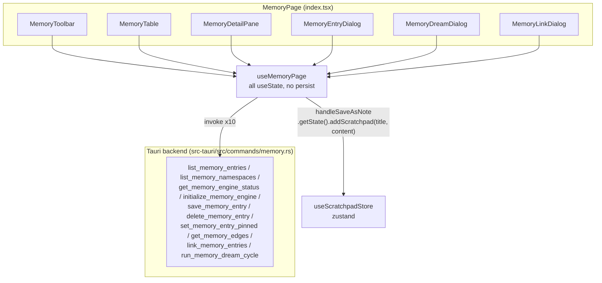

# Memory (memory) — UI Deep Dive

> Source: `references/hexbuffer/src/pages/memory/`

## 1. Overview & Purpose

The Memory page is the frontend for **Uteke**, Halo's local hybrid memory engine (vector embeddings via a local ONNX model — default `bge-small-en-v1.5` — plus a graph of typed edges). It lets a pentester persist reusable findings: facts, findings, credentials, procedures, decisions, and context notes, organized into namespaces.

Features:

- **Toolbar** with hybrid search input (debounced 200 ms), namespace filter, memory-type filter, a live engine badge (which *is* its own tooltip trigger), a one-time "Set Up Engine" button (downloads/loads the embedding model), the "Dream Cycle" maintenance dialog, refresh, and "Add Memory".
- **Table** of entries with pin stars, title + content preview, hybrid-recall match score, namespace, type badge, importance band, edge count, relative updated time, and inline link/edit/delete actions.
- **Detail pane** (conditional right split, 40/25–60%) showing metadata grid, tags, full content, and the entry's graph relationships (clicking an edge navigates to the target entry).
- **Three dialogs**: create/edit entry, Dream cycle (with report grid), and Link relationship (typed edges: references / supersedes / contradicts / similar_to).

All backend interaction is via ten Tauri commands (no events). State is local `useState` in `useMemoryPage`; the only external store touched is `useScratchpadStore` for "Save as Note".

## 2. Annotated File Tree

```
src/pages/memory/
├── index.tsx                       (61 L)   MemoryPage (+ default export): MemoryToolbar over a ResizablePanelGroup split (table 60 / detail 40, detail only when selectedEntry), then the three dialogs
├── types.ts                        (51 L)   MemoryItem (id/title/content/tags/namespace/memoryType/importance/pinned/authorType/source/sourceType/score/createdAt/updatedAt/edgesCount), SaveMemoryPayload, MemoryEdge {targetId, edgeType}, DreamReport, EngineStatus
├── constants.ts                    (31 L)   MEMORY_TYPES (7 options incl. 'all'), EDGE_RELATIONS (4 relations), DEFAULT_NAMESPACE='default', DEFAULT_IMPORTANCE=0.5
├── lib/
│   └── helpers.ts                  (40 L)   formatRelativeTime (just now / Xm / Xh / Xd / short date, '—' fallback), getMemoryTypeBadgeVariant (credential→destructive, finding→default, procedure|decision→secondary, else outline), getImportanceLabel (>=0.8 High, >=0.4 Medium, else Low)
├── hooks/
│   └── use-memory-page.ts          (321 L)  Full page state + 10 Tauri command wrappers; exports MemoryPageState = ReturnType<typeof useMemoryPage> consumed by every component via a single `state` prop
└── components/
    ├── index.ts                    (6 L)    Barrel re-exporting the 6 components
    ├── memory-toolbar.tsx          (355 L)  Search + namespace/type Selects, Uteke engine TooltipTrigger Badge, Set Up Engine button, Dream Cycle, Refresh, Add Memory
    ├── memory-toolbar.test.tsx     (167 L)  jsdom/vitest render tests: badge-as-trigger composition guard (repo rule R1: Base UI has no asChild; element goes on `render`), setup-button lifecycle, two comboboxes mount
    ├── memory-table.tsx            (472 L)  Empty state (Empty* components) or sticky-header Table with 8 columns; row click selects; pin cell, actions cell stopPropagation
    ├── memory-detail-pane.tsx      (473 L)  Header (pin/copy/to-note/edit/delete/close), metadata grid, tag badges, content block, Associated Findings & Links list, timestamp footer
    ├── memory-entry-dialog.tsx     (261 L)  Create/edit form: title*, namespace, type Select, priority Select (0.2/0.5/0.8/1.0 bands), tags CSV, source URL, content* Textarea; local mirror state seeded on open
    ├── memory-dream-dialog.tsx     (179 L)  Explains dedup/contradiction/topology phases; shows target namespace badge and a 4-metric DreamReport grid after a run
    └── memory-link-dialog.tsx      (187 L)  Source (read-only) → Relationship Select → Target Select (candidates exclude self); submits handleLinkEntries(targetId, relation)
```

## 3. Architecture & Dataflow



Key flows:

- **Initial load**: one `useEffect` calls `loadNamespaces()` + `loadStatus()`; a second debounced effect (200 ms `setTimeout`) reloads entries whenever `searchQuery`, `selectedNamespace`, `selectedType`, or the `loadEntries` identity change.
- **Selection**: `selectedEntry` is a `useMemo` lookup of `selectedId` in `entries`. Changing selection triggers `loadEdges(selectedId)`; deselect clears `edges`.
- **Auto-deselect**: `loadEntries` clears `selectedId` when the selected entry vanishes from the result set.
- **Save flow**: dialog builds a `SaveMemoryPayload`, hook merges defaults (`source:'user'`, `sourceType` from `editingItem`, `namespace` falls back to `selectedNamespace`), invokes `save_memory_entry`, selects the saved id, reloads entries + namespaces.
- **Dream cycle**: single async `invoke('run_memory_dream_cycle', { namespace })`; the returned `DreamReport` renders inside the dialog; entries are reloaded after.

## 4. State Management

### `useMemoryPage` — all local `React.useState` (no persistence)
| Field | Type | Default | Notes |
|---|---|---|---|
| `entries` | `MemoryItem[]` | `[]` | Result of `list_memory_entries` |
| `loading` | `boolean` | `true` | Toggled around every load |
| `searchQuery` | `string` | `''` | Toolbar input, debounce 200 ms |
| `selectedId` / `setSelectedId` | `string \| null` | `null` | Drives detail pane visibility |
| `selectedEntry` | derived `useMemo` | `null` | `entries.find(e => e.id === selectedId) ?? null` |
| `namespaces` | `string[]` | `['default']` | Falls back to `DEFAULT_NAMESPACE` when list empty |
| `selectedNamespace` | `string` | `'default'` | Filter; `'all'` allowed at dream time (`namespace: null` sent) |
| `selectedType` | `string` | `'all'` | Filter; `'all'` → `memoryType: null` |
| `isEntryDialogOpen` / `editingItem` | `boolean` / `MemoryItem \| null` | `false` / `null` | Create vs edit mode |
| `isDreamDialogOpen` / `isDreamRunning` / `dreamReport` | `boolean` / `boolean` / `DreamReport \| null` | | Dream dialog lifecycle |
| `isLinkDialogOpen` / `edges` / `edgesLoading` | `boolean` / `MemoryEdge[]` / `boolean` | | Link dialog + edge list |
| `engineStatus` | `EngineStatus \| null` | `null` | `{ engine, model, totalMemories, isReady }` |
| `isEngineInitializing` | `boolean` | `false` | Setup button spinner state |

Actions: `handleRefresh`, `handleOpenCreate`, `handleOpenEdit(item)`, `handleTogglePin(item, event?)` (stops propagation, optimistic local update), `handleSaveEntry(draft)` (re-throws so the dialog can keep itself open on failure), `handleDeleteEntry(id)`, `handleLinkEntries(targetId, relation)`, `handleRunDreamCycle()`, `handleInitializeEngine()`, `handleCopyContent(text)`, `handleSaveAsNote(entry)`.

### External store
`useScratchpadStore` (`@/stores/scratchpad`) — `handleSaveAsNote` calls `useScratchpadStore.getState().addScratchpad(entry.title, entry.content)`; returns the new note id or `''` when `MAX_NOTES` is reached (→ `toast.error('Note limit reached')`; success toast announces it "is now open in the Notes app").

The page renders **no persisted UI state** — filters and selection reset on remount.

## 5. IPC Contracts

### Commands invoked (all in `use-memory-page.ts`)
| Command | Args (names & types) | Returns | Where |
|---|---|---|---|
| `get_memory_engine_status` | — | `EngineStatus { engine, model, totalMemories, isReady }` | `loadStatus` (mount, `handleRefresh`) |
| `list_memory_namespaces` | — | `string[]` | `loadNamespaces` (mount, `handleRefresh`, after save) |
| `list_memory_entries` | `namespace: string \| null`, `query: string \| null`, `memoryType: string \| null` (empty/`'all'` normalized to null) | `MemoryItem[]` | `loadEntries` (debounced effect, refresh, after save, after dream) |
| `get_memory_edges` | `entryId: string` | `MemoryEdge[] { targetId, edgeType }` | `loadEdges` on selection change |
| `set_memory_entry_pinned` | `entryId: string`, `pinned: boolean` | — | `handleTogglePin` |
| `save_memory_entry` | `entry: SaveMemoryPayload { id?, title, content, tags, namespace?, memoryType?, importance?, pinned?, source?, sourceType? }` | `MemoryItem` (saved row) | `handleSaveEntry` |
| `delete_memory_entry` | `entryId: string` | — | `handleDeleteEntry` |
| `link_memory_entries` | `fromId: string` (selected), `toId: string`, `relation: string` | — | `handleLinkEntries` |
| `run_memory_dream_cycle` | `namespace: string \| null` (`'all'` → null) | `DreamReport { status, deduplicated, contradictions, orphans, backlinksRebuilt, message }` | `handleRunDreamCycle` |
| `initialize_memory_engine` | — | `EngineStatus` | `handleInitializeEngine` (one-time ONNX Runtime setup + model download) |

No `listen(...)` event subscriptions anywhere in the folder. Backend command signatures verified in `src-tauri/src/commands/memory.rs` (all ten exist as `pub async fn`).

### Events listened
| Event | Payload | Handler |
|---|---|---|
| — (none) | — | — |

## 6. UI Layout & Component Breakdown

### ASCII layout
```
┌────────────────────────────────────────────────────────────────────────┐
│ MemoryToolbar (border-b bg-muted/30, px-3 py-1.5)                      │
│ [🔍 Search memory (hybrid vector + text)… ✕][Namespace▾ w-36][Type▾ w-32]│
│                       [🧠 Uteke: N memories][⬇Set Up Engine?][🌙Dream  │
│                        Cycle][↻][＋Add Memory]                          │
├──────────────────────────────────┬─┬───────────────────────────────────┤
│ MemoryTable (60%, min 35)        │h│ MemoryDetailPane (40%, 25–60%)    │
│ ┌ sticky header bg-muted/60 ───┐ │a│ ⭐ Title        [Copy][To Note]   │
│ │Pin│Title & Preview│NS│Type│   │ │n│ [Edit][🗑][✕]  (bg-muted/20)     │
│ │   │               │  │Pri │   │ │d│ ┌ metadata grid (2/4 cols) ─────┐ │
│ │   │Links│Updated│Actions│  │ │l│ │Type│Namespace│Importance│Source│ │
│ │ rows… (bg-muted selected,      │ │e│ └───────────────────────────────┘ │
│ │  hover:bg-muted/40, cursor)    │ │ [#tag][#tag]                      │
│ └────────────────────────────────┘ │ Content (min-h-140 mono block)    │
│  Empty state: Empty/EmptyHeader/   │ 🔀 Associated Findings (N)[+Link] │
│  EmptyTitle/Description/Content    │  [edge rows → click to navigate]  │
│  + "Add First Memory" button       │ Created X ago | Updated Y ago     │
└──────────────────────────────────┴─┴───────────────────────────────────┘
  Dialogs (overlaid): MemoryEntryDialog sm:max-w-[580px]
                      MemoryDreamDialog sm:max-w-[500px]
                      MemoryLinkDialog  sm:max-w-[460px]
```

### `MemoryPage` (`index.tsx`)
- Root `div className="flex flex-col flex-1 min-h-0 min-w-0 h-full"` (no `TabbedPageLayout` — single-view page).
- `ResizablePanelGroup orientation="horizontal"` — left `defaultSize="60" minSize="35"`; the handle + right `defaultSize="40" minSize="25" maxSize="60"` panel render **only when `state.selectedEntry`** is truthy. Sizes are strings (local `@/components/ui/resizable` wrapper), like jwt — not the numeric kit API hash uses.

### `MemoryToolbar` (`memory-toolbar.tsx`)
Props: `state: MemoryPageState` (destructures ~13 fields).
- Left: search box (`relative flex-1 max-w-sm`) — `MagnifyingGlassIcon` absolutely positioned `start-2.5`, `Input textSize="xs" className="ps-8 pe-7"`, clear `XIcon` button only when query non-empty. Namespace `Select` (`w-36`, option `'default'` displayed as **"Default Space"**) and type `Select` (`w-32`, from `MEMORY_TYPES`); both `SelectTrigger leading="tight" className="h-7"`. Handlers absorb Base UI's `null` cleared-selection (`if (v !== null) setSelected…(v)`) with explanatory comments.
- Engine badge: `Tooltip > TooltipTrigger render={<Badge mono variant={isReady ? 'secondary' : 'outline'} className="h-6 text-2xs flex gap-1.5 cursor-default" />}` with `BrainIcon` (emerald when ready, amber when not) + text `Uteke: {totalMemories ?? 0} memories` as the trigger's children — the badge **composes into** the trigger element (repo rule R1; guarded by `memory-toolbar.test.tsx` asserting one node carries both `data-slot="tooltip-trigger"` and the badge classes). `TooltipContent side="bottom" max-w-xs` shows model name (`engineStatus?.model ?? 'bge-small-en-v1.5 (ONNX)'`) and the not-ready warning.
- `Set Up Engine` button (visible when `engineStatus && !isReady`): `DownloadSimpleIcon` or spinning `CircleNotchIcon` + label `Setting up…`; `title` documents the ~200 MB one-time download.
- `Dream Cycle` (`MoonStarsIcon`, indigo), `Refresh` (`ArrowClockwiseIcon`, `w-7 p-0`, spins while `loading`), `Add Memory` (`PlusIcon`, `variant="default"`).

### `MemoryTable` (`memory-table.tsx`)
Props: `state`. Zero-result non-loading state renders the `Empty` family (`EmptyHeader`, `EmptyTitle "No Memory Records Found"`, `EmptyDescription`, `EmptyContent` with an outline `Add First Memory` button).
- `ScrollArea` > `Table`; sticky `TableHeader` (`sticky top-0 z-10 bg-muted/60 backdrop-blur-sm`). Columns and widths: Pin `w-10 center`, Title & Preview `min-w-[220px] px-3`, Namespace `w-24`, Type `w-24`, Priority `w-20`, Links `w-20 center`, Updated `w-24`, Actions `w-24 right`. All body cells `TableCell size="sm"`.
- Row: `TableRow onClick={setSelectedId(entry.id)}`, `bg-muted font-medium` when selected else `hover:bg-muted/40`, `cursor-pointer`.
- Pin cell: inner `<button title="Pin/Unpin memory">` wrapping `StarIcon weight={pinned ? 'fill' : 'regular'}` (amber vs `text-muted-foreground/40`); the **cell** handles `onClick={(e) => void handleTogglePin(entry, e)}` (hook stops propagation).
- Title cell: truncated `text-xs font-semibold` title; score chip `(NN%)` when `entry.score != null` (`title="Hybrid recall match score"`, `Math.round(score*100)`); `line-clamp-1` `text-2xs` content preview.
- Type cell: `Badge variant={getMemoryTypeBadgeVariant(type)}` capitalize. Links cell: `Badge mono outline` with `GitForkIcon` (indigo) + count, else an em-dash. Updated cell: `formatRelativeTime(entry.updatedAt)` with full ISO in `title`.
- Actions cell (`onClick={(e) => e.stopPropagation()}`): ghost `GitForkIcon` Link (also sets selection first), `quiet` `PencilSimpleIcon` Edit, ghost `TrashIcon` Delete (`hover:text-destructive`); all `w-6 p-0`.

### `MemoryDetailPane` (`memory-detail-pane.tsx`)
Props: `state`. Renders a placeholder (`bg-card/20`, "Select a memory entry to inspect…") when nothing selected; main surface `bg-card/30`.
- Header `px-4 py-2.5 border-b bg-muted/20`: pin star button, truncated `h3 text-xs font-semibold` title, and ghost action buttons — `Copy` (`CopyIcon`), `To Note` (`NotePencilIcon`, calls `handleSaveAsNote`), edit (`PencilSimpleIcon` `w-7`), delete (`TrashIcon` `hover:text-destructive`), close (`XIcon`, `setSelectedId(null)`).
- Metadata grid `grid-cols-2 sm:grid-cols-4 p-3 rounded-lg border bg-muted/15`: Type badge, Namespace (mono), Importance (`High/Medium/Low (NN%)` via `getImportanceLabel` + percentage), Source (`entry.source ?? 'user'`, `title` fallback to `sourceType`).
- Tags row of `Badge variant="outline" bg-muted/30` showing `#tag`.
- Content: `p-3.5 min-h-[140px] font-mono text-xs whitespace-pre-wrap select-text bg-muted/25 border-border/70`.
- Relationships section (`border-t`): heading `GitForkIcon` + `"Associated Findings & Links (N)"`, `+ Link Finding` outline button. States: `Loading connections…` / dashed-border empty text / edge rows — each row `p-2 rounded border bg-muted/20 hover:bg-muted/50`, left `Badge mono secondary capitalize` of `edge.edgeType.replace('_', ' ')` + target title (or `Entry ID: <first-8-chars>…` when the target isn't loaded), right target `memoryType`; row click navigates via `setSelectedId(targetId)` when the target entry is resolvable.
- Footer: `Created {formatRelativeTime(createdAt)}` / `Updated {formatRelativeTime(updatedAt)}`.

### `MemoryEntryDialog` (`memory-entry-dialog.tsx`)
Props: `state`. Local fields `title/content/namespace/memoryType/importance(as string)/tagsInput/source/saving` re-seeded by a `useEffect` on `isEntryDialogOpen` (edit mode copies the item, create mode uses `selectedNamespace`, type `'fact'`, importance `'0.5'`).
- `Dialog open={isEntryDialogOpen} onOpenChange` > `DialogContent sm:max-w-[580px]` > `DialogHeader/DialogTitle` ("Edit Memory Entry" / "Add Memory Entry").
- Form grid: Title* `Input textSize="xs" h-8 autoFocus`; row of 3 — Namespace `Input mono`, Type `Select` (filters out the `'all'` option, absorbs null), Priority `Select` with four bands `0.2 Low (20%) / 0.5 Normal (50%) / 0.8 High (80%) / 1.0 Critical (100%)` (absorbs null); row of 2 — Tags CSV `Input mono` (placeholder `vuln, auth, api, scope`), Source/URL `Input`; Content* `Textarea mono rows={6}`.
- `canSave = title.trim() && content.trim()`; tags parsed by comma-split, trim, lowercase, de-empty. Submit → `handleSaveEntry` (dialog stays open on throw); footer Cancel (outline) + submit (`Update Memory` / `Save Memory` / `Saving…`).

### `MemoryDreamDialog` (`memory-dream-dialog.tsx`)
Props: `state`. `DialogContent sm:max-w-[500px]`; title = `MoonStarsIcon` + "Uteke Dream Cycle". Body explains three phases with `SparkleIcon` bullets (amber dedup / rose contradiction / indigo topology) in a `bg-muted/30` card; target namespace shown as `Badge mono secondary` (`All Namespaces` when `'all'`). After a run, an emerald report card (`border-emerald-500/40 bg-emerald-950/20`) with `CheckCircleIcon "Dream Cycle Completed"` and a 2×2 grid: Deduplicated / Contradictions / Orphans Cleaned / Backlinks Rebuilt (mono bold values), plus `dreamReport.message` under an `border-t border-emerald-500/20` divider. Footer: Close (outline) + `Run Dream Cycle` (shows spinning `CircleNotchIcon` + "Dreaming…" while `isDreamRunning`).

### `MemoryLinkDialog` (`memory-link-dialog.tsx`)
Props: `state`. `DialogContent sm:max-w-[460px]`; title = `GitForkIcon` + "Link Memory Relationship". Source is a read-only `bg-muted/40` block of `selectedEntry?.title`. Relationship `Select` over `EDGE_RELATIONS` (label + description, absorbs null). Target `Select` over `candidateEntries` (`entries.filter(id !== selectedEntry?.id)`, `useMemo`) rendering `title [memoryType]`; empty candidates render a dashed "No other memory entries available in store." block. The target select maps cleared values back to `''` sentinel (its own nothing-chosen state, with comment). Submit disabled until `targetId`; calls `handleLinkEntries(targetId, relation)`; footer Cancel + `Create Link` / `Linking…`.

### `memory-toolbar.test.tsx`
jsdom render tests (vitest + `react-dom/client` + `act`): asserts the live memory-count text; the **R1 composition guard** (a single `[data-slot="tooltip-trigger"]` node carries badge classes `h-6` and `font-mono`); outline variant + amber icon pairing for a non-ready engine; the setup button appearing/disabling/"Setting up…" flow; and exactly two `[role="combobox"]` nodes. `makeState` casts a partial override into the wide `MemoryPageState` shape.

## 7. UI Libraries & Primitives Used

### `@celestia-project/ui` components
| Component | Used in |
|---|---|
| `Badge` (`mono`, variants default/secondary/outline/destructive) | toolbar, table, detail, dialogs |
| `Button` (variants default/outline/ghost/quiet; sizes sm/md) | everywhere |
| `Dialog`, `DialogContent`, `DialogFooter`, `DialogHeader`, `DialogTitle` | all 3 dialogs |
| `Empty`, `EmptyContent`, `EmptyDescription`, `EmptyHeader`, `EmptyTitle` | memory-table empty state |
| `Input` (`textSize='xs'`, `mono`) | toolbar, entry dialog |
| `Label` (`leading="tight"`) | entry + link dialogs |
| `ScrollArea` | table, detail pane |
| `Select`, `SelectContent`, `SelectItem`, `SelectTrigger`, `SelectValue` | toolbar, entry dialog, link dialog |
| `Table`, `TableBody`, `TableCell` (custom `size="sm"` prop), `TableHead`, `TableHeader`, `TableRow` | memory-table |
| `Textarea` (`leading="tight"`, `mono`) | entry dialog |
| `Tooltip`, `TooltipContent`, `TooltipTrigger` (with `render` prop — no `asChild`) | toolbar engine badge |

### Local wrapper
`@/components/ui/resizable` — `ResizableHandle`, `ResizablePanel`, `ResizablePanelGroup` (string sizes `defaultSize="60" minSize="35" maxSize="60"`).

### Phosphor icons (exact names, `@phosphor-icons/react`)
`ArrowClockwiseIcon`, `BrainIcon`, `CircleNotchIcon`, `DownloadSimpleIcon`, `MagnifyingGlassIcon`, `MoonStarsIcon`, `PlusIcon`, `XIcon` (toolbar); `GitForkIcon`, `PencilSimpleIcon`, `StarIcon`, `TrashIcon` (table); `CopyIcon`, `GitForkIcon`, `NotePencilIcon`, `PencilSimpleIcon`, `PlusIcon`, `StarIcon`, `TrashIcon`, `XIcon` (detail pane); `CheckCircleIcon`, `CircleNotchIcon`, `MoonStarsIcon`, `SparkleIcon` (dream dialog); `GitForkIcon` (link dialog).

### Editors
None — no Monaco/CodeMirror on this page; content is plain text rendering.

### Third-party libs
| Lib | Usage |
|---|---|
| `@tauri-apps/api/core` — `invoke` | all 10 commands |
| `zustand` | `useScratchpadStore.getState().addScratchpad` (imperative, outside React render) |
| `sonner` — `toast` | success/error/info toasts (some with `description` / `duration: 15000`) |
| `vitest` + jsdom + `react-dom/client` | `memory-toolbar.test.tsx` |
| Web APIs | `navigator.clipboard` |

## 8. Keyboard Shortcuts & Interactions

- No custom keyboard shortcuts are bound in this folder (dialogs rely on the kit Dialog's focus/Escape behavior).
- Row click selects an entry (opens the detail pane); pin cell and actions cell suppress row selection via `stopPropagation` (in the hook for pin, inline for actions).
- Edge rows in the detail pane are click-to-navigate (`setSelectedId(targetId)`).
- Search input debounces 200 ms before hitting the backend; the ✕ clear button appears only with a non-empty query.
- Base UI Select quirk handled repeatedly: `onValueChange` receives `null` for a cleared selection; handlers either absorb it (`if (v !== null)`) or map it back to a `''` sentinel (link-dialog target).
- Hover affordances: action buttons `w-6 p-0` ghost icons; edge rows `hover:bg-muted/50`; rows `hover:bg-muted/40`.

## 9. Styling Details

- **Indigo is the graph color**: `GitForkIcon text-indigo-600 dark:text-indigo-400` on link badges, buttons, dialog titles; `MoonStarsIcon` for Dream is also indigo.
- **Amber** marks un-ready/pinned states: engine icon `text-amber-600 dark:text-amber-400` when the model isn't loaded; pinned `StarIcon` amber fill. (The test file notes amber-500 was deliberately paired to `text-amber-600 dark:text-amber-400` for light-mode contrast, guarded by `src/styles/light-mode-shades.test.ts`.)
- **Emerald** = engine ready / dream success: `text-emerald-600 dark:text-emerald-400`, report card `border-emerald-500/40 bg-emerald-950/20`.
- Surfaces: toolbar `bg-muted/30`, sticky table header `bg-muted/60 backdrop-blur-sm`, detail pane `bg-card/30`, metadata `bg-muted/15`, content block `bg-muted/25`.
- Micro type scale `text-2xs` / `text-3xs` with `uppercase tracking-wider font-semibold` section labels; `font-mono` for namespace, scores, timestamps values, report numbers.
- Kit-specific props recur: `leading="tight"`, `textSize="xs"`, `mono`, `TableCell size="sm"`.
- The `cn()` comment-grouping convention (`// Layout & Positioning` / `// Sizing & Spacing` / `// Typography` / `// Backgrounds & Borders` / `// Interactive & States`) is used in most components; entry/link dialogs use plain classNames.
- LTR/RTL-aware spacing (`ps-8 pe-7`, `start-2.5`, `end-2`) in the toolbar search box.

## 10. Integration Points

- **Uteke engine backend** (`src-tauri/src/commands/memory.rs`) — ten commands; the page owns all memory UI. `initialize_memory_engine` triggers the ONNX Runtime + local embedding model download; `EngineStatus.model` defaults to displaying `bge-small-en-v1.5 (ONNX)` in the tooltip.
- **`@/stores/scratchpad`** — "To Note" pushes memory content into the Notes app's scratchpad store (imperative `getState()` call), crossing page boundaries via the store.
- **`@/lib/ipc`** — `toErrorMessage` only (engine-init failure toast, 15 s duration).
- **`@/lib/utils`** — `cn`.
- **Routing** — `src/App.tsx` lazy-imports `MemoryPage` (both named and default exports exist in `index.tsx`).
- **AI agents** — memory types (`fact/finding/credential/…`), `authorType: 'human' | 'agent'`, and `source`/`sourceType` fields exist so agent-written memories render identically to human ones; `MemoryItem.memoryType` is typed as a closed union `| string` to tolerate backend additions.
- No shared tab layout (unlike hash/jwt) and no Zustand persistence of its own UI state.

## 11. Source Files Documented

- `src/pages/memory/index.tsx`
- `src/pages/memory/types.ts`
- `src/pages/memory/constants.ts`
- `src/pages/memory/lib/helpers.ts`
- `src/pages/memory/hooks/use-memory-page.ts`
- `src/pages/memory/components/index.ts`
- `src/pages/memory/components/memory-toolbar.tsx`
- `src/pages/memory/components/memory-toolbar.test.tsx`
- `src/pages/memory/components/memory-table.tsx`
- `src/pages/memory/components/memory-detail-pane.tsx`
- `src/pages/memory/components/memory-entry-dialog.tsx`
- `src/pages/memory/components/memory-dream-dialog.tsx`
- `src/pages/memory/components/memory-link-dialog.tsx`

Supporting shared files read for usage context: `src/stores/scratchpad.ts` (`addScratchpad` contract, `MAX_NOTES`), `src/components/ui/resizable.tsx`, `src/lib/ipc.ts`, `src-tauri/src/commands/memory.rs` (command signatures).
