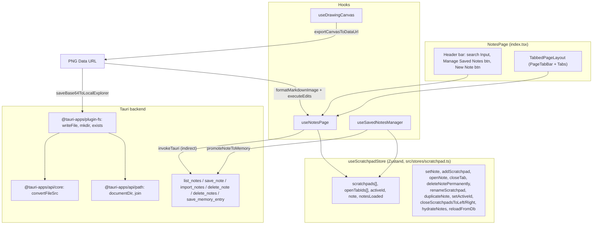

# Notes (notes) — UI Deep Dive

> Source: `references/hexbuffer/src/pages/notes/`

## 1. Overview & Purpose

Notes (historically named "Scratchpad") is Halo's tabbed Markdown notepad. It provides:

- A **tab workspace** of open notes, each persisted to SQLite through Tauri commands (`list_notes`, `save_note`, `import_notes`, `delete_note`, `delete_notes`) via `src/pages/notes/lib/notes-api.ts`.
- A **Monaco-based Markdown editor** (`TextEditor` from `@celestia-project/ui`) with select-all and Cmd/Ctrl+S shortcuts registered directly on the Monaco instance.
- A **Saved Notes Library dialog** (`SavedNotesDialog`) that lists all notes with search, filter tabs (All / Open in Tabs / Closed), five sort options, inline rename, duplicate, export, copy, delete-with-confirm and "Promote to Memory" (AI context injection via the `save_memory_entry` IPC command).
- A **Drawing Canvas studio** (`DrawingCanvasDialog`): a full 90vw×90vh modal with a 2D-canvas whiteboard (pen/line/arrow/rectangle/diamond/ellipse/text/eraser, select+move+resize, pan/zoom, grid, undo/redo) whose output can be exported as PNG or inserted into the active note as a markdown image — the PNG is first written to disk under `Documents/Halo Files/scratchpads/` via `@tauri-apps/plugin-fs`.
- Image drag-and-drop embedding into note content as base64 data-URL markdown images.

The page is mounted at route `/scratchpad` (see `src/App.tsx` and `src/routes/page-resolver.tsx`), lazily imported as `ScratchpadPage`; the module exports both names (`NotesPage` and the alias `ScratchpadPage`). It is also embedded in the Desktop workspace via `src/layout/desktop-workspace/page-lazy-imports.ts` and read from `src/pages/desktop/components/scratchpad-widget.tsx` (which consumes the same store).

State lives in the Zustand store `useScratchpadStore` (`src/stores/scratchpad.ts`). Note content lives in SQLite; which tabs are open and which tab is active are per-window UI state in `localStorage`.

## 2. Annotated File Tree

```
notes/
├── index.tsx                          # NotesPage (alias ScratchpadPage): header bar (search, Manage Saved Notes, New Note) + TabbedPageLayout + SavedNotesDialog
├── constants.ts                       # NOTE_FILTER_TABS, NOTE_SORT_OPTIONS, MAX_NOTES_COUNT = 100
├── types.ts                           # NoteSortOption, NoteFilterTab, EditorViewMode, SavedNotesManagerProps, NoteCardProps, drawing-canvas types (DrawingTool, StrokeWidthOption, CanvasGridType, Point, CanvasElement, DrawingTemplate, ResizeHandle, BoundingBox)
├── hooks/
│   ├── use-notes-page.ts              # Main page hook: store wiring, tab derivation w/ search filter, editor mount + Monaco commands, insert-drawing, export/copy/promote, window Cmd+S listener
│   ├── use-saved-notes-manager.ts     # Library dialog hook: search/filter/sort/counts, open/close/duplicate/delete/rename/promote handlers
│   └── use-drawing-canvas.ts          # Canvas engine (878 lines): elements, history/undo/redo, tools, zoom/pan, pointer drag state machine, keyboard shortcuts, export/insert
├── lib/
│   ├── canvas-helpers.ts              # Pure canvas geometry: bounds, hit tests, resize handles, shape/text/arrow/pen/grid renderers, exportCanvasToDataUrl
│   ├── helpers.ts                     # formatRelativeTime, extractSnippet, getWordAndCharCount, downloadAsMarkdown (Blob download), copyNoteToClipboard
│   ├── image-helpers.ts               # saveBase64ToLocalExplorer: writes base64 PNG into Documents/Halo Files/scratchpads via plugin-fs, returns convertFileSrc asset URL
│   ├── memory-bridge.ts               # promoteNoteToMemory: invoke('save_memory_entry', { entry }) — user-initiated note → AI memory promotion
│   └── notes-api.ts                   # Tauri IPC wrappers: listNotes, saveNote, importNotes, deleteNote, deleteNotes (NoteRecord wire shape, RFC3339 timestamps)
└── components/
    ├── index.ts                       # Barrel: NotesEditorPane, SavedNotesDialog, NotesEmptyState, notes-preview, DrawingCanvasDialog
    ├── notes-editor/
    │   ├── index.ts                   # Barrel: pane, toolbar, search-empty, constants
    │   ├── constants.ts               # NOTES_AUTOSAVE_DELAY_MS = 300 (mirror of store debounce)
    │   ├── notes-editor-pane.tsx      # Per-tab editor surface: toolbar + TextEditor + DrawingCanvasDialog; image drop handler; empty/search empty routing
    │   ├── notes-editor-toolbar.tsx   # Title/rename row + Select All / Copy / Export / Promote buttons + save Kbd badge
    │   └── notes-search-empty.tsx     # "No Matching Open Tabs" empty state (clear search / open library)
    ├── notes-empty-state/
    │   ├── index.ts                   # Barrel
    │   └── notes-empty-state.tsx      # "No Note Tabs Open" empty state (New Note / Saved Notes Library buttons)
    ├── notes-preview/
    │   ├── index.ts                   # Barrel
    │   └── notes-preview-pane.tsx     # BlockTextEditor wrapper injecting a "Drawing Studio" section template (block-style editor; not currently rendered by index.tsx)
    ├── saved-notes-dialog/
    │   ├── index.ts                   # Barrel: dialog, note-list-item, toolbar, empty-state
    │   ├── saved-notes-dialog.tsx     # Library modal: header, SavedNotesToolbar, ScrollArea grid of NoteListItem, footer with counts + Cancel
    │   ├── saved-notes-toolbar.tsx    # Search input, filter pill tabs w/ counts, sort Select
    │   ├── note-list-item.tsx         # Note card: title/open/rename, metadata, badges, snippet, action row, inline delete confirm
    │   └── saved-notes-empty-state.tsx# "No notes found" empty state (contextual copy per search/filter)
    └── drawing-canvas/
        ├── drawing-canvas-dialog.tsx  # 90vw/90vh modal: canvas + floating toolbar + inline text editor + footer (stats, Export PNG, Cancel, Insert into Note)
        └── drawing-canvas-toolbar.tsx # Floating dock: tools, shapes/style/view submenus, selected-object action bar, undo/redo/clear
```

## 3. Architecture & Dataflow



Key flows:

1. **Hydration**: importing `useScratchpadStore` triggers `hydrateNotes()` once (guarded by a module-level `hydrationPromise`) when running inside Tauri (`isTauriAvailable()`). It calls `list_notes`; if the DB is empty it migrates legacy `localStorage['desktop-scratchpads']` rows through `import_notes`, then re-lists. `reconcileTabs` filters stored `openTabIds` against existing notes, defaulting to "open every note", and falls back `activeId` to the first open tab. The page gates rendering on `notesLoaded` ("Loading notes..." meanwhile).
2. **Editing**: `TextEditor.onChange` → `setNote(value)` → updates the active `Scratchpad.note` + `updatedAt` and schedules a debounced `save_note` (`NOTES_AUTOSAVE_DELAY_MS = 300`). `pagehide`/`beforeunload` flush via exported `persistNotesNow()`.
3. **Tab state**: `openTabIds`/`activeId` are persisted to `localStorage` keys `desktop-scratchpads-open-tabs` and `desktop-scratchpad-active-id` on every mutation (`persistTabState`), so each window keeps its own layout.
4. **Drawing insertion**: `useDrawingCanvas.handleInsertIntoNote` → `exportCanvasToDataUrl` (2× retina, 0.95 quality PNG) → `saveBase64ToLocalExplorer` writes the file and returns `convertFileSrc(fullPath)` → `formatMarkdownImage('Scratchpad Drawing', srcUrl)` → `useNotesPage.handleInsertDrawing` inserts it at the Monaco selection via `editor.executeEdits('insert-drawing', ...)` or appends to `note`.
5. **Promote to memory**: either the toolbar or a library card calls `promoteNoteToMemory(note)` → `invoke('save_memory_entry', { entry })` with `memoryType: 'fact'`, `namespace: 'default'`, `importance: 0.5`, `sourceType: 'note'`, `source: note.id`.

## 4. State Management

Store: `useScratchpadStore` (`src/stores/scratchpad.ts`, created with `create<ScratchpadState>()`). The `Scratchpad` record:

```ts
export interface Scratchpad {
  id: string;        // crypto.randomUUID()
  name: string;
  note: string;
  createdAt?: number; // epoch millis in frontend; RFC3339 string over IPC
  updatedAt?: number;
}
```

| Field / action | Used by | Notes |
|---|---|---|
| `scratchpads: Scratchpad[]` | page header count, tabs, dialog | Loaded from SQLite; renamed to `notes` in both hooks via destructuring |
| `openTabIds: string[]` | tabs, dialog counts/filter | Per-window, persisted in `localStorage['desktop-scratchpads-open-tabs']` |
| `activeId: string` | active tab, active note lookup | Persisted in `localStorage['desktop-scratchpad-active-id']` |
| `note: string` | editor value | Backward-compat mirror of the active note's body |
| `notesLoaded: boolean` | index.tsx loading gate | False until first DB load settles |
| `setNote(note)` | editor onChange, drawing insert | Updates active note + `updatedAt`, schedules debounced `save_note` |
| `addScratchpad(name?, initialContent?)` | New Note buttons | Returns new id or `''` at `MAX_NOTES = 100`; auto-names `Note N` (skipping existing `Note N`/`Scratchpad N`) |
| `openNote(id)` | dialog Open | Adds to `openTabIds` if missing, activates, syncs `note` |
| `closeTab(id)` | tab close, dialog Close Tab | Selects previous neighbor tab; note stays in library |
| `deleteNotePermanently(id)` | dialog delete confirm | Filters list, calls `delete_note` IPC |
| `deleteMultipleNotes(ids)` | (store API; not called by this page) | `delete_notes` IPC |
| `setActiveId(id)` | tab change + search auto-switch | No-op for unknown ids |
| `renameScratchpad(id, name)` | toolbar rename, dialog rename | Trims; bumps `updatedAt`; persists |
| `duplicateNote(id)` | dialog Duplicate | Creates `"<name> (Copy)"` with fresh uuid, opens it, returns id |
| `closeScratchpadsToLeft(id)` / `closeScratchpadsToRight(id)` | tab context menu | Slice `openTabIds`; fix active if removed |
| `closeAllTabs()` | (exposed by hook; not wired to UI here) | Clears `openTabIds` + `activeId` |
| `hydrateNotes()` / `reloadFromDb()` | module init / cross-window sync | `reloadFromDb` is invoked by the sync subsystem (`src/stores/sync/index.ts`) |

Local component state (in `useNotesPage`): `editingId`, `renameValue`, `isSavedNotesOpen`, `isDrawingOpen`, `searchQuery`, `editorRef`. Derived: `activeNote` (`notes.find(s => s.id === activeId)`), `tabs: PageTabItem[]` filtered by `searchQuery` against `name` **and** body text (`item.note`). An effect auto-switches `activeId` to the first filtered tab when the active tab no longer matches.

Local state (in `useSavedNotesManager`): `searchQuery`, `activeFilterTab` (`NoteFilterTab`, default `'all'`), `sortOption` (`NoteSortOption`, default `'updated-desc'`), `deleteConfirmId`, `editingNoteId`, `editingNoteName`; derived `counts {all, open, closed}` and `filteredAndSortedNotes`.

Local state (in `useDrawingCanvas`): `elements`, `history`/`historyIndex`, `activeTool` (default `'select'`), `color` (default `'#3b82f6'`), `strokeWidth` (default `2`), `fillMode` (default `'translucent'`), `gridType` (default `'dots'`), `zoom` (default 1, clamp 0.25–3.0), `pan`, `isSpacePressed`, `selectedElementId`, `cursorStyle`, `editingTextElement`; plus refs `canvasRef`, `elementsRef`, `dragInteractionRef` (modes `idle | drawing | moving | resizing | panning` with `activeHandle`, `startPoint`, `startScreenPoint`, `initialPan`, `initialSnapshot`, `hasMoved`), `currentElementRef`. Drawing state is per-dialog-open (resets when dialog remounts; nothing persisted).

Persistence summary: notes → SQLite; open tabs + active id → localStorage; dialog search/filter/sort and drawing state → ephemeral.

## 5. IPC Contracts

### Commands invoked

All note CRUD goes through `notes-api.ts` wrappers around `invokeTauri` (`src/lib/ipc.ts`), which guards on `window.__TAURI_INTERNALS__` and normalizes errors (`toErrorMessage`, dropped-request detection).

| Command | Args (wire) | Returns | Where called |
|---|---|---|---|
| `list_notes` | — | `NoteRecord[]` (`{id, name, note, createdAt: RFC3339, updatedAt: RFC3339}`) | `notes-api.listNotes()` ← store `loadNotes()` / `reloadFromDb()` |
| `save_note` | `{ note: NoteRecord }` | `NoteRecord` | `notes-api.saveNote(pad)` ← store `persistNote` (debounced 300 ms, on `pagehide`, on add/rename/duplicate) |
| `import_notes` | `{ notes: NoteRecord[] }` | `number` (inserted count) | `notes-api.importNotes(pads)` ← legacy migration + first-run seeding (`{id:'1', name:'Note 1'}`) |
| `delete_note` | `{ id: string }` | `void` | `notes-api.deleteNote(id)` ← `deleteNotePermanently` |
| `delete_notes` | `{ ids: string[] }` | `number` | `notes-api.deleteNotes(ids)` ← `deleteMultipleNotes` |
| `save_memory_entry` | `{ entry: { title, content, tags: [], namespace: 'default', memoryType: 'fact', importance: 0.5, pinned: false, source: noteId, sourceType: 'note' } }` | `{ id: string }` | `memory-bridge.promoteNoteToMemory(note)` ← toolbar Promote + library card Promote |

Timestamp conversion lives in `notes-api.ts`: `toIsoString` (epoch ms → `new Date(ms).toISOString()`, `''` when absent) on the way in, `toEpochMillis` (`Date.parse`, `undefined` on NaN) on the way out.

### Plugin APIs used (not `invoke`, but Tauri surface)

| API | Module | Where |
|---|---|---|
| `writeFile(path, Uint8Array)`, `mkdir(path, {recursive:true})`, `exists(path)` | `@tauri-apps/plugin-fs` | `image-helpers.saveBase64ToLocalExplorer` |
| `documentDir()`, `join(...)` | `@tauri-apps/api/path` | same |
| `convertFileSrc(path)` | `@tauri-apps/api/core` | same (asset URL for the saved PNG) |

### Events listened

None. The notes page registers no `listen()` handlers; cross-window sync reaches it via the store's `reloadFromDb` (called by `src/stores/sync/index.ts`).

## 6. UI Layout & Component Breakdown

### Layout diagram

```
┌────────────────────────────────────────────────────────────────────────────┐
│ Header bar  h-10 px-3 border-b bg-muted/15  (shrink-0, select-none)        │
│ ┌──────────────────────────────┐        ┌────────────────────────────────┐ │
│ │ 🔍 [Search open tabs &       │        │ (📁 Manage Saved Notes [N])    │ │
│ │     contents...        ✕]    │        │ [ + New Note ]                 │ │
│ └──────────────────────────────┘        └────────────────────────────────┘ │
├────────────────────────────────────────────────────────────────────────────┤
│ PageTabBar (border-b border-primary; h≈29px incl. pt-2)                    │
│ [Note 1 ×][Note 2 ×][Note 3 ×]                            [+]  (scroll →) │
├────────────────────────────────────────────────────────────────────────────┤
│ NotesEditorToolbar  min-h-12 px-4 py-1.5 border-b bg-muted/10              │
│  "Note 1" ✎(hover)      |  ⌘A  ⧉  ⤓  🧠  |  Save [⌘][S]  (lg only)         │
├────────────────────────────────────────────────────────────────────────────┤
│                                                                            │
│   Monaco TextEditor (language="markdown", height 100%, wordWrap on,        │
│   fontSize 12.5 mono, detectLinks → tauri opener)                          │
│                                                                            │
├────────────────────────────────────────────────────────────────────────────┤
│ (overlays) DrawingCanvasDialog: Dialog 90vw × 90vh, bg-card rounded-xl     │
│   [canvas surface] with floating dock toolbar bottom-center                │
│   footer: "N elements • Tool: pen • Zoom: 100% [Selected: rectangle]"      │
│           [Export PNG] [Cancel] [Insert into Note]                         │
└────────────────────────────────────────────────────────────────────────────┘
 SavedNotesDialog (separate modal): max-w-4xl/5xl, max-h-[85vh]
   header (title/desc + New Note) / toolbar (search, filter pills, sort)
   ScrollArea h-[440px] → grid sm:2 / lg:3 columns of NoteListItem
   footer: "Showing X of Y saved notes" + [Cancel]
```

Proportions: header 40 px fixed; tab strip ~29 px; toolbar min 48 px; editor takes all remaining height. Empty states (both `size-14 rounded-2xl` icon tile) replace the editor area, centered with `max-w-md`.

### Components

**`NotesPage`** — `index.tsx`
- Props: none. Wraps everything in `flex flex-col h-full min-h-0 w-full`.
- Header: `Input textSize="xs"` with absolute `MagnifyingGlassIcon` (left-2.5) and a clear button (`XIcon`) shown when `searchQuery` is non-empty; container `max-w-xs`.
- "Manage Saved Notes" `Button variant="ghost" size="sm"` with `FolderSimpleIcon text-primary`, label `text-xs`, and a count pill `text-3xs font-mono bg-primary/10 text-primary px-1.5 py-0.2 rounded-full` showing `hook.notes.length`.
- "New Note" `Button leading="tight" size="xs"` with `PlusIcon`.
- Below: `TabbedPageLayout` when `notesLoaded`, else a centered "Loading notes..." (`text-xs text-muted-foreground`).
- Footer of module: `export { NotesPage as ScratchpadPage }`.

**`NotesEditorPane`** — `components/notes-editor/notes-editor-pane.tsx`
- Props: `{ hook: NotesPageHookType }` (the whole hook object is passed down — a deliberate pattern in this codebase).
- Routing: if `tabs.length === 0 && searchQuery.trim()` → `NotesSearchEmpty`; else if `!activeNote || tabs.length === 0` → `NotesEmptyState`.
- Image drop: `onDragOver` prevents default only when `e.dataTransfer.types.includes('Files')`; `onDrop` filters `f.type.startsWith('image/')`, reads each via `readFileAsBase64`, appends `formatMarkdownImage(file.name, base64)` to the note, toasts `"Image embedded into note"` / `"N images embedded into note"`.
- Renders `NotesEditorToolbar`, then a `flex-1 min-h-0` container holding `TextEditor` with `value={note}`, `onChange={(v) => setNote(v ?? '')}`, `onMount={handleEditorMount}`, `language="markdown"`, `height="100%"`, `detectLinks={true}`, `theme={theme}` (from `useTheme()`), and mounts `DrawingCanvasDialog` (controlled by `isDrawingOpen`).

**`NotesEditorToolbar`** — `components/notes-editor/notes-editor-toolbar.tsx`
- Props: `activeNote, isRenamingActive, renameValue, onRenameValueChange, onRenameSubmit, onRenameCancel, onStartRename, onOpenDrawingCanvas?, onSelectAll, onCopyNote, onExportNote, onPromoteNote`.
- Rename: double-click the title span (`title="Double-click to rename"`) or the hover-revealed `PencilSimpleIcon` `Button variant="quiet" size="xs"` (`opacity-0 group-hover:opacity-100`). Edit mode is a `<form>` with `Input textSize="xs"` (Escape cancels, submit saves via `CheckIcon` `size-7` button) and an outline `XIcon` cancel.
- Actions group (all `Button leading="tight" variant="quiet" size="sm" size-7 p-0`, separated by `border-s ps-1.5`): `SelectionAllIcon` (Select All Text), `CopyIcon` (Copy Note Content), `DownloadSimpleIcon` (Export as .md), `BrainIcon` (Promote to Memory).
- Save badge (`hidden lg:flex`): text `Save` + `KbdGroup` with `Kbd` "⌘"/"Ctrl" and "S" — Mac detection via `/Mac|iPod|iPhone|iPad/.test(navigator.userAgent)`.
- Note: `onOpenDrawingCanvas` is accepted but no visible button currently renders it in this toolbar (the drawing dialog is mounted by the pane; the prop is optional dead-wiring).

**`NotesSearchEmpty`** — search yielded no open tabs: icon tile `size-14 rounded-2xl bg-muted/50 border` with `MagnifyingGlassIcon size-7`; heading "No Matching Open Tabs" (`text-base font-semibold`); body interpolates the query with `&quot;`; buttons `XIcon Clear Search` (outline) and `FolderSimpleIcon Saved Notes Library (N)` (default).

**`NotesEmptyState`** — no tabs at all: icon tile `bg-primary/10 border border-primary/20 text-primary` with `FileTextIcon size-7`; heading "No Note Tabs Open"; primary `New Note` (`PlusIcon`) and outline `Saved Notes Library (N)` (`FolderSimpleIcon`). Reads `notes.length` directly from `useScratchpadStore`.

**`SavedNotesDialog`** — `components/saved-notes-dialog/saved-notes-dialog.tsx`
- Props: `{ isOpen, onOpenChange }`. Instantiates `useSavedNotesManager(() => onOpenChange(false))`.
- `DialogContent showCloseButton={false}` with `max-h-[85vh] p-0`, widths `max-w-4xl sm:max-w-4xl lg:max-w-5xl`, `bg-card border shadow-2xl rounded-xl`.
- Header (`DialogHeader` as flex-row, `px-6 py-4 border-b bg-muted/10`): title "Saved Notes Library" (`text-base font-semibold tracking-tight`), description "Manage, search, and reopen all your saved notes ({counts.all} total)" (`text-xs`), plus `New Note` button (`PlusIcon`, `h-8 px-3`).
- Body: `ScrollArea` fixed `h-[440px]`; empty → `SavedNotesEmptyState`; else a responsive grid `grid-cols-1 sm:grid-cols-2 lg:grid-cols-3 p-6 gap-3` of `NoteListItem`s.
- Footer (`DialogFooter flex-row justify-between px-6 py-3 border-t bg-muted/10`): "Showing X of Y saved notes" (`text-xs`, counts in `font-medium text-foreground`) + outline `Cancel` button.

**`SavedNotesToolbar`** — search `Input h-8 pl-8 pr-7` with `MagnifyingGlassIcon` + clear `XIcon` (max-w-sm); filter pills in a `p-0.5 rounded-lg border bg-muted/40` segmented container from `NOTE_FILTER_TABS` (active pill: `bg-background text-foreground shadow-xs`; each pill shows a mono count `text-4xs font-mono`); sort `Select` (`SelectTrigger h-8 w-40`) with the five `NOTE_SORT_OPTIONS`.

**`NoteListItem`** — `components/saved-notes-dialog/note-list-item.tsx` (478 lines)
- Card container `p-3.5 rounded-lg border bg-background transition-all`; active tab → `border-primary/50 shadow-xs ring-1 ring-primary/20`, else `hover:border-muted-foreground/30 hover:bg-muted/20`.
- Title button (`hover:text-primary`) opens the note; hover-reveal pencil (`PencilSimpleIcon size-3`) starts rename; rename mode is a form with `Input h-6.5`, `CheckIcon` save and `XIcon` cancel (`h-6.5 w-6.5` outline buttons).
- Metadata row (`text-3xs text-muted-foreground`, mono): `ClockIcon size-3` + `formatRelativeTime(note.updatedAt)`.
- Badge: `Badge variant="outline"` "Active Tab" (`border-primary/40 bg-primary/10 text-primary`) or "Open in Tab" (`border-muted bg-muted/30 text-muted-foreground`) when `isOpenInTab`.
- Open/Switch button: `Button size="sm" h-6.5` with `ArrowSquareOutIcon`, `variant={isOpenInTab ? 'secondary' : 'default'}`, label `Open` / `Switch` / `Current`.
- Snippet: clickable `line-clamp-2 font-mono text-xs text-muted-foreground/80` from `extractSnippet(note.note)` (strips headings/blockquotes/code fences, 140 chars).
- Action row (`pt-2 border-t border-border/50 justify-end`): when `isDeletingConfirm` shows an inline confirm strip (`border-destructive/30 bg-destructive/10`, "Delete note?" with `Yes` / `Cancel` text buttons); otherwise icon buttons `CopyIcon` (copy), `DownloadSimpleIcon` (export), `PlusIcon` (duplicate — note: uses the Plus icon for duplicate), `BrainIcon` (promote), `TrashIcon` (delete, `hover:text-destructive hover:bg-destructive/10`); plus a quiet `XCircleIcon Close Tab` button when the note is open.

**`SavedNotesEmptyState`** — `FileTextIcon opacity-40` in a `size-12 rounded-full bg-muted/50 border` circle; contextual copy: search query match, `"${activeFilterTab}" filter`, or "Create your first note to get started"; outline `Create New Note` button.

**`DrawingCanvasDialog`** — `components/drawing-canvas/drawing-canvas-dialog.tsx`
- Props: `{ isOpen, onOpenChange, onInsertIntoNote(dataUrl, title?) }`. Creates `useDrawingCanvas(isDarkTheme, dataUrl => { onInsertIntoNote(dataUrl, 'Scratchpad Drawing'); onOpenChange(false); })`.
- `DialogContent showCloseButton={true}` sized `w-[90vw] max-w-[90vw] h-[90vh] max-h-[90vh]`, `bg-card border shadow-2xl rounded-xl`, `p-0`.
- Canvas surface: `div tabIndex={0}` (keyboard focus target) with `hook.handleKeyDown/KeyUp`; child `<canvas>` (`w-full h-full block touch-none`) wired to `onWheel/onPointerDown/onPointerMove/onPointerUp`. Cursor classes per tool: `cursor-crosshair` for eraser/drawing tools, `cursor-text` for text; for select/pan the inline `cursorStyle` (`default`, `grab`, `grabbing`, `move`, `nwse-resize`, `nesw-resize`, `ns-resize`, `ew-resize`, `crosshair`) is applied via `style.cursor`.
- Floating inline text editor: when `hook.editingTextElement` is set, an absolutely-positioned `bg-popover border-primary/40` box (`min-w-[200px]`) at `left = max(10, x*zoom + pan.x)`, `top = max(10, y*zoom + pan.y)` with an `Input` ("Enter node label or text..."), Enter saves / Escape cancels, plus `CheckIcon` and `XIcon` buttons.
- Footer: mono stats `"{N} elements • Tool: {tool} • Zoom: {zoom%}"` + optional `Selected: {type}` (`text-primary`); right buttons `Export PNG` (`DownloadSimpleIcon`), `Cancel`, and default `Insert into Note` (`PlusCircleIcon size-4`).

**`DrawingCanvasToolbar`** — `components/drawing-canvas/drawing-canvas-toolbar.tsx` (834 lines)
- Props: `{ hook: DrawingCanvasHookType }`. Root: `absolute bottom-4 left-1/2 -translate-x-1/2 z-30`, `onPointerDown` stops propagation (so canvas doesn't see it).
- State: `activeSubmenu: 'shapes' | 'style' | 'view' | null`. Selecting a non-shape tool closes the shapes submenu.
- **Selected-object bar** (floats above the dock when `selectedElement && !activeSubmenu`): chip with element type (`bg-primary/10 text-primary capitalize`), then `Duplicate` (`CopyIcon`, title "Duplicate (Ctrl+D / Cmd+D)"), `StackIcon` (Bring to Front), `TrashSimpleIcon` (Delete, ghost with `hover:text-destructive`). Container: `bg-card/95 dark:bg-card/90 backdrop-blur-md border-primary/30 shadow-xl animate-in fade-in zoom-in-95 duration-150`.
- **Shapes submenu**: buttons from `SHAPE_TOOLS` = rectangle (`SquareIcon`), ellipse→"Circle" (`CircleIcon`), diamond (`DiamondIcon`), line (`LineSegmentIcon`), arrow (`ArrowRightIcon`); active one `variant='default' shadow-xs font-semibold`.
- **Style submenu** (`min-w-[260px]`): 8-swatch `COLOR_PALETTE` (Blue `#3b82f6`, Emerald `#10b981`, Amber `#f59e0b`, Crimson `#ef4444`, Purple `#8b5cf6`, Cyan `#06b6d4`, Pink `#ec4899`, Slate `#64748b`) as `size-5 rounded-full` buttons with `ring-2 ring-primary ring-offset-2 scale-110` when active; `STROKE_WIDTHS` segmented control (2px/4px/6px, `Button mono text-3xs`); Fill Mode cycle button `translucent → solid → none` (capitalize label).
- **View submenu** (`min-w-[220px]`): zoom group with `MagnifyingGlassMinusIcon` (disabled `zoom <= 0.25`), mono percent button (reset), `MagnifyingGlassPlusIcon` (disabled `zoom >= 3.0`), `Fit` (`CornersOutIcon`) = `handleFitToScreen`; background grid segmented `dots | lines | none` in `grid grid-cols-3`.
- **Main dock** (`p-1.5 rounded-2xl border bg-card/95 dark:bg-card/90 backdrop-blur-md shadow-2xl`): Select (`CursorIcon`, title "Select & Move (V)"), Pan (`HandPalmIcon`, "Pan Hand Tool (H / Space)"), Pen (`PencilSimpleIcon`, "Pen (P)"), Shapes trigger (shows current shape icon + `CaretUpIcon`/`CaretDownIcon`), Text (`TextTIcon`), Eraser (`EraserIcon`) — all `h-8 w-8 p-0` (trigger `h-8 px-2`); `h-5 w-px bg-border/60` separators; Style trigger (color dot + label + caret) and View trigger (`GridFourIcon` + live percent); Undo (`ArrowCounterClockwiseIcon`, disabled `!canUndo`, `disabled:opacity-30`), Redo (`ArrowClockwiseIcon`, disabled `!canRedo`), Clear (`TrashIcon`, ghost → destructive hover).

**`NotesPreviewPane`** — `components/notes-preview/notes-preview-pane.tsx`
- Props: `{ content, onUpdateContent?, onOpenDrawingStudio?, className? }`. Wraps the kit's `BlockTextEditor` (drag-reorderable markdown block editor) with notes copy (`emptyStateCopy.title = 'Empty Note Canvas'`, `dropHint="Drop image here to embed into note"`) and, when `onOpenDrawingStudio` is provided, appends a `SectionTemplateItem { id:'drawing', category:'Visual Media', label:'Drawing Studio', icon: <PaintBrushIcon class="size-4 text-purple-600 dark:text-purple-400"> , action: onOpenDrawingStudio }` to `DEFAULT_SECTION_TEMPLATES`. Exported through the barrel but not currently composed into the page — `index.tsx` uses the Monaco-based `NotesEditorPane` instead.

### Context menus

The only context menu comes from the shared `PageTabBar` (`src/layout/tabs-layout/tab-bar.tsx`): right-clicking a note tab opens a `ContextMenu` with items **Rename**, **Close tabs to the left**, **Close tabs to the right**, and a destructive **Delete** (label "Delete" but wired to `onTabClose`, i.e. it closes the tab, it does not delete the note). Tabs in the notes page pass `closable: true, renamable: true` and no `renderTabContextMenuItems`, so no custom items appear. Tab rename can also be started by double-clicking the tab (`startEditingTab` uses a 50 ms delayed state set so the menu dismissal doesn't blur the inline input).

## 7. UI Libraries & Primitives Used

### UI kit — `@celestia-project/ui` (aliased to `../celestia-starter/packages/ui/src/index.ts`)

| Export | Used in | Notes |
|---|---|---|
| `Button` | header, toolbars, dialogs, cards | Variants used: `default`, `outline`, `ghost`, `quiet`, `secondary`; sizes `xs`, `sm`, `md`; extra props `leading="tight"`, `mono` |
| `Input` | search bars, rename forms, text editor | Prop `textSize="xs"` |
| `Kbd`, `KbdGroup` | editor toolbar save badge | |
| `Badge` | NoteListItem open/active badge | `variant="outline"` |
| `Select`, `SelectContent`, `SelectItem`, `SelectTrigger`, `SelectValue` | library sort | Radix-based select |
| `Dialog`, `DialogContent`, `DialogHeader`, `DialogTitle`, `DialogDescription`, `DialogFooter` | SavedNotesDialog, DrawingCanvasDialog | `showCloseButton` prop |
| `ScrollArea` | library list | Fixed `h-[440px]` |
| `Tabs` | inside `TabbedPageLayout` (value/onValueChange wrapper) | |
| `ContextMenu`, `ContextMenuContent`, `ContextMenuItem`, `ContextMenuSeparator`, `ContextMenuTrigger` | PageTabBar tab menus | |
| `TextEditor`, `TextEditorInstance`, `MonacoInstance` | notes editor pane | Monaco wrapper, see below |
| `BlockTextEditor`, `DEFAULT_SECTION_TEMPLATES`, `SectionTemplateItem` | NotesPreviewPane | Block markdown editor |
| `formatMarkdownImage(fileName, srcUrl)` | drawing insert, image drop | Returns `\n\n\n\n` (brackets/parens stripped from name) |
| `readFileAsBase64(file)` | image drop handler | FileReader → data URL |

### Monaco (`@monaco-editor/react` under the kit's `TextEditor`)

- Default options set by the kit: `fontSize: 12.5`, mono font `var(--font-mono, …)`, `tabSize: 2`, `minimap.enabled: false`, `wordWrap: "on"`, `automaticLayout: true`, `scrollBeyondLastLine: false`, 8 px scrollbars, `padding {top:8,bottom:8}`, `lineNumbersMinChars: 3`.
- Themes `celestia-dark` / `celestia-light` are defined by the kit; `getMonacoTheme` maps the app's `'dark' | 'light'`.
- A link opener routes clicked URLs through `@tauri-apps/plugin-opener.openUrl` (fallback `window.open`).
- Page-registered commands in `handleEditorMount`: `monaco.KeyMod.CtrlCmd | monaco.KeyCode.KeyA` → select-all (`model.getFullModelRange()`), `monaco.KeyMod.CtrlCmd | monaco.KeyCode.KeyS` → "Note saved" toast reading `useScratchpadStore.getState()`.

### Phosphor icons (`@phosphor-icons/react`) — exact names imported

Page + editor toolbar + empty states: `FolderSimpleIcon`, `PlusIcon`, `MagnifyingGlassIcon`, `XIcon`, `PencilSimpleIcon`, `CheckIcon`, `CopyIcon`, `DownloadSimpleIcon`, `SelectionAllIcon`, `BrainIcon`, `FileTextIcon`, `PaintBrushIcon`.

Saved-notes dialog set: `TrashIcon`, `ClockIcon`, `ArrowSquareOutIcon`, `XCircleIcon` (plus the shared set above).

Drawing canvas: `CursorIcon`, `HandPalmIcon`, `SquareIcon`, `DiamondIcon`, `CircleIcon`, `ArrowRightIcon`, `LineSegmentIcon`, `TextTIcon`, `EraserIcon`, `ArrowCounterClockwiseIcon`, `ArrowClockwiseIcon`, `TrashIcon`, `GridFourIcon`, `TrashSimpleIcon`, `StackIcon`, `MagnifyingGlassPlusIcon`, `MagnifyingGlassMinusIcon`, `CornersOutIcon`, `PaletteIcon` (imported but unused in markup), `CaretUpIcon`, `CaretDownIcon`, `PlusCircleIcon`.

Tab bar (shared layout, rendered by this page): `WarningCircleIcon`, `CheckCircleIcon`, `SpinnerGapIcon`, `PlusIcon`, `XIcon`.

### Other third-party libs

| Library | Usage |
|---|---|
| `zustand` | `useScratchpadStore` |
| `sonner` | all toasts (`toast.success/info/error`) |
| `@tauri-apps/api/core` | `invoke` (via `invokeTauri`), `convertFileSrc` |
| `@tauri-apps/plugin-fs` | `writeFile`, `mkdir`, `exists` |
| `@tauri-apps/api/path` | `documentDir`, `join` |
| `@tauri-apps/plugin-opener` | URL opening from Monaco (inside kit) |
| Native `HTMLCanvasElement` 2D + `ResizeObserver` + Pointer Events | drawing canvas (no dnd-kit, no framer-motion in this folder) |

## 8. Keyboard Shortcuts & Interactions

### Editor

| Shortcut | Behavior | Where registered |
|---|---|---|
| `Cmd/Ctrl + A` | Select all text in the editor | `editor.addCommand` on mount; plus toolbar button |
| `Cmd/Ctrl + S` | "Note saved" toast (persistence is autosave; the shortcut is reassurance) | Monaco command **and** a `window` keydown listener in `useNotesPage` (with `preventDefault`) |
| Escape | Cancel inline rename in toolbar | `Input.onKeyDown` |
| Double-click | Title span or tab label → start rename | toolbar span / PageTabBar |
| Drag & drop images | Embed as base64 markdown images at end of note | pane-level `onDrop` |

### Drawing canvas (handled by `handleKeyDown` on the focusable surface; ignored when target is `INPUT`/`TEXTAREA`)

| Shortcut | Behavior |
|---|---|
| `Space` (hold) | Temporarily pan (cursor `grab`); Space+click pans |
| `Delete` / `Backspace` | Delete selected element (toast "Object deleted") |
| `Escape` | Deselect |
| `Cmd/Ctrl + D` | Duplicate selected (offset +20,+20) |
| `Cmd/Ctrl + =` / `+` | Zoom in (max 3.0) |
| `Cmd/Ctrl + -` / `_` | Zoom out (min 0.25) |
| `Cmd/Ctrl + 0` | Reset zoom to 100% |
| `Cmd/Ctrl + Z` | Undo; `Shift` adds redo |
| `Cmd/Ctrl + Y` | Redo |
| Arrow keys | Nudge selected element by 1 px (`Shift` = 10 px) |
| Mouse wheel | Pan; with `Ctrl/Cmd` wheel-zoom around cursor (delta × 0.005) |
| Middle-click drag | Pan (independent of tool) |

Tool tooltips advertise V (select), H/Space (pan), P (pen), T (text), E (eraser) but no letter-key tool switching is implemented — those are hint text only.

### Library dialog / cards

- Card title click, snippet click, or Open/Switch button → `openNote(id)` + close dialog.
- Pencil (hover) → inline rename (Enter submits, Escape cancels).
- Trash → inline two-step confirm ("Delete note?" Yes/Cancel) — no global dialog.
- Copy / Export / Duplicate / Promote are one-click icon actions.

## 9. Styling Details

- Class composition uses `cn` (`src/lib/utils`) and the codebase's comment-section convention (`// Layout & Positioning`, `// Sizing & Spacing`, `// Typography`, `// Backgrounds & Borders`, `// Interactive & States`) inside the `cn(...)` calls.
- Surfaces: header `bg-muted/15`; toolbars `bg-muted/10` or `bg-muted/5`; tab strip `bg-muted/30`; cards `bg-background` on `bg-card` dialog; floating dock `bg-card/95 dark:bg-card/90 backdrop-blur-md`.
- Borders: tab underline uses `border-primary` (`TabbedPageLayout`'s `border-b border-primary` wrapper); active tab `border-x border-t border-primary shadow-sm`; active card ring `ring-1 ring-primary/20`.
- Micro type scale in active use: `text-4xs`, `text-3xs` (count pills, metadata), `text-2xs` (filter pills, toolbar labels), `text-xs`, `text-sm`, `text-base` (empty-state headings). Count pills use `font-mono` (`text-3xs`/`text-4xs`). Unusual paddings: `py-0.2`, `h-6.5`, `w-6.5`, `h-5.5`.
- Drawing canvas colors: accent `#3b82f6` for selection outlines/handles; handle fill `#1e293b` (dark) / `#ffffff` (light); grid `rgba(255,255,255,0.08)` dark / `rgba(0,0,0,0.08)` light with 24 px step; export background `#18181b` dark / `#ffffff` light; default derived fill `rgba(59,130,246,0.15)` for translucent mode; text elements render at `14px system-ui, -apple-system, sans-serif` (shapes use `600` weight at 13 px, centered).
- Animation: submenu/object bars use Tailwind `animate-in fade-in zoom-in-95 duration-150`; status icons animate (`animate-spin` for running).
- Monaco background matches zinc palette (`#18181b` dark / `#ffffff` light) so the editor blends with `bg-background`.

## 10. Integration Points

- **Routing / shell**: mounted at `/scratchpad` in `src/App.tsx` and `src/routes/page-resolver.tsx` (`StandaloneLayout id="/scratchpad" title="Notes"`), and available as a Desktop workspace page via `src/layout/desktop-workspace/page-lazy-imports.ts`.
- **SQLite notes backend**: `list_notes` / `save_note` / `import_notes` / `delete_note` / `delete_notes` Rust commands (called via `notes-api.ts` + `invokeTauri`).
- **Memory subsystem**: `save_memory_entry` makes a note available to the AI as context (`memoryType: 'fact'`, `sourceType: 'note'`, provenance in `source`); the memory page's hook (`src/pages/memory/hooks/use-memory-page.ts`) also touches `useScratchpadStore`.
- **Cross-window sync**: `src/stores/sync/index.ts` triggers `reloadFromDb()` so a second window sees note changes; `persistNotesNow()` is bound to `pagehide`/`beforeunload`.
- **Desktop widget**: `src/pages/desktop/components/scratchpad-widget.tsx` reads the same store.
- **Live traffic integration**: `src/pages/live-traffic/http-history/.../use-log-entry-actions.ts` and `use-http-history-page.ts` use the store to push content into notes ("Save to scratchpad" style actions).
- **File system**: drawing exports land in `Documents/Halo Files/scratchpads/` (`LOCAL_STORAGE_DIR_NAME = 'Halo Files'`) and are referenced from notes via `convertFileSrc` asset URLs rather than embedded base64, keeping note bodies small.
- **Shared layout**: `TabbedPageLayout`/`PageTabBar` (tab strip, context menu, scroll-fade edges) are generic and shared with other tabbed pages.

## 11. Source Files Documented

- `references/hexbuffer/src/pages/notes/index.tsx`
- `references/hexbuffer/src/pages/notes/constants.ts`
- `references/hexbuffer/src/pages/notes/types.ts`
- `references/hexbuffer/src/pages/notes/hooks/use-notes-page.ts`
- `references/hexbuffer/src/pages/notes/hooks/use-saved-notes-manager.ts`
- `references/hexbuffer/src/pages/notes/hooks/use-drawing-canvas.ts`
- `references/hexbuffer/src/pages/notes/lib/canvas-helpers.ts`
- `references/hexbuffer/src/pages/notes/lib/helpers.ts`
- `references/hexbuffer/src/pages/notes/lib/image-helpers.ts`
- `references/hexbuffer/src/pages/notes/lib/memory-bridge.ts`
- `references/hexbuffer/src/pages/notes/lib/notes-api.ts`
- `references/hexbuffer/src/pages/notes/components/index.ts`
- `references/hexbuffer/src/pages/notes/components/notes-editor/index.ts`
- `references/hexbuffer/src/pages/notes/components/notes-editor/constants.ts`
- `references/hexbuffer/src/pages/notes/components/notes-editor/notes-editor-pane.tsx`
- `references/hexbuffer/src/pages/notes/components/notes-editor/notes-editor-toolbar.tsx`
- `references/hexbuffer/src/pages/notes/components/notes-editor/notes-search-empty.tsx`
- `references/hexbuffer/src/pages/notes/components/notes-empty-state/index.ts`
- `references/hexbuffer/src/pages/notes/components/notes-empty-state/notes-empty-state.tsx`
- `references/hexbuffer/src/pages/notes/components/notes-preview/index.ts`
- `references/hexbuffer/src/pages/notes/components/notes-preview/notes-preview-pane.tsx`
- `references/hexbuffer/src/pages/notes/components/saved-notes-dialog/index.ts`
- `references/hexbuffer/src/pages/notes/components/saved-notes-dialog/saved-notes-dialog.tsx`
- `references/hexbuffer/src/pages/notes/components/saved-notes-dialog/saved-notes-toolbar.tsx`
- `references/hexbuffer/src/pages/notes/components/saved-notes-dialog/note-list-item.tsx`
- `references/hexbuffer/src/pages/notes/components/saved-notes-dialog/saved-notes-empty-state.tsx`
- `references/hexbuffer/src/pages/notes/components/drawing-canvas/drawing-canvas-dialog.tsx`
- `references/hexbuffer/src/pages/notes/components/drawing-canvas/drawing-canvas-toolbar.tsx`
- Shared (read for usage context): `src/stores/scratchpad.ts`, `src/layout/tabs-layout/tabbed-page-layout.tsx`, `tab-bar.tsx`, `types.ts`, `use-tab-bar.ts`, `src/lib/ipc.ts`, `src/components/theme-provider.tsx`, celestia-starter `packages/ui/src/components/composite/text-editor.tsx`, `block-text-editor/types.ts` + `image-utils.ts`, `App.tsx` / `routes/page-resolver.tsx` (mount points only).
