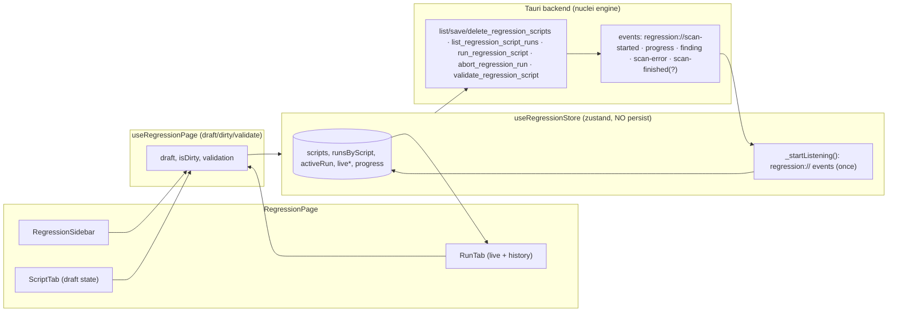

# Regression (`regression`) — UI Deep Dive

> Source: `references/hexbuffer/src/pages/regression/` (11 files, ~1,880 lines)
> Exported page component: `RegressionPage`

## 1. Overview & Purpose

A **Nuclei-YAML regression tester**: each "test case" is a named script (name, description, target URL, YAML) whose YAML documents (`---`) are *conditions* — a matcher hit against the target means the condition **PASSes**. The workspace is a fixed-width script list on the left (with inline two-click delete confirmation and live run-status dots) and a two-tab editor on the right: **Script** (metadata form + Monaco YAML editor with backend validation and detected-condition badges) and **Run** (live progress, conditions table, run console, recent-run history). Runs stream over `regression://*` Tauri events; history is persisted per script by the backend.

## 2. Annotated File Tree

```
regression/
├── index.tsx                            (202)  288px sidebar | tabbed editor shell; shared TAB_CONTENT_CLASS; context band
├── types.ts                              (77)  RegressionScript, Condition/Finding/RunMessage/RunProgress/Run, ValidationResult, ScriptDraft
├── constants.ts                          (64)  STARTER_YAML, SEVERITY_CLASS (5-rung categorical palette), CONDITION_STATUS_META, RUN_STATUS_META
├── hooks/
│   └── use-regression-page.ts           (250)  Draft lifecycle (dirty/save/validate gating), selection, run handlers
└── components/
    ├── regression-sidebar.tsx           (375)  Test case list: status dots, relative timestamps, pending-delete confirm pair
    ├── script-tab.tsx                   (288)  Name/Target/Description grid, YAML TextEditor, error strip, condition badges, Validate/Save footer
    ├── run-tab.tsx                      (277)  Toolbar (Run/Abort, live status + progress), summary badges, 55/45 vertical split (ConditionsTable | RunConsole), Recent Runs
    ├── conditions-table.tsx             (144)  PASS/FAIL/WAIT table with severity badges (sticky header)
    ├── run-console.tsx                   (81)  Level-tagged mono message log
    ├── regression-empty-state.tsx         (72)  FlaskIcon hero + "New Test Case" CTA
    └── pane-header.tsx                    (47)  Shared h-7 pane label strip (label + right meta)
```

## 3. Architecture & Dataflow



- **Run lifecycle**: `runScript(scriptId, { concurrency?, rateLimitRps? })` → `{ runId }`; store resets `liveConditions/Findings/Messages/progress` and marks `activeRun = { runId, scriptId, status: 'running' }`. Event handlers ignore any payload whose `runId` ≠ `activeRun.runId` (`isLiveRun` guard) — stale events from a previous run are dropped.
- **Listener lifecycle**: `_startListening` is idempotent via a module-level `listening` flag; unlisteners are collected but the module never tears them down (deliberate: app-lifetime listeners).
- **Finding ⇒ condition coupling**: a `regression://finding` event appends to `liveFindings` **and** flips the matching condition (`id === finding.templateId`) to `passed` with `matchedUrl`/`extracted`.
- **Gating rules** (`use-regression-page.ts`): Run is refused when dirty ("Save your changes before running") or target URL empty ("Set a target URL before running"); Save runs validation first and refuses invalid YAML ("Cannot save — fix the YAML errors first").
- **Draft model**: `draft` + `draftScriptId` track per-script edits; switching scripts or dropping dirty state rebuilds via `draftFromScript`. New scripts are created immediately (persisted with `name: Test Case ${Date.now() % 1000}`, inherited target URL, `STARTER_YAML`), not as unsaved drafts.

## 4. State Management — `src/stores/regression.ts`

| Field | Type | Persisted |
| :-- | :-- | :-- |
| `scripts: RegressionScript[]` | id/name/description/targetUrl/yaml/enabled/timestamps | ❌ (SQLite via backend) |
| `runsByScript: Record<string, RegressionRun[]>` | per-script run history | ❌ |
| `activeRun: { runId, scriptId, status } \| null` | the single live run | ❌ |
| `liveConditions / liveFindings / liveMessages` | streamed arrays | ❌ |
| `progress: RunProgress \| null` | `{ completedRequests, totalRequests, rps }` | ❌ |

Actions: `loadScripts`, `saveScript` (unshift + dedupe), `deleteScript` (also drops runs + clears activeRun if it belonged to the script), `loadRuns`, `runScript`, `abortRun` (sets status `aborted`), `clearLiveRun`, `_startListening`. **No `persist` middleware** — all persistence is backend-side. Hook-local state: `activeScriptId`, `activeTab`, `draft`, `draftScriptId`, `isDirty`, `isSaving`, `validation`, `isValidating`.

## 5. IPC Contracts

### Commands

| Command | Args | Returns | Where |
| :-- | :-- | :-- | :-- |
| `list_regression_scripts` | — | `RegressionScript[]` | `loadScripts` |
| `save_regression_script` | `{ script: { id, name, description, targetUrl, yaml, enabled } }` | `RegressionScript` (server timestamps) | `saveScript` |
| `delete_regression_script` | `{ id }` | `void` | `deleteScript` |
| `list_regression_script_runs` | `{ scriptId }` | `RegressionRun[]` | `loadRuns` |
| `run_regression_script` | `{ scriptId, concurrency: number \| null, rateLimitRps: number \| null }` | `{ runId }` | `runScript` (UI passes no options → nulls) |
| `abort_regression_run` | `{ runId }` | `void` | `abortRun` |
| `validate_regression_script` | `{ yaml }` | `ValidationResult { valid, errors[], templates[{id,name,severity}] }` | Validate button and Save pre-check |

### Events (`regression://` namespace)

| Event | Payload | Handler |
| :-- | :-- | :-- |
| `regression://scan-started` | `{ runId, scriptId, totalTemplates, totalTargets }` | info message "Scan started: N condition(s) against M target(s)" |
| `regression://progress` | `RunProgress & { runId }` | `set({ progress })` |
| `regression://finding` | `{ runId, finding: RegressionFinding }` | append finding + mark condition passed |
| `regression://scan-error` | `{ runId, target, message }` | error message "`target`: `message`" |
| *(further listeners below line 200 of the store: scan completion/failure flush `activeRun.status` and append final messages)* | | |

## 6. UI Layout & Component Breakdown

```
┌─ ResizablePanelGroup (horizontal) ──────────────────────────────────────────────────┐
│ ┌ Sidebar 288px (min 232, max 45%) ┐ ┌ Editor (min 420px) ─────────────────────────┐ │
│ │ TEST CASES (n)            [+]    │ │ <name> [Unsaved]      <targetUrl> (mono)    │ │
│ │ ───────────────────────────────  │ │ [Script][Run ●pulsing when running]         │ │
│ │ ● My Test Case                   │ │ ┌ TAB_CONTENT (mx-3 mb-3 mt-2 rounded-md) ┐ │ │
│ │   https://t.example.com · 3m ago │ │ │ SCRIPT: Name/Target grid, Description,  │ │ │
│ │ ● Other Case  [🗑→[✓][✗] hover]  │ │ │ NUCLEI YAML pane (Monaco yaml) + errors │ │ │
│ │   (run-status dot colors)        │ │ │ + severity badges + Validate/Save       │ │ │
│ │ (empty: 🧪 FlaskIcon "No test    │ │ │ RUN: toolbar+summary, Conditions 55% /  │ │ │
│ │  cases yet")                     │ │ │ Console 45%, Recent Runs strip          │ │ │
│ └──────────────────────────────────┘ │ └─────────────────────────────────────────┘ │ │
│                                      └─────────────────────────────────────────────┘ │
│ (no selection) → RegressionEmptyState (FlaskIcon, explainer, New Test Case)         │
└─────────────────────────────────────────────────────────────────────────────────────┘
```

### Shell (`index.tsx`)
Explicit-unit panel sizing (comment: "a bare number means pixels"): sidebar `defaultSize="288px" minSize="232px" maxSize="45%"`; editor `minSize="420px"`. Both tab panels share `TAB_CONTENT_CLASS` so "the card edge never shifts when switching tabs". **Context band** (`h-11`): script name + warning-tinted "Unsaved" badge when dirty; right-aligned mono target URL ("No target set" fallback). `TabsList` with **Run tab pulse dot** (`size-1.5 bg-warning animate-pulse motion-reduce:animate-none`) while a run is live.

### `RegressionSidebar`
`TooltipProvider delay={300}` wraps the pane. Header (`h-11`, deliberately matched to the context band "so the rules line up"): "TEST CASES" + count badge + `PlusIcon weight="bold"` ghost icon-button ("New test case"). Rows (`role="list"/"listitem"`, `aria-current` on active): status dot (`size-1.5` — `RUN_STATUS_META` colors when this script is the live run, `bg-primary/70` when merely active, `bg-border` otherwise); selection is the **only** button region; second line shows mono target URL + relative `formatUpdatedAt` ("just now / Xm / Xh / Xd ago", locale date beyond a week). **Delete flow**: hover reveals `TrashSimpleIcon` (icon-xs, aria-labelled per script) → row enters pending state (`border-destructive/30 bg-destructive/5`) swapping to ✓ Confirm / ✗ Cancel pair; pending state resets on selection change (`useEffect`). Empty state: circular `bg-muted` FlaskIcon + two-line copy.

### `ScriptTab`
- **Meta grid** (`grid-cols-2 border-b p-3`, labels via `htmlFor`): Name `Input`, Target URL mono `Input`, Description `Textarea rows={2}` (col-span-2).
- **YAML pane**: `PaneHeader label="Nuclei YAML" meta="N condition(s) | No conditions detected"` (from `validation.templates.length`), then full-height Monaco `TextEditor language="yaml"` themed by `useTheme`.
- **Error strip** (when `validation.errors`): `max-h-24` `ScrollArea`, `border-t border-red-500/30 bg-red-500/5`, mono red lines each prefixed by `WarningCircleIcon weight="fill"`.
- **Detected conditions**: outline `Badge mono` per template, colored by `SEVERITY_CLASS[severity]` (critical red / high orange / medium amber / low sky / info muted — explicit hue pairs, with a comment pointing at the categorical-vs-semantic rationale in `src/lib/status-colors.ts`).
- **Footer**: validation state ("Valid script" emerald w/ `CheckCircleIcon fill` · "N error(s)" red · "Not validated yet" muted), dirty warning ("Unsaved changes — Run uses the last saved version", amber `WarningDiamondIcon`), right-aligned **Validate** (outline, `Spinner` while validating) and **Save** (primary, `FloppyDiskIcon`/`Spinner`).

### `RunTab`
- **Toolbar**: target URL + status line (`RUN_STATUS_META`: running = pulsing amber dot, completed = `bg-success`, failed = `bg-destructive`, aborted = muted) with live `progress.completedRequests/totalRequests · rps.toFixed(1) rps`, or "Idle — press Run to execute the last saved script". Buttons: **Run** (`PlayIcon fill`) / **Abort** (`StopIcon fill`, destructive) while running.
- **Summary badges**: `{passed} passed` (variant success), `{failed} failed` (destructive), `{findings.length} matches` + duration (secondary, `formatDuration`: ms or `X.X s`) + `Spinner` while running.
- **Vertical split** (55/45, explicit `minSize` px): **Conditions** pane (`PaneHeader meta="P/N passed"`) over `ConditionsTable`; **Console** pane (`meta="N lines"`) over `RunConsole`.
- **Recent Runs** strip (`max-h-28 ScrollArea`): per-run mono row — status dot, `toLocaleString` timestamp, status label, `passedConditions/totalTemplates passed`, duration, truncated red error.

### `ConditionsTable`
Kit `Table`, sticky header (`bg-muted/95 backdrop-blur-sm`), columns Result (w-20) / Condition / Severity (w-24) / Matched URL. Result cells: PASS (`CheckCircleIcon` fill, `text-success`), FAIL (`WarningCircleIcon` fill, `text-destructive`), WAIT (`MinusCircleIcon`, muted) — labels from `CONDITION_STATUS_META`. Condition cell stacks name over mono id. Matched URL mono `break-all` ("—" fallback). Empty: `RowsIcon` + "No conditions yet — save and validate the script to see them here."

### `RunConsole`
Mono `text-2xs` log; fixed-width level tags (`w-11`, labels INFO/PASS/ERROR/WARN with emerald/red/amber colors), tabular-nums `toLocaleTimeString`, `break-all` message. Empty: "Run messages will appear here. Press Run to execute the script against the target."

### `PaneHeader` / `RegressionEmptyState`
`PaneHeader`: shared `h-7` strip (`bg-muted/20`, uppercase tracked `text-3xs` label + right meta) used by YAML/Conditions/Console/Recent Runs panes. Empty state: `size-12` circled FlaskIcon, "No test case selected", explainer ("A matcher hit counts as a passed condition"), **New Test Case** button.

## 7. UI Libraries & Primitives Used

| Category | Items (actual imports) |
| :-- | :-- |
| UI kit | `Badge`, `Button`, `Input`, `ScrollArea`, `Spinner`, `Table*`, `Tabs`, `TabsContent`, `TabsList`, `TabsTrigger`, `TextEditor`, `Textarea`, `Tooltip*` (TooltipProvider/Content/Trigger) |
| Local primitives | `ResizablePanel/Handle/Group` (`@/components/ui/resizable`) — outer horizontal AND inner vertical split |
| Icons (`@phosphor-icons/react`) | `CheckIcon`, `FlaskIcon`, `PlusIcon`, `TrashSimpleIcon`, `XIcon`, `CheckCircleIcon`, `FloppyDiskIcon`, `WarningCircleIcon`, `WarningDiamondIcon`, `PlayIcon`, `StopIcon`, `MinusCircleIcon`, `RowsIcon` (several `weight="bold"/"fill"`) |
| Editor | Kit `TextEditor` — `language="yaml"` (the page's defining prop), `height="100%"`, `theme` |
| State/IPC | `zustand` (no persist), `invokeTauri`/`toErrorMessage` (`@/lib/ipc`), `listen` (`@tauri-apps/api/event`, inside the store) |
| Misc | `sonner` toasts for every gate/failure, `cn` |

## 8. Keyboard Shortcuts & Interactions

- No global shortcuts. Delete uses a two-click inline confirm (row-level, not a dialog); selection changes cancel a pending delete.
- Tab pulse dot and all status animations carry `motion-reduce:animate-none`.
- Save blocks invalid YAML; Run blocks dirty/unsaved drafts and empty targets — feedback via toasts plus the amber inline warning.

## 9. Styling Details

- Severity ladder is categorical with explicit light/dark pairs (`SEVERITY_CLASS`); condition result and run status use semantic tokens (`text-success`/`text-destructive`/`text-warning`).
- Consistent `border-border/60` hairlines, `bg-muted/20` pane headers, `tabular-nums` for all counts/timestamps/durations.
- `h-11` sidebar header intentionally equals the context band height; `TAB_CONTENT_CLASS` keeps card edges stable across tab switches — both documented in comments.

## 10. Integration Points

- **Nuclei engine (backend)**: scripts are YAML-compatible with Nuclei templates (`id`/`info`/`http` blocks, `{{BaseURL}}`); the starter template demonstrates a status-200 reachability condition.
- **Live-traffic analogy**: findings/conditions mirror the Invoker (intruder) result model; the run console mirrors telemetry consoles elsewhere.
- **No cross-page bridges**: no "send to Repeater" or Memory export; results stay in run history.

## 11. Notable Findings

1. **One live run at a time, guarded by runId**: every event handler drops payloads for non-active runs, so a stale background run can't corrupt the UI — but the sidebar dot only reflects `activeRun.scriptId`.
2. **Validation is a backend round-trip, not client-side**: both Validate and Save call `validate_regression_script`; there is no local YAML parsing in the UI.
3. **Deleting the active script while its run is live clears `activeRun`** in the store (`deleteScript`), silently orphaning the backend run (no abort is issued).
4. **New test cases are created persisted immediately** (name `Test Case ${Date.now() % 1000}`) — no draft-only state; the dirty flag exists solely for edits.
5. **Options never wired**: `runScript` accepts `{ concurrency, rateLimitRps }` but the page always passes undefined → backend nulls; there is no UI to tune them.

## 12. Source Files Documented

`index.tsx` · `types.ts` · `constants.ts` · `hooks/use-regression-page.ts` · `components/regression-sidebar.tsx` · `components/script-tab.tsx` · `components/run-tab.tsx` · `components/conditions-table.tsx` · `components/run-console.tsx` · `components/pane-header.tsx` · `components/regression-empty-state.tsx` · `src/stores/regression.ts` (store, incl. event listeners)
