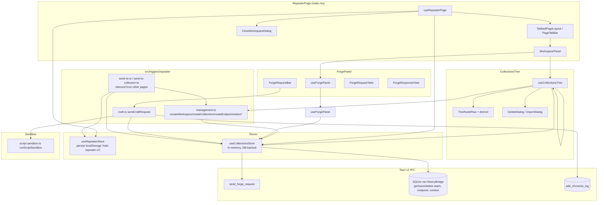

# Repeater (repeater) — UI Deep Dive

> Source: `references/hexbuffer/src/pages/repeater/` (50 files, ~9,240 lines)
> Related shared modules documented for usage: `src/stores/repeater.ts`, `src/stores/collections.ts`, `src/triggers/repeater/*`, `src/layout/tabs-layout/*`, `src/components/select-env-input.tsx` (page-owned), `src/lib/{ipc,utils,monaco-setup}.ts`, `src/hooks/useCopyToClipboard.ts`, `src/components/theme-provider.tsx`, `src-tauri/src/commands/api_collection.rs`

## 1. Overview & Purpose

Repeater is Halo's Burp-Suite-like manual request workbench, internally called the **Forge**. It is the page at route `/repeater`. Structure, top to bottom:

- **Workspace tabs** — every "tab" is a workspace (`WorkspaceTab`), rendered through the shared `TabbedPageLayout`. Closing a tab *deletes* the workspace and its whole collection subtree, guarded by a quantified confirmation.
- **Per-workspace split view** — a resizable **Collections tree** on the left (collections → folders → endpoints, with drag-and-drop reordering/reparenting, filter with match highlighting, import/export JSON) and the **Forge panel** on the right (method + colorized URL + Send, Params/Headers/Body/Scripts request tabs, Request/Response mode switch, response viewer with test results).
- **Environment variables** ("contexts") — a `ContextsDialog` managing named environments with key/value variables. `{{variable}}` tokens are syntax-highlighted in every input via `ColorizedUrlInput`, with an autocomplete dropdown.
- **Scripts sandbox** — Pre-request and Test scripts (Postman-style `pm` API) are executed client-side in `runScriptSandbox` (`new Function('pm','script','expect','console', …)`), producing `TestResult[]` rendered in the response's Tests tab.

State lives in two Zustand stores: `useRepeaterStore` (workspace tabs, persisted to localStorage) and `useCollectionsStore` (stashes/endpoints/contexts/chronicle, persisted to SQLite through Tauri IPC). Sending a request goes through `sendCraftRequest` (`src/triggers/repeater/craft.ts`): pre-script → variable expansion → `invoke('send_forge_request')` → test script → chronicle log.

## 2. Annotated File Tree — every file with a one-line description of what it does

```
src/pages/repeater/
├── index.tsx                                  Page entry: TabbedPageLayout (workspace tabs) + WorkspacePanel + CloseWorkspaceDialog.
├── types.ts                                   RepeaterRequest/ParsedRepeaterRequest/RepeaterResponse (legacy), HttpMethod union, WorkspaceTab + createWorkspaceTab() factory.
├── constants.ts                               DEFAULT_WORKSPACE_NAME = 'Default Workspace'.
├── hooks/
│   └── use-repeater-page.ts                   Page controller: hydration, orphan-stash migration, tab callbacks, Cmd/Ctrl+S save, close-impact computation.
├── components/
│   ├── workspace-panel.tsx                    Horizontal ResizablePanelGroup: collections tree (left) | forge panel or "No request selected" Empty (right).
│   ├── ForgePanel.tsx                         Forge shell: request bar, Request/Response mode switch with live status pill, loading/content routing.
│   ├── close-workspace-dialog.tsx             AlertDialog confirming workspace close; shows name + describeCounts() impact line.
│   ├── close-workspace-dialog.render.test.tsx jsdom DOM tests: impact line text, pluralisation, destructive confirm, single-fire handlers.
│   ├── select-env-input.tsx                   ColorizedUrlInput (highlighted {{var}} textarea), useEnvWatcher autocomplete hook, EnvSuggestionDropdown.
│   ├── collection-tree/
│   │   ├── index.tsx                          CollectionsTree: TreeHeader + TreeFilter + DndContext + rows + dialogs + empty states.
│   │   ├── use-collections-tree.ts            Tree state machine: expansion, filter, inline create, rename, delete, import/export, all dnd handlers.
│   │   ├── utils.ts                           FlatNode model, flattenVisibleTree/flattenFilteredTree, splitHighlight, computeDropResult, row metrics, computeDeleteImpact.
│   │   ├── utils.test.ts                      Unit tests for flatten/filter/highlight/delete-impact.
│   │   ├── tree-header.tsx                    "Collections" 36px toolbar band with Export/Import/New-collection quiet icon buttons.
│   │   ├── tree-filter.tsx                    InputGroup search box ("Filter collections"), Escape-clears, match-count chip, clear button.
│   │   ├── tree-node-row.tsx                  One row: chevron, folder SVG, method pill, label (highlighted), count badge, drag handle, context menu, rename input.
│   │   ├── highlight-text.tsx                 HighlightText: wraps splitHighlight segments; matches get bg-primary/25 mark.
│   │   ├── collection-drop-zone.tsx           useDroppable "Add endpoint / Drop here" dashed hint for empty expanded collections.
│   │   ├── drag-overlay-content.tsx           DragOverlay chip mirroring the row (method pill + label).
│   │   ├── inline-create.tsx                  Auto-focused inline Input+submit for new endpoint/folder names.
│   │   ├── delete-dialog.tsx                  AlertDialog for endpoint/collection delete; shows method+url or cascade counts.
│   │   ├── import-dialog.tsx                  AlertDialog confirming workspace-replacing import; names file + contents counts.
│   │   ├── collections-tree.render.test.tsx   jsdom DOM tests of the filter: rows, highlights, url hints, affordance withdrawal, collapse restore.
│   │   └── dialogs.render.test.tsx            jsdom DOM tests of DeleteDialog + ImportDialog payloads.
│   ├── contexts-dialog/
│   │   ├── index.tsx                          ContextsDialog shell: Dialog 580px/sm:max-w-4xl, sidebar + AnimatePresence editor/empty state.
│   │   ├── types.ts                           ContextsDialogProps + UseContextsDialogReturn interface.
│   │   ├── use-contexts-dialog.ts             Dialog controller: create/edit/duplicate/delete/activate environments; variables list editing.
│   │   ├── use-contexts-dialog.render.test.tsx Hook test of the create-then-select path (created env stays selected).
│   │   ├── contexts-sidebar.tsx               w-72 environments column: header band, search InputGroup, role=listbox, Empty state.
│   │   ├── contexts-list-item.tsx             One environment row: selection rail, hover actions (activate/duplicate/delete), inline delete confirm, "Active" Badge.
│   │   ├── contexts-editor.tsx                Editor: name input + Save/Cancel band, column header, variable rows, "Add variable" row, reference hint footer.
│   │   ├── contexts-variable-row.tsx          One variable row on shared VARIABLE_COLUMNS grid: Checkbox, key Input (mono), value Input, hover Trash.
│   │   ├── contexts-variables-empty.tsx       Empty state inside editor when an environment has no variables.
│   │   ├── contexts-empty-state.tsx           Right panel when nothing is being edited: feature hints + "New environment" + Close.
│   │   └── columns.ts                         VARIABLE_COLUMNS grid template + VARIABLE_GUTTER padding shared by header/rows/empty.
│   └── forge-panel/
│       ├── use-forge-panel.ts                 Forge controller hook: all request-field mutation handlers over store.updateActiveRequest, derived activeEndpoint.
│       ├── forge-utils.ts                     encodeParamPreservingVars, getQueryParams, rebuildUrl, getFormattedBody (JSON pretty), deriveActiveEndpoint.
│       ├── forge-request-bar.tsx              Two rows: environment Select + manage gear + endpoint name/Save/Delete; method Select + ColorizedUrlInput + Send.
│       ├── forge-request-tabs.tsx             Params/Headers/Body/Scripts Tabs (line variant) with TabCount chips; body type none/raw/json; image-mode drop zone.
│       ├── forge-key-value-editor.tsx         Column-aligned KV editor grid [24px checkbox | key | value | 24px remove] used by Params and Headers.
│       ├── forge-response-view.tsx            Response tabs Pretty/Raw/Headers/Request/Tests; error banner; copy button; test-result cards.
│       ├── forge-response-meta.tsx            Status/Time/Size meta strip (Blob size, formatBytes) shown on the mode-switch row in response view.
│       └── forge-loading-view.tsx             In-flight view: Spinner in a bordered circle + "Sending request" copy.
└── lib/
    ├── collection-io.ts                       exportCollectionsToFile (plugin-dialog save + plugin-fs writeTextFile) and importCollectionsFromFile (open + readTextFile + schema validation).
    ├── describe-counts.ts                     describeCounts(parts, emptyLabel): "3 collections · 12 endpoints" with zero-part dropping.
    ├── method-styles.ts                       getMethodTreatment(): text/pill/rail class table for GET/POST/PUT/PATCH/DELETE/OPTIONS/HEAD + NEUTRAL.
    ├── status-styles.ts                       getStatusTreatment()/SUCCESS/FAILURE + formatBytes(); status → pill/text/dot/label classes.
    ├── script-sandbox.ts                      runScriptSandbox(): pm/script/expect/console sandbox via new Function; returns updatedVariables, testResults, logs.
    ├── stash-tree.ts                          collectDescendantStashIds (BFS, cycle-safe) + computeWorkspaceImpact for the close dialog.
    └── stash-tree.test.ts                     Unit tests for the cascade walk (depth, cycles, sibling isolation).
```

## 3. Architecture & Dataflow



**Send pipeline (`sendCraftRequest`, `src/triggers/repeater/craft.ts`):**

1. Set `isLoading: true, error: null, response: null, testResults: []` on `activeRequest`.
2. Read enabled variables of `activeContextId` from the active `ContextRecord.variables` JSON.
3. If `preScript` is set, run it in the sandbox (no response object); collect `updatedVariables`.
4. Expand `{{var}}` in base URL, query-param keys/values, header keys/values and body (leaving unknown placeholders untouched), then rebuild the URL from base + enabled params (`encodeParamPreservingVars` keeps `{{`/`}}` un-encoded through `encodeURIComponent`).
5. `await store.sendForgeRequest({ method, url, headers, body })` → `invoke('send_forge_request', { request })`.
6. If `testScript` is set, run it against the response; merge `updatedVariables` back into the active context via `store.updateContext` (adds new keys).
7. Commit `response` + `testResults`, set `isLoading: false`; on any thrown error set `error: err.message`.
8. Record the exchange with `store.addChronicleRecord(...)` → `invoke('add_chronicle_log')`.

`ForgePanel` auto-switches to the response view via `useEffect` whenever `!isLoading && (response || error)`.

**URL ⇄ query-param sync:** `useCollectionsStore.updateActiveRequest` is the single write path. A `url` patch re-parses `queryParams` (preserving `enabled` of matching existing rows); a `queryParams` patch rebuilds `url` from base + enabled params.

## 4. State Management

### `useRepeaterStore` (`src/stores/repeater.ts`, Zustand `persist`)

Persist key **`halo-repeater-v2`**; `partialize` persists only `workspaces` + `activeWorkspaceId`. `merge` migrates the legacy `{ tabs: [...] }` format (mapping `mode === 'collection'` tabs to `id: collectionId, name: collectionName`) and falls back to the first workspace when the persisted `activeWorkspaceId` no longer resolves.

| Field / Action | Type | Page usage |
|---|---|---|
| `workspaces` | `WorkspaceTab[]` (`{id, name}`) | Read by `use-repeater-page` to build `tabs: PageTabItem[]`, guard last-workspace close, resolve `pendingCloseName`. |
| `activeWorkspaceId` | `string` | Tab selection; keyed `<WorkspacePanel key={activeWorkspaceId}>` (remount resets Forge local state). |
| `createWorkspace(name?, id?)` | `(…) => string` | Auto-create on empty store after hydration; `onTabAdd`. Picks `Workspace {n+1}` by regex `^Workspace (\d+)$`. |
| `renameWorkspace(id, name)` | `void` | `onTabRename` (double-click tab rename in `PageTabBar`). |
| `deleteWorkspace(id)` | `void` (store) / `async` (trigger) | `confirmClose`. Trigger version first `deleteStash`es every stash with `parentId === id` (cascading), then removes the tab. Refuses to remove the last workspace. |
| `setActiveWorkspaceId(id)` | `void` | `onTabChange`. |
| `closeTabsToLeft/Right(id)` | `void` | Tab-bar context-menu actions; keep active id if it survives. |
| Deprecated shims | `addRequestTab`, `addEmptyHttpTab`, `addCollectionTab`, `renameTab`, `updateTab` | Compatibility for external triggers; `addRequestTab` dynamically imports `sendRawToRepeater`. Not used by the page itself. |

### `useCollectionsStore` (`src/stores/collections.ts`, no persist — DB-backed)

Every write action is optimistic (mutate local state, then `invoke`, errors logged to console; `saveActiveEndpoint` additionally toasts success/failure).

| Field | Type | Page usage |
|---|---|---|
| `stashes` | `StashRecord[]` `{id,name,parentId,sortOrder,createdAt,updatedAt}` | Tree flatten, counts, cascades, export/import. |
| `endpoints` | `StashEndpointRecord[]` `{id,stashId,name,method,url,headers(JSON string \| null),body,bodyType,preScript,testScript,sortOrder,createdAt,updatedAt}` | Tree rows, forge, export/import. |
| `contexts` | `ContextRecord[]` `{id,name,variables(JSON string),createdAt,updatedAt}` | Env Select, ContextsDialog, variable expansion. |
| `chronicleLogs` | `ChronicleLogRecord[]` (max 500 in memory) | Written on each send; consumed by the chronicle module. |
| `selectedNodeId` | `string \| null` (`stash-*` / `ep-*`) | Gates ForgePanel vs Empty in WorkspacePanel; Cmd+S guard; dnd selections. |
| `activeContextId` | `string \| null` | Env Select value, expansion, sandbox variables. |
| `activeRequest` | `ActiveRequestState` `{method,url,headers:KeyValuePair[],body,bodyType:'none'\|'raw'\|'json'\|'form-data',preScript,testScript,response:ForgeResponse\|null,isLoading,error,testResults,queryParams:KeyValuePair[]}` | The entire forge editing surface. Not persisted. |
| `isHydrated` | `boolean` | Gate for auto-create-workspace and orphan migration effects. |
| `mode` | `'repeater' \| 'craft'` | Set to `'craft'` by `selectCollection`; no longer branches rendering (legacy). |
| `fetchFromDb()` | `Promise<void>` | `invoke` `get_stashes`, `get_stash_endpoints`, `get_contexts`, `get_chronicle_logs {limit:500}` in parallel; validates `activeContextId`; sets `isHydrated`. |
| `createStash / renameStash / deleteStash / moveStash` | stash CRUD → `save_stash` / `delete_stash` | `createStash` selects `stash-{id}` after insert; `deleteStash` walks descendants recursively and deletes each. |
| `setActiveEndpointId(id)` | `void` | Loads endpoint into `activeRequest`: parses `headers` JSON (both `KeyValuePair[]` and plain-object formats), resets response/error, parses `queryParams` from URL. |
| `createEndpoint / renameEndpoint / deleteEndpoint / moveEndpoint` | endpoint CRUD → `save_stash_endpoint` / `delete_stash_endpoint` | Tree inline create, context menu, request-bar delete, dnd moves. |
| `saveActiveEndpoint()` | `Promise<void>` | Serializes enabled headers to JSON object, rebuilds URL with query params, `save_stash_endpoint`, toasts. Bound to Cmd/Ctrl+S and the Save button. |
| `updateActiveRequest(updater)` | `void` | Single mutation path with URL⇄params sync (see §3). |
| `createContext / updateContext / deleteContext` | context CRUD → `save_context` / `delete_context` | ContextsDialog. `createContext` activates only when nothing was active; `deleteContext` re-points `activeContextId` to `contexts[0]`. |
| `addChronicleRecord(method,url,headers,body,response)` | `Promise<void>` → `add_chronicle_log` | After every successful send. |
| `sendForgeRequest(payload)` | `Promise<ForgeResponse>` → `send_forge_request` | The HTTP send. |
| `clearAllCollections(workspaceId?)` / `batchImportCollections(stashes,endpoints,workspaceId?)` | import/export plumbing → `delete_*` then `save_*` then `get_stashes`/`get_stash_endpoints` reload | Used by the import confirm flow. Returns `{stashesImported,endpointsImported,errors}`. |

### Local component state (notable)

- `useCollectionsTree`: `expandedIds: Set<string>`, `filterQuery`, `inlineCreate {parentId,type}`, `renameTarget {id,name}` + `renameValue`, `dragActiveId`, `dragOverId`, `deleteTarget`, `importDialogOpen`, `pendingImport`, plus `hoverExpandTimerRef`/`hoverExpandTargetRef` (800 ms drag-hover expand) and `pointerPos` (tracked via `window.pointermove` during drags).
- `useForgePanel`: `activeReqTab` (default `'params'`), `activeResTab` (default `'pretty'`).
- `ForgePanel`: `activeView: 'request' | 'response'` (auto-switches to response on completion).
- `ForgeRequestTabs`: `activeScriptTab: 'pre' | 'test'`, `isImageMode` (initialised from `body.startsWith('data:image/')`), `isDragging`, hidden `fileInputRef`.
- `ColorizedUrlInput`: `isExpanded` (single-line ↔ textarea, heights 28px → clamp(64, scrollHeight, 180)px), watcher `isOpen/query/highlightedIndex`.
- `use-contexts-dialog`: `editingContext`, `name`, `variables`, `isCreating`, `searchQuery`, `deletingContextId`.

## 5. IPC Contracts

### Commands invoked

All commands are defined in `src-tauri/src/commands/api_collection.rs` (registered in `main.rs`). None of the page components call `invoke` directly except the orphan-stash migration in `use-repeater-page.ts`; everything else goes through `useCollectionsStore` actions, `collection-io.ts`, or `send-to*.ts`.

| Command | Args | Returns | Where called from |
|---|---|---|---|
| `get_stashes` | – | `StashRecord[]` | `collections.fetchFromDb` (on mount), `batchImportCollections` reload |
| `get_stash_endpoints` | – | `StashEndpointRecord[]` | `fetchFromDb`, `batchImportCollections` reload |
| `get_contexts` | – | `ContextRecord[]` | `fetchFromDb` |
| `get_chronicle_logs` | `{ limit: number }` (500) | `ChronicleLogRecord[]` | `fetchFromDb` |
| `save_stash` | `{ record: StashRecord }` | `()` | `createStash`, `renameStash`, `moveStash`, orphan-stash migration in `use-repeater-page.ts` (`record: { ...stash, parentId: defaultWorkspaceId, updatedAt }`), `batchImportCollections` |
| `delete_stash` | `{ id: string }` | `()` | `deleteStash` (once per descendant), `clearAllCollections`, `batchImportCollections` |
| `save_stash_endpoint` | `{ record: StashEndpointRecord }` | `()` | `createEndpoint`, `renameEndpoint`, `moveEndpoint`, `saveActiveEndpoint`, `management.createEndpoint` (throws "Failed to save the endpoint. It was not added to the collection." on failure so the inline form stays open), `send-to-collection.ts`, `batchImportCollections` |
| `delete_stash_endpoint` | `{ id: string }` | `()` | `deleteEndpoint`, `clearAllCollections`, `batchImportCollections` |
| `save_context` | `{ record: ContextRecord }` | `()` | `createContext`, `updateContext` |
| `delete_context` | `{ id: string }` | `()` | `deleteContext` |
| `add_chronicle_log` | `{ record: ChronicleLogRecord }` | `()` | `addChronicleRecord` after each send |
| `clear_chronicle_logs` | – | `()` | `clearChronicle` (not wired in this page) |
| `send_forge_request` | `{ request: ForgeRequest }` where `ForgeRequest = { method: string, url: string, headers: HashMap<String,String>, body: string }` | `ForgeResponse { status: u16, status_text, headers: HashMap, body: string, time_ms: u128, final_url: string }` | `sendForgeRequest` from `sendCraftRequest`. Rust side: reqwest client, redirect policy limited to 10, decodes `data:`/`;base64,` bodies to binary, measures `time_ms` with `Instant`. |

### Events listened

**None.** The repeater page registers no Tauri `listen()` handlers. The only Tauri event usage in its trigger surface is an **emit**: `openStandaloneRepeater` (`src/triggers/repeater/send-to.ts`) does `emit('halo:subapp-params', query)` (payload = URL query string with `endpointId`, `raw`, `url`, `name`, `target=repeater`) to notify an already-open standalone Repeater window, then opens the deep link `apprecon://repeater?…` via `@tauri-apps/plugin-opener`, falling back to `window.open(`${origin}/?${query}`)`.

### Dialog-plugin IPC (file export/import, `lib/collection-io.ts`)

| Plugin call | Args | Returns | Usage |
|---|---|---|---|
| `save` (`@tauri-apps/plugin-dialog`) | `{ title: 'Export Collections', defaultPath: 'collection-schema.json', filters: [{name:'JSON', extensions:['json']}] }` | path or null | Export |
| `writeTextFile` (`@tauri-apps/plugin-fs`) | `(path, JSON.stringify(data, null, 2))` | – | Export; schema `{ version: 1, exportedAt, collections: { stashes, endpoints } }` |
| `open` | `{ title: 'Import Collections', multiple: false, filters: [JSON] }` | path or null | Import |
| `readTextFile` | `(path)` | string | Import; validated: object → `collections.stashes[]` (id, name; parentId kept only if it references another imported stash, else `null`) → `collections.endpoints[]` (id, stashId, name; stashId must cross-reference) |

## 6. UI Layout & Component Breakdown

### ASCII layout (default sizes)

```
┌──────────────────────────────────────────────────────────────────────────────┐
│ PageTabBar  [Workspace 1 ×] [Workspace 2 ×] [+]      border-b border-primary │  ← rename: dbl-click; ctx-menu: close/left/right
├──────────────────────────────────────────────────────────────────────────────┤
│ ╔═ content m-2 border rounded-md ══════════════════════════════════════════╗ │
│ ║ ┌─ ResizablePanel 272px [200..500] ─┐╫┌─ ResizablePanel min 400px ─────┐║ │
│ ║ │ Collections  [⬇][⬆][+]  h-9 band  │╫│ Row1: [env Select w-44] [⚙]    │║ │
│ ║ ├───────────────────────────────────┤╫│       ...  name  [Save][🗑]    │║ │
│ ║ │ 🔍 Filter collections   h-9 band  │╫│ Row2: [GET ▾ 104px][URL…][Send]│║ │
│ ║ ├───────────────────────────────────┤╫│ ───────────────────────────────│║ │
│ ║ │ ▾ 📁 Payments API            3    │╫│ [⬆Request][⬇Response 200]  ◎… │║ │
│ ║ │   │ POST /v1/charges  (pill)      │╫│ ───────────────────────────────│║ │
│ ║ │   │ GET  /v1/charges/1            │╫│ Params Headers Body Scripts    │║ │
│ ║ │ ▸ 📁 Identity                     │╫│ ☑|Key|Value|🗑 (KV grid)      │║ │
│ ║ │ ▸ 📁 Internal Tooling             │╫│                                │║ │
│ ║ │  (empty → Empty state / dropzone) │╫│  or response: Pretty Raw Head… │║ │
│ ║ └───────────────────────────────────┘╫│       Tests  ✓2 ✗1  Copy       │║ │
│ ║              ResizableHandle ▷▷      ╫└────────────────────────────────┘║ │
│ ╚══════════════════════════════════════════════════════════════════════════╝ │
└──────────────────────────────────────────────────────────────────────────────┘
```

Tree row metrics (from `collection-tree/utils.ts`): `ROW_HEIGHT = 26`px, `INDENT_STEP = 14`px/level, `INDENT_BASE = 6`px, `LABEL_OFFSET = INDENT_BASE + 16 + 6 = 28`px (chevron 16px + gaps). `rowIndent(depth) = depth*14+6`; `labelIndent(depth) = depth*14+28`.

### `RepeaterPage` — `index.tsx`

- Props: none. Renders `TabbedPageLayout` with `tabs`, `activeTabId`, `onTabChange/Rename/Close/Add`, `onCloseTabsToLeft/Right`; layout `className='flex flex-col min-h-0 h-full'`, `contentClassName='flex-1 min-h-0 overflow-hidden m-2 border rounded-md'`.
- Children: `<WorkspacePanel key={page.activeWorkspaceId} workspaceId={...} />` only when an active workspace exists; plus the always-mounted `CloseWorkspaceDialog`.
- `useRepeaterPage` (`hooks/use-repeater-page.ts`) effects: (1) `fetchFromDb()` once on mount; (2) auto-`createWorkspace()` when `workspaces.length === 0 && isHydrated`; (3) one-shot migration (`migrationDoneRef`) of orphaned stashes (`parentId === null`) into `workspaces[0].id` via `invoke('save_stash')` then `fetchFromDb()`; (4) global keydown for Cmd/Ctrl+S.
- `onTabClose` blocks deleting the last workspace with `toast.error('Cannot delete the last remaining workspace')`, otherwise stages `pendingCloseId`.
- `closeImpact = computeWorkspaceImpact(pendingCloseId, stashes, endpoints)` → `{collections, endpoints}`.

### `WorkspacePanel` — `components/workspace-panel.tsx`

- Props: `{ workspaceId: string }` (Readonly).
- `ResizablePanelGroup orientation="horizontal"`; left panel `id="repeater-collections-panel"` `defaultSize="272px" minSize="200px" maxSize="500px"`; `<ResizableHandle withHandle />`; right panel `id="repeater-forge-panel"` `minSize="400px"`.
- Right side: if `selectedNodeId?.startsWith('ep-')` → `<ForgePanel key={selectedNodeId}>` (keyed to reset tabs/view per endpoint); else `Empty` with `FolderStarIcon`, title "No request selected", description pointing at the tree.

### `CollectionsTree` — `components/collection-tree/index.tsx`

- Props: `{ workspaceId: string }`.
- Header → filter → scrollable tree (`px-1.5 py-1.5 overflow-auto`) inside a `DndContext` (`sensors` from hook, `collisionDetection={closestCorners}`, `measuring.droppable.strategy = MeasuringStrategy.WhileDragging`, handlers `handleDragStart/Over/End`) wrapping a `SortableContext` (`items={isFiltering ? [] : flatNodeIds}`, `verticalListSortingStrategy`).
- Empty states: filtering with no hits → `MagnifyingGlassIcon` "No matches" + "Clear filter" outline Button; no collections → `FolderDashedIcon` "No collections" + "New collection" outline Button with `PlusIcon`.
- Per node: `TreeNodeRow`, plus (collections, expanded, not filtering, empty) a `CollectionDropZone`, plus (matching `inlineCreate.parentId`) an `InlineCreate` at `depth + 1`.
- `matchCount` = filtered `flatNodes` with `kind === 'endpoint'` only — collections are path, not results (asserted in the render test: typing `tooling` shows 1 row but count `0`).
- Footer dialogs: `DeleteDialog`, `ImportDialog`.

### `TreeHeader` — `tree-header.tsx`

- 36px (`h-9 px-2.5 border-b`) band: `text-2xs font-semibold tracking-wide text-muted-foreground uppercase` "Collections" + three `Button variant="quiet" size="icon-sm"` 24px keys with `size-3.5` icons: `DownloadIcon` (Export), `UploadIcon` (Import), `PlusIcon` (New collection).

### `TreeFilter` — `tree-filter.tsx`

- `InputGroup` with `InputGroupAddon align="inline-start"` `MagnifyingGlassIcon`; `InputGroupInput` (`aria-label="Filter collections"`, `spellCheck=false`, `autoComplete="off"`, Escape clears); when active, `inline-end` addon shows the numeric `matchCount` (`text-3xs tabular-nums text-muted-foreground`) and an `InputGroupButton size="icon-xs"` `XIcon` clear.

### `TreeNodeRow` — `tree-node-row.tsx`

- Props (interface `TreeNodeRowProps`): `node: FlatNode`, `isSelected`, `isExpanded`, `isDragOver`, `dropAction: DropAction|null`, `endpointCount`, `isFiltering?`, `highlightQuery?`, `isRenaming?`, `renameValue?`, `onRenameValueChange?`, `onRenameSubmit?`, `onRenameCancel?`, `onSelect`, `onToggleExpand`, `onAddChild`, `onRename`, `onDelete`.
- `useSortable({ id: node.id, data: { flatNode: node }, disabled: isFiltering })`; style: `CSS.Transform.toString(transform)`, `opacity: isDragging ? 0.4`, `paddingLeft: rowIndent(depth)px`; DOM `id={node.id}` (used by `handleDragEnd`'s `getElementById`).
- Drop indicators: `reorder-before` → `bg-primary absolute -top-px left-2 right-2 h-0.5 rounded-full`; `reorder-after` → same at `-bottom-px`; `reparent` → row gets `bg-primary/20 ring-primary/40 ring-1`.
- Structure: chevron button (`CaretDownIcon size-3.5`, rotates `-rotate-90` when collapsed; replaced by a `w-4` spacer for endpoints or while filtering); folder `` (collections; clickable to toggle, `hover:scale-110` when not filtering); label area with method pill (`font-mono text-4xs leading-4 font-bold uppercase rounded border px-1` + `methodTreatment.pill`), truncated name (`text-xs`, `font-medium` when selected), endpoint-count badge (`text-3xs tabular-nums`, collection only), optional second-line URL hint (`data-slot="tree-url-hint"`, `font-mono text-3xs leading-4`, shown for every filtered endpoint with a URL so the row shape stays constant); rename `<input>` (`h-5 rounded px-1 text-xs`, `border-ring/55 bg-background focus:border-ring focus:ring-ring`, autofocused + selected); drag handle button (`DotsSixVerticalIcon`, `opacity-0 group-hover/tree-row:opacity-100`, `cursor-grab active:cursor-grabbing`, `aria-label="Drag to reorder"`).
- Selection: row `bg-accent` + left rail `absolute left-0 top-1.5 bottom-1.5 w-0.5 bg-primary rounded-full`; unselected hover `hover:bg-muted/60`.
- Clicks: row click selects endpoints only; collection label click toggles expand; **double-click label renames**; rename input: Enter submits, Escape cancels, blur submits, `stopPropagation` on click/dblclick/pointerdown/mousedown.
- Context menu (`ContextMenuContent className="w-48"`): collections get "New Endpoint" (`PlusIcon`) and "New Folder" (folder SVG); all nodes get "Rename" (`PencilSimpleIcon`) and "Delete" (`TrashIcon`, `variant="destructive"`). Items use `leading="tight"`.

### `HighlightText` / `splitHighlight` — `highlight-text.tsx`, `utils.ts`

- Splits text into matched/unmatched runs (case-insensitive contains). Match: `<span data-slot="tree-match" class="rounded-[3px] bg-primary/25 text-foreground">`. Positional keys (segments are a pure function of text+query).

### `CollectionDropZone` — `collection-drop-zone.tsx`

- `useDroppable({ id: `dropzone-${stashId}`, data: { stashId, kind: 'drop-zone' } })`. Three renderings: idle → dashed "Add endpoint" button (`PlusIcon size-3`, `border-muted-foreground/20 hover:border-primary/40 hover:bg-primary/5`, `h-6`); dragging-but-not-over → `h-1` spacer; drag over → dashed "Drop here" box (`border-primary bg-primary/5` when `isOver`, else `border-muted-foreground/25`). Padded to `labelIndent(depth)`.

### `DragOverlayContent` — `drag-overlay-content.tsx`

- `DragOverlay` chip: `h-[26px] rounded-md border px-2 shadow-lg bg-popover text-popover-foreground text-xs` with method pill (same treatment table) or folder SVG + truncated label.

### `InlineCreate` — `inline-create.tsx`

- Props: `{ depth, type: 'endpoint'|'collection', onSubmit(name), onCancel }`. Autofocused `Input textSize="xs" h-6`, placeholder `'Endpoint name…'` / `'Folder name…'`; wrapped in a `<form>` (submit via Enter or the `size-5` `PlusIcon` button); Escape cancels; blur cancels on a 200 ms `setTimeout` so the submit-button click wins.

### `DeleteDialog` — `delete-dialog.tsx`

- Props: `{ deleteTarget: FlatNode|null, deleteImpact: DeleteImpact|null, onClose, onConfirm }`. `AlertDialog` controlled by `deleteTarget !== null`; `onOpenChange(false)` → `onClose` (the Cancel button deliberately has **no** onClick to avoid double-fire).
- Payload card (`border bg-muted/40 rounded-lg p-3`): `AlertDialogMedia` shows `LinkSimpleIcon` (endpoint) or the folder SVG asset (collection, "the same mark the user just clicked"); title "Delete endpoint?"/"Delete collection?"; endpoint rows show method pill + name + mono URL; collection rows show `describeCounts([{nestedCollections},{endpoints}], 'Empty collection')` in `data-slot="delete-impact"`; confirm is `AlertDialogAction variant="destructive"` labelled **Delete**.

### `ImportDialog` — `import-dialog.tsx`

- Props: `{ open, summary: ImportSummary|null, onOpenChange, onConfirm, onCancel }`. `WarningIcon text-destructive` media; title "Import collections?"; description states the workspace is cleared first, "This cannot be undone."; payload card shows `FileTextIcon` + `font-mono text-2xs` filename (fallback "Selected file") and `data-slot="import-contents"` = `"N collections · M endpoints"` (`ps-[22px]`). Unlike DeleteDialog, **Cancel carries `onClick={onCancel}`** because closing only flips a flag and the staged file must be dropped. Confirm: destructive "Replace all".

### `CloseWorkspaceDialog` — `components/close-workspace-dialog.tsx`

- Props: `{ workspaceName: string|null, impact: WorkspaceImpact|null, onCancel, onConfirm }`. `FoldersIcon` media; title "Close workspace?" (the affordance the user clicked) with a destructive **Delete** action (what actually happens); impact line `describeCounts([{collections},{endpoints}], 'Empty workspace')` in `data-slot="close-workspace-impact"`.

### `ForgePanel` — `components/ForgePanel.tsx`

- No props (reads everything from `useForgePanel`). Vertical stack `gap-2 p-2`:
  1. `ForgeRequestBar`.
  2. Mode-switch row (`border-b pb-2`, `justify-between`): `Tabs value={activeView}` with `TabsTrigger value="request"` (`ArrowUpIcon` + "Request") and `value="response"` (`ArrowDownIcon` + "Response" + a status pill — `rounded border px-1 font-mono text-3xs leading-4 font-semibold tabular-nums` + `statusTreatment.pill` — or a `FAILURE.pill` "Failed" chip). Right side: `SpinnerIcon size-3.5 animate-spin text-primary` + "Sending" while loading; `ForgeResponseMeta` when in response view with a response.
  3. Content: response view (`ForgeLoadingView` while loading, else `ForgeResponseView`) or `ForgeRequestTabs`.
- Comment note: the switch stays mounted so the layout does not jump when a response lands.

### `ForgeRequestBar` — `forge-panel/forge-request-bar.tsx`

- Props: `{ method, url, activeEndpoint, onMethodChange, onUrlChange }`. Two rows on a shared 28px control height.
- **Row 1:** environment `Select` (`value={activeContextId || 'no-context'}`, `SelectTrigger leading="tight" w-44 font-medium`, title "Active environment") whose `SelectValue` renders a status dot (`size-1.5 rounded-full`, `bg-emerald-500` when a context is active, else `bg-muted-foreground/40`) + truncated name, falling back to "No Environment". Items: "No Environment", one per context, `SelectSeparator`, then `SelectItem value="__manage_envs__"` with `PlusIcon` "Add Environment" (opens the dialog instead of selecting). Next to it a `Button size="icon" variant="quiet" size-7` `GearSixIcon` (aria/title "Manage environments"). When an endpoint is selected: truncated name (`max-w-[220px] hidden sm:block`), `Save` outline Button with `FloppyDiskIcon` (`saveActiveEndpoint`), and a ghost `size-7` `TrashIcon` (`hover:bg-destructive/10 hover:text-destructive`) opening the delete AlertDialog.
- **Row 2:** method `Select` (`SelectTrigger mono w-[104px] shrink-0 font-semibold`) whose value renders a rail dot (`methodTreatment.rail`) + colored `methodTreatment.text` method; items `mono font-semibold` colored per method from `METHODS = ['GET','POST','PUT','DELETE','PATCH','OPTIONS','HEAD']` (note: `TRACE`/`CONNECT` exist in the `HttpMethod` type but are not offered). Then `ColorizedUrlInput` (placeholder "Enter request URL (e.g. https://api.example.com/v1/users)", `text-xs`) and the Send `Button size="default" h-7` with `PaperPlaneTiltIcon size-3.5` → `sendCraftRequest()`.
- Owns the endpoint-delete `AlertDialog` ("Delete request?" → destructive Delete → `deleteEndpoint` + `toast.success(`Request "…" deleted`)`), and hosts `ContextsDialog`.

### `ForgeRequestTabs` — `forge-panel/forge-request-tabs.tsx`

- Props: 15-callback interface (see source). Underline `TabsList variant="line"` with `REQUEST_TABS = ['params','headers','body','scripts']` labeled Params/Headers/Body/Scripts; `TabCount` chips (enabled-with-key counts, `min-w-4 rounded-full px-1 text-3xs bg-muted text-muted-foreground`) on params/headers.
- **Params/Headers:** `ScrollArea` + `ForgeKeyValueEditor` (noun "Query parameters"/"Headers"; empty messages "No query parameters. Add one to append it to the request URL." / "No custom headers. Add one to send it with this request.").
- **Body:** sub-`Tabs` over `BODY_OPTIONS = ['none','raw','json']` (capitalize triggers) + "Image mode" `Switch` label. `none` → "No body" centered empty copy ("This request sends no payload. Switch the format above to add one."). Image mode: existing `data:image/` body → preview (`img max-h-56 object-contain` in a `max-h-60` bordered frame), mono `{mimeType} · {sizeKb} KB` info (computed from base64 length × 3/4), "Replace image" outline + destructive-ghost "Remove"; otherwise a dashed drop zone (`border-2 border-dashed`, drag state `border-primary bg-primary/5`, `ImageSquareIcon` in a `size-10` muted circle, "Upload an image", "Choose file" Button) with hidden `<input type="file" accept="image/*">`. Files become `data:` URLs via `FileReader.readAsDataURL`, and `onBodyChange(result, file.type)` sets/updates the `Content-Type` header (in `useForgePanel.handleBodyChange`). Non-image mode → `TextEditor` bound to `req.body`.
- **Scripts:** sub-`Tabs variant="line"` Pre-request ("pre") / Tests ("test") over two `TextEditor`s (`req.preScript` / `req.testScript`), themed via `useTheme()`.

### `ForgeKeyValueEditor` — `forge-panel/forge-key-value-editor.tsx`

- Props: `{ items: KeyValuePair[], onItemChange(index, field, value), onItemToggle(index), onAdd, onRemove(index), noun, emptyMessage }`.
- Shared column template `COLUMNS = 'grid items-center grid-cols-[24px_minmax(0,1fr)_minmax(0,1fr)_24px] gap-1'` used by header + rows so columns cannot drift. Header band: `noun` (`text-2xs font-semibold text-muted-foreground`) + ghost "Add" button (`PlusIcon size-3.5`). Column labels "Key"/"Value" (`text-3xs font-semibold tracking-wider text-muted-foreground/70 uppercase`) only when `items.length > 0`.
- Rows: `Checkbox` (justify-self-center), two `ColorizedUrlInput expandable={false}` inputs (`font-mono text-xs`, `text-muted-foreground` when disabled), hover-revealed remove `Button size="icon-sm"` (`TrashIcon`, `opacity-0 group-hover/kv-row:opacity-100 hover:text-destructive focus-visible:opacity-100`). Row hover `hover:bg-muted/40`. Empty state: dashed rounded box with `emptyMessage` + "Add {singular noun}" outline button.

### `ColorizedUrlInput` / `useEnvWatcher` / `EnvSuggestionDropdown` — `components/select-env-input.tsx`

- `ColorizedUrlInput` props extend the kit's `Textarea` props with `{ value, onChange(value), containerClassName?, expandable? = true }`.
- Implementation: transparent-text `Textarea` (mono `text-xs`, `text-transparent caret-foreground selection:bg-primary/30 selection:text-foreground placeholder:text-muted-foreground`, single-line `min-h-7 h-7`, expanded `min-h-16 max-h-48`) over a pointer-events-none **backdrop** div that renders `renderHighlightedText`: `{{token}}` spans get `text-sky-600 dark:text-sky-300 bg-sky-500/15 font-semibold` when the key exists in the active environment, `text-amber-600 dark:text-amber-400 bg-amber-500/15` when unknown. Backdrop and textarea scroll-sync (`scrollLeft/scrollTop`).
- Expand toggle: `CaretDownIcon`/`CaretUpIcon` `size-4` button at the right (`title`/`aria-label` "Expand to textarea"/"Collapse to single line"); disabled when `expandable={false}` (KV grids).
- `useEnvWatcher`: parses variables of the active context (only `enabled !== false`), and on every change/select/click/keyup runs `checkTrigger(text, selectionStart)`: the dropdown opens when there is an unclosed `{{` after the cursor with no whitespace in the query. `selectVariable(key)` splices `{{key}}` at the last open brace, strips following `}`s, sets the cursor, refocuses via `requestAnimationFrame`.
- Keyboard: `ArrowDown`/`ArrowUp` cycle `highlightedIndex`, `Enter`/`Tab` accept, `Escape` closes; plain Enter inserts a newline only when expanded **and** Shift is held, otherwise it is prevented.
- `EnvSuggestionDropdown`: absolutely positioned popover (`w-64 max-w-sm`, `bg-popover shadow-lg`, `animate-in fade-in-0 zoom-in-95 duration-100`), header "Environment Variables" + active context chip (`bg-sky-500/10 text-sky-600 dark:text-sky-400 font-mono text-4xs lowercase`), `max-h-48` list of buttons showing `{{key}}` (sky mono) + truncated value; `data-highlighted="true"` on the active row with `bg-accent … font-semibold` and `scrollIntoView({block:'nearest'})`; empty messages "No active environment selected" / "No matching variables". Closes on outside `mousedown`.

### `ForgeResponseView` — `forge-panel/forge-response-view.tsx`

- Props: `{ error, response, testResults, testScript, activeResTab, onResTabChange, getFormattedBody, requestMethod, requestUrl, requestHeaders, requestBody, requestBodyType }`.
- Error banner (`border-rose-500/30 bg-rose-500/10 rounded-md`): `XCircleIcon` + "Request failed" (`text-rose-600 dark:text-rose-400`) + mono error text.
- Tabs `RESPONSE_TABS = ['pretty','raw','headers','request','testResults']` labeled Pretty/Raw/Headers/Request/Tests (`variant="line"`); Tests tab carries a failed-count chip (`bg-rose-500/15 text-rose-600 dark:text-rose-400`) when `failedCount > 0`. Copy button (quiet `sm`) → `useCopyToClipboard().copy(response.body, 'Response body copied to clipboard')`, flipping to `CheckIcon` + "Copied" in `SUCCESS.text`.
- **Pretty:** `TextEditor value={getFormattedBody()} options={{readOnly:true}} theme={theme}` (JSON re-serialized with 2-space indent when parseable). **Raw:** read-only `TextEditor` with the body verbatim. **Headers:** `ScrollArea` of `DetailRow` (`grid grid-cols-[minmax(120px,240px)_minmax(0,1fr)]`, mono, `odd:bg-muted/20`). **Request:** request-line block (method in `font-mono text-xs font-bold text-primary`, URL with `expandVars` applied for display), "Headers · N sent" DetailRows (vars expanded), and a body `TextEditor` (read-only, vars expanded) when `bodyType !== 'none'`. **Tests:** summary bar (`CheckCircleIcon` passed / `XCircleIcon` failed, `tabular-nums` counts), per-result cards (`border-emerald-500/25 bg-emerald-500/5` pass / `border-rose-500/25 bg-rose-500/5` fail, mono rose message), or a dashed empty state (`WarningCircleIcon`) with different copy depending on whether a `testScript` exists ("…Call pm.test() to record one." vs "…Add assertions on the Scripts tab…").
- `variables` map + `expandVars` here are display-only (re-parses the active context's JSON; unknown `{{key}}` passes through).

### `ForgeResponseMeta` — `forge-panel/forge-response-meta.tsx`

- Props: `{ response: ForgeResponse }`. Three `MetaItem`s: `Status {status} {statusText}` (dot + colored `treatment.text`, `treatment.dot`), `Time {timeMs} ms`, `Size formatBytes(new Blob([body]).size)`. Values are `font-mono font-medium tabular-nums`.

### `ForgeLoadingView` — `forge-panel/forge-loading-view.tsx`

- Centered `Spinner` (`text-primary`) inside a `size-10 rounded-full border border-border/60 bg-muted/30` circle, "Sending request" (`text-sm font-medium`) and "Running the pre-request script and opening the connection through the proxy." (`max-w-[280px] text-xs text-muted-foreground`).

### `ContextsDialog` — `components/contexts-dialog/*`

- Shell (`index.tsx`): `Dialog` + `DialogContent showCloseButton={false} h-[580px] p-0 sm:max-w-4xl flex flex-col overflow-hidden`; sr-only `DialogTitle` "Manage Environments"; body `divide-x` split of `ContextsSidebar` (left) and an `AnimatePresence mode="wait"` between `ContextsEditor` and `ContextsEmptyState` (right). Exports `useContextsDialog` and the props type.
- Controller (`use-contexts-dialog.ts`): on `open`, selects the active or first context into the editor (or nothing); `handleStartCreate` resets to one blank `{key:'',value:'',enabled:true}`; `handleStartEdit` parses `ctx.variables` JSON defensively; `handleSave` filters blank keys, calls `createContext`/`updateContext`, and after create **diffs context ids** to select the newly created record (guarding against the open-effect bouncing back to the previously active env — covered by `use-contexts-dialog.render.test.tsx`); `handleDuplicate` creates `"Copy of {name}"`; `handleSetActive` activates + toasts; `getVariablesSummary` renders `"k1, k2 (+N more)"` / `"No variables"`.
- Sidebar (`contexts-sidebar.tsx`): `w-72 bg-muted/20`, 36px "Environments" band + quiet `PlusIcon` key, search `InputGroup` (Escape clears, `XIcon` clear), `role="listbox" aria-label="Environments"` of `ContextsListItem`s, and an `Empty` (GlobeIcon) with "No environments" / "No matches".
- List item (`contexts-list-item.tsx`): `role="option" aria-selected`, selection = `bg-accent` + 2px `bg-primary` rail (same mark as tree rows); name line + hover action cluster kept in layout via `opacity-0 group-hover/ctx-row:opacity-100 focus-within:opacity-100`: `CheckIcon` "Set as active" (`hidden`/`invisible` when already active), `CopyIcon` "Duplicate", `TrashIcon` "Delete" (destructive tint on hover). Second line: variables summary (`text-3xs text-muted-foreground/70`) + `Badge variant="secondary"` "Active" when active. Delete mode swaps the row for an inline confirm: `Delete "{name}"?` (uppercase `text-3xs text-destructive`) with `Button size="sm" variant="destructive"` Delete and ghost Cancel.
- Editor (`contexts-editor.tsx`): `motion.div` keyed by context id (`initial={{opacity:0,y:4}} exit={{opacity:0,y:-4}} transition={{duration:0.15, ease:[0.23,1,0.32,1]}}`); 48px identity band — `Input` "Environment name (e.g. Production, Staging)" + ghost Cancel + primary Save (`disabled={!name.trim()}`, label "Save changes"/"Create environment"); 36px column header on `VARIABLE_COLUMNS` = `grid-cols-[28px_minmax(0,1fr)_minmax(0,1.4fr)_28px] gap-1.5` with `VARIABLE_GUTTER = 'px-2.5'` (On/Key/Value uppercase labels); `ScrollArea` of `ContextsVariableRow`s; "Add variable" pseudo-row button (`hover:bg-muted/50`); footer 32px hint band: "Reference variables in requests with `{{variable_key}}`" (mono code chip `bg-muted/60`) + `{configuredCount} variable(s)` right-aligned.
- Variable row (`contexts-variable-row.tsx`): `Checkbox` (`aria-label` "Enable {key}" fallback "Enable variable {i+1}"), `Input textSize="xs" mono` key (placeholder `VARIABLE_KEY`), plain `Input` value, hover-revealed `TrashIcon` remove (`text-muted-foreground/40 opacity-0 group-hover/var-row:opacity-100 hover:text-destructive`).
- Empty states: `contexts-variables-empty.tsx` (`BracketsCurlyIcon`, "No variables yet", `rounded-md border bg-muted/5` — radius matched to the rows it replaces) and `contexts-empty-state.tsx` (`SlidersHorizontalIcon` media, "Environments & variables" title, two hint `<li>`s — `{{base_url}}` chip in `text-sky-600 dark:text-sky-400 bg-sky-500/10` and a one-active-environment note with `GlobeIcon` in emerald — plus "New environment" button and a 48px footer "Close" ghost).

## 7. UI Libraries & Primitives Used

### Component kit — `@celestia-project/ui` (shadcn/ui-style design system, v0.4.0, linked from celestia-starter)

Every component below is imported by name from `@celestia-project/ui` in this page's files.

| Component | Used in |
|---|---|
| `AlertDialog`, `AlertDialogAction`, `AlertDialogCancel`, `AlertDialogContent`, `AlertDialogDescription`, `AlertDialogFooter`, `AlertDialogHeader`, `AlertDialogMedia`, `AlertDialogTitle` | CloseWorkspaceDialog, DeleteDialog, ImportDialog, ForgeRequestBar delete |
| `Badge` (`variant="secondary"`) | ContextsListItem "Active" |
| `Button` (variants `quiet`, `outline`, `ghost`, `destructive`, default; sizes `icon`, `icon-sm`, `sm`, `md`, `default`; `leading="tight"` prop) | Everywhere |
| `Checkbox` | ForgeKeyValueEditor, ContextsVariableRow |
| `Dialog`, `DialogContent`, `DialogTitle` | ContextsDialog |
| `Empty`, `EmptyHeader`, `EmptyMedia` (`variant="icon"`), `EmptyTitle`, `EmptyDescription`, `EmptyContent` | WorkspacePanel, CollectionsTree ×2, ContextsSidebar, ContextsEmptyState, ContextsVariablesEmpty |
| `Input` (`textSize="xs"`, `mono` prop) | InlineCreate, ContextsEditor, ContextsVariableRow |
| `InputGroup`, `InputGroupAddon` (`align="inline-start"/"inline-end"`), `InputGroupButton` (`size="icon-xs"`), `InputGroupInput` | TreeFilter, ContextsSidebar search |
| `ResizablePanelGroup`, `ResizablePanel`, `ResizableHandle` (`withHandle`) | WorkspacePanel |
| `ScrollArea` | ForgeRequestTabs, ForgeResponseView, ContextsSidebar, ContextsEditor |
| `Select`, `SelectContent`, `SelectItem` (`mono`), `SelectSeparator`, `SelectTrigger` (`mono`, `leading="tight"`), `SelectValue` | ForgeRequestBar (env + method) |
| `Spinner` | ForgeLoadingView |
| `Switch` | ForgeRequestTabs image mode |
| `Tabs`, `TabsList` (`variant="line"`), `TabsTrigger` | ForgePanel mode switch, ForgeRequestTabs, body options, scripts, ForgeResponseView, TabbedPageLayout |
| `TextEditor` (Monaco-backed; props `value`, `onChange`, `options={{readOnly}}`, `theme`) | body, scripts, Pretty/Raw response, request body echo |
| `Textarea` (`mono`, `leading="tight"`) | ColorizedUrlInput base |
| `monacoLoader` | configured once in `src/lib/monaco-setup.ts` with the bundled `monaco-editor` 0.55.1 (CSP-safe, no CDN; workers bundled via Vite `?worker` imports) |

Radix primitives (AlertDialog, Checkbox, ContextMenu, Dialog, Select, Switch, Tabs, ScrollArea, plus the resizable splitter) are reached **through the kit**, not imported directly by page code; their exact packages live in the linked `celestia-starter` UI package rather than this repo's `node_modules`.

### Icon set

**No `lucide-react` is used anywhere in this page.** All icons are `@phosphor-icons/react` (v2.1.10). Exact names imported:

| Icon | Where |
|---|---|
| `ArrowDownIcon`, `ArrowUpIcon` | ForgePanel Request/Response triggers |
| `BracketsCurlyIcon` | ContextsEmptyState hint, ContextsVariablesEmpty |
| `CaretDownIcon`, `CaretUpIcon` | Tree chevron, ColorizedUrlInput expand toggle |
| `CheckCircleIcon`, `XCircleIcon`, `WarningCircleIcon` | ForgeResponseView tests/error |
| `CheckIcon` | ContextsListItem activate, response copy feedback |
| `CopyIcon` | ContextsListItem duplicate, response copy |
| `DotsSixVerticalIcon` | TreeNodeRow drag handle |
| `DownloadIcon`, `UploadIcon` | TreeHeader export/import |
| `FileTextIcon` | ImportDialog filename |
| `FloppyDiskIcon` | ForgeRequestBar Save |
| `FolderDashedIcon`, `FolderStarIcon` | tree empty state, workspace empty state |
| `FoldersIcon` | CloseWorkspaceDialog media |
| `GearSixIcon` | ForgeRequestBar manage environments |
| `GlobeIcon` | ContextsSidebar empty, ContextsEmptyState hint |
| `ImageSquareIcon` | body image drop zone |
| `LinkSimpleIcon` | DeleteDialog endpoint media |
| `MagnifyingGlassIcon` | TreeFilter, tree no-matches, ContextsSidebar search |
| `PaperPlaneTiltIcon` | Send button |
| `PencilSimpleIcon` | tree context menu Rename |
| `PlusIcon` | everywhere (add/new/create) |
| `SlidersHorizontalIcon` | ContextsEmptyState media |
| `SpinnerIcon` | "Sending" indicator (`animate-spin text-primary`) |
| `TrashIcon` | deletes (tree menu, KV rows, image remove, list items, request bar) |
| `UploadSimpleIcon` | "Replace image" |
| `WarningIcon` | ImportDialog media (`text-destructive`) |
| `XIcon` | InputGroup clear buttons |

Custom SVG assets (imported as modules): `@/assets/explorer-icon/_folder.svg` and `@/assets/explorer-icon/_folder_open.svg` for collection glyphs (tree rows, context menu, drag overlay, dialogs).

### Third-party libraries

| Library | Version | Usage in this page |
|---|---|---|
| `@dnd-kit/core` | ^6.3.1 | `DndContext`, `DragOverlay`, `closestCorners`, `MeasuringStrategy.WhileDragging`, `PointerSensor` (activation distance 8), `KeyboardSensor`, `useSensor(s)`, `useDroppable`, drag event types |
| `@dnd-kit/sortable` | ^10.0.0 | `SortableContext`, `verticalListSortingStrategy`, `sortableKeyboardCoordinates`, `useSortable` |
| `@dnd-kit/utilities` | ^3.2.2 | `CSS.Transform.toString` |
| `motion` (Framer Motion lineage, `motion/react`) | ^12.40.0 | `AnimatePresence mode="wait"` (contexts editor swap), `motion.div` (editor/empty-state enter/exit) |
| `sonner` | ^2.0.7 | `toast.success/error/warning` for workspace delete, import/export, endpoint save/delete, env CRUD, copy |
| `zustand` | ^5.0.12 | `useRepeaterStore`, `useCollectionsStore` (the former with `persist` middleware) |
| `monaco-editor` | 0.55.1 | via `TextEditor` + `monacoLoader.config({ monaco })` in `src/lib/monaco-setup.ts` |
| `@tauri-apps/api/core` | ^2 | `invoke` (stores, migration) |
| `@tauri-apps/api/event` | ^2 | `emit('halo:subapp-params')` in `send-to.ts` |
| `@tauri-apps/plugin-dialog` / `plugin-fs` / `plugin-opener` | ^2 | export/import file dialogs + IO; deep links |
| `@phosphor-icons/react` | ^2.1.10 | all icons |

## 8. Keyboard Shortcuts & Interactions

| Input | Context | Behavior |
|---|---|---|
| `Cmd/Ctrl+S` | Page-level (`window` keydown in `use-repeater-page`) | If `selectedNodeId` starts with `ep-`: `preventDefault()` + `saveActiveEndpoint()`. |
| `Escape` | Tree filter / env search inputs | Clears the query (`onChange('')`). |
| `Enter` | Tree rename input | Submit rename. |
| `Escape` | Tree rename input | Cancel rename. |
| blur | Tree rename input | Submit rename. |
| `Enter` | InlineCreate form | Submit (creates endpoint/folder via triggers). |
| `Escape` | InlineCreate | Cancel. |
| blur | InlineCreate | Cancel after a 200 ms grace period (so clicking the submit button wins). |
| Double-click | Tree row label | Start rename. |
| Click | Collection row label / chevron / folder glyph | Toggle expand/collapse. |
| Right-click | Tree row | Context menu (New Endpoint / New Folder / Rename / Delete). |
| Double-click | Workspace tab (`PageTabBar`) | Inline rename (Enter commits, Escape cancels, blur commits). |
| Tab context menu | `PageTabBar` | Close, close tabs to left/right (wired through `onCloseTabsToLeft/Right`). |
| Drag | Tree rows | PointerSensor activates after **8px**; drop zones: top/bottom 25% of a row = reorder before/after, middle 50% of a collection = reparent (`computeDropResult`, `REPARENT_ZONE_RATIO=0.5`, `EDGE_ZONE_RATIO=0.25`); pointer Y tracked on `window` during drag. Hovering a collapsed collection for **800 ms** auto-expands it. Dropping on a `dropzone-*` id moves the endpoint into that (empty) collection at index 0. Moving a folder into itself/descendants is rejected with `toast.error("Cannot move a folder inside itself or its own subfolders")`. Reorders replay `moveEndpoint`/`moveStash` over the affected sibling range. |
| Keyboard drag | dnd `KeyboardSensor` + `sortableKeyboardCoordinates` | Accessible reordering; `sortable` is disabled on rows while filtering. |
| `Escape` | ImportDialog / DeleteDialog / CloseWorkspaceDialog / request-bar delete | Radix AlertDialog dismiss → cancel path. |
| `ArrowUp/Down`, `Enter`, `Tab`, `Escape` | `ColorizedUrlInput` with open suggestions | Move highlight, accept (`selectVariable`), close. `Tab`/`Enter` are swallowed while the dropdown is open. |
| `Shift+Enter` | Expanded `ColorizedUrlInput` | Newline; plain Enter is always prevented. |
| Drag & drop file | Body tab image drop zone | `image/*` file → base64 data URL body + `Content-Type` header. |
| Filter active | CollectionsTree | Expansion is forced (`committedExpandedIds` = all visible), chevrons become spacers, drag handles unmount, `SortableContext` items empty, `useSortable` disabled — "both affordances withdrawn rather than left as dead controls". Collapse state is restored on clear. |

## 9. Styling Details

- **Comment-conventioned class strings**: nearly every `cn()` call groups classes under `// Layout & Positioning`, `// Sizing & Spacing`, `// Backgrounds & Borders`, `// Typography`, `// Interactive & States` comments — a repo-wide convention this page follows strictly.
- **Control rhythm**: 28px control height (`h-7`, `min-h-7`) for the request line, 36px (`h-9`) panel header bands (tree header, filter, env sidebar, context column header), 48px (`h-12`) dialog identity band, 32px (`h-8`) hint band. Tree rows are a fixed 26px (`ROW_HEIGHT`), two-line filtered endpoint rows being the content-sized exception.
- **Method treatments** (`lib/method-styles.ts`) — text / pill / rail triplets:

| Method | text | pill | rail |
|---|---|---|---|
| GET | `text-emerald-600 dark:text-emerald-400` | `border-emerald-500/25 bg-emerald-500/10 …` | `bg-emerald-500` |
| POST | `text-sky-600 dark:text-sky-400` | `border-sky-500/25 bg-sky-500/10 …` | `bg-sky-500` |
| PUT | `text-amber-600 dark:text-amber-400` | `border-amber-500/25 bg-amber-500/10 …` | `bg-amber-500` |
| PATCH | `text-violet-600 dark:text-violet-400` | `border-violet-500/25 bg-violet-500/10 …` | `bg-violet-500` |
| DELETE | `text-rose-600 dark:text-rose-400` | `border-rose-500/25 bg-rose-500/10 …` | `bg-rose-500` |
| OPTIONS | `text-teal-600 dark:text-teal-400` | `border-teal-500/25 bg-teal-500/10 …` | `bg-teal-500` |
| HEAD | `text-indigo-600 dark:text-indigo-400` | `border-indigo-500/25 bg-indigo-500/10 …` | `bg-indigo-500` |
| (none/unknown) | `text-muted-foreground` | `border-border/60 bg-muted …` | `bg-muted-foreground/40` |

- **Status treatments** (`lib/status-styles.ts`): `<200` Informational = sky, `<300` SUCCESS = emerald, `<400` Redirect = amber, `<500` Client error = **orange**, else Server error = rose; `FAILURE` deliberately reuses rose ("both mean 'this did not work'"). Unknown = muted (`label: 'No status'`). Every text class carries light+dark halves — the file records that a bare `text-emerald-500` measures 2.56:1 on a light surface and references `styles/globals.contrast.test.ts`. `formatBytes` renders "largest unit keeping the number under 1000" (`9.8 KB`, `1.2 MB`), dividing by 1024.
- **Environment variable colors**: known token `text-sky-600 dark:text-sky-300 bg-sky-500/15`; unknown `text-amber-600 dark:text-amber-400 bg-amber-500/15`; suggestion keys `text-sky-600 dark:text-sky-300 font-mono font-semibold`.
- **Selection marks**: `bg-accent` row tint + `w-0.5 bg-primary rounded-full` left rail — identical in tree rows and environment list items.
- **Match highlight**: `rounded-[3px] bg-primary/25 text-foreground` (`data-slot="tree-match"`).
- **Drop indicators**: 2px (`h-0.5`) `bg-primary` lines inset `left-2 right-2`; reparent highlight `bg-primary/20 ring-1 ring-primary/40`.
- **Destructive pattern**: `hover:bg-destructive/10 hover:text-destructive` on ghost icon buttons; dialogs use `AlertDialogAction variant="destructive"` (tests assert the class contains `bg-destructive`).
- **Typography tokens**: `text-2xs` / `text-3xs` / `text-4xs` micro sizes for badges and labels; `font-mono tabular-nums` on all numbers (counts, status, size, time); uppercase micro-headers with `tracking-wider(/wide) text-muted-foreground(/70)`.
- **Misc**: `divide-x` on the contexts split (comment notes `divide-border` was redundant); dialogs' payload cards use `border bg-muted/40 rounded-lg p-3`; KV/response tables use `odd:bg-muted/20` zebra; all hover tints are `bg-muted/40..60` so they never overpower selection.

## 10. Integration Points

- **HTTP history → Repeater**: `sendToRepeater({ logId })` (`src/triggers/repeater/send-to.ts`) fetches the log via `getHttpLogDetail` (live-traffic API), rebuilds a raw request with `buildRawHttpRequest` (`src/lib/http-message`), and funnels into `sendRawToRepeater`: resolves/creates the active workspace, finds or creates a `"Collection"` stash under it, parses the raw request (`parseRawHttpRequest`), creates the endpoint (name = `cleanUrl(targetUrl)` or `"{method} Request"`), selects it (`selectEndpoint` → `selectedNodeId` + `setActiveEndpointId` loads the forge), then navigates: `useNavStore.triggerNavBlink('/repeater')`, `openWindow('/repeater','Repeater')`, `focusWindow('/repeater')` — or, when the current window target is not repeater, dispatches the standalone window (`apprecon://repeater` deep link + `emit('halo:subapp-params')`).
- **Other tools → Collections**: `sendToCollection({ stashId, stashName, endpointData })` (`send-to-collection.ts`) writes a `StashEndpointRecord` directly (`save_stash_endpoint`, headers normalized to `KeyValuePair[]` JSON, `bodyType: body ? 'raw' : 'none'`), selects it, activates the owning workspace, and navigates to `/repeater`. Consumers include intercept, live-traffic, nuclei-run, sync and the websocket history context menu (verified via repo-wide grep of `sendToRepeater|sendRawToRepeater|sendToCollection`).
- **Inbound raw shim**: `useRepeaterStore.addRequestTab(request)` (deprecated) lazily imports `@/triggers/repeater` and calls `sendRawToRepeater({ raw, url })` against a guaranteed workspace. `convertRepeaterToCraft`/`convertCraftToRepeater` are explicit no-op deprecations — the Forge panel absorbed both modes.
- **AI assistant tools** (`src/triggers/repeater/ai-tool.ts`): `REPEATER_AI_TOOL_DEFINITION`, `CREATE_COLLECTION_AI_TOOL_DEFINITION`, `CREATE_FOLDER_AI_TOOL_DEFINITION`, `CREATE_ENDPOINT_AI_TOOL_DEFINITION` plus `executeSendToRepeaterAiTool` / `executeCreateCollectionAiTool` / `executeCreateFolderAiTool` / `executeCreateEndpointAiTool` drive the same management triggers, so AI-created requests appear in the tree/forge.
- **Chronicle**: every send appends a `ChronicleLogRecord` (method, url, request headers/body JSON, response status/headers/body, `durationMs`) via `add_chronicle_log`, keeping the request log reachable from other modules (chronicle view, capped at 500).
- **Environments everywhere**: the active `ContextRecord` is read by (a) the send pipeline for substitution, (b) `ColorizedUrlInput` for highlighting + autocomplete, (c) `ForgeResponseView` for display-time expansion of the sent request echo, and (d) `craft.ts` writes script-mutated variables back via `updateContext`.
- **Outbound to Intruder**: none — the repeater page folder and its triggers contain no Intruder references. Repeater is a *destination* for send-to flows and sends its own requests straight through `send_forge_request`; the same capability that Intruder uses (`start_invoker_attack`) is registered alongside it in `main.rs` but is not wired here.
- **Navigation/global**: `useNavStore` (blink/open/focus `/repeater`), `getAppTarget()` from `src/routes/page-resolver` decides main-window vs standalone dispatch; `TabbedPageLayout`/`PageTabBar` come from `src/layout/tabs-layout`; theme for editors via `useTheme()` (`src/components/theme-provider.tsx`, persisted in `app-settings-store`).

## 11. Source Files Documented

Page folder (`src/pages/repeater/`), all read in full:

- `index.tsx`, `types.ts`, `constants.ts`
- `hooks/use-repeater-page.ts`
- `components/workspace-panel.tsx`, `components/ForgePanel.tsx`, `components/close-workspace-dialog.tsx`, `components/close-workspace-dialog.render.test.tsx`, `components/select-env-input.tsx`
- `components/collection-tree/index.tsx`, `use-collections-tree.ts`, `utils.ts`, `utils.test.ts`, `tree-header.tsx`, `tree-filter.tsx`, `tree-node-row.tsx`, `highlight-text.tsx`, `collection-drop-zone.tsx`, `drag-overlay-content.tsx`, `inline-create.tsx`, `delete-dialog.tsx`, `import-dialog.tsx`, `collections-tree.render.test.tsx`, `dialogs.render.test.tsx`
- `components/contexts-dialog/index.tsx`, `types.ts`, `use-contexts-dialog.ts`, `use-contexts-dialog.render.test.tsx`, `contexts-sidebar.tsx`, `contexts-list-item.tsx`, `contexts-editor.tsx`, `contexts-variable-row.tsx`, `contexts-variables-empty.tsx`, `contexts-empty-state.tsx`, `columns.ts`
- `components/forge-panel/use-forge-panel.ts`, `forge-utils.ts`, `forge-request-bar.tsx`, `forge-request-tabs.tsx`, `forge-key-value-editor.tsx`, `forge-response-view.tsx`, `forge-response-meta.tsx`, `forge-loading-view.tsx`
- `lib/collection-io.ts`, `describe-counts.ts`, `method-styles.ts`, `script-sandbox.ts`, `stash-tree.ts`, `stash-tree.test.ts`, `status-styles.ts`

Shared modules read for usage context:

- `src/stores/repeater.ts`, `src/stores/collections.ts`
- `src/triggers/repeater/index.ts`, `management.ts`, `craft.ts`, `ui.ts`, `send-to.ts`, `send-to-collection.ts`, `convert-to-craft.ts` (skimmed), `ai-tool.ts` (exports verified)
- `src/layout/tabs-layout/tabbed-page-layout.tsx`, `types.ts`, `tab-bar.tsx` (partial, rename/close/rename-input behavior)
- `src/hooks/useCopyToClipboard.ts`, `src/components/theme-provider.tsx` (partial), `src/lib/monaco-setup.ts`, `src/lib/ipc.ts` (`toErrorMessage`), `src/lib/utils.ts` (`cleanUrl` location), `vite.config.ts`, `package.json`
- `src-tauri/src/commands/api_collection.rs` (ForgeRequest/ForgeResponse structs and command signatures), `src-tauri/src/main.rs` (command registration)
