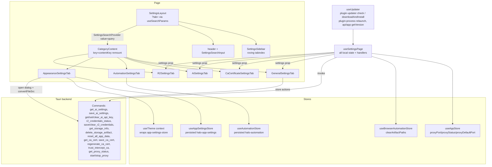

# Settings (settings) — UI Deep Dive

> Source: `references/hexbuffer/src/pages/settings/` (19 files, ~4,770 lines)

## 1. Overview & Purpose

The Settings page is the app's six-section configuration surface: **General** (proxy listener port, app updates, local storage destruction), **CA Certificate** (MITM CA download/install/regenerate plus browser guides), **AI** (BYOK provider, model, per-provider OS-keychain API keys, third-party sharing consent, embeddings config), **R2 Storage** (Cloudflare R2 credentials), **Automation** (live-traffic workflow runtime limits), and **Appearance** (theme, accent color, background image/color, workspace widgets).

It is mounted twice, in two shapes:

- Route `/settings` in `src/App.tsx` (`React.lazy(() => import("@/pages/settings").then(m => ({ default: m.Settings })))`) — all six tabs (`DEFAULT_TABS = ['general', 'ca-cert', 'ai', 'appearance']` plus `r2`/`automation` available via the `categories` prop override; the full sidebar shows all six).
- `SettingsModal` in `src/layout/desktop-workspace/standalone-layout.tsx` passes `categories={STANDALONE_SETTINGS_CATEGORIES}` = `["general", "ca-cert"]`, so the sidebar filters to two sections.

Entry point `index.tsx` is a thin shell:

```tsx
export function Settings({ categories }: Readonly<SettingsProps>) {
  const settings = useSettingsPage();
  return <SettingsLayout settings={settings} categories={categories} />;
}
```

Everything else hangs off one hook (`useSettingsPage`) that owns all IPC and mutable state, a CSS-driven per-section search, and a macOS-style `SettingsGroup`/`SettingsRow` layout system.

## 2. Annotated File Tree

```
src/pages/settings/
├── index.tsx                                (15)  Page shell: Settings = useSettingsPage() + SettingsLayout; exports SettingsProps/SettingsCategory
├── constants.ts                             (226) CA install guides, HOW_IT_WORKS, troubleshooting copy, AI provider ids/labels/model lists/placeholders, base-URL examples
├── hooks/
│   └── use-settings-page.ts                 (687) The page's brain: all AI/R2/CA/storage/update/proxy handlers, IPC calls, legacy key migration; exports SettingsPageState
├── lib/
│   ├── ai-providers.ts                      (200) Pure provider-gate logic: switchAiProvider, keyGateBaseUrl, providerIsSharingExempt, canSaveProviderKey, buildAiProviderKeyEntries
│   └── ai-providers.test.ts                 (508) Vitest unit tests for the gate functions (loopback exemptions, profiles, no-op re-select)
└── components/
    ├── settings-layout.tsx                  (226) Two-pane layout, ?tab= URL sync, CATEGORY_META header copy, search wiring, pane remount key
    ├── settings-sidebar.tsx                 (223) Sectioned nav (Application/Network/Integrations/Automation), roving-tabindex keyboard nav, active indicator bar
    ├── settings-search.tsx                  (35)  SettingsSearchContext (default '' = match all), matchesSettingsQuery, SETTINGS_MATCH_ATTRIBUTE
    ├── settings-search-input.tsx            (107) Scoped search field (role="searchbox", Escape clears, custom clear button)
    ├── settings-group.tsx                   (220) SettingsGroup (macOS card), SettingsRow (label+control row, unmounts on search miss), SettingsBlock (searchable hand-rolled content)
    ├── settings-group.test.tsx              (148) jsdom render tests for the search contract (rows must leave the DOM, not hide)
    ├── general-settings-tab.tsx             (308) Proxy listener port, updater controls, storage rows (database/log/delete-all) with AlertDialog confirmations
    ├── ca-certificate-settings-tab.tsx      (132) Security notice Alert, CA actions, installation-guide and troubleshooting Accordions
    ├── ai-settings-tab.tsx                  (720) Provider select, wire format/base URL/model, sharing toggle, Saved API Keys rows, embeddings/vector-search status
    ├── ai-settings-tab.test.tsx             (409) jsdom render tests for saved-key rows, blocked/local-endpoint notices, vector-search badge
    ├── automation-settings-tab.tsx          (139) Four number rows + allowRunScriptActions toggle + Reset, all via useAutomationStore
    ├── appearance-settings-tab.tsx          (275) Theme switch, accent presets, background image/color/wallpapers/preview/reset, embedded ShortcutManager
    ├── r2-settings-tab.tsx                  (120) R2 account/access-key/secret/endpoint inputs + Save/Clear
    └── manual-update-command.tsx            (69)  "Manual Download" fallback box, opens https://0xbuffer.com/downloads
```

## 3. Architecture & Dataflow



Key flow facts:

- One hook, one prop: tabs receive the entire `SettingsPageState` object rather than slices; `AutomationSettingsTab` and `AppearanceSettingsTab` take no `settings` prop and talk to their stores directly.
- The search is **stateless in React**: `SettingsSearchProvider` broadcasts the query via context; `SettingsRow`/`SettingsBlock`/`AiProviderKeyRow` return `null` on a miss (unmount, not hide — required by `divide-y` dividers and a CSS `:has()` emptiness check); `globals.css` hides whole groups with no `[data-settings-match]` descendant and reveals `[data-settings-empty]` when the pane has none.
- Tab switching increments `contentKey`, remounting the pane to replay the `settings-panel-in` entrance animation and reset scroll; the query is reset on tab change (search is scoped to one section).
- The proxy port save goes through `useAppStore.saveProxyDefaultPort`, which stops and restarts the proxy if connected (`stop_proxy` → `start_proxy`), so settings edits can restart the core listener.

## 4. State Management

### 4.1 Zustand store fields touched

| Store | Field / action | Used by | Persistence |
|---|---|---|---|
| `useAppStore` (`@/stores/app`) | `proxyDefaultPort`, `proxyPort` (`number \| null`), `proxyStatus` (`'connected' \| 'disconnected' \| 'starting' \| 'stopping'`), `saveProxyDefaultPort(port) => Promise<number>`, `checkProxyStatus()` | `use-settings-page.ts` | In-memory (not persisted); `saveProxyDefaultPort` validates via `isValidProxyPort` then, if `proxyStatus === 'connected'`, awaits `stopProxy()` + `startProxy()` and returns `getEffectiveProxyPort` |
| `useAppStore` constants | `DEFAULT_PROXY_PORT = 8888`, `MIN_PROXY_PORT = 1024`, `MAX_PROXY_PORT = 65535`, `isValidProxyPort`, `getEffectiveProxyPort({proxyPort, proxyDefaultPort})` | hook + General tab | — |
| `useBrowserAutomationStore` (`@/stores/browser-automation`) | `clearArtifactPaths()` — maps every tab's every page, deleting `screenshotPath` / `renderedHtmlPath` | hook (`handleDeleteAllData`) | — |
| `useAutomationStore` (`@/stores/automation`) | `automationSettings`, `updateAutomationSettings(partial)` (clamps through `normalizeAutomationSettings`), `resetAutomationSettings()` | Automation tab | `persist` name `'halo-automation'`; `partialize` includes `automationSettings`; merge re-normalizes |
| `useAppSettingsStore` (`@/stores/app-settings-store`) | `bgType` (`'none' \| 'color' \| 'image'`), `bgValue`, `setBg(type, value)`, `clearBg()`; note `setTheme` in the store also resets `bgType:'none', bgValue:''` | Appearance tab | `persist` name `'halo-app-settings'` (localStorage), partialize includes `bgType`/`bgValue` |
| `useTheme` (`@/components/theme-provider`) | `theme` (`'dark' \| 'light'`), `setTheme`, `primaryColor` (`PrimaryColor`), `setPrimaryColor` — context that mirrors the store and applies `html.dark` / `html[data-primary-color]` | Appearance tab | via store |

`DEFAULT_AUTOMATION_SETTINGS`: `liveTrafficConcurrency: 1`, `filteredTriggerQueueCap: 100`, `catchAllTriggerQueueCap: 25`, `recentMatchDedupeTtlMs: 2000`, `allowRunScriptActions: false`.
`AUTOMATION_SETTINGS_LIMITS`: concurrency 1–8, filtered cap 1–1000, catch-all cap 1–250, dedupe 0–10000 ms.

### 4.2 Hook-local React state (`useSettingsPage`)

| State | Type / initial | Purpose |
|---|---|---|
| `aiSettings` | `AiSettings` (provider `'deepseek'`, model `'deepseek-v4-pro'`, apiKey `''`, hasApiKey, allowThirdPartyAiSharing `false`, customBaseUrl?, providerProfiles?, embeddingsBaseUrl?, embeddingsModel?) | AI draft form |
| `savedAiSettings` | `AiSettings \| null` | Last backend-confirmed snapshot; the sharing-toggle write is rebuilt from this so unsaved edits never ride along |
| `aiSettingsLoading` / `aiSettingsSaving` | `true` / `false` | Form gating |
| `providerKeyStatus` | `Record<string, boolean>` | Which providers hold a key in the OS credential store (`get_ai_key_status`) |
| `keyActionProvider` | `string \| null` | Only that provider's row shows pending spinners |
| `storageInfo` | `StorageInfo \| null` (`appDataDir`, `databasePath`, `browserArtifactsPath`, `databaseSizeBytes`, `browserArtifactsSizeBytes`, `regressionArtifactsSizeBytes`, `logFileSizeBytes`) | Storage rows |
| `deletingAllData` / `deletingArtifact` | `boolean` / `string \| null` | Pending flags for destructive actions |
| `proxyPortDraft` | `String(proxyDefaultPort)` | Listener-port input; resyncs on `proxyDefaultPort` change |
| `downloading` / `installingCa` / `regeneratingCa` | `boolean` | CA button pendings |
| `r2AccountId`, `r2AccessKeyId`, `r2SecretAccessKey`, `r2CustomEndpointUrl`, `r2HasSecretKey`, `r2Saving`, `r2Loading` | strings/booleans | R2 form; secret is never read back — only `hasSecret` |
| from `useUpdater` | `currentVersion`, `checking`, `downloading`, `downloadError`, `downloadMessage`, `updateInstalled`, `updateAvailable`, `updateVersion` | Update rows; `useUpdater` runs a silent `check({timeout: 15000})` on mount and `getVersion()` |

`switchAiProvider` (pure, `lib/ai-providers.ts`) clears provider-scoped draft fields on provider change, restores the target's `providerProfiles[provider]` model/base URL (normalizing `undefined` → `''` so inputs stay controlled), never restores a key into the form, and is a **no-op on re-select** so a half-typed form survives. Non-provider-scoped state (embeddings, sharing policy) is kept.

## 5. IPC Contracts

### 5.1 Commands invoked

| Command | Args | Returns | Called from |
|---|---|---|---|
| `get_ai_settings` | — | `AiSettings` (`provider, model, apiKey, hasApiKey, allowThirdPartyAiSharing, customBaseUrl?, providerProfiles?, embeddingsBaseUrl?, embeddingsModel?`) | `loadAiSettings` (hook, raw `invoke`) |
| `save_ai_settings` | `{ settings: AiSettings }` (apiKey forced `''`) | `AiSettings` (canonicalized) | `handleSaveAiSettings`; `handleToggleThirdPartyAiSharing` (rebuilt from `savedAiSettings` with only `allowThirdPartyAiSharing` flipped) |
| `get_ai_key_status` | — | `Record<string, boolean>` | `refreshAiKeyStatus` |
| `set_ai_api_key` | `{ provider: string, apiKey: string }` | `Record<string, boolean>` (fresh status map) | `handleSaveProviderKey`; also `migrateLegacyAiKeys` |
| `clear_ai_api_key` | `{ provider: string }` | `Record<string, boolean>` | `handleClearProviderKey` |
| `r2_credentials_status` | — | `{ accountId, accessKeyId, customEndpointUrl?: string \| null, hasSecret: boolean } \| null` | `loadR2Settings` (secret never leaves Rust) |
| `save_r2_credentials` | `{ accountId, accessKeyId, secretAccessKey: string \| null, customEndpointUrl: string \| null }` — `null` secret keeps the stored keychain entry | `void` | `handleSaveR2Settings` |
| `clear_r2_credentials` | — | `void` | `handleClearR2Credentials` |
| `get_storage_info` | — | `StorageInfo` | `refreshStorageInfo` |
| `delete_storage_artifact` | `{ artifact: string }` (`'database'`, `'log_file'`, …) | `{ bytesDeleted: number, label: string }` | `handleDeleteArtifact` |
| `reset_all_app_data` | — | `void` | `handleDeleteAllData` (then `window.location.reload()` after 1 s) |
| `get_ca_cert` | — | `string` (PEM) | CA tab via `getCaCert()` from `@/pages/live-traffic/http-history/api` |
| `save_ca_cert` | `{ path: string, content: string }` | `void` | same wrapper `saveCaCert` |
| `regenerate_ca_cert` | — | `void` | wrapper `regenerateCaCert` |
| `trust_intercept_ca` | — | `string` (success message toasted) | wrapper `trustInterceptCa` (macOS only button) |
| `get_proxy_status` | — | `ProxyRuntimeStatus` (`{ running, port, connections }`) | via `checkProxyStatus()` — polled every 5 s (`window.setInterval`) while Settings is mounted — and inside `saveProxyDefaultPort` |
| `stop_proxy` / `start_proxy` | `{ port, tlsPort }` | `void` | via `saveProxyDefaultPort` when the proxy is connected |

Tauri plugin APIs (no custom commands): `getVersion()` (`@tauri-apps/api/app`), `check()` + `downloadAndInstall(onEvent)` (`@tauri-apps/plugin-updater`, `DownloadEvent` of `Started`/`Progress`/`Finished`), `relaunch()` (`@tauri-apps/plugin-process`), `save({title, defaultPath, filters})` and `open({title, filters})` (`@tauri-apps/plugin-dialog`), `openUrl(url)` (`@tauri-apps/plugin-opener`), `convertFileSrc(path)` (`@tauri-apps/api/core`) for background images.

### 5.2 Events listened

**None.** The page registers no `listen()` subscriptions; freshness comes from the 5-second `get_proxy_status` poll and one-shot loads in mount effects. (`broadcastProxyStatus` exists in `stores/app.ts` but the settings page does not subscribe.)

### 5.3 Legacy data migration

`migrateLegacyAiKeys` runs before loading AI settings: if `localStorage['halo-ai-keys-migration-attempted']` is not `'true'`, it parses the legacy persisted key `halo-ai-keys` (`state.keys` or top-level `keys`), pushes each non-empty key through `set_ai_api_key`, removes the legacy entry, and toasts "Migrated saved AI API keys to the OS credential store". Failure still marks the attempt flag to avoid retry loops.

### 5.4 Error handling

Every catch path logs to console and toasts via `toErrorMessage(error, fallback)` from `@/lib/ipc` (decodes `ArrayBuffer`/`Blob`/`Response` rejection bodies, unwraps JSON `message`/`error`/`detail`). The CA wrappers use `invokeTauri`, which additionally guards a missing Tauri shell and dropped (empty-payload) requests.

## 6. UI Layout & Component Breakdown

### 6.1 Layout diagram

```
┌──────────────┬──────────────────────────────────────────────────────────────────┐
│ nav w-56     │ header  (px-6 py-4 lg:px-10, border-b, bg-background/80          │
│ p-3, gap-4   │          backdrop-blur-sm, flex-wrap justify-between)             │
│ border-r     │  ┌ h1 text-lg font-semibold truncate ──┐   ┌ Search input w-64 ┐ │
│ bg-muted/30  │  └ p text-xs text-muted-foreground  ──┘   └───────────────────┘ │
│              ├──────────────────────────────────────────────────────────────────┤
│ APPLICATION  │  scroll container (flex-1 overflow-auto)                          │
│  General     │  ┌ pane: mx-auto w-full max-w-3xl px-6 py-6 lg:px-10 lg:py-8 ──┐ │
│  Appearance  │  │ space-y-6 of SettingsGroup sections                          │ │
│ NETWORK      │  │                                                              │ │
│  CA Cert     │  │  ┌ h2 label (uppercase 2xs) + description ┐                 │ │
│ INTEGRATIONS │  │  ┌ card: rounded-xl border bg-card shadow-2xs            ┐ │ │
│  AI          │  │  │ row: px-4 py-3, hover:bg-muted/30      │ │ │
│  R2 Storage  │  │  │  label+desc (min-w-0)   control (shrink-0 right col) │ │ │
│ AUTOMATION   │  │  └────────────────────────────────────────────────────────┘ │ │
│  Runtime     │  │  [data-settings-empty] "Nothing in {label} matches…" (CSS)  │ │
│ (active item │  └──────────────────────────────────────────────────────────────┘ │
│  = 3px bar + │                                                                    │
│  filled icon)│                                                                    │
└──────────────┴──────────────────────────────────────────────────────────────────┘
```

### 6.2 `SettingsLayout` (`components/settings-layout.tsx`)

- Props: `settings: SettingsPageState`, `categories?: SettingsCategory[]`.
- `CATEGORY_META` supplies header copy per tab, e.g. General — "Proxy listener, updates, and local storage."; AI — "Bring your own key, pick a model, and control what leaves your machine."
- URL sync: reads `?tab=`, validates against `validTabs`, falls back to `validTabs[0] || 'general'`. `handleSelect` sets active tab, bumps `contentKey`, clears the query, and writes `tab` with `setSearchParams(..., { replace: true })`. An effect also follows external `tabParam` changes (e.g. layout links like `/settings?tab=appearance`), and another clamps `active` into a provided `categories` list.
- Root: `flex h-full overflow-hidden`; content column `flex min-w-0 flex-1 flex-col overflow-hidden`.
- Scroll container carries `data-settings-search={searching ? 'active' : undefined}` and `animate-settings-panel motion-reduce:animate-none` (`settings-panel-in`: 0.22s, opacity 0→1, translateY 4px→0, defined in `globals.css` as `--animate-settings-panel`).
- Empty state `<p data-settings-empty>` reads "Nothing in {meta.label} matches “{query}”. Try another section from the list." — hidden by CSS unless the pane has zero matches.

### 6.3 `SettingsSidebar` (`components/settings-sidebar.tsx`)

- Props: `active`, `onSelect`, `categories?`. `NAV_SECTIONS` groups: **Application** (General/Gear, Appearance/Palette), **Network** (CA Certificate/ShieldCheck), **Integrations** (AI/Sparkle, R2 Storage/CloudArrowUp), **Automation** (Runtime/Robot). A `categories` prop filters items per section and whole sections disappear when emptied.
- `<nav aria-label="Settings sections">` — `w-56 shrink-0 flex-col gap-4 overflow-y-auto p-3 border-r bg-muted/30`; section labels are `text-3xs font-semibold uppercase tracking-wider text-muted-foreground/70`.
- Items are plain `<button type="button">` with `aria-current="page"` on the active one and roving `tabIndex` (see §8).
- Active styling: `bg-primary/10 text-foreground`; inactive `text-muted-foreground hover:bg-muted/60 hover:text-foreground`. A `3px × h-5 rounded-full bg-primary` bar sits absolutely at `left-0`, animated with opacity+`scale-y` only (`transition-[opacity,transform] duration-200 motion-reduce:transition-none`) — deliberately not a width animation, which would keep tweening under reduced motion.
- Icons render `weight={isActive ? 'fill' : 'regular'}` — `Icon` is imported as a *type* from `@phosphor-icons/react`.

### 6.4 Search components

- `SettingsSearchInput` (`settings-search-input.tsx`): props `value`, `onChange`, `scopeLabel`. Wrapper `w-full sm:w-64` with a `MagnifyingGlassIcon` (size-3.5, absolute left-2.5). The `Input` is `type="text"` with `role="searchbox"` — `type="search"` is avoided on purpose so WebKit/Chromium's native clear button doesn't duplicate the custom one. `aria-label="Search {scopeLabel} settings"`, `placeholder="Search settings"`, autocomplete/autocorrect/autoCapitalize/spellCheck all off; `pl-8`, and `pr-8` only when there's a value. Escape clears (only when non-empty, `preventDefault`); the `XIcon` clear button (`aria-label="Clear search"`, rounded p-0.5) clears and refocuses via `inputRef`.
- `settings-search.tsx`: `SettingsSearchContext` defaults to `''` (= match everything, so render tests mounting a tab without a provider still show rows). `matchesSettingsQuery(query, ...fields)` is a trimmed-lowercase substring test over displayed text ("deliberately dumb" — ~60 rows make a linear scan cheaper than an index). `SETTINGS_MATCH_ATTRIBUTE = 'data-settings-match'`.

### 6.5 `SettingsGroup` / `SettingsRow` / `SettingsBlock` (`settings-group.tsx`)

- **SettingsGroup**: `<section data-settings-group className="space-y-2">`; optional header (`px-1`; `h2` = `text-2xs font-semibold uppercase tracking-wider text-muted-foreground`; description `text-xs leading-relaxed text-muted-foreground`); card = `divide-y divide-border/60 overflow-hidden rounded-xl border border-border/70 bg-card shadow-2xs`. Dividers come from `divide-y`, not hand-placed separators, so filtered rows can't leave stray hairlines.
- **SettingsRow**: props `label` (required), `description?`, `children?`, `className?`, `stacked?`, `htmlFor?`. Returns **`null`** when `matchesSettingsQuery(query, label, description)` fails — leaving the DOM entirely (not `display:none`) keeps `divide-y` and the CSS `:has()` group check honest. Row classes: `flex` (`items-center justify-between`, or `flex-col` when `stacked`), `gap-x-6 gap-y-2 px-4 py-3`, `transition-colors duration-150 hover:bg-muted/30`. Label is a real `<label htmlFor>` when `htmlFor` is passed (clicking row text focuses the field), else a `<p>`; `text-sm font-medium leading-snug`. Description: `max-w-prose text-xs leading-relaxed text-muted-foreground`. Control column is `flex min-w-0 shrink-0 items-center` — `shrink-0` keeps all controls in one aligned column with descriptions absorbing the shrink.
- **SettingsBlock**: for hand-rolled content; props `label` (search alias, never rendered), `description?`. `data-settings-match`, `px-4 py-3`, returns `null` on a miss.

### 6.6 `GeneralSettingsTab` (`general-settings-tab.tsx`)

Three groups. Local helper `formatBytes`: `0 → '< 1 KB'`, B/KB (`toFixed(1)`)/MB (`toFixed(1)`)/GB (`toFixed(2)`), `undefined → '—'`.

- **Proxy Listener** — "Choose the port used when the proxy starts."
  - Row "Listener port": description composes `Current: {127.0.0.1:proxyPort | 'Not running'} — Configured: 127.0.0.1:{proxyDefaultPort}` plus `(running on {getEffectiveProxyPort(...)})` when the runtime differs while connected. `Input type="number" min=1024 max=65535 step=1 inputMode="numeric"` `w-28`, `aria-invalid={!proxyPortIsValid}`.
  - Save `Button size="sm" variant="outline"` with `FloppyDiskIcon mr-1.5 size-3.5`; disabled unless the parsed draft is valid AND changed, or the runtime port differs from configured. Ghost reset button (`ArrowCounterClockwiseIcon`) disabled when already at factory default 8888. Toasts: "Proxy listener restarted on {activePort}" / "Proxy listener port saved: {port}" / error `toErrorMessage`.
- **Updates** — group description includes `Current version: {currentVersion}` and ` (v{updateVersion} available)` when pending.
  - "Check for updates" row: Check button (`ArrowClockwiseIcon`, spins via `animate-spin` while checking; label "Checking…"); then conditionally "Restart Now" (`updateInstalled` → `handleRestartApp` → `relaunch()`) or "Install v{updateVersion}" (`AsteriskIcon` spins while downloading; calls `handleInstallUpdate`).
  - Optional "Status" row shows `updateMessage`. On `updateError`, renders `ManualUpdateCommand`.
  - `handleInstallUpdate` shows `toast.loading("Installing v…")`, replaces with success ("Restarting app to finish applying the update...") and `relaunch()` after 1 s, or error (with "Release signature mismatch." when the message mentions "signature").
- **Storage** — three rows with size badges (`rounded-md bg-muted px-2 py-0.5 text-xs font-mono tabular-nums text-muted-foreground`):
  - "SQL Database & Payloads" (`databaseSizeBytes`, path in description) → `StorageRowDelete artifact="database"`; dialog copy: "Permanently deletes the SQLite database, WAL/SHM files, and all payload segment (.bin) files…".
  - "Log File" (`/tmp/halo.log`, `logFileSizeBytes`) → `artifact="log_file"`; "Truncates the active application log file…".
  - "Delete all data" → destructive Button + AlertDialog ("This permanently deletes everything: proxy history, WebSocket messages, documents, browser automation artifacts, CA certificates, and saved settings. The app will reload to a fresh state."). Handler invokes `reset_all_app_data`, calls `clearBrowserAutomationArtifactPaths()`, toasts "All data deleted. Reinitializing...", reloads after 1 s.
- **`StorageRowDelete`** (local component): an `AlertDialog` per row. Trigger pattern is load-bearing — Base UI has no `asChild`, so the element goes on `render`:

```tsx
<AlertDialogTrigger render={<Button size="sm" variant="outline" disabled={isDeleting || deletingArtifact !== null} />}>
  <TrashIcon className="mr-1.5 size-3.5" /> Clear
</AlertDialogTrigger>
```

  Passing `<Button>` as a *child* would nest `<button>` in `<button>`. While one artifact is deleting, `onOpenChange` refuses to close and all rows' triggers disable (`deletingArtifact !== null`). `AlertDialogAction` is `size="xs" variant="destructive"`; `onClick` is `preventDefault`-ed, awaits `onDelete`, closes on success, toasts on error. Buttons swap to `CircleNotchIcon animate-spin` + "Clearing…"/"Deleting…".

### 6.7 `CaCertificateSettingsTab` (`ca-certificate-settings-tab.tsx`)

- Top `<Alert>` with `SECURITY_NOTICE_ICON` (`WarningCircleIcon`): "Important Security Notice — Open Browser uses an isolated Chrome profile. Install the CA only when you want to intercept HTTPS traffic from external browsers or apps."
- **Certificate Actions** group with one `SettingsBlock` of three `size="sm"` buttons: "Install to macOS Keychain" (`KeyIcon`, only when `isMac`, handler `trust_intercept_ca`), "Download CA Certificate" (`DownloadSimpleIcon`, outline), "Regenerate CA" (`ArrowClockwiseIcon`, outline). Pendings: "Installing…"/"Saving…"/"Regenerating…".
  - Download flow: `save()` dialog titled `'FloppyDisk CA Certificate'` (sic — icon-name leftover), `defaultPath: 'halo-ca.pem'`, filters `pem/crt/cer`; then `getCaCert()` → `saveCaCert(path, pem)` → toast with path.
  - Regenerate toasts "CA certificate regenerated. You may need to re-install it in your browsers."
- **Installation Guides**: `Accordion` over `INSTALLATION_GUIDES` (chrome-windows, chrome-mac, firefox, safari) — ordered `<ol className="list-decimal list-inside space-y-2 text-sm text-muted-foreground">`, optional per-guide `<Alert>` note.
- **How It Works**: five numbered paragraphs (generation → install → dynamic signing → passthrough → privacy) from `HOW_IT_WORKS`.
- **Troubleshooting**: `Accordion` over `TROUBLESHOOTING_GUIDES` (`cert-warning`, `some-apps-not-working`, `remove-ca`); bullets render as `<ul className="list-disc list-inside">` with a lead-in that switches to "To remove the installed CA certificate:" for `remove-ca`.

### 6.8 `AiSettingsTab` (`ai-settings-tab.tsx`) — largest component (720 lines)

Shared `handleInputKeyDown` intercepts Ctrl/Cmd+A (`event.key === 'a'/'A'` or `event.code === 'KeyA'`) to `select()` the focused field's contents instead of selecting the whole page.

**Provider group:**
- "Provider" `Select` (`id="ai-provider"`, `w-72`) over `AI_PROVIDER_OPTIONS`: `deepseek` / `openai-compatible` ("OpenAI Compatible (Chat Completions)") / `anthropic-compatible` ("Anthropic Compatible (Messages)"); `onValueChange={updateAiProvider}` (the profile-restoring switch).
- When `isCustomCompatible` (either `*-compatible`; note it also treats literal `'anthropic'` as Anthropic-compatible): a read-only "Wire Format" row showing a `Badge variant="secondary"` ("OpenAI Chat Completions" or "Anthropic Messages") and a "Base URL" `Input w-72` with provider-specific placeholder/examples (OpenAI examples include `https://api.openai.com/v1`, `https://api.xkiro.com/v1`, `https://openrouter.ai/api/v1`, Ollama `:11434/v1`, LM Studio `:1234/v1`).
- "Model" row: free-text `Input w-72` for compatible providers (descriptions mention `vendor/model` syntax e.g. `openai/gpt-5.6-sol`), or a `Select w-48` for `deepseek` (`AI_MODEL_OPTIONS_BY_PROVIDER`).
- **Sharing consent**: a `SettingsBlock` wrapping a `<label>` styled `border border-amber-500/40 bg-amber-500/10 dark:border-amber-500/30 dark:bg-amber-500/10` containing a `Checkbox` bound to `allowThirdPartyAiSharing`; `onCheckedChange` calls `handleToggleThirdPartyAiSharing(checked === true)` which **persists immediately** (rebuilt from `savedAiSettings`, never the draft) because the policy gates every non-local request and key save. Copy lists what may be sent: "prompts, chat messages, crawl context, page summaries, logs, insights, URLs, and analysis context to {provider}".
- "Actions" row: Save button (`FloppyDiskIcon`, disabled while loading/saving or `!canSaveProviderSettings`). Gate math: `needsModel = !aiSettings.model.trim()`, `needsBaseUrl = isOpenAiCompatible && !customBaseUrl?.trim()`. Below it, amber hints (`text-amber-700 dark:text-amber-300`) for the block reason plus a muted note when `providerSwitchUnsaved` ("{provider} is selected here but not applied yet — press Save to switch the assistant over to it.").

**Saved API Keys group** — rows from `aiProviderKeyEntries` (`buildAiProviderKeyEntries`): one per `AI_KEY_PROVIDER_OPTIONS` entry (`deepseek`, `openai-compatible`, `anthropic-compatible`, plus the non-selectable `embeddings` "Embeddings (Memory RAG)").
- `AiProviderKeyRow` (local, hand-rolled rather than a `SettingsRow` because it needs two stacked control rows; opts itself into the search via `useSettingsQuery` + `data-settings-match`): header row with label, `Badge` "Key saved"/"No key" (`secondary`/`outline`) and "Active" (`default`) when `entry.isActive`; "Use"/"In use" outline button for selectable providers (disabled when active/pending/loading).
- Key field: `w-72` `Input type={showApiKey ? 'text' : 'password'}`, `aria-label="{label} API key"`, password-manager opt-outs `data-1p-ignore="true" data-lpignore="true"`. Placeholder is `'Enter a new key to replace the saved one'` when a key exists — never masked dots, which "look exactly like a masked stored value and made the field appear read-only" (the regression the render tests guard). Eye toggle (`EyeIcon`/`EyeSlashIcon`, `tabIndex={-1}`).
- Buttons: Save (`FloppyDiskIcon`, label "Save key"/"Replace key"/"Saving…", disabled unless `!disabled && !pending && canSave && apiKeyInput.trim()`), Clear (`TrashIcon`, outline, only enabled when `entry.hasKey`).
- Inline notices: when `!canSave` — "Enable third-party AI data sharing above to save a key for this provider." (amber); when `entry.savesKeyWithoutSharing` — "Local endpoint, so no third-party sharing consent is needed. A key is optional here." (muted). A group-level amber note appears while the sharing toggle is unsaved ("Press Save above to apply third-party AI data sharing…").
- Success of a row save/clear resets the local draft (`apiKeyInput`, `showApiKey`); failure keeps the typed key.

**Embeddings (Memory RAG) group:**
- "Embeddings Base URL" `Input w-72` and "Embeddings Model" `Input w-56` (placeholders `https://api.openai.com/v1`, `text-embedding-3-small`), both bound via `updateAiSettings`.
- "Vector Search Status" row: badge text/variant from three states — `embeddingsUsable ? 'Vector Search Active' (default) : embeddingsConfigured ? 'Needs Sharing Consent' (secondary) : 'FTS5 Keyword Only' (secondary)`, where `embeddingsConfigured = !!baseUrl?.trim() && !!model?.trim()` and `embeddingsUsable = configured && embeddingsEndpointAllowed(baseUrl, allowThirdPartyAiSharing)`. The AND matters: `embeddingsEndpointAllowed` is permission-only (true whenever sharing is on), so it alone would claim "active" for an empty endpoint; the real backend gate is `embeddings_sharing_allowed` in Rust, which otherwise silently stores entries without vectors.

### 6.9 `R2SettingsTab` (`r2-settings-tab.tsx`)

One group "Cloudflare R2 Storage". Four `SettingsRow`s with `w-80` inputs: Account ID, Access Key ID (placeholders are real-looking hex examples), Secret Access Key (`type={showSecret ? 'text' : 'password'}` in a `relative w-80` wrapper, eye toggle `tabIndex={-1}`; placeholder **"Leave blank to keep the saved secret"** when `r2HasSecretKey` — same "not dots" rationale as the AI keys; description says "A Secret Access Key is securely stored in your OS Keychain."), and Custom Endpoint URL ("Leave blank to use the default https://<account-id>.r2.cloudflarestorage.com"). Actions row: Save (`FloppyDiskIcon`) and "Clear Settings" (outline, disabled when no `accountId` and no saved secret). Client validation in the hook toasts "Account ID, Access Key ID, and Secret Access Key must not be empty" when the secret field is blank and none is stored.

### 6.10 `AutomationSettingsTab` (`automation-settings-tab.tsx`)

Single group "Runtime" driven by `useAutomationStore`. Four `AutomationNumberRow`s (label, description with "Range: {min}–{max}" appended, `htmlFor={id}` so clicking row text focuses the `Input id={id}` `type="number" w-28 step=1`): live traffic concurrency, filtered trigger queue cap, catch-all trigger queue cap, duplicate suppression window. Every change writes through `updateAutomationSettings({ [id]: Number(value) })` — "Changes are saved automatically and apply to new scheduling decisions." Then a `SettingsBlock` with the same amber consent styling as AI hosting a `Checkbox id="allowRunScriptActions"` + `Label` ("Enables automation workflows to execute local commands from action nodes. Keep this disabled unless you trust the workflow."). A "Reset to defaults" row renders an outline Reset button (`ArrowCounterClockwiseIcon`) disabled while `isDefault` (deep-compared against all five defaults).

### 6.11 `AppearanceSettingsTab` (`appearance-settings-tab.tsx`)

- **Theme group**: "Dark mode" row with `SunIcon` / `Switch id="appearance-theme-switch"` / `MoonIcon` flanks (sun amber when light, moon blue-600/blue-400 when dark, otherwise `text-muted-foreground`); `setTheme(checked ? 'dark' : 'light')` (which also clears the background in the store). "Accent color" row maps `PRIMARY_COLOR_PRESETS` (purple #E84B8A, emerald #10b981, blue #3b82f6, violet #8b5cf6, rose #f43f5e, amber #f59e0b, cyan) to `size-6 rounded-full` buttons (`style={{backgroundColor: preset.swatchHex}}`, `title={preset.name}`); selected shows `CheckIcon weight="bold"` `size-3` in `text-stone-900` for amber/purple swatches else `text-white`, plus `ring-2 ring-foreground/30 ring-offset-2 ring-offset-card scale-105`; hover `scale-110`, active `scale-95`.
- **Background group**: "Background image" row — Pick/Change image button (`ImageIcon`) opens `open({ title: 'Select background image', filters: ['png','jpg','jpeg','webp','gif','avif'] })` and stores the raw local path via `setBg('image', path)`; `convertFileSrc` turns it into an `asset://` URL only at render time. Ghost trash button appears when `bgType !== 'none'`. "Preset wallpapers" row: two `h-12 w-20` thumbnails (`whiteWallpaper`/`blackWallpaper` asset imports; sentinel values `'default-light'`/`'default-dark'`), selected via inline `outline: '2px solid var(--primary)'`. "Background color" row: 12 `PRESET_COLORS` dark hex swatches (`size-6 rounded-md`, same primary-outline selection) plus a native color picker hidden behind a dashed `PaletteIcon` label (`input type="color"`). "Preview" row renders a `h-16 w-40` div with `backgroundImage: url(backgroundSrc)` cover or `backgroundColor`. "Reset background" row (outline, `ArrowCounterClockwiseIcon`) calls `clearBg`.
- **Workspace Customization group**: a `SettingsBlock` embedding `<ShortcutManager />` from `@/pages/desktop/components/shortcut-manager` inside a `rounded-md border border-border/80 bg-muted/10 p-4` box. `ShortcutManager` (mode `'all'`) manages `hiddenNavItems` (via `toggleNavItem`/`resetHiddenNavItems` over `MAIN_NAV_ITEMS` minus Desktop) and `hiddenWidgets` (via `toggleWidget`/`resetHiddenWidgets`), with its own search input and a conditional reset button.

### 6.12 `ManualUpdateCommand` (`manual-update-command.tsx`)

Fallback card (`rounded-md border bg-muted/30 p-3`) rendered under Updates when `updateError` is set. Header `DownloadSimpleIcon` + "Manual Download"; an outline `size="sm"` button "0xbuffer.com/downloads" opens `https://0xbuffer.com/downloads` via `openUrl` with a `window.open(..., '_blank', 'noopener,noreferrer')` fallback; optional `message` prop rendered as muted `text-xs` (General tab passes "Download the latest version manually from the website.").

### 6.13 Confirmation dialogs

All destructive confirmations are `AlertDialog` (UI kit): three per-artifact "Clear {label}?" dialogs, one "Delete all application data?" dialog. There is no confirmation for: R2 "Clear Settings", CA regenerate, key Clear, Automation Reset, or the sharing toggle (the toggle itself is the consent).

## 7. UI Libraries & Primitives Used

### 7.1 UI-kit components — `@celestia-project/ui` ^0.4.0 (shadcn-style over Base UI; composition via a `render` prop, **not** `asChild`)

| Component | Where used |
|---|---|
| `AlertDialog`, `AlertDialogTrigger` (with `render={<Button …/>}`), `AlertDialogContent`, `AlertDialogHeader`, `AlertDialogTitle`, `AlertDialogDescription`, `AlertDialogFooter`, `AlertDialogCancel` (`size="xs"`), `AlertDialogAction` (`size="xs"`, `variant="destructive"`) | GeneralSettingsTab (4 confirmations) |
| `Accordion`, `AccordionItem` (`value={guide.id}`), `AccordionTrigger`, `AccordionContent` | CA certificate tab (guides, troubleshooting); also embedded `ShortcutManager` |
| `Alert`, `AlertTitle`, `AlertDescription` | CA security notice, guide notes |
| `Badge` (`variant`: `secondary`, `outline`, `default`) | AI tab (key status, Active, wire format, vector search) |
| `Button` (`variant`: default, `outline`, `ghost`, `destructive`; `size`: `sm`, `xs`) | every tab |
| `Checkbox` | AI sharing toggle, automation run-script toggle |
| `Input` | port, URLs, models, keys, search, R2 fields (forwards `ref` for search clear-focus) |
| `Label` | automation run-script label |
| `Select`, `SelectTrigger` (`id`, `w-72`/`w-48`), `SelectValue` (`placeholder`), `SelectContent`, `SelectItem` | AI provider + deepseek model |
| `Switch` (`id="appearance-theme-switch"`) | appearance dark mode |

### 7.2 Phosphor icons — `@phosphor-icons/react` (exact names; `Icon` also imported as a type)

`WarningCircleIcon`, `GearIcon`, `ShieldCheckIcon`, `SparkleIcon`, `PaletteIcon`, `RobotIcon`, `CloudArrowUpIcon` (sidebar), `MagnifyingGlassIcon`, `XIcon` (search), `AsteriskIcon`, `ArrowClockwiseIcon`, `ArrowCounterClockwiseIcon`, `FloppyDiskIcon`, `TrashIcon`, `CircleNotchIcon` (general), `DownloadSimpleIcon`, `KeyIcon` (CA), `EyeIcon`, `EyeSlashIcon`, `CheckIcon` (AI + accent swatches), `ImageIcon`, `SunIcon`, `MoonIcon` (appearance), `ArrowSquareOutIcon` (manual download). Icon sizing convention: `size-3.5`/`size-4` with `mr-1.5` inside buttons.

### 7.3 Third-party / platform libs

| Library | Usage |
|---|---|
| `@tauri-apps/api/core` | `invoke` (hook + General tab), `convertFileSrc` (appearance) |
| `@tauri-apps/plugin-dialog` | `save` (CA PEM file), `open` (background image) |
| `@tauri-apps/plugin-process` | `relaunch` (restart app, post-update) |
| `@tauri-apps/plugin-updater` | `check`, `downloadAndInstall` (via `useUpdater`) |
| `@tauri-apps/plugin-opener` | `openUrl` (manual downloads page) |
| `@tauri-apps/api/app` | `getVersion` (via `useUpdater`) |
| `sonner` | `toast.success/error/loading` throughout |
| `react-router-dom` | `useSearchParams` (`?tab=`) |
| `zustand` (+ `persist` middleware, in stores) | `useAppStore`, `useAutomationStore`, `useAppSettingsStore`, `useBrowserAutomationStore` |
| Vitest + `react-dom/client` + `act` (jsdom) | the three test files |
| No Monaco / CodeMirror anywhere on this page. |

## 8. Keyboard Shortcuts & Interactions

| Context | Key | Behavior |
|---|---|---|
| Settings sidebar | `ArrowDown` / `ArrowUp` | Moves focus to next/previous visible item, **wrapping** (`(index ± 1) mod length`), `preventDefault` |
| Settings sidebar | `Home` / `End` | Focus first / last visible item |
| Settings sidebar | `Tab` | Roving tabindex: the nav is **one tab stop**; only the item whose `id === tabbableId` has `tabIndex 0`, all others `-1`. `tabbableId` is `active` when it survives the `categories` filter, else the first visible item — so a filtered-out active tab can never orphan the group's keyboard access |
| Search input | `Escape` | Clears the query (only when non-empty) and keeps focus |
| Search input | click on `XIcon` | Clears and refocuses the field |
| AI credential inputs (`handleInputKeyDown`) | `Ctrl/Cmd + A` | `preventDefault` + `select()` — selects the field's contents instead of the whole page document |
| AI password fields | eye toggle | `tabIndex={-1}` so tab order skips it |
| Automation rows | click row label | `htmlFor` → focuses the `Input` with the same id |
| Storage dialogs | trigger/Cancel/Action | While deleting, `onOpenChange` blocks closing and buttons disable |

## 9. Styling Details

- **Settings chrome**: sidebar `bg-muted/30 border-r`; header `bg-background/80 backdrop-blur-sm border-b`; pane `max-w-3xl` centered; group card `rounded-xl border-border/70 bg-card shadow-2xs divide-border/60`; rows `hover:bg-muted/30`.
- **Micro type scale**: section labels `text-3xs uppercase tracking-wider text-muted-foreground/70`, group labels `text-2xs uppercase tracking-wider text-muted-foreground` — custom `3xs`/`2xs` sizes below Tailwind's scale; body rows `text-sm font-medium leading-snug`; descriptions `text-xs leading-relaxed text-muted-foreground` with `max-w-prose`.
- **Destructive styling**: `Button variant="destructive"` for "Delete all data"; `AlertDialogAction variant="destructive" size="xs"` for all confirm buttons; danger spinners use `CircleNotchIcon animate-spin` with label swaps ("Clearing…", "Deleting…").
- **Amber warning language**: the sharing-consent and run-script consent boxes use `border-amber-500/40 bg-amber-500/10 dark:border-amber-500/30 dark:bg-amber-500/10` with `WarningCircleIcon text-amber-600 dark:text-amber-400`; warning copy is `text-amber-700 dark:text-amber-300`. Dark-mode accent text pairs: sun `text-amber-600 dark:text-amber-400`, moon `text-blue-600 dark:text-blue-400`.
- **Motion**: pane entrance `--animate-settings-panel: settings-panel-in 0.22s var(--ease-out) both` (opacity + 4px translateY), always paired with `motion-reduce:animate-none`; active nav bar transitions `opacity,transform` only with `motion-reduce:transition-none`; accent swatches `transition-all duration-150 ease-out` with `hover:scale-110 active:scale-95`.
- **Monospace numerics**: storage size badges `font-mono tabular-nums`.
- **Focus rings**: `focus-visible:outline-none focus-visible:ring-2 focus-visible:ring-ring` everywhere custom buttons appear (sidebar, search clear, accent swatches, wallpapers), with `ring-offset-2 ring-offset-card` on accent swatches; wallpapers and color swatches use inline `outline: 2px solid var(--primary)` for selection instead.
- **Theme application** (via `useTheme`/`ThemeProvider`): `html.dark` class toggled and `data-primary-color` attribute set on `document.documentElement`; the app's `--primary` (oklch values per preset in `src/constants/theme.ts`) follows the accent choice.

## 10. Integration Points

- **Proxy lifecycle**: saving the listener port through `useAppStore.saveProxyDefaultPort` restarts the running proxy (`stop_proxy` → `start_proxy`), so Settings is the only settings UI that can bounce the core listener; the 5 s `get_proxy_status` poll keeps `proxyStatus`/`proxyPort` current while the page is open, and `getEffectiveProxyPort` explains port-fallback (busy port) in the row description. `DEFAULT_PROXY_PORT` (8888) drives the reset button's disabled state.
- **CA / MITM**: `getCaCert`/`saveCaCert`/`regenerateCaCert`/`trustInterceptCa` are imported from `@/pages/live-traffic/http-history/api` (the live-traffic feature owns the CA wrappers); the page adds only the file dialog and toasts. Regenerating invalidates browser trust (copy tells users to re-install).
- **Factory reset**: `reset_all_app_data` + `clearArtifactPaths` (browser-automation store) + `window.location.reload()` — the UI-side of wiping proxy history, artifacts, CA, and settings.
- **AI runtime**: `save_ai_settings` feeds the assistant's provider/model; the sharing policy is mirrored from the Rust gates `is_local_ai_endpoint` (chat, provider-scoped to `openai-compatible`) and `embeddings_sharing_allowed` (URL-only) by `lib/ai-providers.ts` + `src/lib/ai-endpoint.ts`; vector-search status must agree with what `tool_loop.rs` will actually store.
- **OS credential store**: AI keys and the R2 secret never round-trip through the UI — only boolean status / `hasSecret` flags; legacy `localStorage` keys are migrated once and removed.
- **Updater**: `useUpdater` silently checks on mount; Settings exposes check/install/restart plus the manual-download escape hatch.
- **Desktop workspace**: Appearance tab embeds `ShortcutManager`, sharing `useAppSettingsStore` (`hiddenNavItems`, `hiddenWidgets`, `widgetOrder`) with the taskbar/dock; the standalone (modal) mount restricts the same page to `["general", "ca-cert"]` via the `categories` prop.
- **Other pages linking in**: layout code navigates to `/settings` and `/settings?tab=appearance`; the page reads and rewrites `?tab=` with `replace` so deep links and back/forward behave.

## 11. Source Files Documented

Page folder (all read in full):

- `/Users/870041/Desktop/project/hexbuffer-rust/references/hexbuffer/src/pages/settings/index.tsx`
- `/Users/870041/Desktop/project/hexbuffer-rust/references/hexbuffer/src/pages/settings/constants.ts`
- `/Users/870041/Desktop/project/hexbuffer-rust/references/hexbuffer/src/pages/settings/hooks/use-settings-page.ts`
- `/Users/870041/Desktop/project/hexbuffer-rust/references/hexbuffer/src/pages/settings/lib/ai-providers.ts`
- `/Users/870041/Desktop/project/hexbuffer-rust/references/hexbuffer/src/pages/settings/lib/ai-providers.test.ts`
- `/Users/870041/Desktop/project/hexbuffer-rust/references/hexbuffer/src/pages/settings/components/settings-layout.tsx`
- `/Users/870041/Desktop/project/hexbuffer-rust/references/hexbuffer/src/pages/settings/components/settings-sidebar.tsx`
- `/Users/870041/Desktop/project/hexbuffer-rust/references/hexbuffer/src/pages/settings/components/settings-search.tsx`
- `/Users/870041/Desktop/project/hexbuffer-rust/references/hexbuffer/src/pages/settings/components/settings-search-input.tsx`
- `/Users/870041/Desktop/project/hexbuffer-rust/references/hexbuffer/src/pages/settings/components/settings-group.tsx`
- `/Users/870041/Desktop/project/hexbuffer-rust/references/hexbuffer/src/pages/settings/components/settings-group.test.tsx`
- `/Users/870041/Desktop/project/hexbuffer-rust/references/hexbuffer/src/pages/settings/components/general-settings-tab.tsx`
- `/Users/870041/Desktop/project/hexbuffer-rust/references/hexbuffer/src/pages/settings/components/ca-certificate-settings-tab.tsx`
- `/Users/870041/Desktop/project/hexbuffer-rust/references/hexbuffer/src/pages/settings/components/ai-settings-tab.tsx`
- `/Users/870041/Desktop/project/hexbuffer-rust/references/hexbuffer/src/pages/settings/components/ai-settings-tab.test.tsx`
- `/Users/870041/Desktop/project/hexbuffer-rust/references/hexbuffer/src/pages/settings/components/automation-settings-tab.tsx`
- `/Users/870041/Desktop/project/hexbuffer-rust/references/hexbuffer/src/pages/settings/components/appearance-settings-tab.tsx`
- `/Users/870041/Desktop/project/hexbuffer-rust/references/hexbuffer/src/pages/settings/components/r2-settings-tab.tsx`
- `/Users/870041/Desktop/project/hexbuffer-rust/references/hexbuffer/src/pages/settings/components/manual-update-command.tsx`

Shared modules consulted for page usage:

- `/Users/870041/Desktop/project/hexbuffer-rust/references/hexbuffer/src/stores/app.ts`
- `/Users/870041/Desktop/project/hexbuffer-rust/references/hexbuffer/src/stores/app-settings-store.ts`
- `/Users/870041/Desktop/project/hexbuffer-rust/references/hexbuffer/src/stores/automation/index.ts` (+ `constants.ts`, `slices/live-traffic-slice.ts`)
- `/Users/870041/Desktop/project/hexbuffer-rust/references/hexbuffer/src/stores/browser-automation.ts` (`clearArtifactPaths`)
- `/Users/870041/Desktop/project/hexbuffer-rust/references/hexbuffer/src/hooks/use-updater.ts`, `src/hooks/use-platform.ts`
- `/Users/870041/Desktop/project/hexbuffer-rust/references/hexbuffer/src/lib/ipc.ts`, `src/lib/ai-endpoint.ts`
- `/Users/870041/Desktop/project/hexbuffer-rust/references/hexbuffer/src/pages/live-traffic/http-history/api.ts` (CA wrappers)
- `/Users/870041/Desktop/project/hexbuffer-rust/references/hexbuffer/src/components/theme-provider.tsx`, `src/constants/theme.ts`
- `/Users/870041/Desktop/project/hexbuffer-rust/references/hexbuffer/src/pages/desktop/components/shortcut-manager.tsx`
- `/Users/870041/Desktop/project/hexbuffer-rust/references/hexbuffer/src/styles/globals.css` (search rules, `--animate-settings-panel`)
- `/Users/870041/Desktop/project/hexbuffer-rust/references/hexbuffer/src/App.tsx`, `src/layout/desktop-workspace/standalone-layout.tsx` (mount points)
