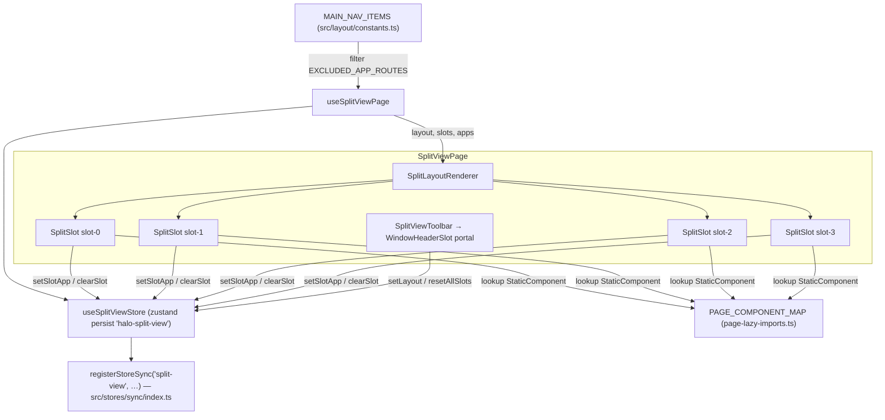

# Split View (split-view) — UI Deep Dive

> Source: `references/hexbuffer/src/pages/split-view/`

## 1. Overview & Purpose

Split View is Halo's multi-pane workspace: a single page (also hosted in its own Tauri sub-window) that holds 2, 3, or 4 resizable slots, each of which can be filled with any other Halo app. Slots lazily mount the real page components from `PAGE_COMPONENT_MAP` inside a `WindowProvider` so the embedded app believes it lives in its own window (standalone headers, etc.). Layout choice and slot assignments are persisted (zustand `persist`, key `halo-split-view`) and synchronized across windows by the store-sync subsystem.

The page itself is chrome-less: its toolbar does not render inline but is portaled into the window header via `WindowHeaderSlot` (`src/providers/window-provider.tsx`) — "Toolbar controls live in the window header slot".

Mounted at route `/split-view` (`src/App.tsx`, `src/routes/page-resolver.tsx` as `StandaloneLayout id="/split-view" title="Split View"`), registered in `PAGE_COMPONENT_MAP` (`src/layout/desktop-workspace/page-lazy-imports.ts`), and opened in a dedicated sub-window by the taskbar's split-screen launcher (`openSplitWindow` → `openSubAppWindow('/split-view', 'Split View')`).

## 2. Annotated File Tree

```
split-view/
├── index.tsx                            # SplitViewPage: SplitViewToolbar (header-portal) + SplitLayoutRenderer
├── constants.ts                         # SPLIT_LAYOUT_OPTIONS (split-2/3/4 with labels, titles, descriptions, slotCount), EXCLUDED_APP_ROUTES = ['/', '/split-view']
├── hooks/
│   └── use-split-view-page.ts           # Store selectors, availableApps (nav minus excluded), handlers, filledSlotCount
└── components/
    ├── split-layout-renderer.tsx        # Maps layout id → nested ResizablePanelGroup trees of SplitSlots
    ├── split-slot.tsx                   # One slot: mini header (app icon, change popover, clear) + embedded app via WindowProvider; falls back to SplitAppPicker
    ├── split-app-picker.tsx             # Empty-state grid of app icon buttons (tooltip labels) for filling a slot
    └── split-view-toolbar.tsx           # Layout switcher ButtonGroup with custom SVG-like glyphs + reset button, rendered via WindowHeaderSlot
```

## 3. Architecture & Dataflow



Flow: `useSplitViewPage` subscribes to `layout` and `slots` from the persisted store. `SplitLayoutRenderer` builds the panel tree for the active layout, giving each `SplitSlot` its `slotId` and current app href. A slot with no app renders the `SplitAppPicker`; picking an app calls `setSlotApp(slotId, href)`, which re-renders the slot with the lazily imported page component wrapped in `WindowProvider`. The taskbar launcher and the store's `openSplitWindow` create the standalone sub-window (`subapp-split-view` label via `@tauri-apps/api/webviewWindow.WebviewWindow`, `index.html?target=split-view`, 1200×800 default, min 750×520, macOS overlay title bar with `trafficLightPosition (20,20)`); on failure it falls back to an in-workspace window via `useNavStore.openWindow` (nav sizes `/split-view` windows specially: width `min(1280, max(900, innerWidth-80))`, height `min(820, max(600, innerHeight-120))`).

## 4. State Management

Store: `useSplitViewStore` (`src/stores/split-view.ts`), `create<SplitViewState>()(persist(...))` with `partialize` keeping only `layout` + `slots`; persisted under localStorage key `halo-split-view`. Registered with the cross-window sync registry as `'split-view'` in `src/stores/sync/index.ts` (`PERSISTED_STORES`), so slot assignments made in one window appear in others.

| Field / action | Type | Notes |
|---|---|---|
| `layout` | `SplitLayoutType = 'split-2' \| 'split-3' \| 'split-4'` | Default `'split-2'` |
| `slots` | `Record<string, string \| null>` | Keys `slot-0`…`slot-3` (DEFAULT_SLOTS all null); value is a nav route href or null |
| `setLayout(layout)` | action | Switches the arrangement; slot values beyond the new slotCount are ignored (not deleted) by the UI |
| `setSlotApp(slotId, appHref \| null)` | action | Assign or replace an app in a slot |
| `clearSlot(slotId)` | action | Sets the slot back to `null` → picker re-renders |
| `resetAllSlots()` | action | Restores `DEFAULT_SLOTS` (all four null); layout unchanged |
| `openSplitWindow(layout?, navigate?)` | action | Optionally sets layout, then dynamic-imports `openSubAppWindow('/split-view','Split View')`; falls back to `useNavStore.openWindow/focusWindow` |

Page-local state: only `isSwitchOpen` (per-slot Popover open flag) and `bodyElement` (ref-state for the slot body container) inside `SplitSlot`. Derived in the hook: `availableApps` = `MAIN_NAV_ITEMS.filter(item => !EXCLUDED_APP_ROUTES.includes(item.href))` (excludes `/` and `/split-view` itself, so a slot cannot host the workspace home or another split view), `activeLayoutOption` (falls back to `SPLIT_LAYOUT_OPTIONS[0]`), `filledSlotCount` = number of truthy values among the first `slotCount` keys of `slots`.

## 5. IPC Contracts

### Commands invoked

None. The page folder contains no `invoke`/`invokeTauri` calls, and the embedded apps run in-process as React components (no WebviewWindow-per-slot isolation). The only Tauri surface is indirect through integration points: `openSplitWindow` (store, not page) uses `@tauri-apps/api/webviewWindow` to create/focus the `subapp-split-view` window.

### Events listened

None in the page folder.

## 6. UI Layout & Component Breakdown

### Layout diagram

```
 Window header (portal target):  WindowHeaderSlot
 ┌──────────────────────────────────────────────────────────────────────┐
 │ [▭ 2-Split] [◫ 3-Split] [⊞ 4-Split]   [↻]   (ButtonGroup + reset)   │
 └──────────────────────────────────────────────────────────────────────┘
 SplitViewPage body (flex-1 min-h-0 overflow-hidden)
 ┌──────────────── split-2 (horizontal group) ─────────────────────────┐
 │ ┌───────────────────────────┬───────────────────────────────────┐   │
 │ │ slot-0 (50%, min 20)      │ slot-1 (50%, min 20)              │   │
 │ └───────────────────────────┴───────────────────────────────────┘   │
 ├──────────────── split-3 ────────────────────────────────────────────┤
 │ ┌───────────────────────────┬───────────────────────────────────┐   │
 │ │ slot-0 (50%, min 20)      │ slot-1 (50%, min 20)   ▲ vertical │   │
 │ │ full height               ├───────────────────────────────────┤   │
 │ │                           │ slot-2 (50%, min 20)              │   │
 │ └───────────────────────────┴───────────────────────────────────┘   │
 ├──────────────── split-4 (vertical group of 2 horizontal groups) ────┤
 │ ┌───────────────────────────┬───────────────────────────────────┐   │
 │ │ slot-0                    │ slot-1                            │   │
 │ ├───────────────────────────┼───────────────────────────────────┤   │
 │ │ slot-2                    │ slot-3                            │   │
 │ └───────────────────────────┴───────────────────────────────────┘   │
 └──────────────────────────────────────────────────────────────────────┘

 Filled slot anatomy:
 ┌──────────────────────────────────────────────┐
 │ h-7 px-2 border-b bg-muted/30 backdrop-blur  │
 │ [app icon 16px] (tooltip)  [⇄][✕]            │
 ├──────────────────────────────────────────────┤
 │ Suspense fallback: SpinnerGapIcon spin       │
 │ <StaticComponent/> in WindowProvider         │
 └──────────────────────────────────────────────┘
```

All `ResizablePanel`s use `defaultSize="50" minSize="20"` (numeric percent values in this layout, versus the encoder page's string sizes) and every `ResizableHandle` uses `withHandle` (the 14 px `DotsSixVerticalIcon` grab pill).

### Components

**`SplitViewPage`** — `index.tsx`
- Props: none; destructures the hook. Renders `SplitViewToolbar` (portaled to the header) and a `flex-1 min-h-0 overflow-hidden` body holding `SplitLayoutRenderer`.

**`SplitViewToolbar`** — `components/split-view-toolbar.tsx`
- Props: `{ layout, filledSlotCount, onLayoutChange, onResetSlots }`.
- Wraps everything in `WindowHeaderSlot` (a `ReactDOM.createPortal` into the window header's slot node — renders nothing when there is no header slot, e.g. plain browser mode).
- Layout switcher: `ButtonGroup` of one outline `Button` per `SPLIT_LAYOUT_OPTIONS` entry; each button contains a `LayoutGlyph` (a `w-3.5 h-2.5 gap-px rounded-[2px]` CSS grid of `bg-current opacity-80` cells — 1×2 for split-2, left cell + stacked right column for split-3, 2×2 for split-4) plus a label span (`text-[0.725rem]`, `text-primary` when active). `aria-pressed` reflects active; `aria-label` is the option title ("Dual Split Screen", "Sub-Split Screen", "Quad Split Screen"). Tooltips (`side="bottom" sideOffset={6}`, `text-xs`) show the longer description.
- Reset: ghost `Button size="icon-xs"` with `ArrowClockwiseIcon size-3`, `disabled={filledSlotCount === 0}`, tooltip "Clear all slots (N filled)".

**`SplitLayoutRenderer`** — `components/split-layout-renderer.tsx`
- Props: `{ layout, slots, apps, onSelectApp, onClearSlot }`.
- Pure layout mapping, memo-free (cheap): `split-2` = one horizontal group; `split-3` = horizontal group whose right panel nests a vertical group; `split-4` = vertical group of two horizontal groups. Comments in code: `'split-4' (four screen grid)`.

**`SplitSlot`** — `components/split-slot.tsx` (`React.memo`-wrapped named component)
- Props: `{ slotId, appHref, apps, onSelectApp, onClearSlot }`.
- If `!appHref || !PAGE_COMPONENT_MAP[appHref]` → renders `SplitAppPicker` (so an unknown href degrades to the picker rather than crashing).
- Filled state:
  - Mini header `h-7 px-2 border-b border-border/50 bg-muted/30 backdrop-blur-xs select-none z-10`:
    - Identity: `getAppIconImage(href, label)` bitmap in a `size-4 rounded-xs` tile (uses `matchedItem.colors.bg` + `border-white/20 dark:border-white/10 shadow-2xs` when the nav item defines colors, else `bg-muted/60 border-border/60`); fallback to the nav item's Phosphor icon component (`item.icon`, `size-4 text-muted-foreground`). Hover tooltip shows the app label (`text-xs font-medium`).
    - Change button: `Popover open={isSwitchOpen}` whose `PopoverTrigger` (a `size-5 rounded-xs` icon button, `aria-label="Change Application"`) is wrapped in a `Tooltip` ("Change"); the `PopoverContent` (`w-72 max-h-80 p-0 overflow-y-auto scrollbar-thin`, `align="end" side="bottom" sideOffset={4}`) hosts another `SplitAppPicker`; selection assigns the app and closes the popover.
    - Clear button: `size-5` icon button, `hover:text-destructive hover:bg-destructive/10`, `aria-label="Clear Slot"`, tooltip "Clear".
  - Body: `div ref={setBodyElement}` (`flex-1 min-h-0 relative overflow-hidden`) → `WindowProvider id={appHref} windowElement={bodyElement}` → `React.Suspense` fallback (centered `SpinnerGapIcon size-4 animate-spin text-primary`) → `<StaticComponent />` from `PAGE_COMPONENT_MAP`.
- Local state: `isSwitchOpen`, `bodyElement`.

**`SplitAppPicker`** — `components/split-app-picker.tsx`
- Props: `{ apps, onSelectApp }`.
- Built on the kit's `Empty` composite: `EmptyMedia variant="icon"` with `GridFourIcon`, `EmptyTitle` "Fill this slot", `EmptyDescription` "Pick an app to pin here."
- `EmptyContent max-w-md` holds a wrapping flex row (`gap-0.5`) of `size-10 rounded-md border border-transparent` icon buttons (`hover:bg-muted/60 focus-visible:ring-1 focus-visible:ring-ring active:bg-muted`, `aria-label={item.label}`); each shows the app's bitmap icon (``) or its Phosphor fallback (`size-5 text-muted-foreground`), with a bottom tooltip (`sideOffset={6}`) of the label. Root is `h-full overflow-y-auto scrollbar-thin p-4 sm:p-6 bg-background select-none`.

### Context menus
None on this page.

## 7. UI Libraries & Primitives Used

### UI kit — `@celestia-project/ui`

| Export | Used in | Notes |
|---|---|---|
| `Button` | toolbar buttons | `variant="outline"`, `variant="ghost"`, `size="icon-xs"` |
| `ButtonGroup` | layout switcher | Composite joiner |
| `Tooltip`, `TooltipTrigger`, `TooltipContent` | toolbar, slot header, app picker | `TooltipTrigger` is used with the kit's **`render` prop** pattern (e.g. `render={<PopoverTrigger …/>}` or `render={<button …/>}`) with children as the visible content — Base UI–style composition, not shadcn `asChild` |
| `Popover`, `PopoverContent`, `PopoverTrigger` | slot "Change Application" | `align`, `side`, `sideOffset` props |
| `Empty`, `EmptyHeader`, `EmptyMedia`, `EmptyTitle`, `EmptyDescription`, `EmptyContent` | app picker | `EmptyMedia variant="icon"` |

### Radix / underlying primitives

No Radix packages are imported directly in this folder; the kit's Tooltip/Popover encapsulate them. The resizable panels come from:

- `@/components/ui/resizable` (Halo-local wrapper around `react-resizable-panels` — same wrapper the encoder page uses): `ResizablePanelGroup` (`orientation="horizontal" | "vertical"`), `ResizablePanel` (`defaultSize`/`minSize`), `ResizableHandle withHandle` (Phosphor `DotsSixVerticalIcon` grab pill).

### Phosphor icons (`@phosphor-icons/react`) — exact names

`ArrowClockwiseIcon` (toolbar reset), `ArrowsClockwiseIcon` (slot change — note both spellings are used in this folder), `XIcon` (slot clear), `SpinnerGapIcon` (Suspense fallback), `GridFourIcon` (picker empty media). The nav items' own icons flow through `NavItem.icon` dynamically.

### Other third-party

| Library | Usage |
|---|---|
| `zustand` + `zustand/middleware` `persist` | `useSplitViewStore` |
| `react-resizable-panels` | via local wrapper |
| `@tauri-apps/api/webviewWindow` | store's `openSplitWindow` (integration, not page) |
| `React.lazy` / `React.Suspense` | embedded page components from `PAGE_COMPONENT_MAP` |

No Monaco, no dnd-kit, no framer-motion in this folder.

## 8. Keyboard Shortcuts & Interactions

No keyboard shortcuts are registered. Interactions:

- Click a layout button (or `aria-pressed` state) → `setLayout`; resizable via the two/three drag handles (min 20% per panel).
- Empty slot → click any app tile (`SplitAppPicker`) → fills the slot.
- Filled slot → `⇄` opens the switch popover (re-pick app); `✕` clears the slot (returns to picker).
- Reset button clears all filled slots (disabled when none filled).
- Hovering shows tooltips for layout descriptions, app labels, Change and Clear.
- The embedded apps remain fully interactive; they render inside a real `WindowProvider` so page-level header portals (`WindowHeaderSlot`) nest correctly.

## 9. Styling Details

- Page root: `relative flex flex-col overflow-hidden h-full w-full bg-background text-foreground` — full-bleed, unlike the encoder's card-inset framing.
- Slot chrome is deliberately minimal: `h-7` header, `bg-muted/30 backdrop-blur-xs`, hairline `border-border/50`.
- Icon tiles use the nav item's brand `colors.bg` with a light/dark-aware white hairline border (`border-white/20 dark:border-white/10`) and `shadow-2xs`.
- Glyph tiles in the toolbar are drawn with pure CSS (`bg-current opacity-80`, `rounded-[1px]`, gap-px grid) rather than an icon font, so they inherit `text-primary` when active.
- Scrollbars in popover/picker use the app's `scrollbar-thin` utility.
- Micro type: `text-[0.725rem]` (toolbar labels), `text-xs` (tooltips).

## 10. Integration Points

- **Routing / shell**: lazy route `/split-view` in `src/App.tsx`; `StandaloneLayout` in `src/routes/page-resolver.tsx`; Desktop workspace via `PAGE_COMPONENT_MAP['/split-view']`.
- **Taskbar launcher**: `src/layout/taskbar/components/split-screen-launcher.tsx` calls `useSplitViewStore.openSplitWindow(layoutId, navigate)` to open the split view in a dedicated Tauri sub-window (label `subapp-split-view`; created by `openSubAppWindow` in `src/lib/sub-window.ts` with fallback to an in-workspace nav window, which gets special 1280×820 sizing in `src/stores/nav.ts`).
- **App hosting**: any `MAIN_NAV_ITEMS` route except `/` and `/split-view` can be pinned into a slot; components resolve through `PAGE_COMPONENT_MAP` (`src/layout/desktop-workspace/page-lazy-imports.ts`) so slots mount the exact same lazy page components used by the workspace windows, wrapped in `WindowProvider` (`src/providers/window-provider.tsx`) for per-slot header slots/window context.
- **Cross-window sync**: the store is registered as `'split-view'` in `PERSISTED_STORES` (`src/stores/sync/index.ts`), so layout + slot assignment persist (`halo-split-view`) and stay consistent across all open Halo windows.
- **Nav metadata**: `NavItem` (`src/layout/constants.ts`) supplies labels, icons, optional bitmap images via `getAppIconImage`, and brand colors reused by the slot header and picker.

## 11. Source Files Documented

- `references/hexbuffer/src/pages/split-view/index.tsx`
- `references/hexbuffer/src/pages/split-view/constants.ts`
- `references/hexbuffer/src/pages/split-view/hooks/use-split-view-page.ts`
- `references/hexbuffer/src/pages/split-view/components/split-layout-renderer.tsx`
- `references/hexbuffer/src/pages/split-view/components/split-slot.tsx`
- `references/hexbuffer/src/pages/split-view/components/split-app-picker.tsx`
- `references/hexbuffer/src/pages/split-view/components/split-view-toolbar.tsx`
- Shared (read for usage context): `src/stores/split-view.ts`, `src/layout/constants.ts` (NavItem/MAIN_NAV_ITEMS/getAppIconImage), `src/layout/desktop-workspace/page-lazy-imports.ts` (map), `src/providers/window-provider.tsx` (WindowProvider/WindowHeaderSlot), `src/components/ui/resizable.tsx`, `src/lib/sub-window.ts`, `src/stores/nav.ts` and `src/stores/sync/index.ts` (integration excerpts), `src/App.tsx` + `src/routes/page-resolver.tsx` (mount points), celestia-starter tooltip primitive (render-prop surface).
