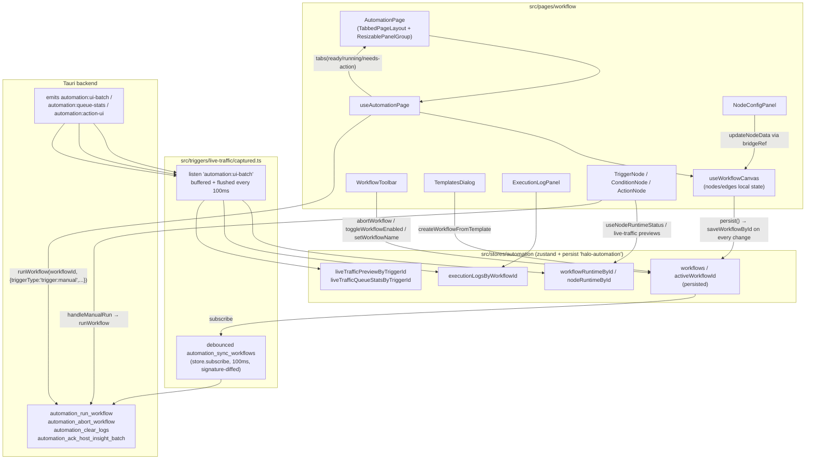

# Workflow / Automation (workflow) — UI Deep Dive

> Source: `references/hexbuffer/src/pages/workflow/` (43 files, ~6,300 lines)
> Related shared modules documented for page usage: `src/stores/automation/*` (sliced Zustand store), `src/components/flow/*` (React-Flow canvas kit), `src/layout/tabs-layout/*` (TabbedPageLayout), `src/components/ui/resizable.tsx` (react-resizable-panels wrappers), `src/triggers/live-traffic/captured.ts` (Tauri event bridge), `src/lib/utils.ts` (`cn`).

## 1. Overview & Purpose

The workflow page (route-level export `AutomationPage`, product name "FlowArrow") is Halo's node-based automation builder — a Burp-Suite-like "automation rules" canvas. Users compose directed graphs of three node categories:

- **Triggers** (`trigger:*`, 8 types) — start a run: manual button, cron schedule, scan-completed, browser page crawled, proxy intercept request, WebSocket message, port-scan result, live traffic captured. Exactly **one trigger per workflow** is enforced in the UI.
- **Conditions** (`condition:*`, 12 types) — evaluate a JSON data path against a value with 6 operators; every condition node has **two source handles, `true` and `false`**, so both branches are wired explicitly.
- **Actions** (`action:*`, 16 types) — side effects: send to Repeater/Intercept/Intruder, AI analyze, create finding, add-to-report, webhook, notification, shell script, crawl start/stop, port scan, encode/decode, hash, export JSON, connect CDP inspector.

Every node type is described twice, deliberately: a UI registry (`node-type-registry.ts`: label, icon, default config) and a capability/profile catalog (`lib/*-node-profiles.ts` merged into `NODE_PROFILE_MAP`: `wired` flag, handle IDs, and a full input/output `dataSchema` shown in the Data Flow tab). `lib/workflow-readiness.ts` computes a human-readable "why can't this run" reason that surfaces in the toolbar, the page tab badge, and as a toast before any run.

Canvas state (nodes/edges) is **local React state via `@xyflow/react`'s `useNodesState`/`useEdgesState`**; every change is persisted into `useAutomationStore.workflows` via `saveWorkflowById`, and the whole store is debounce-synced to the Rust backend (`automation_sync_workflows`) which actually executes runs and emits UI events back. The page never runs a workflow itself — it only requests runs; execution, logs, node statuses, and live-traffic queues stream back through three `automation:*` events handled in `src/triggers/live-traffic/captured.ts`.

## 2. Annotated File Tree — every file with a one-line description of what it does

```
src/pages/workflow/
├── index.tsx                          AutomationPage: ReactFlowProvider > TabbedPageLayout > ResizablePanelGroup (canvas+log | node config); renders TemplatesDialog.
├── types.ts                           Domain types: TriggerType/ConditionType/ActionType unions, Trigger/Condition/ActionConfig, AutomationNodeData/Node/Edge, WorkflowDef, WorkflowRun(+Step), RunStatus/StepStatus.
├── constants.ts                       Re-exports NODE_TYPE_REGISTRY; NODE_CATEGORY_GROUPS, CATEGORY_BORDER/BG/ICON_BG/ICON_TEXT/HANDLE color maps, DEFAULT_WORKFLOW_NAME='Untitled FlowArrow', makeNodeId().
├── node-type-registry.ts              NODE_TYPE_REGISTRY: Record<AutomationNodeType, NodeTypeDef{type,label,category,iconName,description,defaultConfig}> — 36 entries (8 trigger, 12 condition, 16 action).
├── templates.ts                       WorkflowTemplate[] (10 templates in 4 categories) + createWorkflowFromTemplate() building nodes/edges with crypto.randomUUID() ids.
├── hooks/
│   ├── use-automation-page.ts         Page controller: tabs derivation (readiness/status), selected-node state, bridge/persist/addNode refs, auto-create first workflow, close-tabs-to-left/right.
│   └── use-workflow-canvas.ts         Canvas controller (~450 lines): nodes/edges state, persist-on-every-change, context menus, connect/delete/validations, manual-run, keybind Cmd/Ctrl+S, bridge ref.
├── components/
│   ├── workflow-canvas.tsx            Thin wrapper: FlowCanvas + CanvasContextMenu + NodeContextMenu; shows FlowEmptyState when no active workflow.
│   ├── workflow-toolbar.tsx           h-10 toolbar: inline rename (Input + check/X), readiness indicator, Abort button while running, Start/Pause Listening toggle, Delete workflow.
│   ├── canvas-context-menu.tsx        Right-click node palette: search Input, Accordion grouped by category, per-item Tooltip, disabled triggers with sonner toast + "Remove" action.
│   ├── node-context-menu.tsx          Node context menu: header label, Properties (opens config panel), Delete (red). Plain absolutely-positioned div w/ outside-click + Escape handling.
│   ├── node-config-panel.tsx          Right-side config panel: header w/ delete+close, node info bar, Tabs (Config | Traffic [live-traffic only] | Properties | Data Flow).
│   ├── node-data-flow.tsx             Data Flow tab: Received/Output runtime JSON blocks + typed input/output schema field list (str/num/bool/obj/arr chips).
│   ├── execution-log-panel.tsx        Bottom log panel: collapsible header w/ count + clear, newest-first mono rows, per-log expandable Input/Output JSON, prune on mount.
│   ├── execution-log-toggle.tsx       Floating bottom-left ghost Button (LayoutIcon) toggling the log panel; both branches render the same icon.
│   ├── templates-dialog.tsx           "Create Workflow" Dialog: blank option + templates grouped Monitoring/Security/Crawl/General with node/edge counts.
│   └── deletable-edge.tsx             DeletableEdge: wraps FlowDeletableEdge, forwards delete via window CustomEvent 'automation-delete-edge'.
├── nodes/
│   ├── trigger-node.tsx               TriggerNode (~300 lines): category styling, "Host required" warning banner, per-trigger live status rows (Manual Run button / Listening pulse / direction+host+operator summary).
│   ├── condition-node.tsx             ConditionNode: operator glyph chip (=, ≠, ⊃, >, <, ≈), `dataPath glyph value` summary row, True/False handle labels, dual colored source handles.
│   ├── action-node.tsx                ActionNode: drag-handle dots, icon tile, label + "Action" subtitle, warning icon, unconfigured badge, NodeCardMenu, runtime status strip.
│   ├── node-runtime-status.tsx        NodeRuntimeStatus strip (running/success/error/skipped icons+colors, Received-payload preview) + useNodeRuntimeStatus(nodeId) store hook.
│   ├── node-capability-badge.tsx      NodeCapabilityBadge: amber "unconfig" pill with title/aria reason.
│   └── node-card-menu.tsx             NodeCardMenu (DotsThreeVertical ghost Button) + CustomEvent bridge 'automation-open-node-context-menu' with addOpenNodeContextMenuListener().
├── nodes/nodes-config/
│   ├── index.ts                       Barrel: TriggerConfigForm, LiveTrafficPanel, ConditionConfigForm, OPERATOR_LABELS, placeholderForCondition, ActionConfigForm.
│   ├── trigger-fields.tsx             Shared filter widgets: HttpMethodFilter, HostWhitelistFilter (Textarea), UrlPatternFilter (operator+value), TriggerInfoPanel; OPERATOR/METHOD/DIRECTION option lists.
│   ├── trigger-config.tsx             TriggerConfigForm per triggerType (cron/manual/live-traffic/intercept/page-crawled/port-scan/websocket/info-only); LiveTrafficPanel = Queue + Captured hosts lists.
│   ├── condition-config.tsx           ConditionConfigForm: condition type label, Data key Select fed by schema+runtime JSON paths (+ free Input), Operator Select, conditional Value Input.
│   ├── action-config.tsx              ActionConfigForm dispatch table ACTION_CONFIG_MAP — 16 per-action field forms over shared Field/TextField/SelectField/BooleanField.
│   └── action-fields.tsx              useActionParams hook + generic Field/TextField(Textarea)/SelectField/BooleanField primitives + REQUEST_SOURCE_OPTIONS.
└── lib/
    ├── canvas-definitions.ts          NODE_TYPES (36 entries → 3 components), EDGE_TYPES {deletable: DeletableEdge}, CONNECTION_LINE_STYLE (green #00c950, width 3).
    ├── edges.ts                       AUTOMATION_DEFAULT_EDGE_OPTIONS (type 'deletable', animated, primary stroke, ArrowClosed marker, interactionWidth 20); buildAutomationEdge(FromConnection); keepOneAutomationEdgePerHandle; normalizeAutomationEdges.
    ├── node-factory.ts                hasTriggerNode(); createAutomationNode(nodeType, position) → AutomationNode from NODE_TYPE_REGISTRY defaults.
    ├── node-capability-types.ts       AutomationNodeCapability, DataSchemaField, NodeDataSchema, NodeProfile interfaces.
    ├── node-schema-fragments.ts       HTTP_CONTEXT_INPUT (7 fields), CONDITION_OUTPUT, ACTION_OUTPUT_BASE, NO_INPUT/NO_OUTPUT schema fragments.
    ├── trigger-node-profiles.ts       TRIGGER_NODE_PROFILES: NodeProfile per trigger (all wired; rich output schemas e.g. page-crawled has 14 output fields).
    ├── condition-node-profiles.ts     CONDITION_NODE_PROFILES: all wired, sourceHandleIds ['true','false'], per-condition input/output schemas.
    ├── action-node-profiles.ts        ACTION_NODE_PROFILES: 15 wired + action:connect-cdp wired:false ("setup UI, but real action execution is not wired yet").
    ├── node-profile-map.ts            NODE_PROFILE_MAP = merge of the three profile maps.
    ├── node-capabilities.ts           Public API: getNodeProfile, getAutomationNodeCapability, deleteConnectedWires(ForNodes), getNodeSourceHandles, isConditionNode, get(Un)wiredNodeTypes, getNodeDataSchema.
    ├── node-warnings.ts               getLiveTrafficSetupWarning, getTriggerHostSetupWarning (host whitelist required), getAutomationNodeWarning (skipped runtime → warning).
    ├── workflow-readiness.ts          getWorkflowReadiness(): ≥1 node, has trigger, has start node (no incoming edge), per-node config checks → {ready, reason}.
    ├── condition-evaluator.ts         defaultDataPathForCondition map, resolveJsonPath (case-insensitive segments, array index), evaluateCondition() implementing 6 operators + header-exists + array-any.
    └── workflow-runtime.ts            isWorkflowProcessing(workflowId, workflowRuntimeById) helper.
```

## 3. Architecture & Dataflow



Key flow facts:

- **Every canvas mutation persists.** `onNodesChange`, `onEdgesChange`, `onConnect`, `updateNodeData`, `addNodeFromMenu`, `deleteNode`, `removeTriggerNode` all call `persist(nextNodes, nextEdges)` inside the same `set`/`setNodes` updater, writing through `saveWorkflowById` into the store. The hook also persists on unmount (tab switch, since `WorkflowCanvas` is keyed by `activeWorkflowId`) and on Cmd/Ctrl+S.
- **Single-trigger rule** is enforced at three levels: `addNodeFromMenu`/`addNodeRef` skip when `hasAnyTriggerNode`, the palette disables trigger rows and shows a `sonner` toast with a "Remove" action calling `onRemoveTrigger`, and `workflow-readiness` requires a trigger.
- **Edge model:** each handle supports at most one wire — `isValidConnection` rejects a connection if either endpoint handle is already used, and `keepOneAutomationEdgePerHandle` dedupes after edge changes. Edge deletion paths: double-click the edge, click the X badge rendered by `FlowDeletableEdge` (dispatches `window` CustomEvent `automation-delete-edge`), select + Backspace/Delete (`deleteKeyCode`).
- **Runs are backend-driven.** `runWorkflow` (in the store's execution slice) first calls `automation_sync_workflows`, then `automation_run_workflow`, then optimistically marks the trigger node `running`. Actual per-node statuses, logs, queue stats, and completion arrive via `automation:ui-batch` events, buffered and flushed into the store by the live-traffic bridge.
- **UI-only actions** (`send-to-repeater`, `send-to-intercept`, `start-invoker`) come back as `automation:action-ui` events and are executed in the frontend bridge by touching `useRepeaterStore` / `useInterceptStore` / `useIntruderStore` and blinking the nav via `useNavStore.triggerNavBlink`.

## 4. State Management

All page state lives in `useAutomationStore` (`src/stores/automation/index.ts`, `zustand/persist`, key **`halo-automation`**) except canvas-local nodes/edges and a few UI flags. Persisted via `partialize`: `workflows`, `activeWorkflowId`, `automationSettings`; on rehydrate `merge` validates `activeWorkflowId` against persisted workflows and resets all runtime fields (`nodeRuntimeById`, `workflowRuntimeById`, log maps, live-traffic buffers, `runningWorkflowIds`, `isRunning`).

Fields the page touches:

| Field | Type | Used by | Notes |
|---|---|---|---|
| `workflows` | `WorkflowDef[]` | page hook, canvas, toolbar, nodes | `WorkflowDef{id,name,description,enabled,nodes,edges,createdAt,updatedAt}` |
| `activeWorkflowId` | `string \| null` | canvas, toolbar, trigger node, log panel | validated on merge; page auto-falls back to `workflows[0].id` |
| `workflowRuntimeById` | `Record<string, WorkflowRuntimeState>` | tab status, toolbar, log panel | `{processing, executingNodeId?, updatedAt}` |
| `nodeRuntimeById` | `Record<string, NodeRuntimeState>` | node components, config panel, data-flow | `{workflowId,status:'running'\|'success'\|'error'\|'skipped',message?,inputData?,outputData?,updatedAt}` |
| `executionLogsByWorkflowId` | `Record<string, ExecutionLog[]>` | ExecutionLogPanel | capped at `AUTOMATION_LOG_UI_LIMIT` (50) per workflow, 500 total |
| `liveTrafficPreviewByTriggerId` | `Record<string, LiveTrafficHostInsight[]>` | LiveTrafficQueuePanel | reversed + deduped for display |
| `liveTrafficCapturedPreviewByTriggerId` | `Record<string, LiveTrafficHostInsight[]>` | LiveTrafficCapturedHostsPanel | same |
| `liveTrafficQueueStatsByTriggerId` | `Record<string, LiveTrafficQueueStats>` | LiveTrafficQueuePanel | `{pending,dropped,lastDroppedAt?,cap}` |
| `automationSettings` | `AutomationRuntimeSettings` | synced to backend | `{liveTrafficConcurrency, filteredTriggerQueueCap, catchAllTriggerQueueCap, recentMatchDedupeTtlMs, allowRunScriptActions}` |

Actions used by this page (all others belong to the bridge/backend path): `createWorkflow`, `createWorkflowFromTemplate`, `setActiveWorkflowId`, `renameWorkflow`, `setWorkflowName`, `deleteWorkflow`, `deleteWorkflows`, `saveWorkflowById`, `runWorkflow`, `abortWorkflow`, `toggleWorkflowEnabled`, `clearLogs`, `pruneExecutionLogs`, `clearLiveTrafficHostInsights`, `clearLiveTrafficCapturedHosts`, `setNodeRuntimeStatus(es)`, `setWorkflowRuntimeSnapshot`, `clearWorkflowRuntimeStatus`, `appendExecutionLog(s)`.

Local page state (in `useAutomationPage` / `useWorkflowCanvas`):

- `templatesOpen: boolean`, `showExecutionLog: boolean` (default `true`), `selectedNode: Node<AutomationNodeData> | null`.
- `addNodeAtCenterRef`, `persistRef`, `bridgeRef: WorkflowCanvasBridge` — refs so the page can command the canvas (`updateNodeData`, `deleteNode`, `onRun`, `clearSelection`).
- Canvas: `contextMenu {x,y,flowX,flowY}`, `nodeContextMenu {x,y,nodeId,nodeLabel}`, `selectedNodeId` (drives the config panel; `selectedNode` derived).
- Toolbar: `editing`/`editName` for inline rename.
- Log panel: `collapsed`, `expandedLogIds: Set<string>`.

## 5. IPC Contracts

The page itself invokes commands through `useAutomationStore` actions (execution/logs/live-traffic slices). The event side is handled by `src/triggers/live-traffic/captured.ts`.

### Commands invoked

| Command | Args | Returns | Where called from |
|---|---|---|---|
| `automation_sync_workflows` | `{ workflows: WorkflowDef[], settings: AutomationRuntimeSettings }` | void (promise) | `runWorkflow` (execution-slice, before every run) and debounced store subscriber in `captured.ts` (signature-diffed, 100 ms) |
| `automation_run_workflow` | `{ workflowId: string, context: WorkflowContext \| null }` where `WorkflowContext = { triggerType?: string, triggerNodeId?: string, data?: Record<string, unknown> }` | void | `runWorkflow` — invoked by toolbar-less manual Run (canvas hook `onRun`), manual TriggerNode button, and `TriggerConfigForm` Run button |
| `automation_abort_workflow` | `{ workflowId: string, reason: string }` | void | `abortWorkflow` (Abort button, workflow delete, close-tabs) |
| `automation_clear_logs` | `{ workflowId: string \| null }` | void | `clearLogs` (log panel trash button) |
| `automation_clear_host_insights` | `{ triggerNodeId: string \| null }` | void | `clearLiveTrafficHostInsights` / `clearLiveTrafficCapturedHosts` (Traffic tab clear buttons) |
| `automation_ack_host_insight_batch` | `{ batchId: string }` | void | bridge flush after applying an `automation:ui-batch` |

All command sites are guarded by `isTauriAvailable()` (`window.__TAURI_INTERNALS__`), so the page degrades gracefully in a plain browser.

### Events listened

| Event | Payload | Handler |
|---|---|---|
| `automation:ui-batch` | `AutomationUiBatchEvent { batchId: string, hostInsights: LiveTrafficHostInsight[], capturedHosts: LiveTrafficHostInsight[], removeHostInsightIds: string[], logs: ExecutionLog[], nodeRuntimes: Array<NodeRuntimeEvent { nodeId } & NodeRuntimeState>, workflowRuntimes: Array<{runningWorkflowIds, activeRunWorkflowId?, executingNodeId?}>, workflowRuntimeClearIds: string[], queueStats: QueueStatsEvent[] }` | buffered; flushed to store every 100 ms (`appendLiveTrafficHostInsights`, `appendLiveTrafficCapturedHosts`, `removeLiveTrafficHostInsights`, `appendExecutionLogs`, `setNodeRuntimeStatuses`, `clearWorkflowRuntimeStatus`, `setWorkflowRuntimeSnapshot`, queue-stats `setState`), then `automation_ack_host_insight_batch` |
| `automation:queue-stats` | `QueueStatsEvent { triggerNodeId, pending, dropped, lastDroppedAt?, cap }` | updates `liveTrafficQueueStatsByTriggerId` via flush |
| `automation:action-ui` | `AutomationActionUiEvent { actionId, workflowId, nodeId, actionType, params, inputData }` | `handleAutomationActionUi`: `action:send-to-repeater` → `sendRawToRepeater` (+nav blink `/repeater`), `action:send-to-intercept` → `useInterceptStore.addTabForHost` + `setRawRequest` + optional `toggleIntercept(true)`, `action:start-invoker`/`action:start-intruder` → `useIntruderStore.addAttackConfig`-style `buildInvokerConfig(payload)` + `startAttack()` when positions+payloads exist |

Window CustomEvents (frontend-only, not Tauri): `automation-delete-edge {edgeId}` (DeletableEdge → canvas hook), `automation-open-node-context-menu {nodeId,nodeLabel,clientX,clientY}` (NodeCardMenu → canvas hook).

## 6. UI Layout & Component Breakdown

```
┌──────────────────────────────────────────────────────────────────────────────┐
│ PageTabBar (workflow tabs; status dot: running spinner / warning / ready)    │  border-b border-primary
├──────────────────────────────────────────────────────────────────────────────┤
│ ┌ m-2 border rounded-lg ───────────────────────────────────────────────────┐ │
│ │ ResizablePanelGroup horizontal id="automation-workspace-panels"          │ │
│ │ ┌──────────────── canvas panel 100% / 60% w/ config ───────────────────┐ │ │
│ │ │ ResizablePanelGroup vertical                                         │ │ │
│ │ │ ┌──────────────────────────────────────────────────────┐             │ │ │
│ │ │ │ WorkflowToolbar (h-10, bg-muted, border-b)           │             │ │ │
│ │ │ ┌──────────────────────────────────────────────────────┐             │ │ │
│ │ │ │ WorkflowCanvas = FlowCanvas (75% default)            │             │ │ │
│ │ │ │   [LayoutIcon toggle] floating bottom-left z-20      │             │ │ │
│ │ │ │   nodes… context menus… minimap/controls/background  │             │ │ │
│ │ │ ├──────────── ResizableHandle withHandle ──────────────┤             │ │ │
│ │ │ │ ExecutionLogPanel (25%, shown when showExecutionLog) │             │ │ │
│ │ │ └──────────────────────────────────────────────────────┘             │ │ │
│ │ └──────────────────────────────────────────────────────────────────────┘ │ │
│ │ (Res_HANDLE)  ┌─ NodeConfigPanel 460px default (380–760), 40% ─┐         │ │
│ │               └────────────────────────────────────────────────┘         │ │
│ └──────────────────────────────────────────────────────────────────────────┘ │
└──────────────────────────────────────────────────────────────────────────────┘
```

Panel sizing uses px-style strings understood by `react-resizable-panels` wrappers in `src/components/ui/resizable.tsx` (`defaultSize="100"|"60"`, `minSize="420px"`, config panel `defaultSize="460px"` `minSize="380px"` `maxSize="760px"`; vertical log panel `defaultSize="75"`/`"25"`, `minSize="30"`/`"10"`).

### AutomationPage (`index.tsx`)
Props: none. Wraps everything in `ReactFlowProvider` (required for `useReactFlow().screenToFlowPosition` inside the canvas hook). `WorkflowCanvas` gets `key={page.activeWorkflowId}` so switching tabs remounts the canvas (persist-on-unmount saves the old graph). The config panel is conditionally rendered from `page.selectedNode`.

### WorkflowToolbar (`components/workflow-toolbar.tsx`)
- Rename: `Input textSize="xs" className="h-6 w-48"` with Enter=confirm (`setWorkflowName`), Escape=cancel; name truncated at `max-w-[200px]`, pencil (`PencilIcon size-3`) in `w-6 p-0` ghost Button.
- Status area (ml-auto), first match wins: "Listening Paused" (amber `PauseCircleIcon`) when a live-traffic/page-crawled trigger exists and `workflow.enabled === false`; "Running" (spinning `SpinnerGapIcon`, emerald) when `workflowRuntimeById[id].processing`; readiness warning (`WarningCircleIcon`, amber, `title=reason`, `max-w-56 truncate`); else a `size-1.5` emerald dot + "Ready".
- Abort Button (`variant="outline"`, amber border `border-amber-500/30`) → `abortWorkflow(id, 'stopped by user')`, only while running.
- Start/Pause Listening Button (only when the workflow has `trigger:live-traffic-captured` or `trigger:browser-page-crawled`) → `toggleWorkflowEnabled` (`PlayIcon`/`PauseIcon`).
- Delete workflow (`TrashIcon`, `text-destructive`) → `deleteWorkflow(id)` (which also aborts and cleans all runtime maps).

### WorkflowCanvas (`components/workflow-canvas.tsx`)
Renders `FlowEmptyState title="Select or create a workflow to start building"` when no active workflow. Otherwise `FlowCanvas` with: `onlyRenderVisibleElements`, `fitView`, `snapToGrid`, `snapGrid={[16,16]}`, `deleteKeyCode={['Backspace','Delete']}`, `showMiniMap`, `showControls`, `showBackground`, `showHelpBadge`, `className="automation-flow"`. Canvas defaults from `FlowCanvas`: `panOnScroll`, space-held pan (`useFlowKeyboard`), selection-on-drag when space not held. Children: `CanvasContextMenu`, `NodeContextMenu`.

### CanvasContextMenu (`components/canvas-context-menu.tsx`)
`w-56` popover-styled `div` positioned by `{left,top}` from pane-context-menu state (clamped 8 px margins using measured menu size 224×360). Contents: search `Input textSize="xs" pl-7` with `MagnifyingGlassIcon` prefix (placeholder literally "MagnifyingGlassIcon nodes..." — a string-template mishap in source), results in `Accordion multiple` grouped by `NODE_CATEGORY_GROUPS` (all expanded only while searching via `key` remount). Each row: 20 px icon tile colored by `CATEGORY_ICON_BG/ICON_TEXT`, truncated label, right-side `TooltipContent side="right"`. Trigger rows are `opacity-40 cursor-not-allowed` when a trigger exists; clicking shows `toast.error('Trigger already exists', … action: {label:'Remove', onClick: onRemoveTrigger})`. Closes on outside click (delayed by `setTimeout(0)` so the opening right-click doesn't immediately dismiss), Escape, or another contextmenu.

### NodeContextMenu (`components/node-context-menu.tsx`)
`w-44` menu with uppercase label header; two items: Properties (`GearSixIcon`) → `onProperties(nodeId)` sets `selectedNodeId` (opens config panel); Delete (`TrashIcon`, red) → `deleteNode`. Same outside-click/Escape mechanics. Opened by right-clicking a node or by the node's own kebab menu (`NodeCardMenu` → CustomEvent, anchored at `rect.right/rect.bottom`, clamped 176×96).

### TriggerNode / ConditionNode / ActionNode (`nodes/`)
Shared shape (all `React.memo`): `min-w-[180px] rounded-md border-2` card wrapped in `Tooltip` → `TooltipTrigger render={<div …/>}` (the `@celestia-project/ui` render-prop pattern) with `TooltipContent side="right" sideOffset={12} max-w-52`. Selected state: `ring-2 ring-ring ring-offset-2`. Executing state: red border + `animate-pulse` + `shadow-red-500/25`.

- **TriggerNode** (`border-blue-500/50`): icon tile 28 px (`size-7`, `bg-blue-500/20`), drag dots `DotsSixIcon`, label + "Trigger" subtitle, warning `WarningCircleIcon` (bigger `size-5` when host missing). Extra rows per type:
  - host-required banner: `rounded-t-[5px] border-b border-warning/40 bg-warning/15` "Host required" with explanation, shown for live-traffic/websocket without `config.host`.
  - `trigger:manual`: row with green `bg-success` dot and a `Run` Button (`nodrag nopan`, disabled while executing) calling `runWorkflow(activeWorkflowId, {triggerType:'trigger:manual', triggerNodeId:id, data:{triggeredAt, source:'manual-node'}})`.
  - `trigger:live-traffic-captured`: row whose tint shifts cyan when `workflow.enabled` (listening), amber otherwise; pulsing dot `shadow-[0_0_4px_theme(colors.cyan.400)]`; summary of `Method/Host/operator "value"`.
  - `trigger:websocket-message`: same pattern in violet (`bg-violet-400` pulse), plus `Direction:`.
  - `trigger:browser-page-crawled`: same pattern in blue, "Listening for pages"/"Listening paused".
  - `NodeRuntimeStatus accentClassName="border-blue-500/20"`; single bottom `Handle type="source"` (blue), no target handle.
- **ConditionNode** (`border-amber-500/50`, `FunctionIcon` tile): config summary row `border-t border-amber-500/20` with `code` chip of the operator glyph (`equals '='`, `not_equals '≠'`, `contains '⊃'`, `gt '>'`, `lt '<'`, `regex '≈'`) and `dataPath glyph value` (or `(not set)`). True/False label row (`text-4xs`, emerald/red). Two bottom source handles: `id="true"` at `left:'35%'` emerald, `id="false"` at `left:'65%'` red; one top target handle. Runtime accent `border-amber-500/20`.
- **ActionNode** (`border-emerald-500/50`): icon from per-node `iconName` (18-entry iconMap), subtitle "Action". `NodeRuntimeStatus accentClassName="border-emerald-500/20"`. Top target + bottom source handles (emerald).
- All three render `NodeCapabilityBadge` (amber "unconfig" pill, `title=reason`) when `getAutomationNodeCapability(nodeData).supported === false` — in practice only `action:connect-cdp` and unknown types.

### NodeRuntimeStatus / useNodeRuntimeStatus (`nodes/node-runtime-status.tsx`)
`useNodeRuntimeStatus(nodeId)` subscribes to `nodeRuntimeById[nodeId]`. Strip rendered only when a runtime exists: status row (`SpinnerGapIcon` spinning/`CheckCircleIcon`/`WarningCircleIcon`/`SkipForwardIcon` with running=primary, success=emerald, error=red, skipped=amber) and, if `inputData != null`, a `DatabaseIcon` "Received" mono preview (`formatPayloadPreview`: arrays → "N items", objects → first 3 keys + `+N`, strings truncated to 36 chars).

### NodeConfigPanel (`components/node-config-panel.tsx`)
Props: `{node, onClose, onUpdate, onDelete?, onRun?}`. Header "Node Properties" with delete (`TrashIcon`, red hover) and close (`XIcon`) ghost buttons. Info bar: `def.label` (`text-sm font-medium`) + `Info` Tooltip with `def.description` + uppercase category. Then `Tabs defaultValue="config"` with `TabsList mx-4 mt-3 h-7 w-auto`:
- **Config** — `TriggerConfigForm` / `ConditionConfigForm` (receives `runtime?.inputData` for path suggestions) / `ActionConfigForm` per category.
- **Traffic** — only when `config.triggerType === 'trigger:live-traffic-captured'`; renders `LiveTrafficPanel nodeId` (below).
- **Properties** — Node ID (`select-all` mono), Node Type (label "TextTIcon" in source — copy artifact), Category, Position (`x: …, y: …` rounded).
- **Data Flow** — `NodeDataFlow nodeType runtime`.
All `TabsContent` use `data-[state=inactive]:hidden` + inner `ScrollArea` `h-full` to keep heights stable.

### LiveTrafficPanel (`nodes/nodes-config/trigger-config.tsx`)
Two `LiveTrafficHostList`s: "Queued to execute" (`liveTrafficPreviewByTriggerId[nodeId]`, with `stats` line `N matched requests / cap X`, amber `Alert` when `stats.dropped > 0`: "Live traffic queue is dropping requests") and "Captured hosts" (`liveTrafficCapturedPreviewByTriggerId[nodeId]`). Each row: `matchedAt` time (HH:MM:SS), method (cyan), optional status, host, path (mono). Header has clear button → `clearLiveTrafficHostInsights(nodeId)` / `clearLiveTrafficCapturedHosts(nodeId)`; lists are capped at 30/60 by the store slices (`LIVE_TRAFFIC_QUEUED_HOST_UI_LIMIT`, `LIVE_TRAFFIC_CAPTURED_HOST_UI_LIMIT`).

### TriggerConfigForm (`nodes/nodes-config/trigger-config.tsx`)
Branches by `config.triggerType`:
- scheduled: cron `Input` with leading `ClockIcon` (`pl-7`), placeholder `0 */6 * * *`.
- manual: explanatory text + full-width `Run FlowArrowIcon` Button (label text contains another template mishap) calling `onRun`.
- live-traffic: warning `Alert` (host whitelist required, `border-warning/60 bg-warning/15`), Method `Select` (`METHOD_OPTIONS = ['ANY','GET','POST','PUT','PATCH','DELETE','HEAD','OPTIONS']`, ANY → `method: undefined`), Host whitelist `Textarea` (asterisk label, hint about newlines/commas/semicolons/spaces, wildcard domains), Operator Select (`OPERATOR_OPTIONS equals/contains/regex`), Value Input (blank = match all).
- intercept-request: `HttpMethodFilter` + `HostWhitelistFilter` + `UrlPatternFilter` + help text.
- browser-page-crawled: Host + URL pattern filters.
- port-scan-result: Ports Input (comma-separated, blank = all) + host filter.
- websocket-message: warning Alert, Host filter, Direction Select (Both/`DIRECTION_OPTIONS` sent/received), URL pattern filter.
- scan-completed (info-only): `TriggerInfoPanel` with `ScanIcon` and help text.

### ConditionConfigForm (`nodes/nodes-config/condition-config.tsx`)
Condition-type label (registry lookup); **Data key**: `Select` whose options come from `getSuggestedDataPaths` = `defaultDataPathForCondition(type)` + schema input keys (`getNodeDataSchema(type).input`) + runtime JSON paths (`collectJsonPaths(inputData)` up to depth 3, deduped) — plus a free-form `Input mono` override (placeholder `e.g. response.headers.content-type`); **Operator** Select over `OPERATOR_LABELS` (`equals/not_equals/contains/gt/lt/regex`); **Value** Input hidden only for `condition:header-exists`, placeholder via `placeholderForCondition()` (e.g. `e.g. password:\
s*(.+)` for grep).

### ActionConfigForm (`nodes/nodes-config/action-config.tsx`)
Dispatch table `ACTION_CONFIG_MAP[type]` → 16 small forms. Notable fields: SendToRepeater (`tabName`, `source` from `REQUEST_SOURCE_OPTIONS`, `open` boolean), AiAnalyze (`prompt`, profile select security/performance/qa/custom, include request/response booleans), CreateFinding (`title`, severity critical→info, description supporting `{{url}}/{{host}}/{{status}}` templates, evidence source), AddToReport (`documentId` blank = active document, `section` key, title default 'FlowArrow Report', content textarea, append/replace), SendWebhook (method GET…DELETE, url, headers textarea, `bodyTemplate`), ShowNotification (`level` info/success/warning/error), RunScript (command, working dir, timeout), StartCrawl (url, maxDepth, scope same-host/same-origin/all), StopCrawl (`crawlId` default `{{crawlId}}`, scope current/host/all), SendToIntercept (source, queueMode front/back/replace, pause boolean), StartInvoker (mode sniper/battering-ram/pitchfork/cluster-bomb, target `{{url}}`, wordlist path), PortScan (target, preset quick/web/top-100/full/custom, custom ports), EncodeDecode (mode encode/decode, codec url/base64/hex, sourceField), HashData (md5/sha1/sha256/sha512, sourceField), ExportJson (filename, pretty/compact, source), ConnectCdp (targetUrl, targetMode active-tab/new-tab/existing-url, openInspector boolean).

### NodeDataFlow (`components/node-data-flow.tsx`)
Two expandable `RuntimeDataBlock`s ("Received Data", "Output Data" from `runtime.inputData/outputData`; collapsed summary via `compactDataSummary`: array length / first 4 keys / 80-char string) followed by the static schema: Input block for conditions+actions (fields from `getNodeDataSchema().input`), Output block for triggers+conditions+actions. Each `FieldRow`: colored type chip (`text-4xs font-mono`; string=emerald, number=amber, boolean=violet, object=sky, array=rose; labels str/num/bool/obj/arr), key, description. Empty state line when no runtime data: "Run the workflow to see the latest data received by this node."

### ExecutionLogPanel (`components/execution-log-panel.tsx`)
Header h-8: collapsible caret (`CaretDownIcon`, rotates `-rotate-90` when collapsed), `PlayIcon` (pulses while running), "Execution Log", count; trash button clears (`clearLogs(workflowId)`). Rows: newest-first (`dedupeById(logs).reverse()`), scroll pinned to top; per-row optional expand caret when `inputData/outputData != null` else level icon (info=muted, success=emerald, error/warning=amber/red), `formatTime` HH:MM:SS.mmm, message, right-aligned `nodeLabel` chip; error rows get `bg-red-500/5`. Expanded block shows `Input:` and `Output:` `pre` JSON (`JSON.stringify(data, null, 2)`). Calls `pruneExecutionLogs()` on mount. Empty state: "Running..." or "Run this workflow to see execution logs".

### ExecutionLogToggle (`components/execution-log-toggle.tsx`)
`Button variant="ghost" size="md"` absolutely positioned `bottom-2 left-2 z-20 w-7 bg-background/80 backdrop-blur-sm`; toggles `showExecutionLog`. Both icon branches render `LayoutIcon` (identical).

### TemplatesDialog (`components/templates-dialog.tsx`)
`Dialog` + `DialogContent max-w-2xl max-h-[80vh] p-0 gap-0`. Blank option: dashed-border button (`PlusIcon` in 40 px muted tile) → `createWorkflow()`. Templates from `WORKFLOW_TEMPLATES` grouped by `CATEGORY_ORDER` (Monitoring, Security, Crawl, General); each card: 36 px `bg-primary/10 text-primary` icon (from `TEMPLATE_ICONS` map, fallback `LightningIcon`), name, description, "{n} nodes · {m} connections". Click → `createWorkflowFromTemplate(id)` + close. The 10 template ids: `live-traffic-alert`, `api-error-triage`, `port-scan-notify`, `exposed-service-review`, `credential-leak-watch`, `scheduled-crawl`, `crawl-error-capture`, `intercept-review`, `manual-payload-lab`, `websocket-token-review`.

### DeletableEdge (`components/deletable-edge.tsx`)
Registered as edge type `deletable`. Wraps shared `FlowDeletableEdge` (smooth-step path via `getSmoothStepPath`, centered `EdgeLabelRenderer` X button `size-4.5 rounded-full border-destructive/40 hover:bg-destructive hover:text-destructive-foreground`); forwards the click as `window` CustomEvent `automation-delete-edge {detail:{edgeId}}` which the canvas hook listens for.

## 7. UI Libraries & Primitives Used

### UI kit — `@celestia-project/ui` (shadcn-style; uses `render` props, e.g. `TooltipTrigger render={…}`, not `asChild`)

| Component | Where used |
|---|---|
| `Accordion`, `AccordionContent`, `AccordionItem`, `AccordionTrigger` | CanvasContextMenu category groups |
| `Alert`, `AlertDescription`, `AlertTitle` | trigger-config host-required and queue-drop warnings |
| `Button` | toolbar, menus, nodes, config panel, dialog, log panel |
| `Dialog`, `DialogContent`, `DialogDescription`, `DialogHeader`, `DialogTitle` | TemplatesDialog |
| `Input` | search, rename, cron, value/paths fields (accepts `textSize="xs"`, `mono`) |
| `Label` (with `size="2xs"`) | every config-form field |
| `ScrollArea` | config panel tabs, TemplatesDialog |
| `Select`, `SelectContent`, `SelectItem`, `SelectTrigger`, `SelectValue` | all dropdowns (accept `leading="tight"`, `mono` on SelectItem) |
| `Tabs`, `TabsContent`, `TabsList`, `TabsTrigger` | NodeConfigPanel; `TabbedPageLayout` internally |
| `Textarea` (accepts `leading="tight"`) | host whitelists, webhook headers/body, content fields |
| `Tooltip`, `TooltipContent`, `TooltipTrigger` | node cards, palette rows, config info |

Kit-specific non-standard props observed: `Button size="md"|"sm"|"icon"`, `Input textSize="xs"` + `mono`, `Textarea leading="tight"`, `SelectItem leading="tight" mono`, `Label size="2xs"`.

### Radix / Primitives (via the kit's `src/components/ui/resizable.tsx`)
`react-resizable-panels` exports `Group`/`Panel`/`Separator` wrapped as `ResizablePanelGroup`/`ResizablePanel`/`ResizableHandle` (with `withHandle` variant using `DotsSixIcon`/`DotsSixVerticalIcon`).

### Graph / canvas — `@xyflow/react` (React Flow)
APIs used from page code: `ReactFlowProvider`, `useReactFlow().screenToFlowPosition`, `useNodesState`, `useEdgesState`, `applyNodeChanges`, `applyEdgeChanges`, `addEdge`, `Handle`, `Position`, `MarkerType.ArrowClosed`, `BackgroundVariant`, types `Node/Edge/NodeProps/EdgeProps/Connection/NodeChange/EdgeChange`. Shared kit (`src/components/flow`) renders `ReactFlow` plus `FlowControls`, `FlowBackground`, `FlowMiniMap`, `FlowCommandHelp` and exports `FlowDeletableEdge` (`BaseEdge` + `EdgeLabelRenderer` + `getSmoothStepPath`) and `FlowEmptyState`.

### Phosphor icons — `@phosphor-icons/react` (exact names imported)

Toolbar: `WarningCircleIcon, TrashIcon, PencilIcon, CheckIcon, XIcon, SpinnerGapIcon, OctagonIcon, PauseIcon, PlayIcon, PauseCircleIcon`. Log panel: `PlayIcon, CheckCircleIcon, WarningCircleIcon, Info, TrashIcon, CaretDownIcon, CaretRightIcon`. Log toggle: `LayoutIcon`. Data flow: `ArrowDownIcon, ArrowRightIcon, CaretDownIcon, CaretRightIcon`. Node status: `WarningCircleIcon, CheckCircleIcon, DatabaseIcon, SpinnerGapIcon, SkipForwardIcon`. Node card menu: `DotsThreeVerticalIcon`. Nodes: `DotsSixIcon, WarningCircleIcon, FunctionIcon, ArrowClockwiseIcon, SparkleIcon, BugIcon, FileTextIcon, WebhooksLogo, Bell, TerminalIcon, ScanIcon, Plug, ShieldIcon, LightningIcon, CodeIcon, Hash, DownloadIcon, FilePlusIcon, FileCodeIcon, NetworkIcon, SquareIcon, PlayIcon, GlobeIcon, ClockIcon, CheckCircleIcon, RadioIcon, PulseIcon`. Context menus: `PlayIcon, FunctionIcon, SparkleIcon, GlobeIcon, ClockIcon, BugIcon, CheckCircleIcon, FunnelIcon, ArrowClockwiseIcon, FileTextIcon, WebhooksLogo, Bell, TerminalIcon, ScanIcon, Plug, ShieldIcon, LightningIcon, CodeIcon, Hash, DownloadIcon, FilePlusIcon, FileCodeIcon, NetworkIcon, RadioIcon, PulseIcon, SquareIcon, MagnifyingGlassIcon, TrashIcon, GearSixIcon`. Trigger config: `WarningCircleIcon, ClockIcon, GlobeIcon, FunnelIcon, PlayIcon, TrashIcon, NetworkIcon, RadioIcon, ScanIcon`, plus `Info` in trigger-fields. Templates dialog: `PulseIcon, Bell, BugIcon, ClockIcon, CodeIcon, DownloadIcon, FileCodeIcon, FileTextIcon, FunnelIcon, GlobeIcon, Hash, NetworkIcon, PlusIcon, RadioIcon, ScanIcon, MagnifyingGlassIcon, ShieldIcon, SparkleIcon, LightningIcon`. Deletable-edge kit: `XIcon`. Note the un-suffixed names `Bell`, `Plug`, `Hash`, `Info`, `WebhooksLogo` are imported verbatim.

### Other third-party
- `sonner` — `toast.error` for trigger-duplicate and run-failure messaging.
- `zustand` + `zustand/middleware` (persist) — automation store.
- `react-resizable-panels` — split layout.
- No dnd-kit, no framer-motion, no Monaco/CodeMirror on this page.

## 8. Keyboard Shortcuts & Interactions

| Input | Context | Effect |
|---|---|---|
| `Cmd/Ctrl + S` | window (canvas hook) | `persist()` — save current nodes/edges into the store (prevents browser default) |
| `Backspace` / `Delete` | React Flow selection | deletes selected nodes/edges (`deleteKeyCode`), which triggers `onNodesChange`/`onEdgesChange` → persist |
| Right-click pane | canvas | opens CanvasContextMenu at cursor (clamped); menu records flow coords for node insertion |
| Right-click node | canvas | opens NodeContextMenu |
| Node kebab (`DotsThreeVertical`) | node card | opens NodeContextMenu anchored to the button (CustomEvent bridge), `nodrag nopan` |
| Double-click edge | canvas | deletes the edge immediately |
| Click edge X badge | edge label renderer | dispatches `automation-delete-edge` |
| `Escape` | open menus | closes canvas/node context menu; Escape in rename input cancels |
| `Enter` | rename input | confirms `setWorkflowName` |
| Space (hold) | canvas | pan mode (`cursor-grab`); release returns to selection-on-drag |
| Click Run (manual node) / Run FlowArrowIcon (config) / (toolbar has no Run) | manual trigger | `runWorkflow(workflowId, {triggerType:'trigger:manual', triggerNodeId, data:{triggeredAt, source:'manual-node'|'manual'}})` |
| Click Abort | toolbar (running) | `abortWorkflow(id, 'stopped by user')` |
| Click Start/Pause Listening | toolbar (live-traffic trigger) | `toggleWorkflowEnabled(id)` |
| Mouse connect handle→handle | canvas | `onConnect` with one-wire-per-handle validation |
| Click trigger row in palette (trigger exists) | context menu | error toast with Remove action → `removeTriggerNode()` deletes the trigger + `deleteConnectedWires` |
| Tab click / rename / close / + / close-left / close-right | tab bar | `setActiveWorkflowId` / `renameWorkflow` / `deleteWorkflow` / open TemplatesDialog / `deleteWorkflows(slice)` |

## 9. Styling Details

- Category color system (constants.ts): borders `border-blue-500/50` (trigger), `border-amber-500/50` (condition), `border-emerald-500/50` (action); icon tiles `bg-{color}-500/20` with `text-{color}-600 dark:text-{color}-400`; handles `!bg-{color}-500 !border-background hover:!bg-{color}-600`. All three categories use `bg-background` card background.
- Connection line while dragging: `stroke: '#00c950'`, `strokeWidth: 3` (green, hardcoded hex). Persisted edges use `stroke: 'var(--primary)'`, `strokeWidth: 1`, `animated: true`, `MarkerType.ArrowClosed` 20×20 in `var(--primary)`, `interactionWidth: 20`.
- Typography scale uses nonstandard tokens throughout: `text-3xs`, `text-4xs`, `text-2xs` (project-defined smaller steps) with `uppercase tracking-wider` for section labels and `font-mono` for IDs/paths/JSON.
- Warning/attention color is a semantic `warning` token: node banner `border-warning/40 bg-warning/15 text-warning-foreground`; Alert `border-warning/60 bg-warning/15 shadow-sm shadow-warning/10`.
- Listening state tints per trigger: cyan (live traffic), violet (websocket), blue (page crawled) at `/[0.03]`–`/[0.06]` backgrounds with pulsing dots using `shadow-[0_0_4px_theme(colors.cyan.400)]`-style glows.
- Executing node: `border-red-500 animate-pulse ring-2 ring-red-500 ring-offset-2 shadow-lg shadow-red-500/25` (trigger node uses `border-destructive` token instead of raw red).
- Toolbar/menus use `bg-muted`, `bg-popover`, `shadow-lg`, `rounded-lg border`; the log panel uses `font-mono text-2xs` rows with `hover:bg-muted/50`.
- Handles are styled inline `style={{ width: 12, height: 12, borderWidth: 2, top/bottom: -6 }}`; condition handles at `left: '35%'` / `left: '65%'`.

## 10. Integration Points

- **Automation store ⇄ backend**: the store's `workflows`/`automationSettings` are the source of truth; the live-traffic bridge subscribes and syncs to Rust, which persists/loads workflow definitions and executes them (scheduler, proxy taps, crawl hooks all live backend-side).
- **Trigger sources** (all in `src/triggers/`): live traffic (`captured.ts` filter logic `matchesLiveTrafficTrigger` + `parseHostWhitelist`), browser crawl (`page-crawled.ts`), intercept, intruder, repeater, nuclei — other modules push events; this page only edits definitions and displays runtime state.
- **Cross-tool actions** via `automation:action-ui`: Repeater (`sendRawToRepeater` + `buildRawHttpRequest`), Intercept (`useInterceptStore.addTabForHost`/`setRawRequest`/`toggleIntercept`), Intruder (`buildInvokerConfig` → `AttackConfig` with payload positions; auto-start when configured), plus nav-blink highlights in the sidebar (`useNavStore.triggerNavBlink('/repeater' | '/intercept' | '/intruder')`).
- **Condition evaluation**: `evaluateCondition` is consumed by the backend-driven pipeline sync path (frontend exports the logic; the same dataPath/operator semantics drive the node card summary and config UI).
- **TabbedPageLayout**: page tabs mirror workflows; the shared `PageTabItem.status` (`running | needs-action | ready`) drives tab badges from `getWorkflowReadiness` + `isWorkflowProcessing`.
- **Templates** import `buildAutomationEdge` from the page's `lib/edges.ts` and `NODE_TYPE_REGISTRY` from its `constants.ts`, so template edits stay type-safe with the registry.

## 11. Source Files Documented

Page (`src/pages/workflow/`):
- index.tsx; types.ts; constants.ts; node-type-registry.ts; templates.ts
- hooks/use-automation-page.ts; hooks/use-workflow-canvas.ts
- components/workflow-canvas.tsx; workflow-toolbar.tsx; canvas-context-menu.tsx; node-context-menu.tsx; node-config-panel.tsx; node-data-flow.tsx; execution-log-panel.tsx; execution-log-toggle.tsx; templates-dialog.tsx; deletable-edge.tsx
- nodes/trigger-node.tsx; condition-node.tsx; action-node.tsx; node-runtime-status.tsx; node-card-menu.tsx; node-capability-badge.tsx
- nodes/nodes-config/index.ts; trigger-config.tsx; trigger-fields.tsx; condition-config.tsx; action-config.tsx; action-fields.tsx
- lib/canvas-definitions.ts; edges.ts; node-factory.ts; node-capabilities.ts; node-capability-types.ts; node-schema-fragments.ts; node-profile-map.ts; trigger-node-profiles.ts; condition-node-profiles.ts; action-node-profiles.ts; node-warnings.ts; workflow-readiness.ts; condition-evaluator.ts; workflow-runtime.ts

Shared modules read for usage:
- src/stores/automation/index.ts; types.ts; constants.ts; slices/workflows-slice.ts; slices/execution-slice.ts; slices/logs-slice.ts; slices/runtime-slice.ts (live-traffic-slice.ts grepped for IPC)
- src/triggers/live-traffic/captured.ts (full — event bridge, filters, action handlers)
- src/components/flow/index.ts; canvas/flow-canvas.tsx; canvas/flow-empty-state.tsx; edges/flow-deletable-edge.tsx
- src/layout/tabs-layout/tabbed-page-layout.tsx; types.ts
- src/components/ui/resizable.tsx (head)
